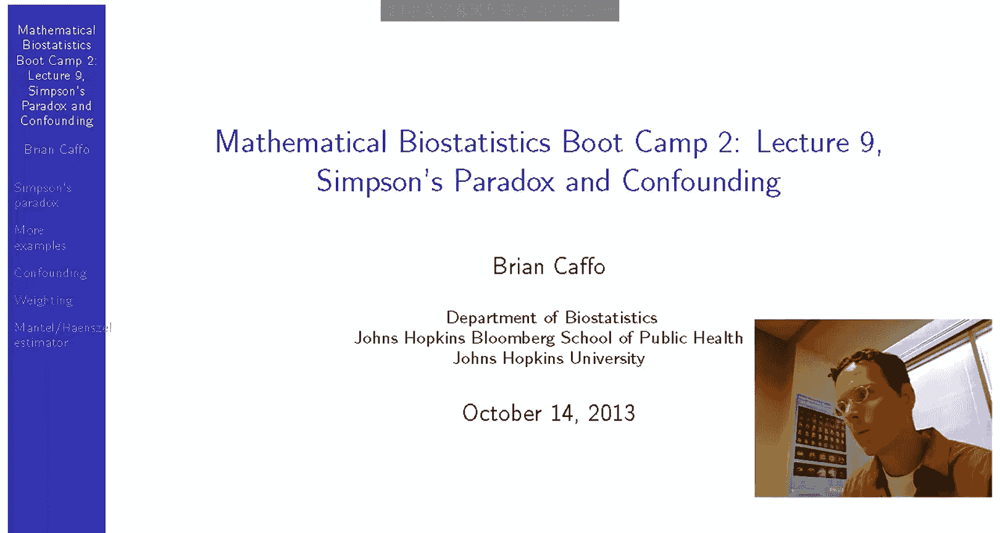
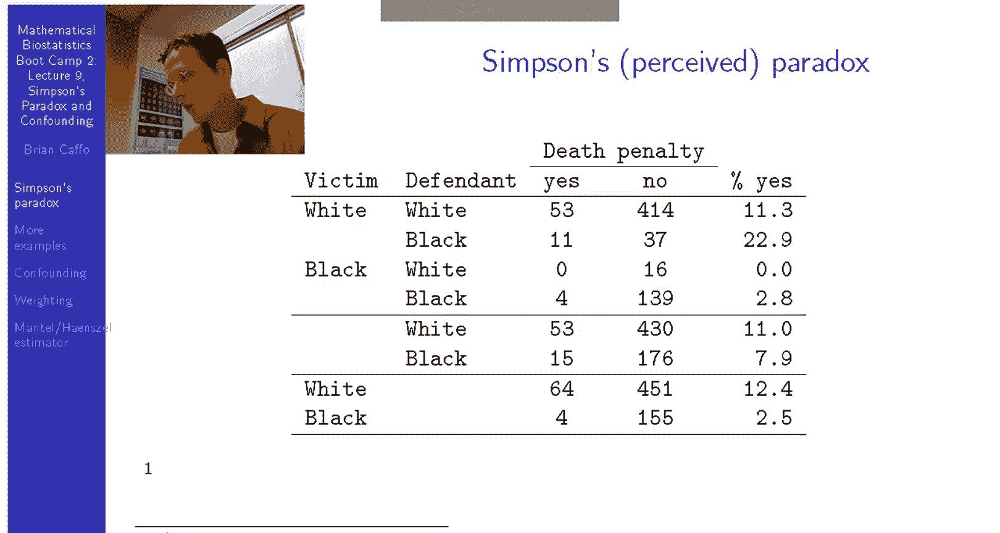
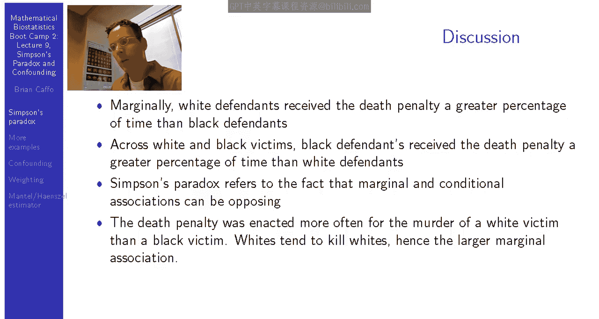

#  058：辛普森悖论与混杂

在本节课中，我们将要学习一个被称为“辛普森悖论”的现象。我们将通过具体例子来理解它，探讨其与“混杂”概念的关系，并介绍一种通过加权估计来处理混杂的方法。

## 概述

辛普森悖论描述了这样一种现象：当考虑一个额外的变量（混杂变量）时，两个变量之间的关联方向可能会发生逆转。这并非真正的数学悖论，但在数据解读中可能造成混淆。本节课我们将通过实例理解这一现象，并学习如何应对它。

## 辛普森悖论实例：死刑判决数据

以下数据来自Agresti的《分类数据分析》一书，它交叉分类了刑事审判中的被告。

数据根据**受害者种族**、**被告种族**以及是否被判处**死刑**进行分类。我们只考虑白人和黑人两种族裔。

以下是完整的列联表数据及其边际总计：

| 受害者种族 | 被告种族 | 死刑（是） | 死刑（否） | 总计 | 死刑比例 |
| :--- | :--- | :--- | :--- | :--- | :--- |
| 白人 | 白人 | 19 | 141 | 160 | 11.9% |
| 白人 | 黑人 | 11 | 149 | 160 | 6.9% |
| 黑人 | 白人 | 0 | 9 | 9 | 0.0% |
| 黑人 | 黑人 | 6 | 97 | 103 | 5.8% |

现在，让我们来考察不同条件下的死刑判决比例。

### 按受害者种族分层分析

如果我们**按受害者种族分层**（即条件化），分别观察每个子表：

*   **当受害者为白人时**：白人被告的死刑率为 **11.9%** (19/160)，黑人被告的死刑率为 **6.9%** (11/160)。
*   **当受害者为黑人时**：白人被告的死刑率为 **0.0%** (0/9)，黑人被告的死刑率为 **5.8%** (6/103)。

**结论**：在两种受害者种族条件下，白人被告的死刑率都**低于或等于**黑人被告的死刑率。

### 忽略受害者种族的边际分析

如果我们**忽略受害者种族**，只看被告种族的边际总计：

*   **白人被告总计**：死刑 19+0=19 人，总案件 160+9=169 起，死刑率 = **11.2%** (19/169)。
*   **黑人被告总计**：死刑 11+6=17 人，总案件 160+103=263 起，死刑率 = **6.5%** (17/263)。

**结论**：从总体（边际）上看，白人被告的死刑率**高于**黑人被告的死刑率。

### 悖论的产生

这就产生了看似矛盾的现象：
*   **分层（条件）关联**：在每个受害者种族层内，白人被告的死刑率 ≤ 黑人被告。
*   **总体（边际）关联**：合并所有数据后，白人被告的死刑率 > 黑人被告。

在关于死刑是否被平等适用的法庭辩论中，你会得出截然相反的结论，这取决于你是否考虑了受害者种族。

## 理解现象背后的原因

上一节我们看到了数据中出现的矛盾关联。本节中我们来分析其背后的原因。

这种现象之所以发生，是因为：
1.  **判决倾向**：杀害白人受害者的案件比杀害黑人受害者的案件更可能判处死刑（总体12.5% vs. 5.4%）。
2.  **案件分布**：从人口统计学上看，白人更倾向于杀害白人（白人被告杀害白人的案件远多于杀害黑人的案件）。
3.  **混杂效应**：“受害者种族”这个变量同时影响了“被告种族”（通过案件分布）和“死刑判决”（通过判决倾向），因此它是一个**混杂变量**。当它分布不均衡时，就会扭曲被告种族与死刑判决之间的边际关联。

辛普森悖论的本质是：**两个变量之间的表面关系，在考虑进第三个变量（混杂变量）后可能会改变甚至逆转**。从数学上看，这并不矛盾，但在因果推断中容易引发误解。

统计学家Larry Wasserman指出，人们感到困惑的根源在于混淆了**概率性陈述**（描述观察到的关联）和**因果性陈述**（描述干预的效果）。概率关系可以表现出这种“悖论”，但明确的因果陈述则不会。对因果推断的深入探讨超出了本课程范围，但理解这一区别至关重要。

## 处理混杂：加权估计法

既然我们认识到忽略混杂变量可能导致错误结论，那么如何调整数据以得到更准确的估计呢？一种常见的方法是使用加权估计。

其核心思想是：通过加权，让混杂变量在每个处理组（本例中是被告种族）中的分布变得相同，从而消除其带来的扭曲。常用的权重是**逆概率权重**。

假设我们想估计白人被告与黑人被告的死刑率差异。一个简单的调整方法是，根据受害者种族的分布对数据进行重新加权。

以下是计算加权估计的一个简化步骤：

1.  **确定标准人群**：例如，我们可以将总人口（白人被告+黑人被告）中受害者种族的分布作为标准。
    *   总案件数 = 169 + 263 = 432
    *   白人受害者案件比例 = (160+160)/432 ≈ 74.1%
    *   黑人受害者案件比例 = (9+103)/432 ≈ 25.9%

2.  **计算权重**：对于每个种族组，计算其内部受害者种族分布与标准分布的差异，并以此构建权重。
    *   对于**白人被告组**：其内部白人受害者比例为 160/169 ≈ 94.7%，远高于标准的74.1%。因此，白人被告中“黑人受害者”案件的权重应增加，以使其在组内的代表性提升到标准水平。
    *   权重的计算公式通常为：`权重 = (标准比例) / (组内比例)`。

通过这种加权，我们构建了一个“伪总体”，其中受害者种族在两组被告间的分布是平衡的，然后再计算这个伪总体中的死刑率差异。这种方法有助于得到调整了混杂因素后的关联估计。

## 科克伦-曼特尔-亨塞尔估计量

在介绍加权思想后，我们来看一个在分层列联表分析中常用的具体方法：**科克伦-曼特尔-亨塞尔估计量**。它主要用于在控制一个或多个分层变量（混杂因素）后，估计两个二分类变量之间的公共优势比。

CMH方法适用于当我们有多个层（如不同的研究中心、不同的年龄组），想得到一个综合的、调整了层因素的效应估计时。

其基本思想是：
*   分别在每一层内计算优势比。
*   然后以每层样本量的函数作为权重，将这些层的优势比进行加权平均。
*   公式可以简化为：`ORMH = (Σ a_i d_i / N_i) / (Σ b_i c_i / N_i)`，其中在每一层i的2x2表中，a,b,c,d是四个格子频数，N_i是该层总人数。

CMH估计量提供了一种有效调整分层变量（混杂）的方式，是处理辛普森悖论中类似混杂问题的有力工具之一。

## 总结

本节课我们一起学习了辛普森悖论与混杂。
*   我们通过**死刑判决数据**的实例，看到了在忽略**受害者种族**这一混杂变量时，**被告种族**与**死刑判决**之间的边际关联与条件关联方向相反。
*   我们探讨了这一现象的本质：混杂变量的存在扭曲了变量间的表面关系，这并非数学悖论，但在数据解读中需要格外小心。
*   最后，我们介绍了通过**加权估计**来调整混杂的基本思想，并简要提到了**科克伦-曼特尔-亨塞尔估计量**这一具体方法。

理解辛普森悖论对于正确解读数据、识别潜在混杂因素至关重要，是进行可靠统计推断的基础。