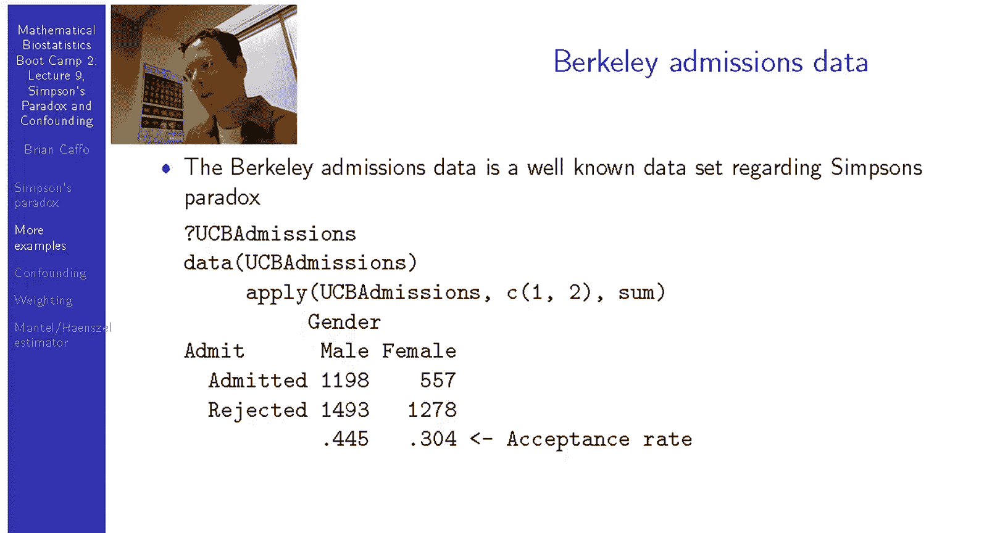
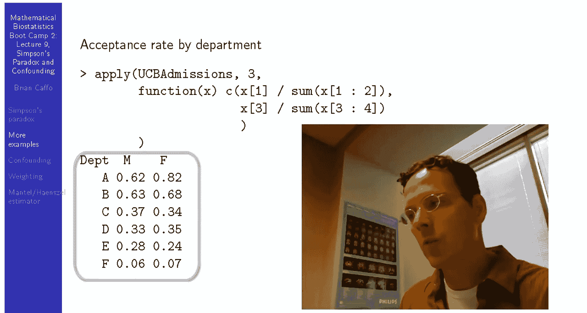
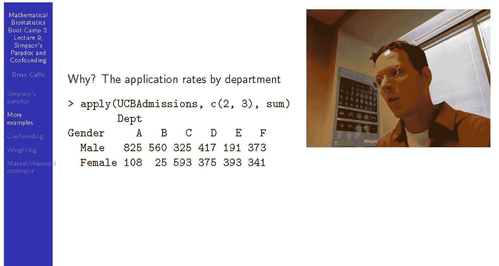
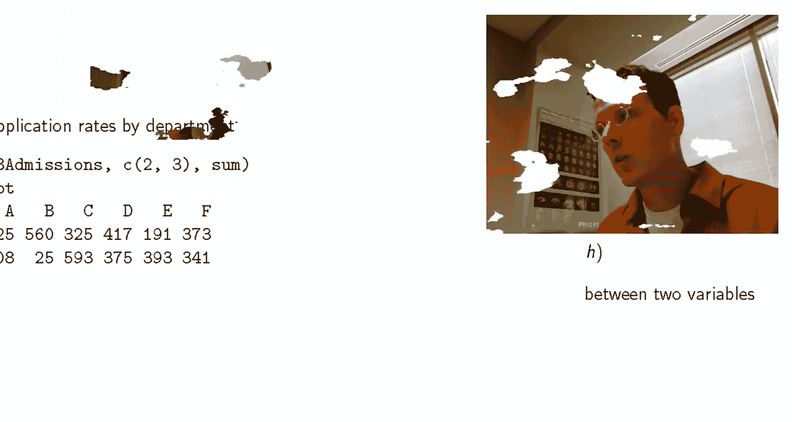
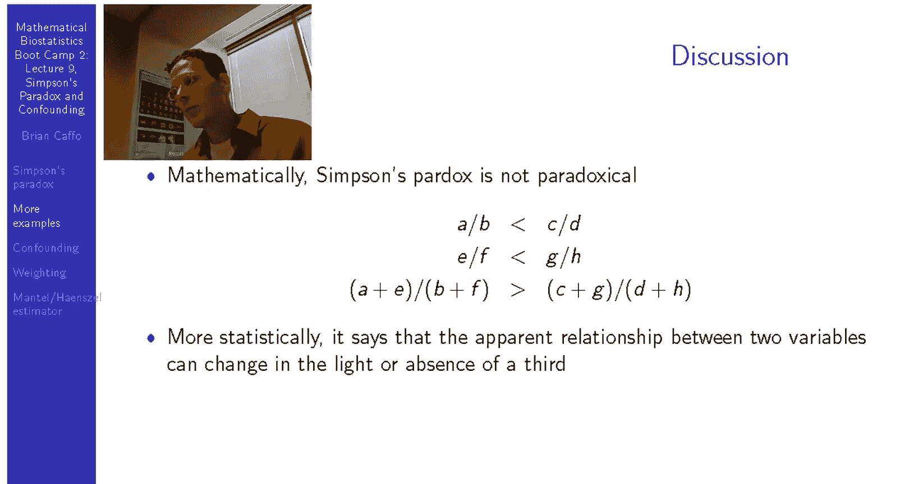

#  059：更多案例 📊

在本节课中，我们将通过两个经典案例深入探讨辛普森悖论。我们将看到，即使数据在分组比较中呈现一致的趋势，在合并后也可能出现完全相反的结论。理解这一现象的关键在于识别潜在的混杂变量。

---

## 案例一：棒球击球率 ⚾

首先，我们来看一个来自维基百科的著名例子，它清晰地展示了辛普森悖论在数字上是如何发生的。

在棒球运动中，击球率是衡量球员击球表现的核心指标。击球率的计算公式为：

**击球率 = 安打数 / 打数**

以下是两名球员在两个半赛季的表现数据：

**上半赛季数据：**
*   **球员一**：10次打数，4支安打。击球率 = 4 / 10 = **40%**
*   **球员二**：100次打数，35支安打。击球率 = 35 / 100 = **35%**

**下半赛季数据：**
*   **球员一**：125次打数，25支安打。击球率 = 25 / 125 = **20%**
*   **球员二**：10次打数，2支安打。击球率 = 2 / 10 = **20%**

从分组数据看，球员一在上、下半赛季的击球率均不低于球员二。

然而，当我们计算整个赛季的**总击球率**时，情况发生了逆转：

*   **球员一总数据**：29支安打 / 110次打数 ≈ **26.4%**
*   **球员二总数据**：37支安打 / 110次打数 ≈ **33.6%**

球员二拥有了更高的赛季总击球率。



这个悖论之所以发生，是因为两名球员在不同半赛季的**打数（样本量）**差异巨大。球员一在击球率高的上半赛季打数很少，而在击球率低的下半赛季打数很多，这拉低了他的整体平均值。球员二的情况则相反。打数在这里扮演了关键的混杂变量角色。

---

上一节我们通过棒球案例看到了样本量如何导致悖论。接下来，我们分析一个更著名的社会统计案例。

## 案例二：伯克利大学录取数据 🎓

另一个辛普森悖论的经典案例是1973年加州大学伯克利分校的研究生录取数据。该数据集已内置在R语言中。



首先，我们忽略所有其他因素，只查看按性别汇总的录取率。在R中，我们可以使用以下命令加载并查看数据：

```r
data(UCBAdmissions)
# 计算按性别汇总的边际录取率
margin_table <- apply(UCBAdmissions, c(1, 2), sum)
prop.table(margin_table, margin = 2)
```





汇总结果显示，男性的总体录取率高于女性。这似乎表明存在性别歧视。

但是，当我们引入第三个变量——**申请院系**——并进行条件分析时，情况发生了变化。

以下是按院系和性别细分的录取率（近似值）：

| 院系 | 男性录取率 | 女性录取率 |
| :--- | :--- | :--- |
| A | 较低 | 较高 |
| B | 较低 | 较高 |
| C | 相近 | 相近 |
| D | 相近 | 相近 |
| E | 较高 | 较低 |
| F | 较高 | 较低 |

在大多数院系中，女性的录取率并不低于男性，甚至在部分院系更高。那么，为什么总体数据会显示男性占优呢？

关键在于不同性别申请者的**院系分布**。以下是申请者的分布情况：

| 院系 | 男性申请者比例 | 女性申请者比例 |
| :--- | :--- | :--- |
| A（易录取） | 低 | 低 |
| B（易录取） | 低 | 低 |
| F（难录取） | 高 | **非常高** |

数据显示，女性申请者大量涌向了录取率本身就较低的院系（如F院系），而男性申请者则更均匀地分布在各个院系。因此，在汇总数据时，由于女性更多地申请了难录取的院系，导致其总体录取率被拉低。

这个案例清晰地表明，**录取中的性别差异证据，取决于你是否以“院系”为条件进行分析**。院系选择是一个关键的混杂变量。

---

## 如何理解与应对辛普森悖论 🤔

从数学上看，辛普森悖论并不神秘。它只是表明，两个变量之间的表面关系，可能会在引入第三个变量（混杂变量）后发生改变甚至逆转。

真正的挑战在于实践：**我们应该根据什么条件进行分析？或者根本不应该设定条件？**

这本质上是一个**因果推断**问题，是统计学中一个专门用于在形式化框架下处理此类问题的子领域。在缺乏随机实验的观测性数据分析中，如何在“过度调整”和“调整不足”之间取得平衡，是核心难题之一。

目前，最务实的应对方法是：**不要将统计分析与其背后的科学讨论割裂开来**。

*   在死刑案例中，我们需要讨论种族与判决之间可能的因果机制。
*   在伯克利录取案例中，我们需要探讨不同院系的录取标准差异，以及性别与院系选择之间的关系。

数据分析应为这些科学讨论提供信息，而最终的结论需要结合统计证据与领域知识共同得出。这种统计与科学的交叉互动，是当前处理混杂问题最有效的策略。

---



**本节课总结**：我们一起学习了辛普森悖论的两个经典案例——棒球击球率和伯克利大学录取数据。我们看到，忽略关键的混杂变量（如打数、申请院系）会导致对整体趋势的误解。理解辛普森悖论的核心在于认识到，变量间的关联性可能依赖于其他未观察或未调整的因素。在数据分析中，识别并恰当地处理这些混杂变量至关重要。