#  061：CMH检验 📊

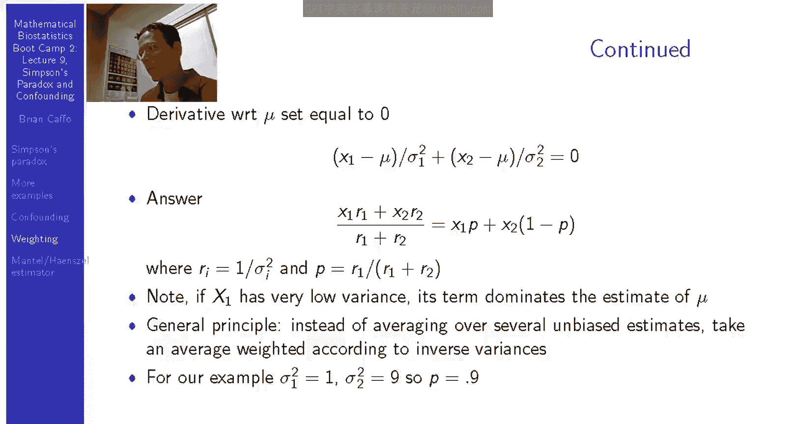

在本节课中，我们将学习如何分析分层数据，特别是当存在潜在混杂变量时。我们将重点介绍**Mantel-Haenszel估计量**和**Cochran-Mantel-Haenszel检验**，它们是处理多个2x2列联表的强大工具。

---

## 概述与背景

上一节我们讨论了混杂变量的概念。本节中，我们来看看当数据被一个第三变量（如研究中心、种族等）分层时，如何估计和检验一个共同的效应。

想象回到我们的死刑判决例子。我们有两个2x2表，分别对应被告的种族和是否被判死刑。然后我们根据第三个变量——受害者的种族——对数据进行了分层。

---

## 数据表示与分层比值比

我们用 `N_ijk` 表示第 `k` 个表中的第 `(i, j)` 个条目。在这个例子中，`k` 从1到2，`k=1` 对应第一个受害者种族组，`k=2` 对应第二个受害者种族组。`i` 和 `j` 则分别索引被告种族和死刑判决结果。

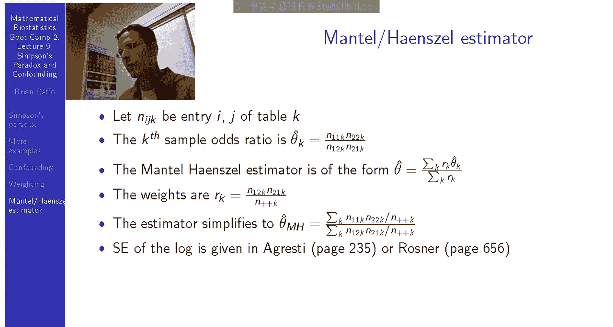

对于第 `k` 个层（或表），其样本比值比（odds ratio）的计算公式为：

**公式：**
`θ̂_k = (n_11k * n_22k) / (n_12k * n_21k)`

这计算的是每个层内，主对角线乘积与副对角线乘积的比值。

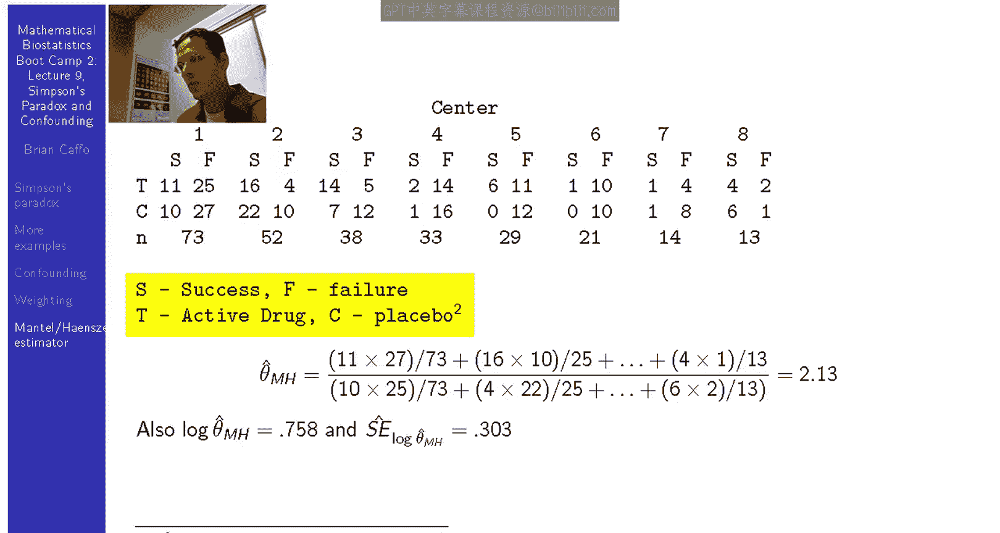

---

## Mantel-Haenszel 估计量

Mantel-Haenszel估计量本质上是这些层特异性比值比的一个加权平均。其思想是，样本量更大、估计更精确的层应该被赋予更高的权重。

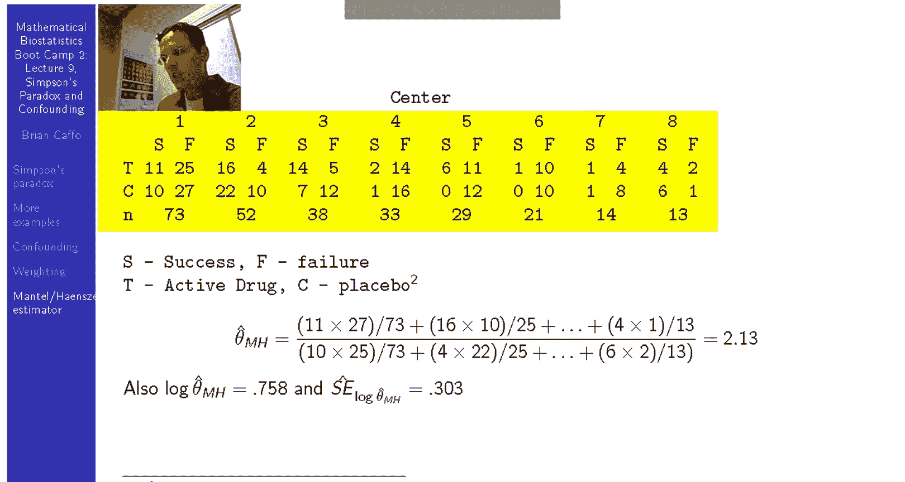

**公式：**
`θ̂_MH = (Σ (w_k * θ̂_k)) / (Σ w_k)`

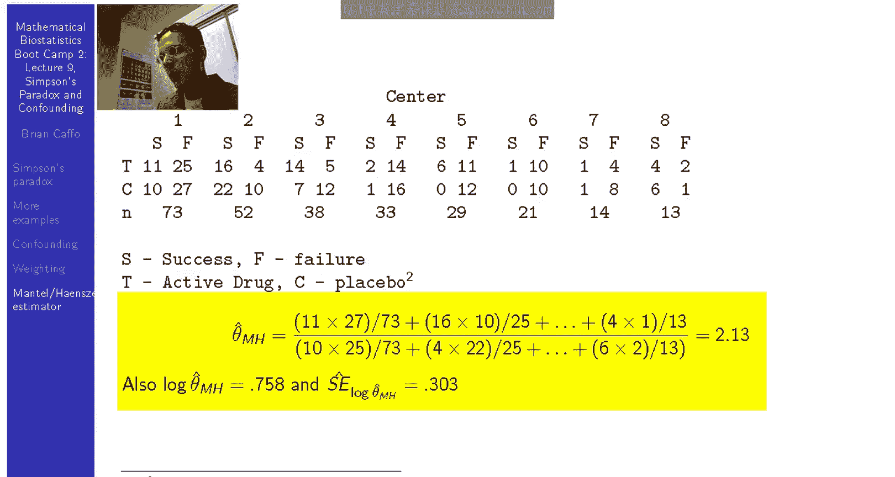

这是一个加权平均，或称为凸组合。那么权重 `w_k` 是如何确定的呢？权重的动机源于**逆方差加权**。具体来说，权重 `w_k` 的公式基于超几何分布的逆方差推导而来，目的是让方差更小的估计值（通常来自样本量更大的层）对最终结果的影响更大。

简化后的Mantel-Haenszel估计量公式如下（具体形式可参考统计教材）：

**公式：**
`θ̂_MH = (Σ (n_11k * n_22k / N_k)) / (Σ (n_12k * n_21k / N_k))`
其中 `N_k` 是第 `k` 层的总样本量。

---

## 应用实例：多中心临床试验

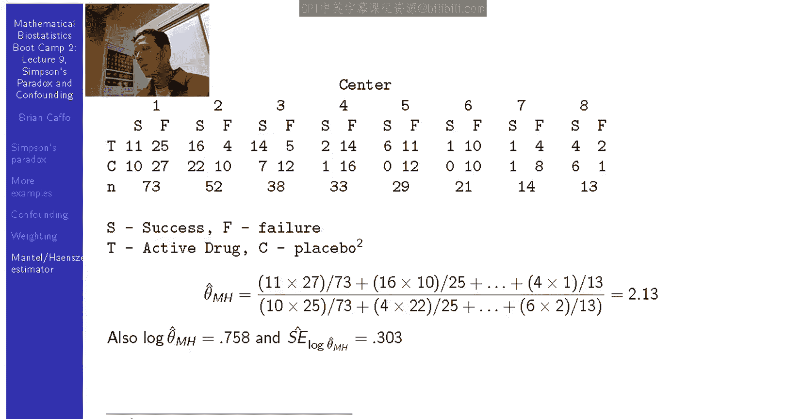

以下是一个Mantel-Haenszel估计量的绝佳例子。假设我们有一个活性药物（T）与安慰剂（C）的临床试验，结果分为成功与失败。数据来自8个不同的研究中心。

研究者担心“研究中心”可能是一个混杂因素。例如：
*   某些中心可能更倾向于使用该治疗方案。
*   不同中心因政策或操作差异，可能影响治疗的成功率。

因此，我们需要按中心进行分层，计算每个中心特定的比值比，然后进行合并。样本量大的中心（如73名患者）其比值比估计更精确，应比样本量小的中心（如14名患者）获得更高的权重。这正是Mantel-Haenszel方法所做的。

计算得到合并的比值比为 **2.13**，其对数比值比为 **0.758**，标准误为 **0.303**。通过对数比值比加减约2倍标准误，再取指数，即可得到比值比的置信区间。

**另一种应用场景**：即使我们认为研究中心是治疗效果的**效应修饰因子**（即治疗效果因中心而异），如果我们愿意将中心视为来自“中心总体”的一个随机样本，并且我们关注的是跨中心的**平均治疗效果**，那么使用CMH方法估计这个“共同比值比”仍然非常有意义。

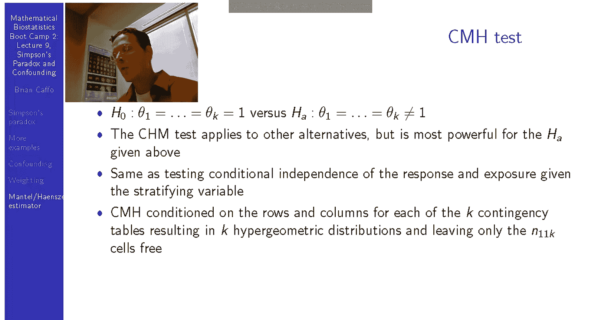

---

## Cochran-Mantel-Haenszel 检验

接下来，我们介绍一个著名的检验，用于检验“共同比值比是否等于1”。这个检验通常表述为：

*   **零假设 (H₀)**：所有层的比值比都相等，并且等于1。
*   **备择假设 (H₁)**：所有层的比值比都相等，但不等于1。

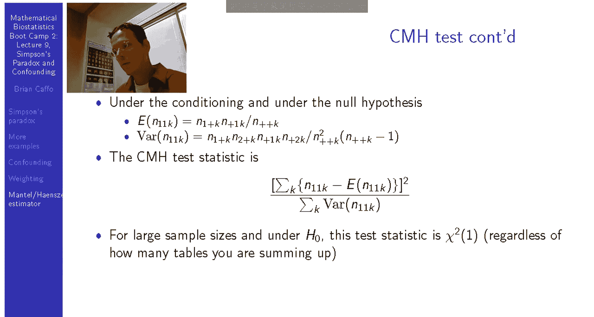

需要注意的是，这个检验的备择假设是“所有比值比相等但不为1”，而不是“比值比不全相等”。CMH检验对于上述特定的备择假设效力更强。这个检验等价于在给定分层变量的条件下，检验“反应”与“暴露”（如治疗）是否条件独立。

CMH检验的执行方式类似于将Fisher精确检验推广到多层的情况。它在每个列联表中固定行合计与列合计（条件化），使得每个表中只有左上角单元格是自由的，并服从超几何分布。

**检验统计量**：在零假设和上述条件下，每个表左上角单元格的期望值和方差可以计算。CMH检验统计量是这些单元格观测值与期望值偏差之和的平方，再除以方差之和。

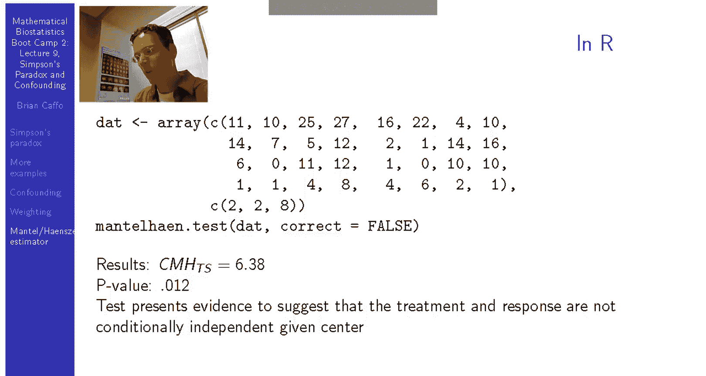

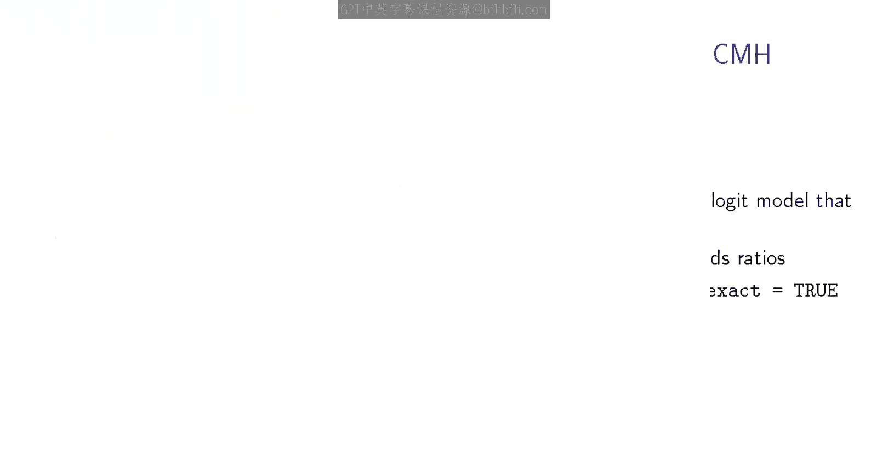

**公式：**
`X²_CMH = [Σ (n_11k - E(n_11k))]² / Σ Var(n_11k)`

在零假设下，这个统计量服从自由度为1的卡方分布。这是一个与之前讲座中卡方检验不同的检验统计量，因为它检验的是不同的假设（条件独立 vs. 关联性）。

---

## 在R中执行CMH检验

手动执行CMH检验比较繁琐。我们可以在R中轻松实现。以下是将数据构造成一个8个2x2表的数组后进行的检验：

```r
# 假设 data_array 是一个 2x2x8 的数组
mantelhaen.test(data_array, correct = FALSE)
```

通常，我们会设置 `correct = TRUE` 以使用连续性校正。这里设为FALSE是为了与手算结果对照。输出结果显示，检验统计量为 **6.38**，P值为 **0.012**。这提供了证据表明，在给定研究中心的条件下，治疗与反应不是条件独立的。

---

## 扩展说明与总结

关于CMH检验的一些最终说明：

1.  **现代方法**：可以使用更现代的方法进行类似检验，例如**随机效应Logistic模型**（广义线性混合模型）。这允许在模型中纳入更多变量，方法更为灵活通用。本课程介绍CMH检验是为了让大家理解混杂和分层的基本思想。
2.  **检验比值比齐性**：CMH检验假设各层比值比相等。如果想检验“所有层的比值比是否完全相等”（而不关心是否等于1），可以使用其他检验，如**Breslow-Day检验**或**Woolf检验**。
3.  **精确检验**：与Fisher精确检验类似，也可以基于各层的超几何分布进行**精确CMH检验**。在R中，可以通过设置 `exact = TRUE` 参数来实现。其概念是，在每个层内进行置换，多次重新计算CMH统计量，通过模拟得到精确的P值。
4.  **混杂的重要性**：混杂是**从观察性数据中生成知识**的最大障碍之一。大多数易于收集的数据都是观察性数据，因此分析这类数据需要高度的技巧。因果推断领域正试图用数学上更形式化的方法来应对这一挑战。

本节课中，我们一起学习了：
*   如何使用**Mantel-Haenszel估计量**来合并分层数据中的比值比，以调整潜在的混杂因素。
*   如何利用**Cochran-Mantel-Haenszel检验**来检验在给定分层变量后，两个二分变量是否条件独立（即共同比值比是否为1）。
*   理解了这些方法在多中心临床试验等实际场景中的应用及其背后的逻辑。

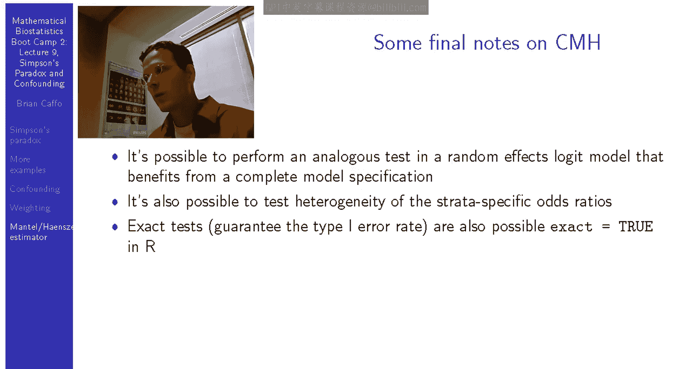

掌握这些方法是处理分类数据、识别和调整混杂效应的基础。随着深入学习，你将会接触到更复杂的模型来应对这些挑战。