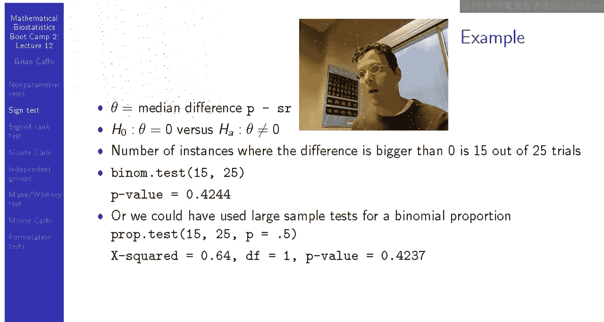
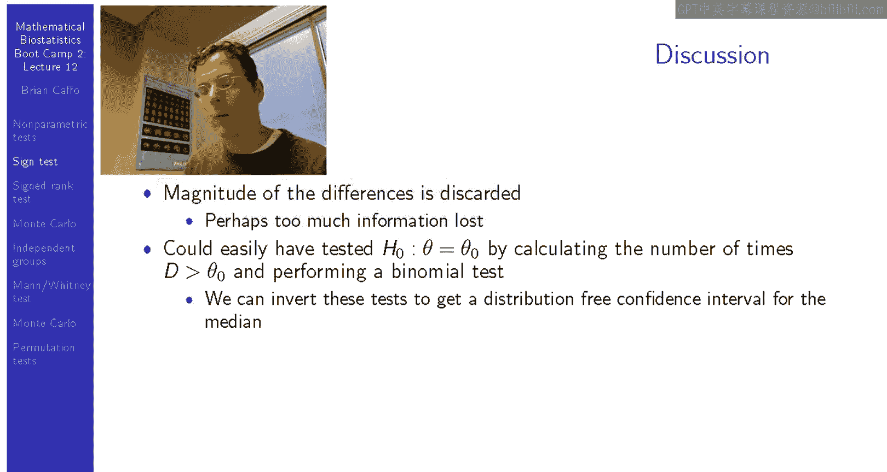
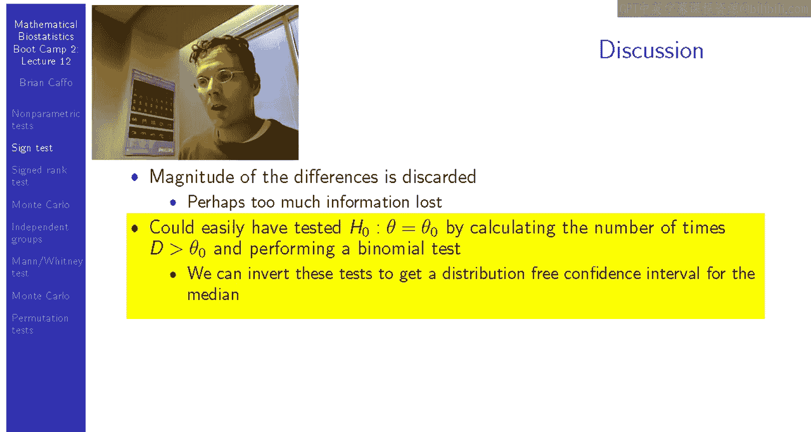
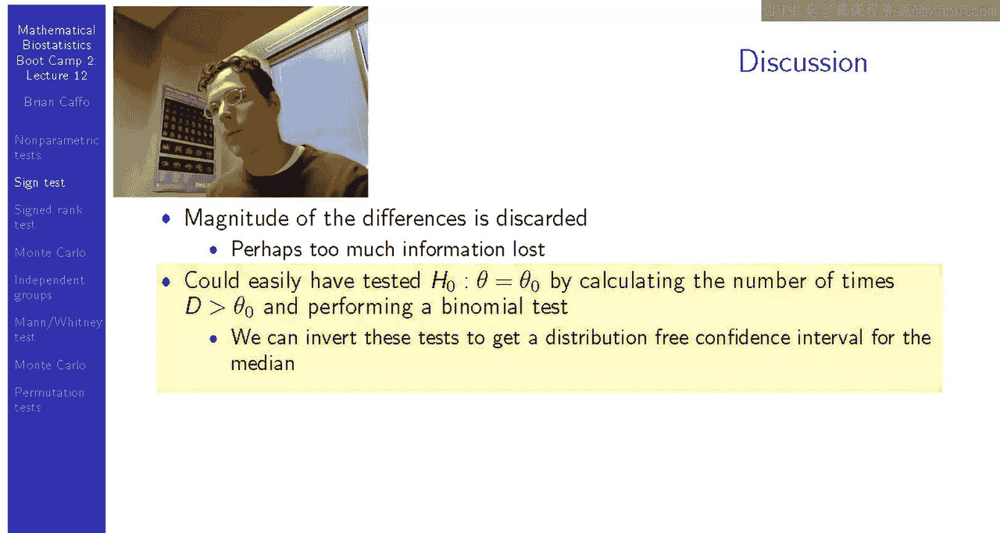
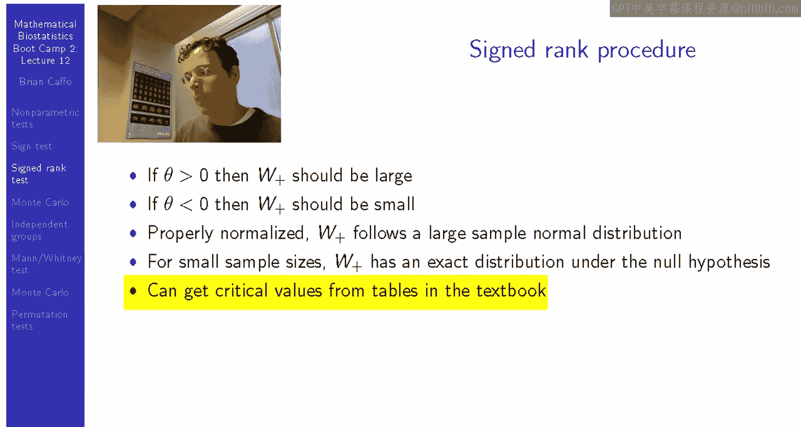
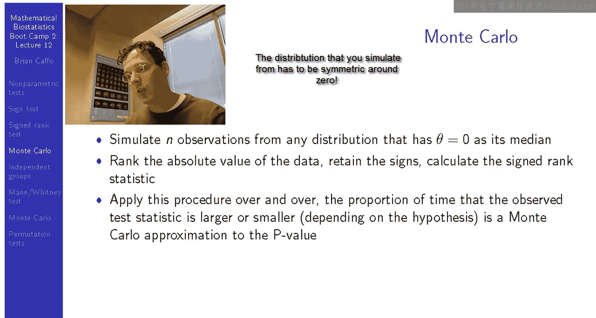
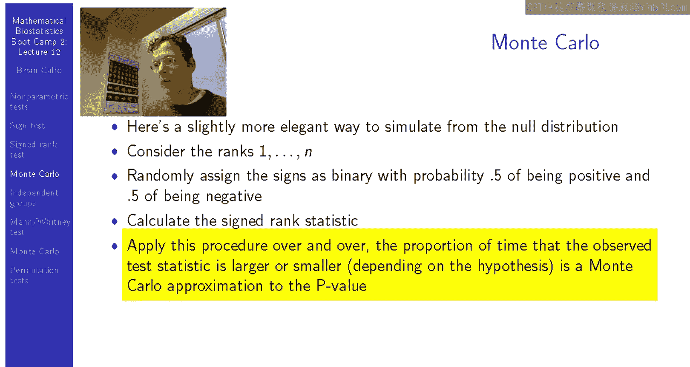
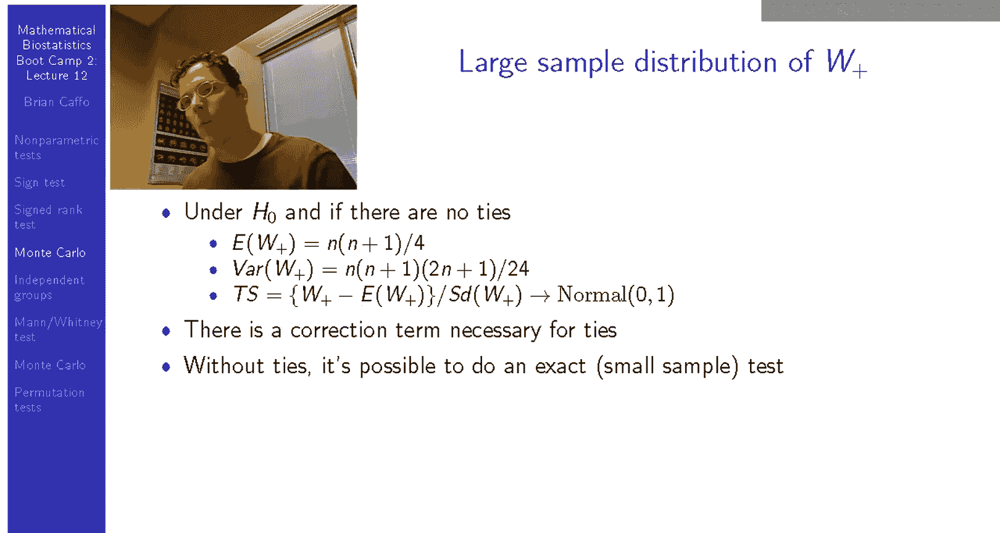
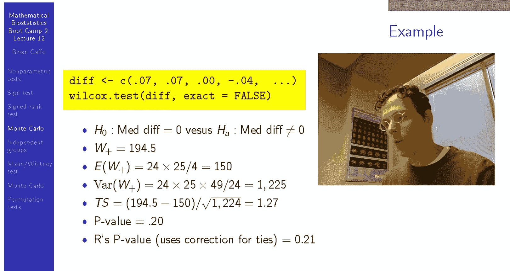
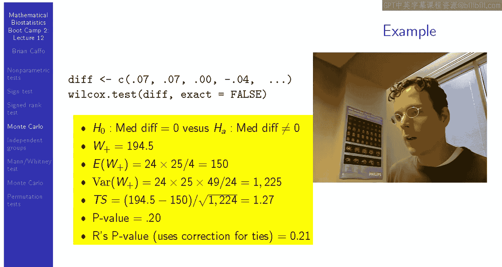

#  069：符号秩检验 📊

在本节课中，我们将要学习符号秩检验。这是一种非参数统计方法，用于检验配对数据差值的**中位数**是否为零。与上一节讨论的符号检验相比，符号秩检验不仅利用了差值的符号，还利用了其**排序**信息，因此通常具有更高的检验效能。

---

## 符号检验的局限性

上一节我们介绍了符号检验，它通过计算差值大于零的次数来检验中位数是否为零。然而，这种方法存在一个主要问题：它完全**丢弃了差值的大小信息**。

例如，如果所有正差值都很大，而所有负差值都很小，这种情况与正负差值大小相近的情况在符号检验中可能得到相同的结果。因此，符号检验的效能可能不如预期。

此外，符号检验并不局限于检验中位数是否为零。我们可以检验中位数是否等于任何特定值 `θ₀`，只需计算差值大于 `θ₀` 的次数即可。这意味着我们可以通过网格搜索等方法，找到所有无法拒绝原假设的 `θ` 值，从而**反推出中位数的置信区间**。这是一种非常非参数化的获取中位数置信区间的方法。

---

## 威尔科克森符号秩检验

为了解决丢弃差值大小信息的问题，威尔科克森提出了符号秩检验。该方法不仅使用差值的符号，还使用其**绝对值的秩**，从而保留了部分关于差值大小的信息。

我们仍然检验中位数是否为零（或任何特定值 `θ₀`），但构造的统计量包含了排序信息。在无结值（ties）的情况下，该统计量的小样本精确分布是已知的。对于大样本，经过适当标准化后，该统计量近似服从标准正态分布。

以下是符号秩检验的步骤：

1.  **计算配对差值**：`d_i = X_i - Y_i`。
2.  **取绝对值并排序**：计算 `|d_i|`，并从小到大排序。忽略所有差值为零的配对。
3.  **处理结值**：如果存在非零的相等差值（结值），则分配平均秩。
4.  **分配符号**：将每个差值的原始符号（正号为+1，负号为-1）乘以其对应的秩。
5.  **计算统计量**：计算所有**正号秩**的总和，记为 `W⁺`。

如果中位数较大，则 `W⁺` 应较大；如果中位数较小，则 `W⁺` 应较小。在原假设（中位数为零）下，`W⁺` 的分布是已知的。

---

## 精确分布与蒙特卡洛模拟

由于检验过程对数据的分布具有不变性，我们可以轻松地获得统计量在原假设下的精确分布，或通过蒙特卡洛方法进行模拟。

一种优雅的方法是：取整数 `1` 到 `n`（即可能的秩），对每个秩独立地以 `0.5` 的概率随机分配正号或负号，然后计算 `W⁺` 统计量。重复此过程多次，即可得到 `W⁺` 在原假设下的精确分布。

若要计算蒙特卡洛 `p` 值，只需计算模拟得到的 `W⁺` 统计量中，有多少比例比观测到的 `W⁺` 统计量更极端（与原假设的偏离程度相同或更大）。

---

## 大样本近似

对于大样本，`W⁺` 统计量近似服从正态分布。其期望和方差公式如下：

*   **期望值**：`E[W⁺] = n(n+1)/4`
*   **方差**：`Var[W⁺] = n(n+1)(2n+1)/24`

标准化后的检验统计量为：
`Z = (W⁺ - E[W⁺]) / sqrt(Var[W⁺])`

该统计量在原假设下渐近服从标准正态分布 `N(0,1)`。虽然存在针对结值的修正公式，但由于我们可以进行精确的小样本检验，通常无需依赖大样本近似。

---

## 实例分析

让我们通过一个实例来应用符号秩检验。假设我们有一组配对差值数据。

在 R 语言中，可以使用 `wilcox.test()` 函数进行计算，设置参数 `exact=FALSE` 可避免精确计算（使用正态近似）。为了与理论计算对比，可能需要设置 `correct=FALSE` 来关闭连续性校正。

假设我们通过计算得到：
*   观测到的 `W⁺` = 194.5
*   期望值 `E[W⁺]` = 150
*   方差 `Var[W⁺]` = 1225

则标准化统计量 `Z` 为：
`Z = (194.5 - 150) / sqrt(1225) ≈ 1.27`

查标准正态分布表，`Z = 1.27` 对应的 `p` 值约为 0.204。由于 `p` 值大于常用的显著性水平（如 0.05），我们**无法拒绝**原假设，即没有足够证据表明差值的中位数不为零。

---

## 总结

本节课中我们一起学习了威尔科克森符号秩检验。我们首先回顾了符号检验丢弃差值大小信息的局限性，进而引出了符号秩检验，它通过结合差值的**符号**和**绝对值的秩**，提高了检验的效能。我们详细介绍了检验的步骤、统计量 `W⁺` 的计算，以及如何通过**精确分布**或**蒙特卡洛模拟**获得 `p` 值。最后，我们探讨了大样本下的正态近似，并通过一个实例演示了完整的分析过程。符号秩检验是分析配对数据或单样本位置参数的强大非参数工具。