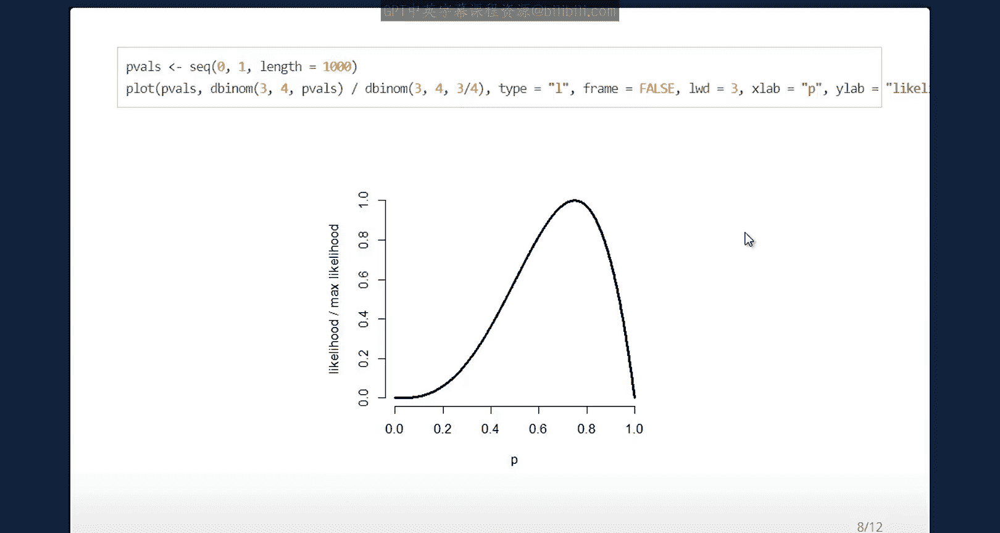
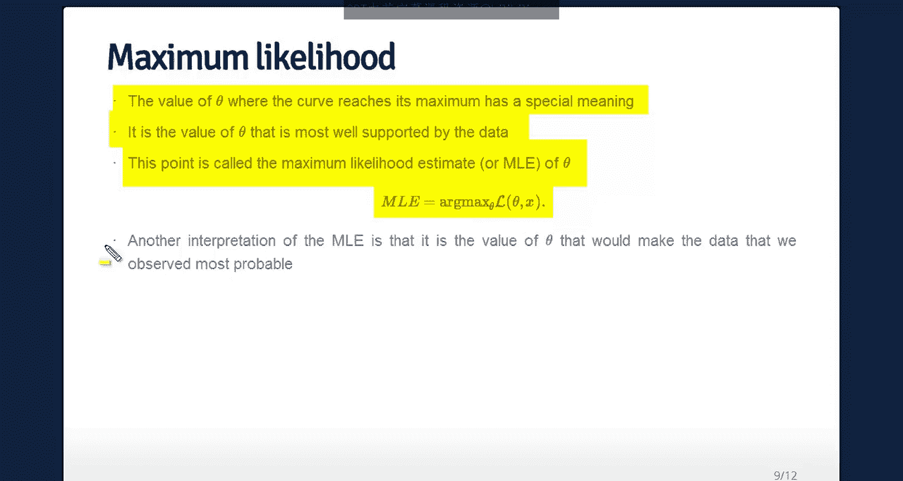
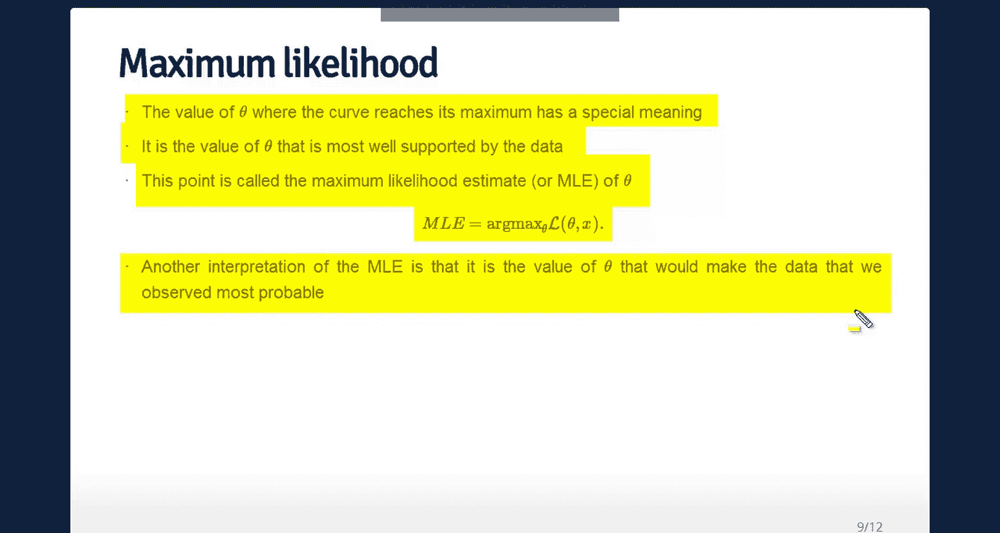
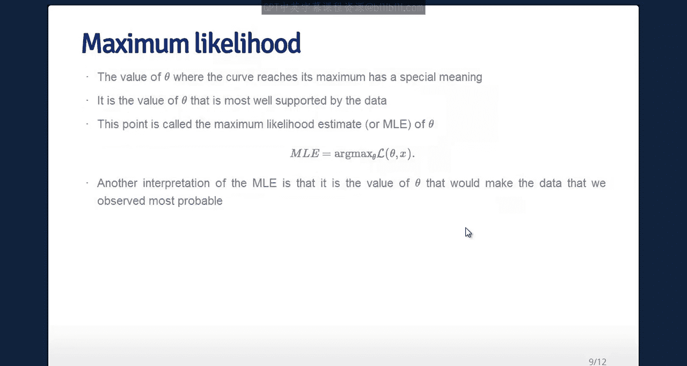
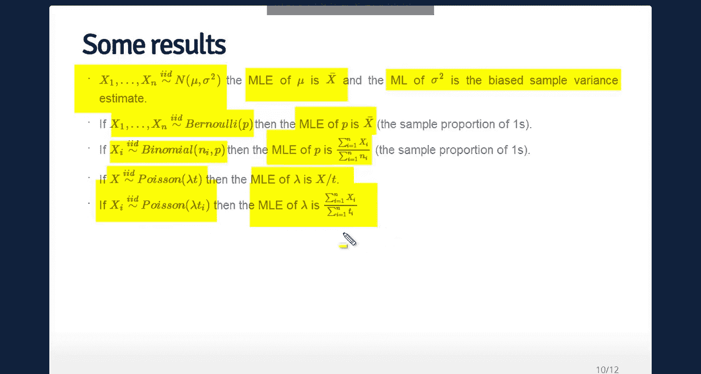
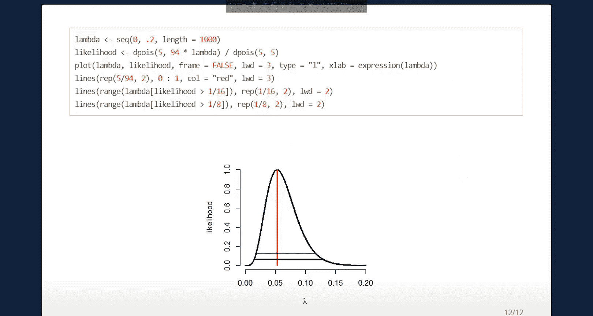

#  072：泊松似然

在本节课中，我们将深入探讨最大似然估计的概念，特别是如何将其应用于泊松模型。我们将学习如何计算和解释似然函数，并理解最大似然估计量的含义。

## 最大似然估计量

上一节我们介绍了似然函数的基本概念。本节中，我们来看看如何找到使似然函数最大化的参数值。

似然曲线达到最大值时的参数θ值，被称为最大似然估计量。它是给定似然函数下，数据最支持的参数值。因此，最大似然估计量是使观测数据概率最大的参数值。这很合理，因为我们确实观测到了这些数据，所以它必须是某种程度上可能的。

我们可以将最大似然估计量定义为参数θ在似然函数上的**argmax**。

以下是常见分布的最大似然估计量结果：

*   如果数据是独立同分布的正态数据，则μ的MLE是样本均值`x̄`，σ²的MLE是除以n（而非n-1）的样本方差。
*   如果X₁到X_N是伯努利分布，则参数p的MLE是`x̄`，即样本中“1”的比例。
*   如果X_i服从二项分布B(n, p)，则p的MLE是总成功次数与总试验次数的比例。
*   如果X服从泊松分布Poisson(λt)，则λ的MLE是`x / t`，即事件发生率。
*   如果有一系列独立同分布的泊松随机变量，则λ的MLE是总事件数除以总时间（或总速率）。

## 泊松似然示例

现在，我们通过一个具体例子来应用这些概念。假设在监测一个核泵的94天中，观测到了5次故障事件。我们采用泊松模型，并绘制其似然函数。

我们知道，λ的最大似然估计是`5 / 94`。

以下是计算和绘制似然函数的步骤：

1.  首先，创建一个λ值的网格作为参数空间。
2.  似然函数是泊松概率密度函数，但将其视为关于参数λ的函数，同时固定数据（观测次数为5，观测时长为94天）。
3.  λ的MLE，即`λ̂ = 5 / 94`。将λ̂代入似然函数，即可得到在MLE处的似然值。
4.  绘制λ与似然值的函数关系图。图中会添加一条红线标示MLE的位置，此时似然值归一化为1。同时，我们还会添加两条参考线，分别位于1/8和1/16处。

这张图展示了估计的故障率与其证据支持度之间的关系。例如，比较图中任意两点，其似然值的比值就代表了证据支持的相对强弱。

## 似然区间

接下来，我们解释图中两条参考线的作用。1/8和1/16这两条线用于定义所谓的“似然区间”。

位于1/8参考线上方的所有λ值构成的区间，其含义是：在这个区间内的任何参数值，都没有其他参数值能获得超过8倍的证据支持（与MLE相比）。换句话说，MLE比区间外的任何点的支持证据都强至少8倍。

同理，位于1/16参考线上方的区间内的点，则没有其他点能获得超过16倍的证据支持。

这类似于频率学派中的置信区间，但解释方式是基于证据强度的。1/8和1/16的阈值选择虽然有一定任意性，但其程度不亚于选择95%作为置信水平。实际上，最佳做法是提供完整的似然函数图，因为它包含了所有相关信息。似然推断的一个挑战在于多参数情形（如回归设置）下的可视化，但了解这种基于似然的推断思想非常重要。

本节课中我们一起学习了最大似然估计量的定义和常见结果，并通过一个泊松模型的实例，演示了如何计算和绘制似然函数，以及如何利用似然函数图定义和解释基于证据强度的似然区间。尽管课程后续将更多关注频率学派的推断方法，但理解似然推断的这种直观展示方式非常有价值。