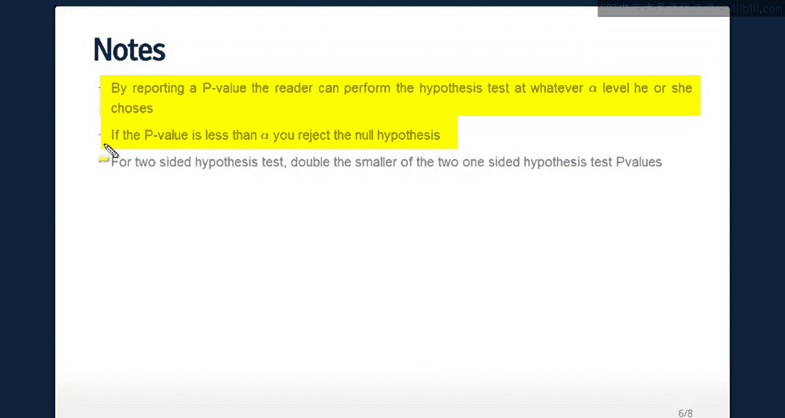
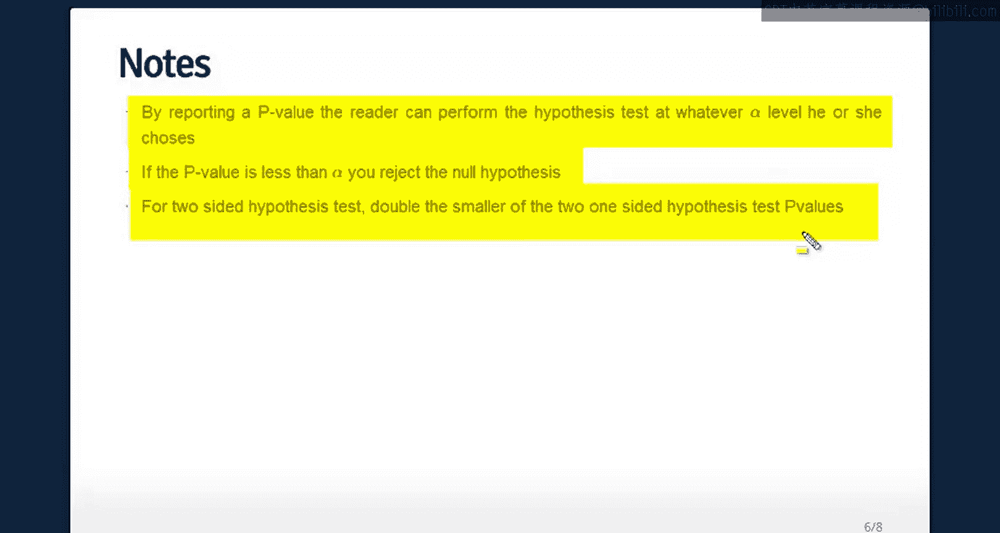
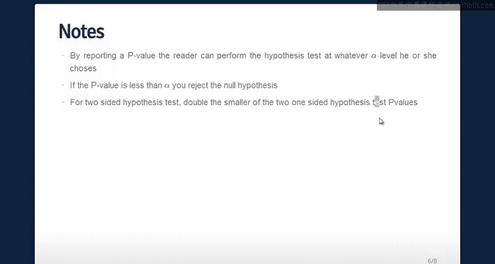
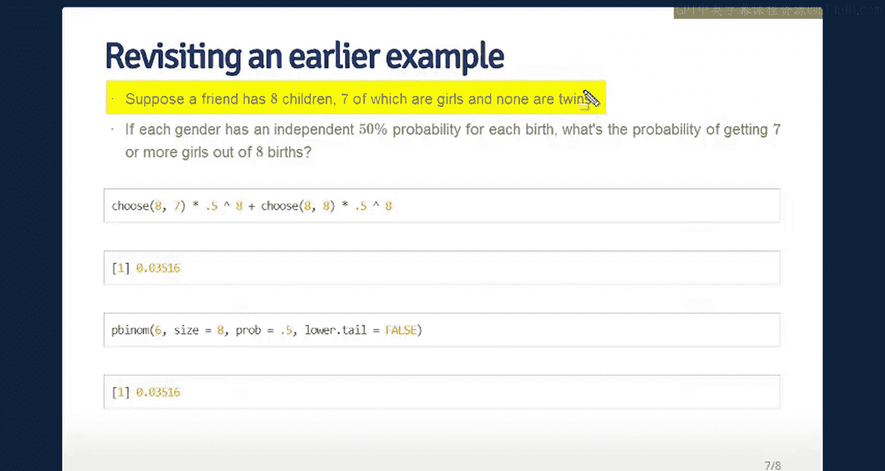
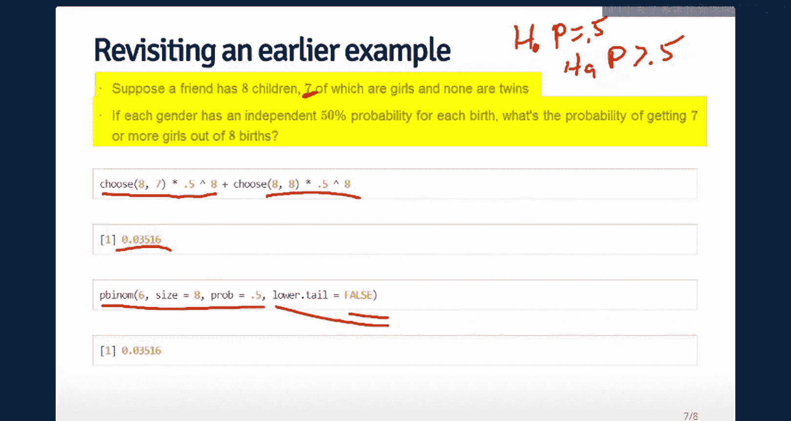
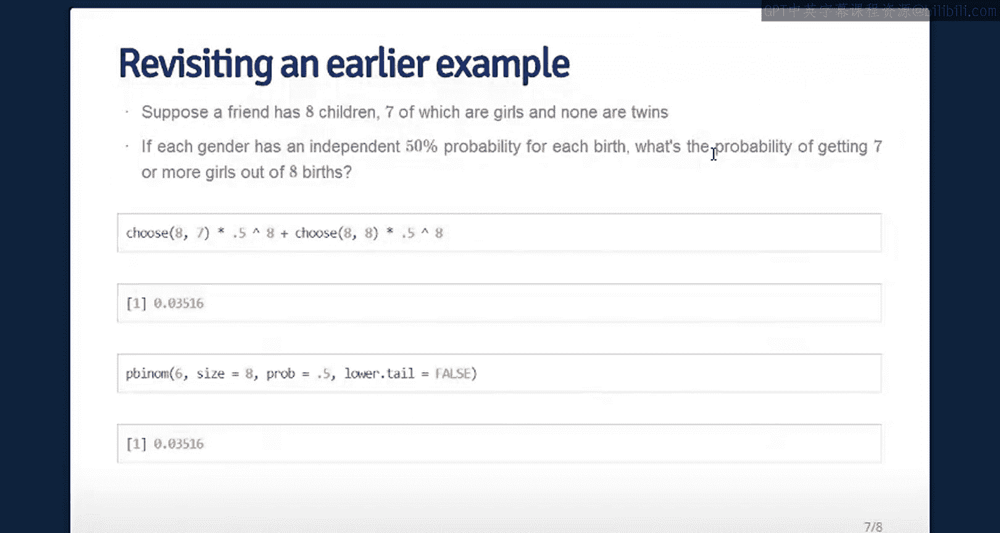
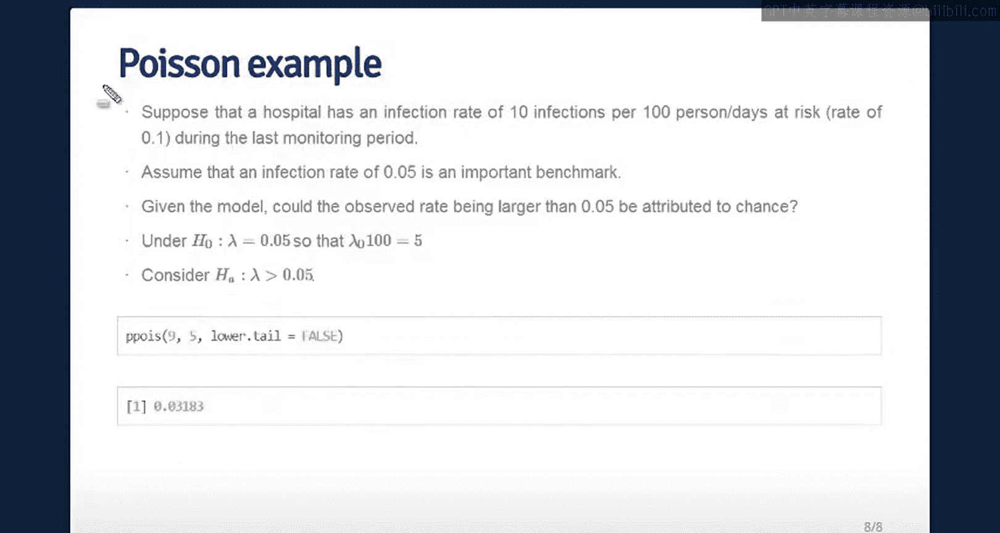
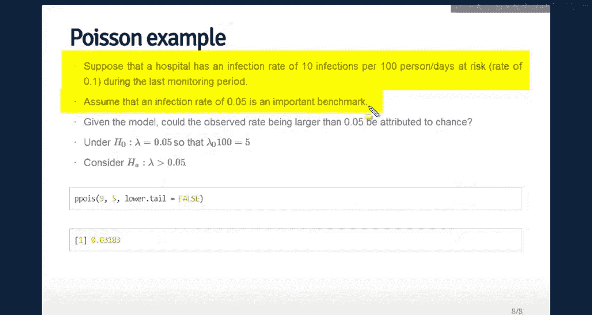
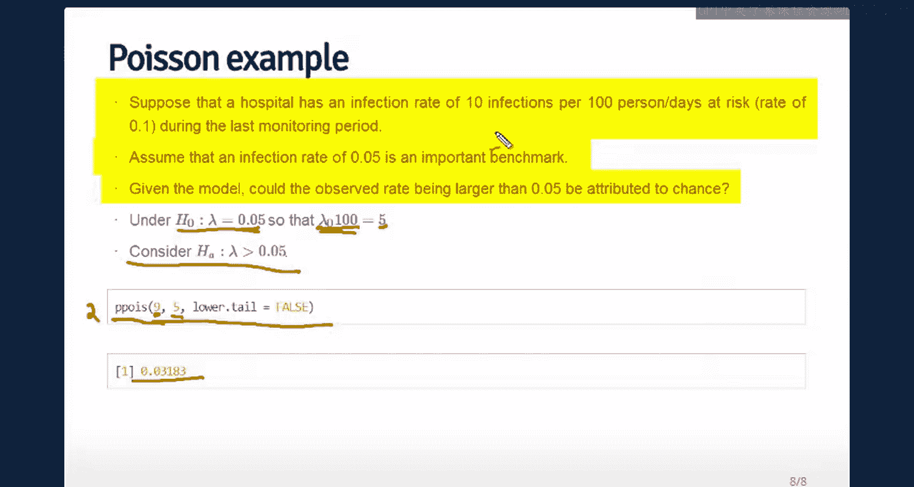
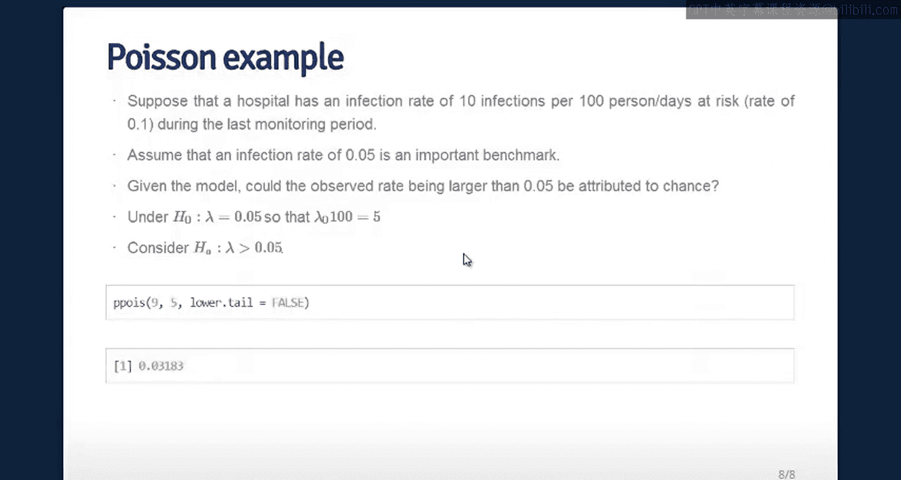

#  073：泊松P值计算 📊

在本节课中，我们将学习**P值**的概念及其在假设检验中的应用。我们将通过正态分布、二项分布和泊松分布的具体例子，详细讲解如何计算P值，并理解其与**达到的显著性水平**之间的关系。

---

## 概述

假设检验的核心是判断观察到的数据是否与某个假设（即**零假设**）存在显著差异。P值是一个量化这种“极端程度”的概率指标。具体来说，P值是在零假设为真的前提下，观察到当前数据（或更极端数据）的概率。P值越小，表明数据与零假设的背离程度越大，从而越有理由拒绝零假设。

上一节我们介绍了假设检验的基本框架，本节中我们来看看如何具体计算P值，并理解其与另一个概念——达到的显著性水平——的异同。

---

## 达到的显著性水平与P值

有一个相关的概念，实际上在数值上是等价的，即所谓的**达到的显著性水平**。

回顾之前的例子，我们的检验统计量是2，用于检验零假设 H₀: μ = 30 与备择假设 H₁: μ ≠ 30，样本量 n = 100。

我们的标准化检验统计量在零假设下的分布如下。检验统计量计算结果是2。对于单侧检验，如果我们设定显著性水平 α = 5%，对应的临界值是1.645。由于2 > 1.645，我们会拒绝零假设。

那么，如果 α 设为1%呢？临界值会远在2之外。如果我们设定 α 为那个水平，我们将无法拒绝零假设。

现在，思考这样一个问题：是否存在一个特定的 α 水平，使得检验统计量恰好处于“拒绝”与“不拒绝”的临界点上？如果我们选择的 α 水平大于这个值，就会拒绝零假设；如果小于这个值，就无法拒绝。这个特定的 α 水平就被称为**达到的显著性水平**。它直观地表示：**我能够选择并仍然拒绝零假设的最小显著性水平是多少？**

你可以看到，这与P值是等价的。通过移动临界线，直到它与检验统计量完全重合，此时对应的 α 水平，其概率（即检验统计量大于该临界值的概率）正是P值。

因此，达到的显著性水平与P值在哲学解释上有所不同，但它们是**相同的数值**。


---

## 为何使用P值？


我喜欢P值的一个原因是：如果有人给你一个P值，那么读者或检验的解释者就可以按照他们自己选择的任何 α 水平来执行假设检验。

他们遵循的规则是：
*   如果 **P值 < α**，则拒绝零假设。
*   如果 **P值 ≥ α**，则无法拒绝零假设。

这样，P值就提供了更丰富的信息。如果你只是告诉别人“我拒绝了”或“我没有拒绝”，你并没有提供同等量的信息，因为他们无法根据自己的风险偏好（α水平）重新评估结果。



---

## 双侧检验的P值计算



对于双侧假设检验，P值的计算方法是：取两个单侧P值中较小的那个，然后将其**乘以2**。

例如，如果你的Z分布如图所示，检验统计量位于右侧。那么，右侧方向的单侧P值是一个概率，左侧方向的单侧P值是另一个概率。你取较小的那个概率值，将其翻倍，就得到了用于双侧检验的P值。

---



## 计算实例

我们已经讨论了正态分布的例子，现在让我们计算其他分布的P值。



### 二项分布示例

你的朋友有8个孩子，其中7个是女孩（没有双胞胎）。假设每次生育，孩子性别的概率独立且各为50%。

我们想检验的假设是：H₀: p = 0.5 vs H₁: p > 0.5。更支持备择假设的证据是女孩数量更多。

观察到的女孩数量是7。P值定义为：在零假设（p=0.5）下，观察到**7个或更多**女孩的概率。

以下是计算步骤：
1.  计算恰好有7个女孩的概率。
2.  计算有8个女孩的概率。
3.  将这两个概率相加。

使用R语言的 `pbinom` 函数可以方便计算。注意，`pbinom(q, size, prob, lower.tail=FALSE)` 计算的是 **P(X > q)** 的概率。因此，要计算 P(X ≥ 7)，我们需要设置 `q = 6`。





```r
# 计算 P(X >= 7) 当 n=8, p=0.5
p_value_binom <- pbinom(6, size=8, prob=0.5, lower.tail=FALSE)
print(p_value_binom)
```
计算结果约为 **4%**。

---



### 泊松分布示例 🦠



假设一家医院的感染率为每100个风险人日发生10次感染，即感染率 λ = 10/100 = 0.1（次/风险人日）。

在最近一个监测期内，假设感染率 λ = 0.05（5%）是一个重要的基准值。

给定这个模型，我们想知道：观察到的感染率（0.1）高于基准值（0.05），这能否归因于偶然机会？这就是我们要进行假设检验的问题。

我们想检验：H₀: λ = 0.05 vs H₁: λ > 0.05（因为我们关注感染率是否高于基准）。

如果每日感染率 λ₀ = 0.05，那么在100个风险人日内，预期的感染次数应为 λ₀ × 100 = 5。

我们观察到的感染次数是10。因此，P值是在零假设（λ=0.05，即期望次数为5）下，观察到**9次或更多**感染的概率（因为“9次或更多”比观察值“10次”更极端）。

使用R语言的 `ppois` 函数计算。同样，`ppois(q, lambda, lower.tail=FALSE)` 计算的是 **P(X > q)**。

```r
# 计算 P(X >= 10) 当 lambda=5
# 即计算 P(X > 9)
p_value_poisson <- ppois(9, lambda=5, lower.tail=FALSE)
print(p_value_poisson)
```
计算结果约为 **3%**。

对于这个单侧检验，如果设定 α=5%，由于P值（3%）< α（5%），我们会拒绝零假设，认为感染率显著高于基准。如果是双侧检验，则需要将此P值乘以2。

---

## 总结

本节课中我们一起学习了P值的核心概念与计算方法。

我们回顾了三个不同场景下的P值计算：
1.  **正态分布P值**：通过Z统计量和标准正态分布计算。
2.  **二项分布P值**：使用 `pbinom` 函数，计算在特定成功概率下，观察到某个数量或更多“成功”事件的概率。
3.  **泊松分布P值**：使用 `ppois` 函数，计算在特定发生率下，观察到某个数量或更多事件的概率。

在所有情况下，步骤都是一致的：
*   明确设定零假设和备择假设。
*   计算**检验统计量**。
*   计算P值，即**在零假设为真的前提下，获得当前观测值或更极端值的概率**。
*   做出决策：如果 **P值 < α**，则拒绝零假设；如果 **P值 ≥ α**，则无法拒绝零假设。





理解P值后，你就可以去阅读相关文献，并理解围绕它产生的诸多讨论了。记住，P值是一个工具，正确理解和解释它至关重要。