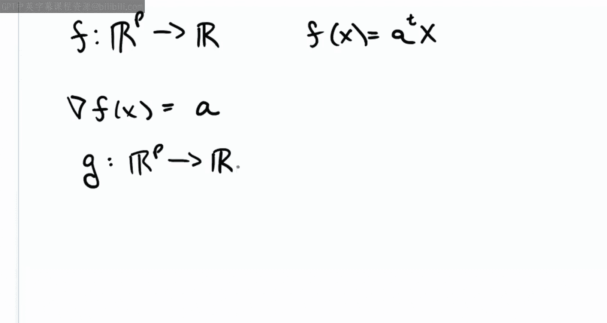
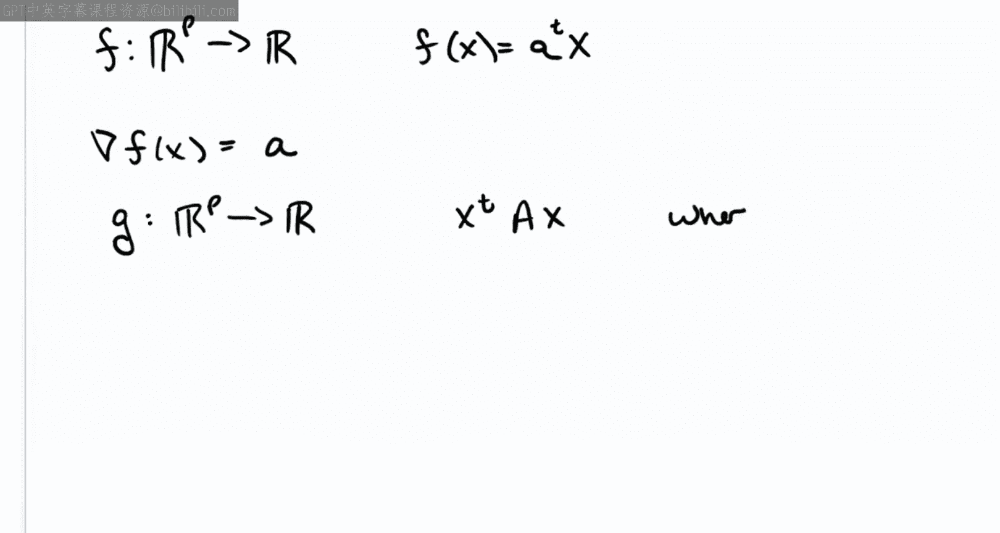
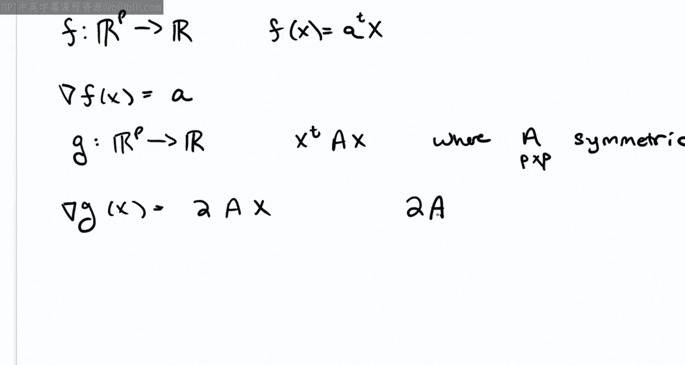
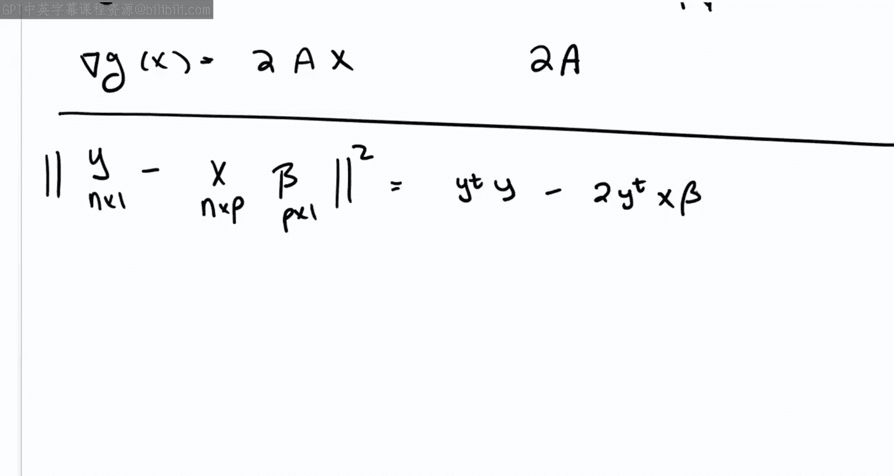
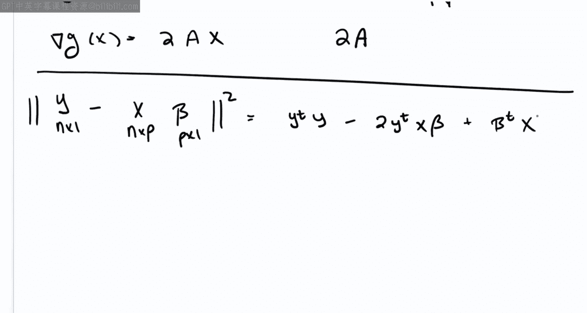
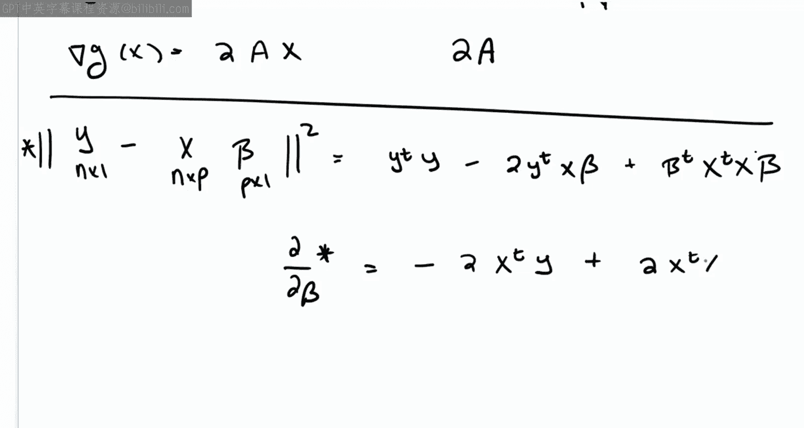
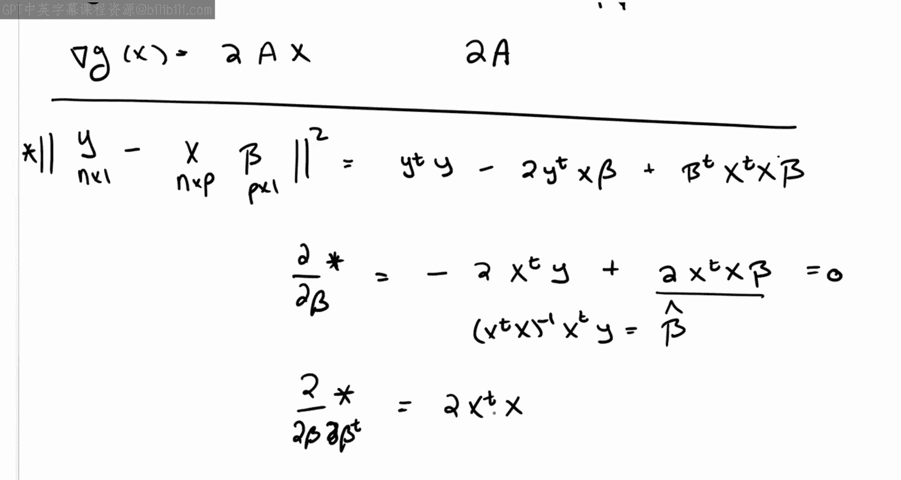
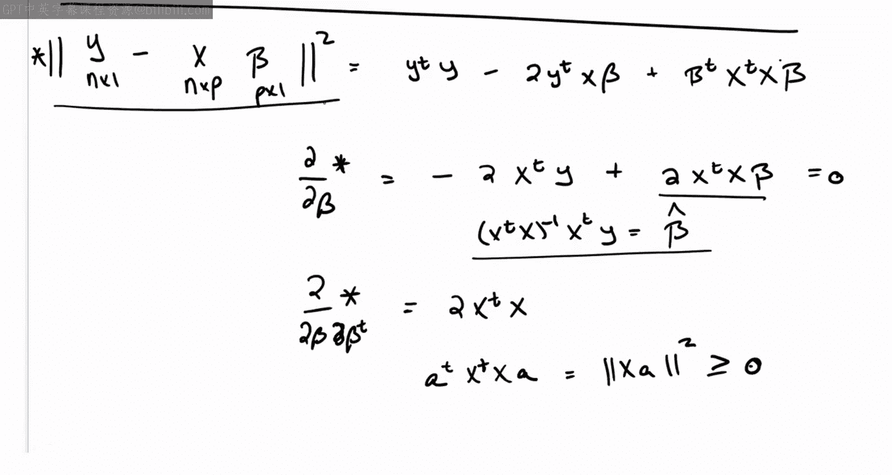

#  075：矩阵求导基础 🧮

在本节课中，我们将学习矩阵求导的基础知识，并通过一个统计学的经典例子——最小二乘法，来展示其应用。

## 概述

本节课程将介绍两种基本函数的矩阵导数：线性函数和二次型。我们将推导它们的梯度（一阶导数）和黑塞矩阵（二阶导数）公式。随后，我们会将这些公式应用于线性回归的最小二乘估计问题，求解最优参数。

## 线性函数的导数

首先，考虑一个线性函数 **f**，它将一个 **p** 维向量映射为一个实数。其形式如下：

**f(x) = aᵀx**

其中 **a** 是一个 **p** 维向量，**x** 也是一个 **p** 维向量。函数 **f** 的梯度（即对 **x** 各分量求偏导组成的向量）非常简单：

**∇f(x) = a**

## 二次型的导数

接下来，我们考虑一个二次型函数 **g**，它同样将 **p** 维向量映射为实数。其形式为：

**g(x) = xᵀAx**

其中 **A** 是一个 **p × p** 的对称矩阵。对于这个函数：
*   其一阶导数（梯度）为：
    **∇g(x) = 2Ax**
*   其二阶导数（黑塞矩阵，即所有二阶偏导组成的矩阵）为：
    **H(g) = 2A**

上一节我们介绍了线性函数和二次型求导的基本公式，本节中我们来看看如何将这些公式应用于一个核心的统计学问题。

## 应用示例：最小二乘估计

假设我们有一个 **n × 1** 的数据向量 **Y**，以及一个 **n × p** 的解释变量矩阵 **X**。我们的目标是用 **X** 的线性组合来解释 **Y**，即寻找一个 **p × 1** 的参数向量 **β**，使得 **Xβ** 尽可能接近 **Y**。

我们通过最小化残差平方和来实现这个目标，即最小化以下目标函数：

**S(β) = ||Y - Xβ||² = (Y - Xβ)ᵀ(Y - Xβ)**

将其展开，我们得到：

**S(β) = YᵀY - 2YᵀXβ + βᵀXᵀXβ**

现在，我们利用前面推导的矩阵求导规则来求解最小化 **S(β)** 的 **β**。

*   首先，对 **S(β)** 求关于 **β** 的梯度。根据线性函数和二次型的求导公式：
    **∇S(β) = -2XᵀY + 2XᵀXβ**
*   为了找到最小值点，我们令梯度等于零向量：
    **-2XᵀY + 2XᵀXβ = 0**
*   求解上述方程，得到著名的普通最小二乘（OLS）估计量：
    **β̂ = (XᵀX)⁻¹XᵀY**

（此处我们暂时假设 **XᵀX** 是可逆的。）

为了确认我们找到的是最小值而非最大值，需要检查二阶条件。

*   目标函数 **S(β)** 的黑塞矩阵是其二阶导数。从梯度表达式 **∇S(β) = -2XᵀY + 2XᵀXβ** 可以看出，只有第二项包含 **β**。再次求导，根据二次型求导公式，我们得到：
    **H(S) = 2XᵀX**
*   矩阵 **XᵀX** 是半正定的，因为对于任意非零向量 **a**，有 **aᵀXᵀXa = (Xa)ᵀ(Xa) = ||Xa||² ≥ 0**。因此，**2XᵀX** 也是半正定的。这保证了我们通过令一阶导数为零求得的解 **β̂** 确实是目标函数 **S(β)** 的最小值点。

## 总结

本节课中我们一起学习了矩阵求导的基础知识。我们首先推导了线性函数 **f(x)=aᵀx** 的梯度（**∇f=a**）和二次型 **g(x)=xᵀAx** 的梯度（**∇g=2Ax**）与黑塞矩阵（**H(g)=2A**）。随后，我们将这些公式应用于线性回归的最小二乘估计问题，通过求导并令导数为零，推导出了参数估计量 **β̂ = (XᵀX)⁻¹XᵀY**，并通过分析黑塞矩阵的正定性确认了该解为全局最小值。这个例子清晰地展示了矩阵求导在统计学核心方法中的关键作用。