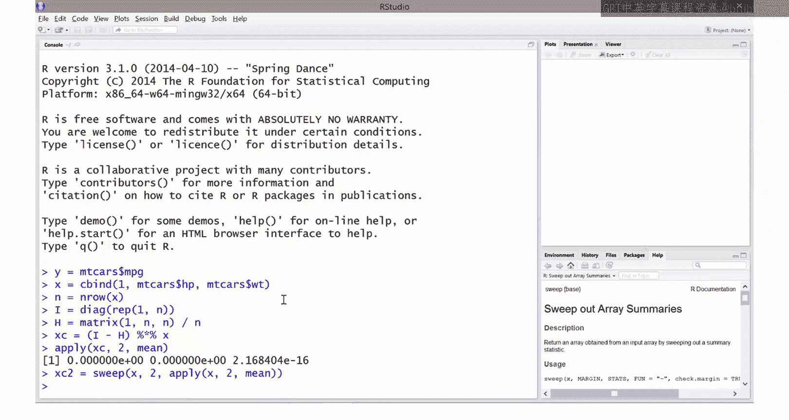
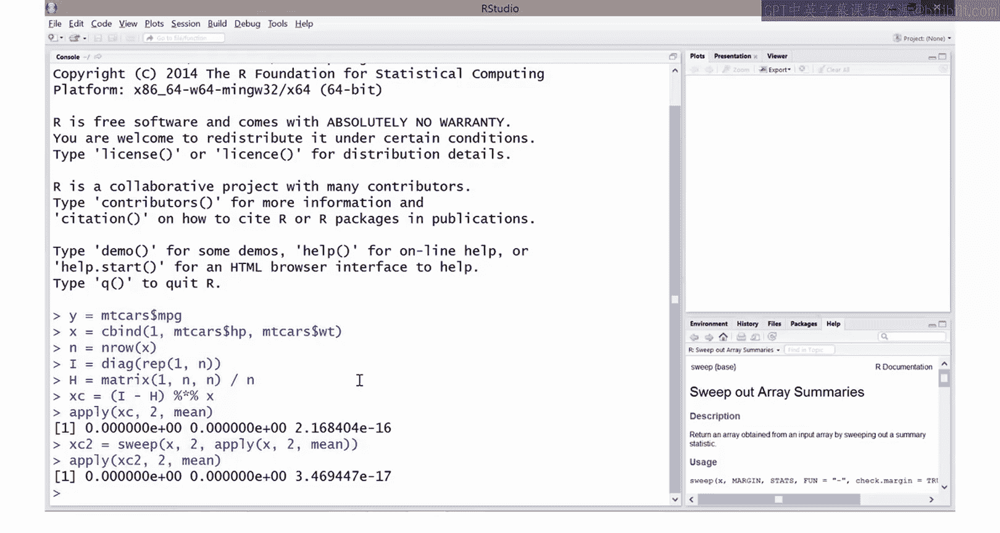

#  078：编程示例 🧮

在本节课中，我们将通过一个简单的编程示例，学习如何使用矩阵操作来实现数据列的“中心化”处理。我们将使用经典的 `mtcars` 数据集，并演示两种不同的中心化方法。

## 概述

上一节我们介绍了中心化的概念及其数学原理。本节中，我们将通过具体的R语言代码，将理论付诸实践。我们将看到如何通过矩阵运算和内置函数两种方式，从数据矩阵中减去每列的均值，从而实现中心化。

## 数据准备与矩阵定义

首先，我们需要准备数据并定义必要的矩阵。我们使用 `mtcars` 数据集，并选取 `horsepower`（马力）和 `weight`（重量）两列，同时添加一列常数1以构成设计矩阵 `X`。

```r
# 定义设计矩阵 X，包含常数项、马力和重量
X <- cbind(1, mtcars$hp, mtcars$wt)
colnames(X) <- c("Intercept", "Horsepower", "Weight")

# 获取样本数量 n
n <- nrow(X)
```

接下来，我们定义单位矩阵 `I` 和由1构成的矩阵 `J`。`J` 矩阵是一个 n×n 的矩阵，其中所有元素都是 1/n。

```r
# 定义 n×n 的单位矩阵 I
I <- diag(n)

# 定义 n×1 的全1向量 J_n
J_n <- matrix(1, nrow = n, ncol = 1)

# 计算帽子矩阵 H = J_n (J_n^T J_n)^{-1} J_n^T
# 对于全1向量，这等价于一个所有元素均为 1/n 的 n×n 矩阵
H <- J_n %*% solve(t(J_n) %*% J_n) %*% t(J_n)
```

## 方法一：通过矩阵运算实现中心化

中心化的核心操作是从原始数据中减去其均值。在矩阵形式下，这可以通过一个“中心化矩阵” `(I - H)` 左乘原始数据矩阵 `X` 来实现。`(I - H)` 的作用正是从每一列中减去该列的均值。

以下是实现步骤：
1.  计算中心化矩阵 `M_center = I - H`。
2.  将 `M_center` 与数据矩阵 `X` 相乘，得到列中心化后的矩阵 `X_c`。

```r
# 计算中心化矩阵并应用于 X
M_center <- I - H
X_c <- M_center %*% X

# 检查中心化后的列均值是否接近0
colMeans(X_c)
```
执行上述代码后，`colMeans(X_c)` 的输出结果应该是一个所有元素都非常接近零的向量（由于计算机浮点数精度，可能显示为极小的数字，如 1e-16），这验证了我们的中心化操作是正确的。

## 方法二：使用 `sweep` 函数实现中心化

虽然矩阵运算能清晰地展示其数学原理，但在实际编程中，使用R语言的内置函数通常更加高效和简洁。`sweep()` 函数就是这样一个工具，它可以按行或列“扫除”一个统计量。

以下是使用 `sweep` 函数实现中心化的步骤：
1.  首先，使用 `apply` 函数计算数据矩阵 `X` 每一列的均值。
2.  然后，使用 `sweep` 函数，从 `X` 的每一列中减去对应的均值。

```r
# 使用 apply 计算列均值
col_means <- apply(X, 2, mean)

# 使用 sweep 从每一列中减去其均值 (MARGIN=2 表示按列操作)
X_c2 <- sweep(X, 2, col_means)



# 再次检查列均值
colMeans(X_c2)
```
同样，`colMeans(X_c2)` 的结果也应接近零，确认了中心化的成功。

## 两种方法的比较与意义

我们刚刚演示了两种达到相同目的的方法。`sweep` 函数是更直接、计算效率更高的编程选择。然而，通过矩阵运算 `(I - H)X` 来理解中心化过程具有重要的理论价值。

**公式**：`X_centered = (I - H) X`

这个矩阵公式不仅仅是代码，它封装了中心化的核心思想，并且是后续许多高级统计方法（例如线性模型、主成分分析）推导的基础。理解这个公式，有助于我们洞察这些方法背后的统一数学结构。

## 总结



本节课中，我们一起学习了数据列中心化的编程实现。我们首先通过构建单位矩阵 `I` 和均值投影矩阵 `H`，利用公式 `(I - H)X` 实现了中心化，并验证了结果。接着，我们掌握了使用R语言内置的 `sweep()` 函数这一更高效的实践方法。最重要的是，我们明确了矩阵运算形式在理论理解上的关键作用，它为学习更复杂的数据科学统计模型奠定了坚实的基础。