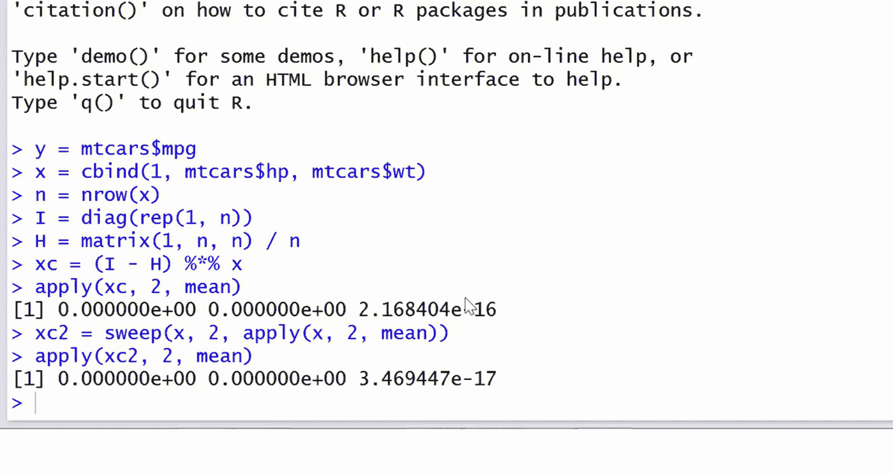
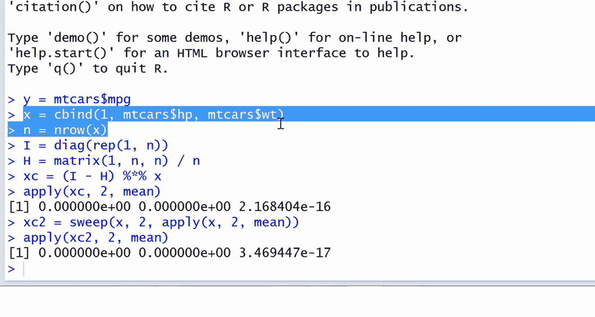
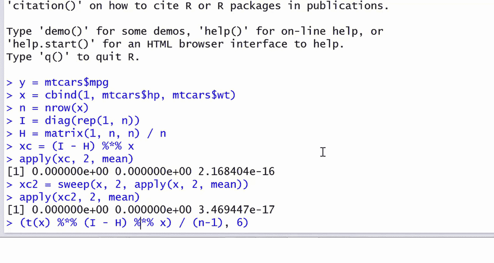
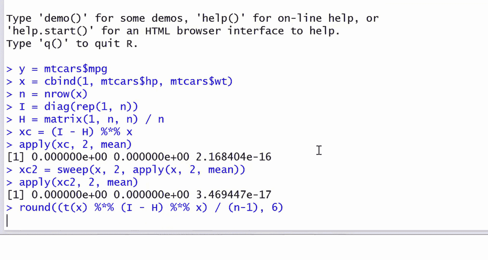
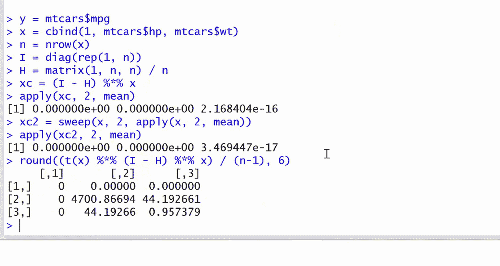
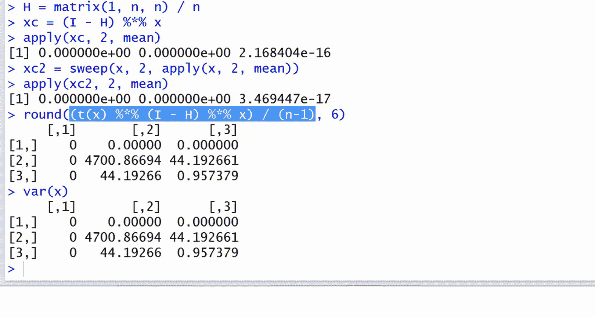

#  080：编程示例 🧮

在本节课中，我们将学习如何使用矩阵运算手动计算方差-协方差矩阵。我们将以钻石数据集为例，通过矩阵操作来验证R语言内置函数的结果。

上一节我们介绍了矩阵运算的基本概念，本节中我们来看看如何具体应用这些概念来计算方差-协方差矩阵。

## 概述

我们将使用钻石数据集，并定义一个矩阵 **X**，它包含一列常数（全1）、马力（horsepower）和重量（weight）三列数据。此外，我们已预定义了两个矩阵：单位矩阵 **I** 和帽子矩阵 **H**（一个所有元素均为 1/n 的 n×n 矩阵）。

## 核心计算过程

我们声称，方差-协方差矩阵可以通过以下公式计算：

**公式：**
`Cov(X) = (X^T * (I - H) * X) / (n - 1)`

其中：
*   `X^T` 是矩阵 **X** 的转置。
*   `I` 是 n×n 的单位矩阵。
*   `H` 是帽子矩阵，即所有元素为 1/n 的 n×n 矩阵。
*   `n` 是样本数量。

以下是计算步骤：

1.  首先，我们计算矩阵 **I** 减去帽子矩阵 **H** 的结果。
2.  接着，将结果左乘 **X** 的转置，再右乘 **X** 本身。
3.  最后，将得到的矩阵除以 `n - 1`，即可得到方差-协方差矩阵。

为了输出整洁，我们将结果四舍五入到六位小数。

## 与R语言结果对比

为了验证我们手动计算的结果，我们可以直接使用R语言的 `var()` 函数来计算矩阵 **X** 的方差-协方差矩阵。

可以看到，两种方法得到的结果完全一致。

## 结果解读

在我们计算出的方差-协方差矩阵中：

*   第一行和第一列的所有元素均为零。这是因为第一列是常数向量（全1），其本身没有变异。
*   矩阵右下角的 2×2 子矩阵包含了我们关心的核心信息：
    *   对角线上的元素 4700 和 0.95 分别是 **X** 矩阵第二列（马力）和第三列（重量）的方差。
    *   非对角线上的元素 44 则是这两列数据之间的协方差。

这个示例展示了如何利用矩阵计算来替代传统的循环索引方法，高效地完成统计计算。

## 总结

本节课中我们一起学习了如何通过矩阵运算手动计算数据的方差-协方差矩阵。我们回顾了核心公式，并一步步演示了计算过程，最终验证了其结果与R语言内置函数输出的一致性。理解这种矩阵化的计算方法对于后续深入学习数据科学中的高级统计技术至关重要，在本课程中我们将频繁使用此类矩阵操作。