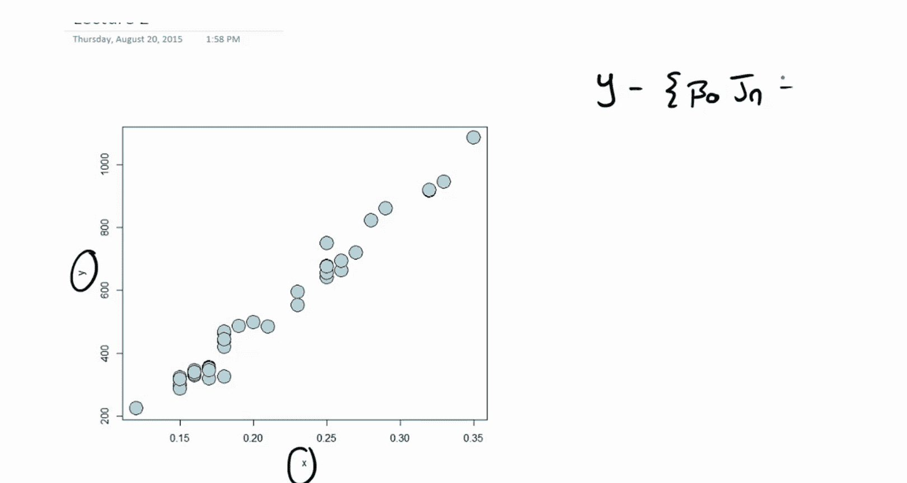
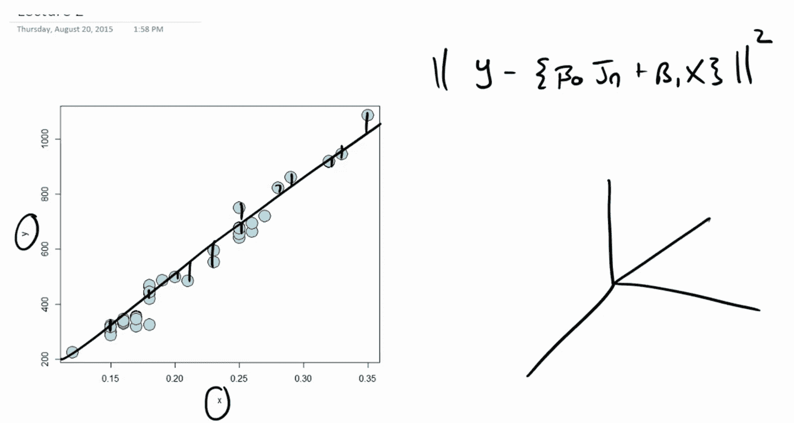
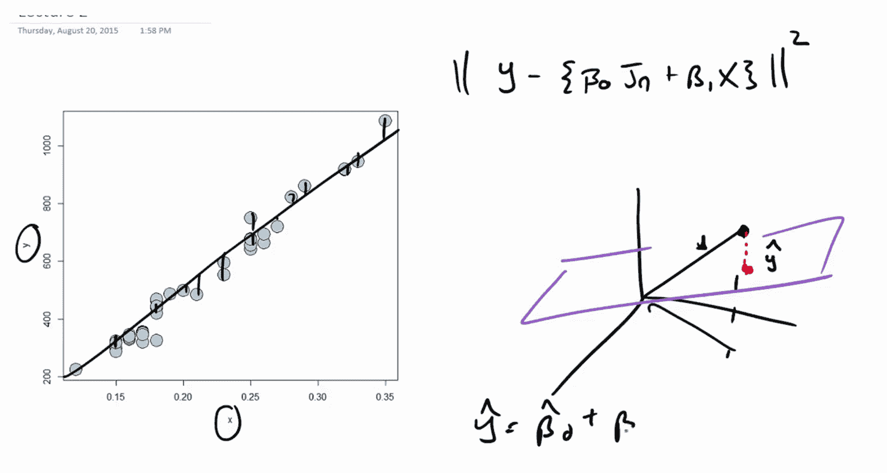
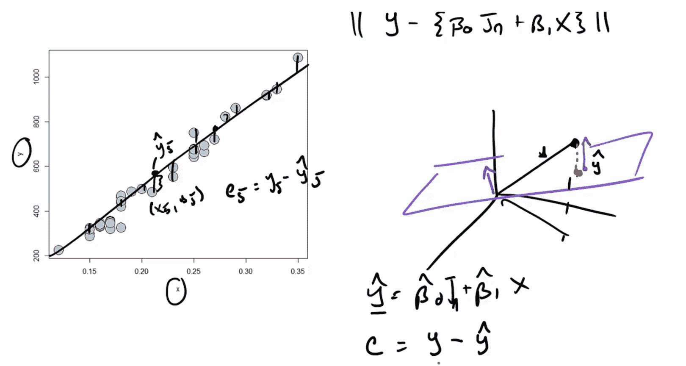
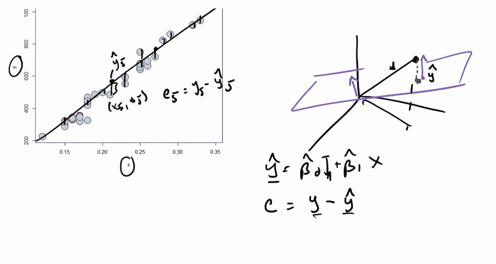
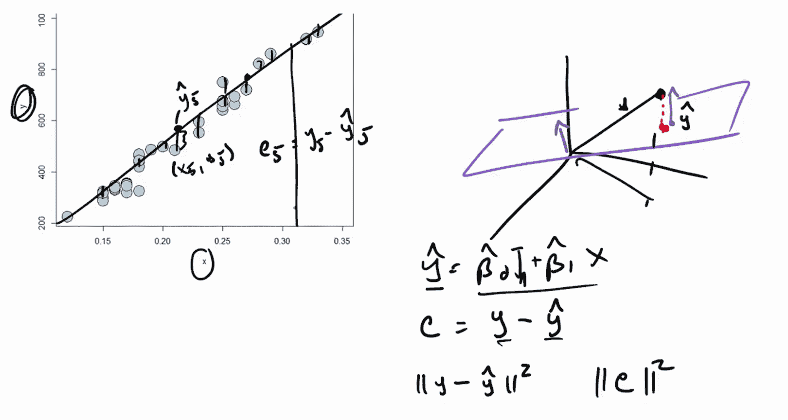

#  086：拟合值与残差 📊

在本节课中，我们将学习线性回归中的两个核心概念：**拟合值**与**残差**。我们将回顾钻石数据集，并通过几何和代数两种视角来理解这些概念，最后通过一个计算示例进行巩固。

---

## 回顾钻石数据集

我们正在研究钻石数据集，其中 **X** 代表克拉数（carat），**Y** 代表价格（price）。

我们拟合了一个模型，或者说，我们拟合了最小二乘方程，目标是最小化 **y - (β₀ + β₁x)** 的平方和。

我们最小化了这个最小二乘方程。之前我们讨论了至少有两种方式来理解这个过程。

---

## 理解最小二乘的两种视角

### 视角一：寻找最佳拟合线

第一种方式是将此视为寻找一条最佳拟合数据点的直线，这条直线最小化了数据点与直线之间**垂直距离的平方和**。

### 视角二：n维空间中的投影

第二种方式是将 **Y** 视为一个 **n 维空间**中的点（在本例中，我们可以用 R³ 来可视化）。**Y** 是 n 维空间中的一个点，而由 **β₀Jₙ + β₁X** 定义的平面是一个二维平面，它穿过了这个 n 维空间。

**β̂**（即 β₀̂ 和 β₁̂ 的特定组合）定义了 **Jₙ** 和 **X** 的线性组合，这个组合产生了一个点，即 **Y** 在该平面上的**投影**。我们称这个投影点为 **Ŷ**（Y hat）。

因此，**Ŷ = β₀̂ + β₁̂X**。

在左侧的图形化视角中，**Ŷ** 的每个分量就是数据点到拟合直线上的垂直投影点。例如，点 **(x₅, y₅)** 在直线上的投影点就是 **ŷ₅**。**Ŷ** 就是所有 **ŷᵢ** 组成的向量。

更准确地说，**Ŷ** 被定义为 **β₀̂Jₙ + β₁̂X**。**Ŷ** 被称为**拟合值**，它是数据点 **Y** 在由 **X** 和常数向量 **Jₙ** 所张成的二维空间上的投影。

---

## 引入残差

另一个重要的向量是 **E**，即**残差**，它定义为 **Y - Ŷ**。

在图形中，每个 **eᵢ** 就是 **yᵢ** 和 **ŷᵢ** 之间的垂直距离。例如，**e₅** 就是 **y₅** 和 **ŷ₅** 之间的距离。

在右侧的几何视角中，**E** 是从投影点 **Ŷ** 指向原始数据点 **Y** 的向量。这个向量**正交于**（垂直）我们之前提到的那个紫色平面。

**E**，即 **Y** 与 **Ŷ** 之差的向量，被称为**残差向量**。

---

## 与最小二乘准则的联系

我们的最小二乘准则可以理解为最小化 **‖Y - Ŷ‖²**，其中 **Ŷ** 具有 **β₀̂ + β₁̂X** 的形式。同时，这等价于最小化**残差平方和**，即 **∑eᵢ²**。

因此，**拟合值 Ŷ** 和**残差 E** 是回归分析中两个至关重要的概念。

---

## 预测与新数据点

关于 **Ŷ** 的最后一个要点是：如果我们想为某个给定的克拉值预测价格，那么预测值就是 **Ŷ**。

需要注意的是，我们不仅可以在已观测到的 **X** 值处进行预测。例如，如果我们想在下图所示的位置进行预测：

我们可以直接代入一个未观测过的 **x** 值，从而得到一个预测的 **y** 值。严格来说，这个预测值不属于 **Ŷ** 向量，因为 **Ŷ** 特指在**已观测的 X 值**处的拟合值向量。但这说明了我们如何通过将新值代入拟合的直线来获得对新数据点的预测。

---

## 总结

本节课中，我们一起学习了线性回归的核心组成部分：
*   **拟合值 Ŷ**：数据 **Y** 在由预测变量张成的空间上的投影，代表了模型对已观测数据的预测结果。
*   **残差 E**：观测值 **Y** 与拟合值 **Ŷ** 之间的差值（**E = Y - Ŷ**），代表了模型未能解释的部分。
*   最小二乘回归的目标就是找到参数，使得残差平方和最小。
*   我们既可以从数据点与直线的垂直距离角度来理解，也可以从高维空间投影的几何角度来理解这些概念。
*   拟合的模型可用于在未观测到的预测变量值处进行预测。