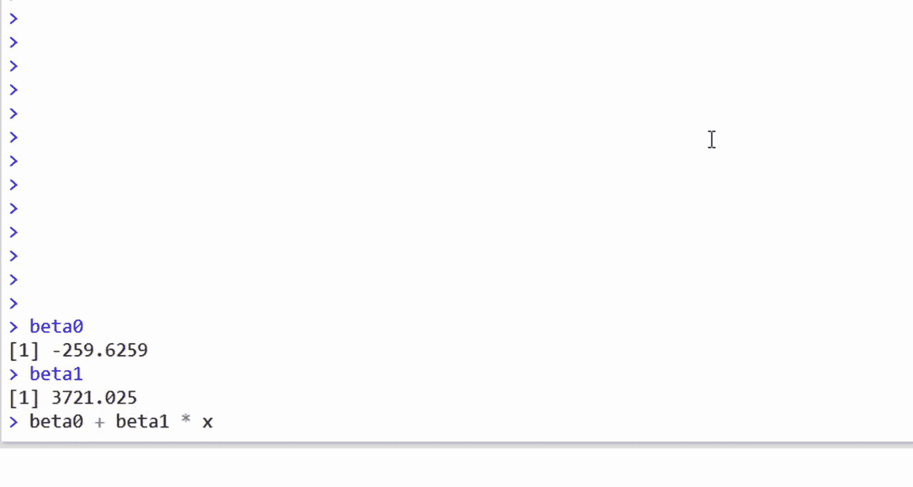
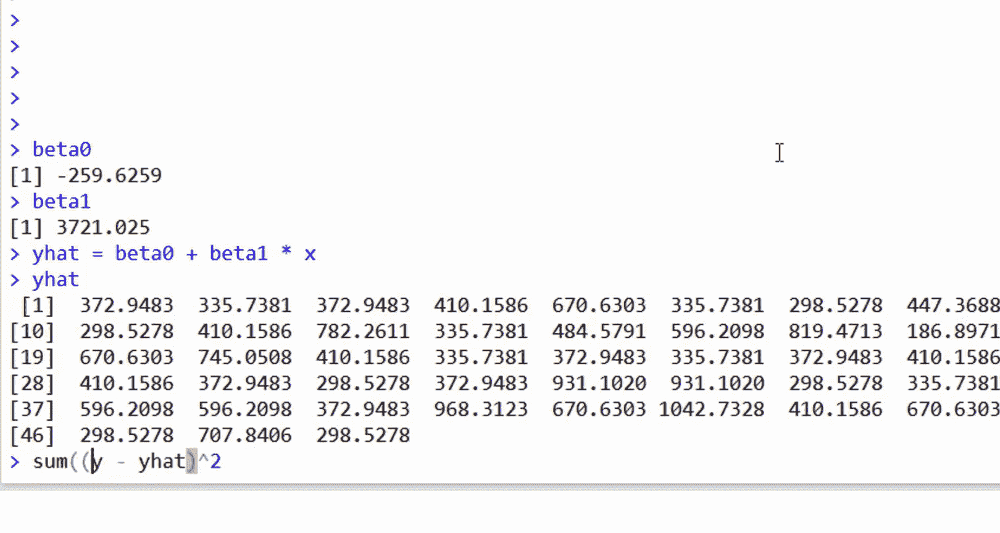
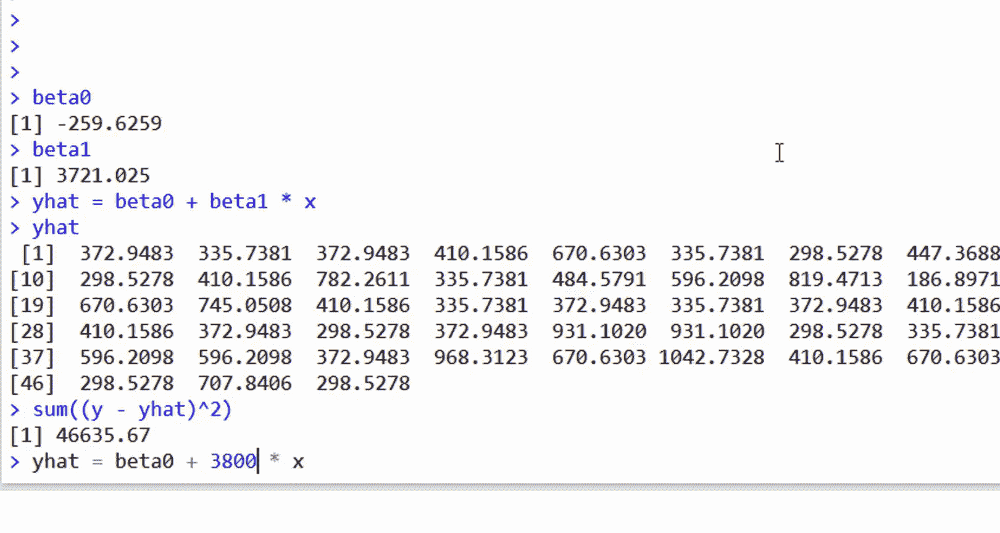
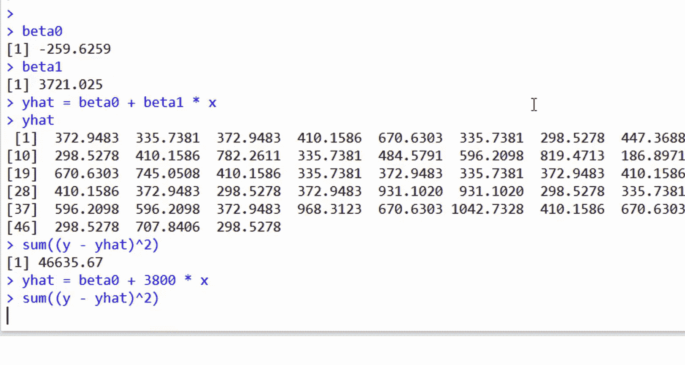
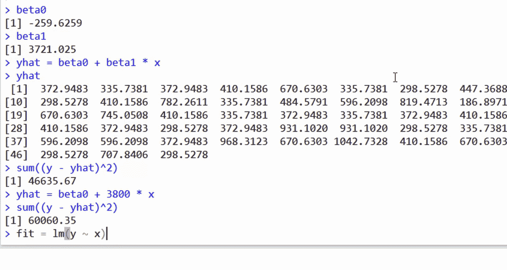
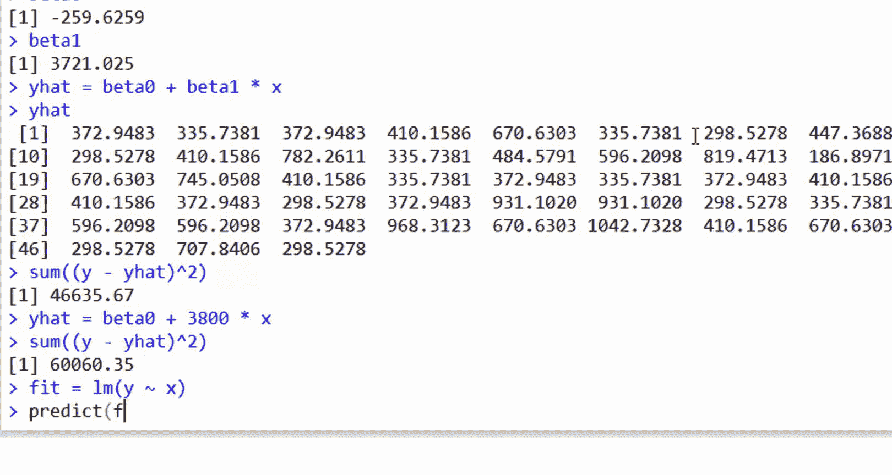
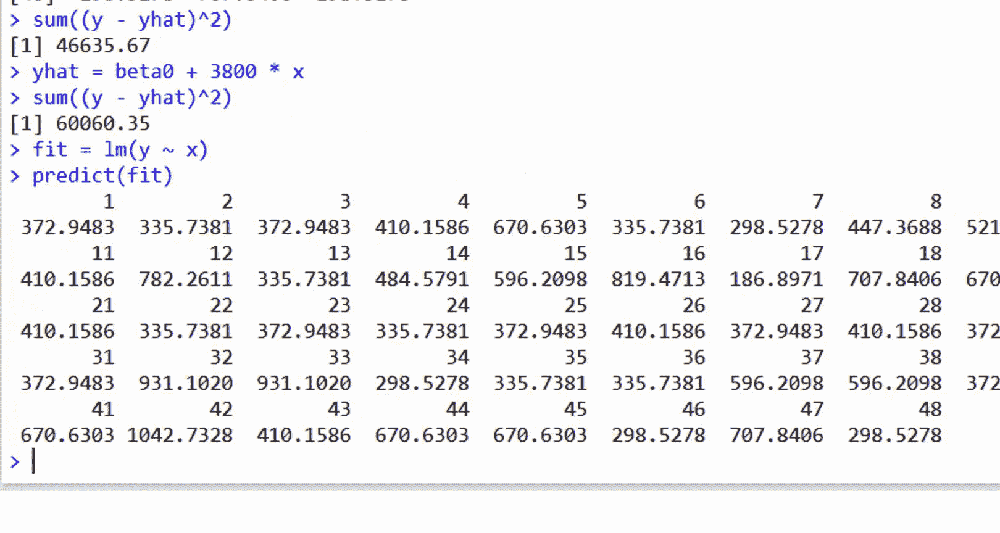
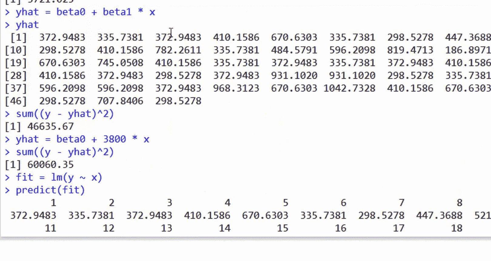
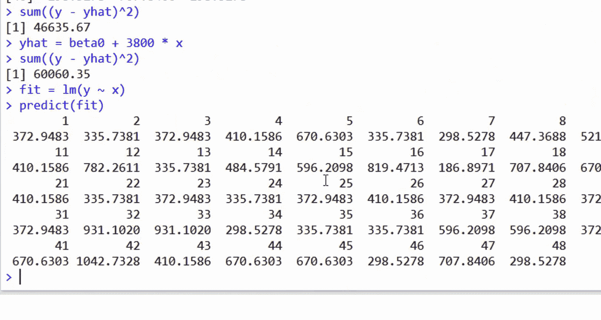

#  090：编程示例 💻

在本节课中，我们将通过一个编程示例，学习如何在线性回归模型中计算拟合值、残差以及使用R语言进行预测。我们将回顾钻石数据集的例子，并演示如何手动和自动地获取预测值。

---

## 回顾上一节内容

在之前的例子中，我们使用了钻石数据集，并定义了截距项 `beta0` 和斜率项 `beta1`。

## 计算拟合值向量



如果我们想获得拟合值向量 `Y_hat`，只需计算 `beta0 + beta1 * x`。在R语言中，我们无需显式地将 `beta0` 与一个全1向量相乘，因为R会根据需要自动进行向量化操作。

**公式**：
`Y_hat = beta0 + beta1 * x`

以下是计算 `Y_hat` 的代码示例：



```r
# 假设 beta0 和 beta1 已定义，x 是自变量向量
Y_hat <- beta0 + beta1 * x
```

## 理解残差与最小二乘法



`Y` 减去 `Y_hat` 得到的就是残差。我们的目标是最小化这些残差的平方和，即最小二乘准则。

**公式**：
`残差 = Y - Y_hat`
`目标：最小化 Σ(残差^2)`



为了说明这一点，如果我们尝试一个不同的 `beta1` 值（例如3800），计算出的残差平方和将会不同，并且通常会比最优值更大。

## 自动获取预测值

上一节我们介绍了如何手动计算拟合值，本节中我们来看看如何使用R内置函数更自动地获取预测值。

虽然为了节省时间，我们有时会直接操作，但最佳实践是将模型拟合的输出赋值给一个变量（例如 `fit`），然后使用 `predict()` 函数。

以下是具体步骤：

1.  首先，拟合线性回归模型并将结果保存到变量中。
2.  然后，使用 `predict()` 函数基于该模型获取预测值。

```r
# 最佳实践示例
fit <- lm(y ~ x, data = your_data) # 拟合模型
predictions <- predict(fit) # 获取预测值
```

通过对比可以发现，这样得到的预测值（例如372，335等）与手动计算的结果是一致的。



## 扩展到多元线性回归

我们学习了如何从线性回归模型中获取预测值，将这种方法扩展到多元回归模型是非常直观的。原理相同，只是模型公式中包含了更多的自变量。

**公式**（多元回归）：
`Y_hat = beta0 + beta1*x1 + beta2*x2 + ... + betap*xp`

在R中，你只需在 `lm()` 函数中指定包含多个自变量的公式即可。

```r
# 多元线性回归示例
fit_multi <- lm(y ~ x1 + x2 + x3, data = your_data)
predictions_multi <- predict(fit_multi)
```





---



## 总结



本节课中我们一起学习了：
1.  如何手动计算线性回归的拟合值 `Y_hat`。
2.  理解了残差和最小二乘最小化的目标。
3.  掌握了使用R语言的 `predict()` 函数自动获取模型预测值的最佳实践。
4.  了解了将单变量线性回归的预测方法平滑地扩展到多元线性回归模型的过程。