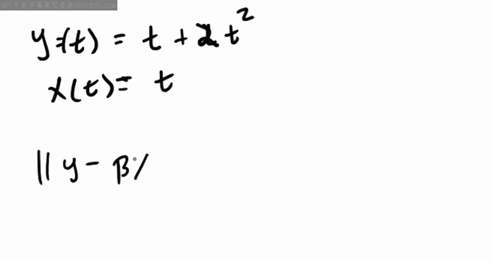
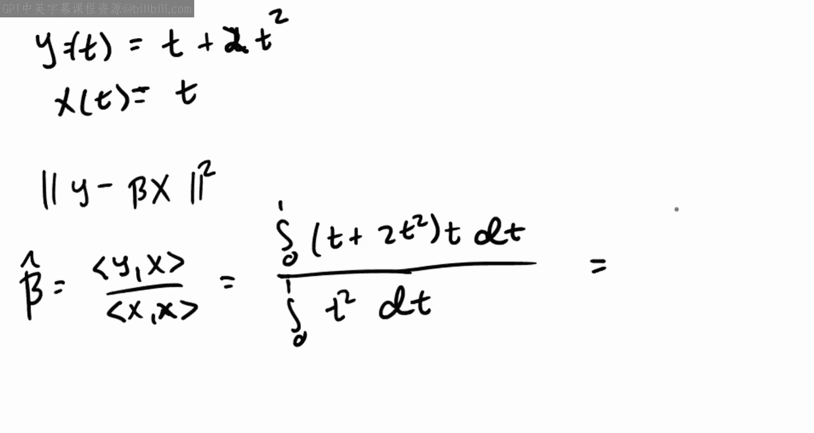
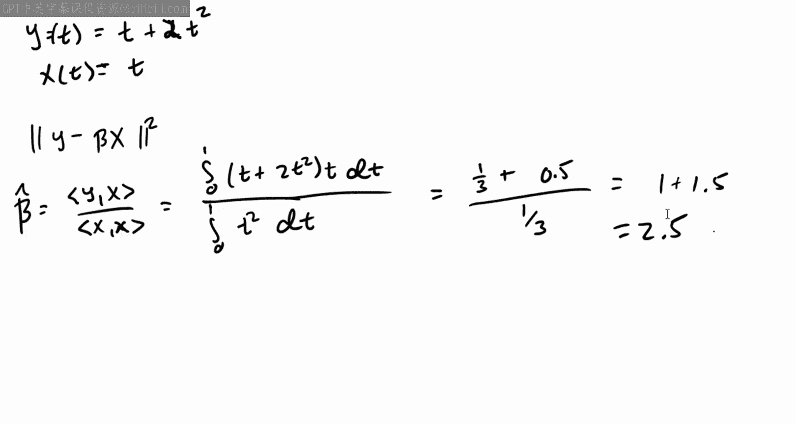
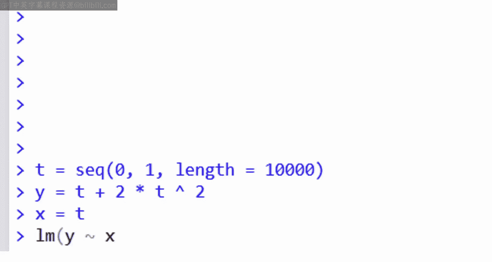
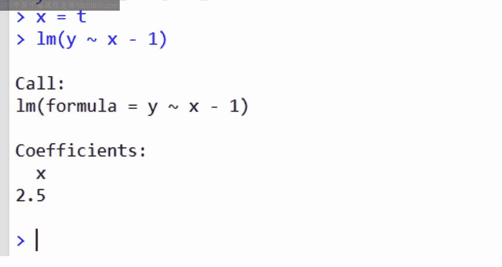

#  094：广义化示例 🧮

在本节课中，我们将通过一个具体的例子，来学习如何在函数空间中进行线性回归。我们将把一个二次函数近似为一个线性函数，并计算其回归系数。

上一节我们介绍了函数空间回归的基本概念，本节中我们来看看一个具体的计算示例。

## 示例设定

假设我们有一个二次函数 `y(t)` 和一个线性函数 `x(t)`，定义在区间 `[0, 1]` 上。具体函数如下：

*   `y(t) = t + 2t²`
*   `x(t) = t`

我们的目标是通过回归（强制通过原点）来找到最佳的线性系数 `β`，使得线性函数 `β * x(t)` 能最好地近似 `y(t)`。

## 计算回归系数 β̂

我们知道，在函数空间中，最优的回归系数 `β̂` 由以下公式给出：

**β̂ = <y, x> / <x, x>**



其中 `<·, ·>` 表示函数的内积，定义为两个函数乘积在定义域上的积分。

因此，我们需要计算两个积分：

1.  分子：`<y, x> = ∫₀¹ (t + 2t²) * t dt`
2.  分母：`<x, x> = ∫₀¹ t * t dt = ∫₀¹ t² dt`

以下是详细的计算步骤：

*   计算分子：
    *   `∫₀¹ (t + 2t²) * t dt = ∫₀¹ (t² + 2t³) dt`
    *   `= [t³/3 + (2t⁴)/4]₀¹`
    *   `= (1/3 + 1/2) - 0`
    *   `= 5/6`

*   计算分母：
    *   `∫₀¹ t² dt = [t³/3]₀¹ = 1/3`



*   计算系数 β̂：
    *   `β̂ = (5/6) / (1/3) = (5/6) * 3 = 5/2 = 2.5`

所以，我们得到的最佳线性近似为 `ŷ(t) = 2.5 * t`。

## 使用计算机验证



理论上，当数据点足够密集时，离散数据的线性回归结果应该逼近我们上面通过积分计算出的连续函数结果。

以下是使用R语言进行的验证代码和结果：

```r
# 生成密集的数据点
t <- seq(0, 1, length.out = 1000)

# 定义函数
y <- t + 2 * t^2
x <- t

# 进行线性回归（强制截距为0）
fit <- lm(y ~ 0 + x) # ‘0 +’ 表示拟合一个没有截距项的模型
summary(fit)
```



运行上述代码，回归模型给出的斜率系数 `β̂` 将非常接近 `2.5`，从而验证了我们积分计算的结果。



本节课中我们一起学习了如何将函数空间中的回归问题具体化。我们通过一个二次函数近似为线性函数的例子，演示了如何利用内积公式 `β̂ = <y, x> / <x, x>` 计算最优回归系数，并使用计算机模拟验证了当数据点足够多时，离散回归的结果会收敛于连续函数计算的理论值。