#  096：手动拟合最小二乘法 👨‍💻

在本节课中，我们将通过一个编程示例，学习如何手动计算最小二乘法的系数估计。我们将使用R语言和内置的`swiss`数据集，手动构建设计矩阵并求解系数，最后与R内置的`lm`函数结果进行对比，以验证我们的计算过程。

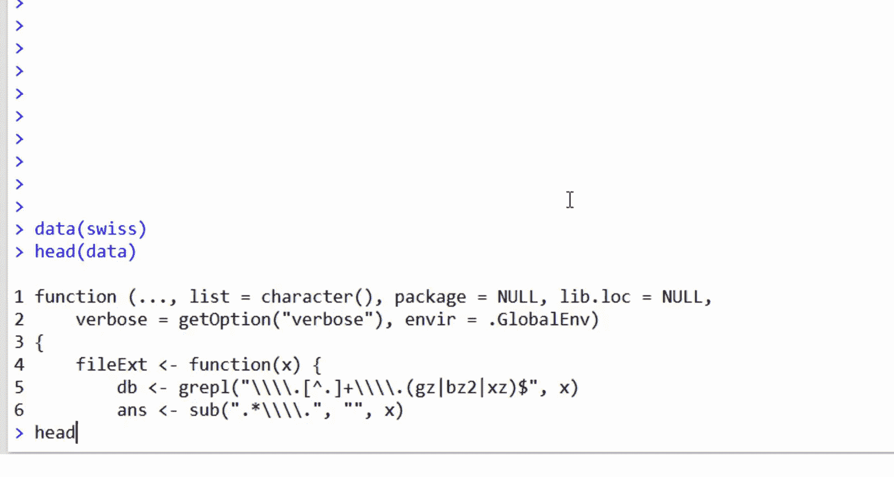

## 概述

我们将使用`swiss`数据集，以生育率（`Fertility`）作为因变量，并使用农业（`Agriculture`）、考试（`Examination`）、教育（`Education`）、天主教徒比例（`Catholic`）和婴儿死亡率（`Infant.Mortality`）作为自变量来构建一个多元线性回归模型。我们将手动计算回归系数，并与R的`lm`函数结果进行比较。

## 准备数据

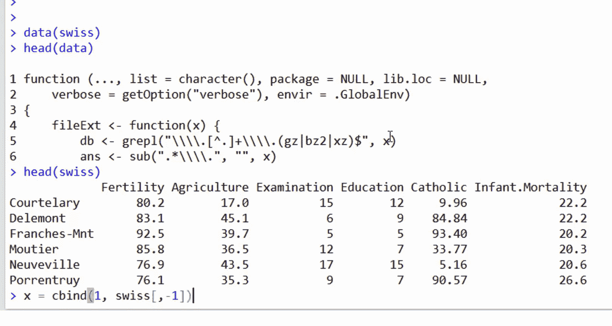

首先，我们需要加载数据并创建设计矩阵`X`和响应向量`y`。设计矩阵`X`需要包含一个截距项。

```r
# 加载swiss数据集
data(swiss)

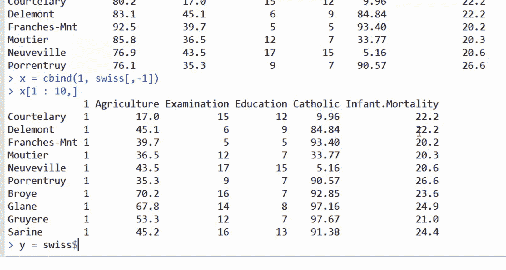

# 创建设计矩阵X，包含截距项和所有预测变量
X <- cbind(1, as.matrix(swiss[, -1]))
# 查看X的前10行
head(X, 10)

# 创建响应向量y，即Fertility列
y <- swiss$Fertility
```

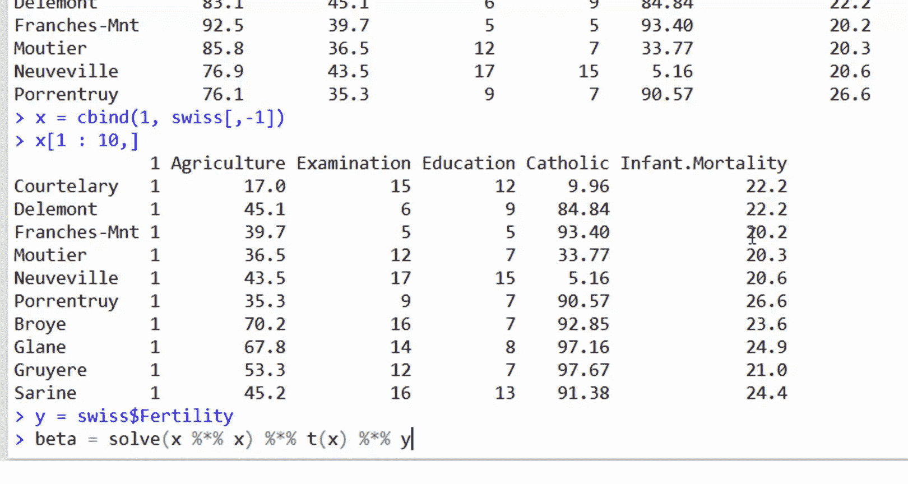

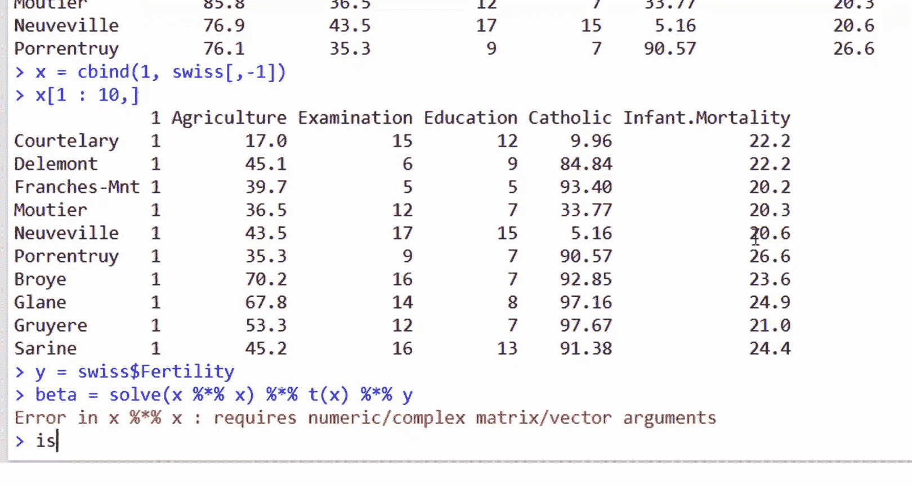

## 手动计算回归系数

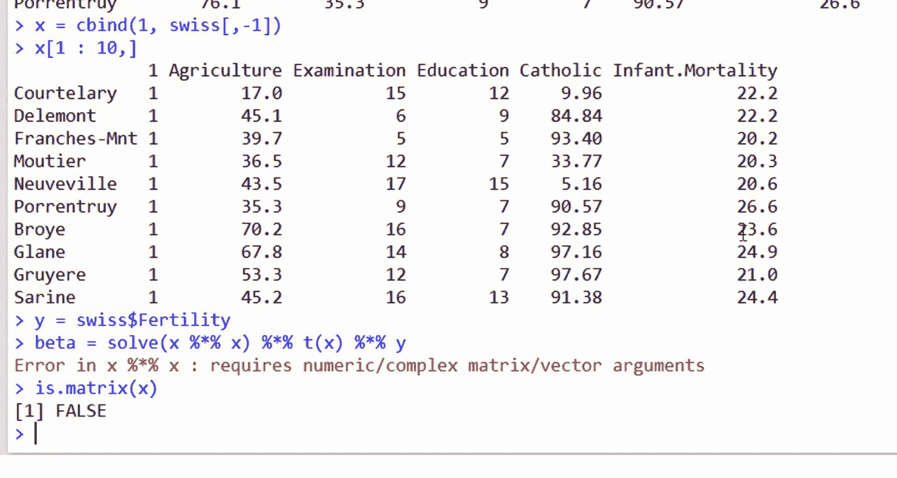

多元线性回归的最小二乘估计系数由以下公式给出：
**β̂ = (XᵀX)⁻¹ Xᵀy**

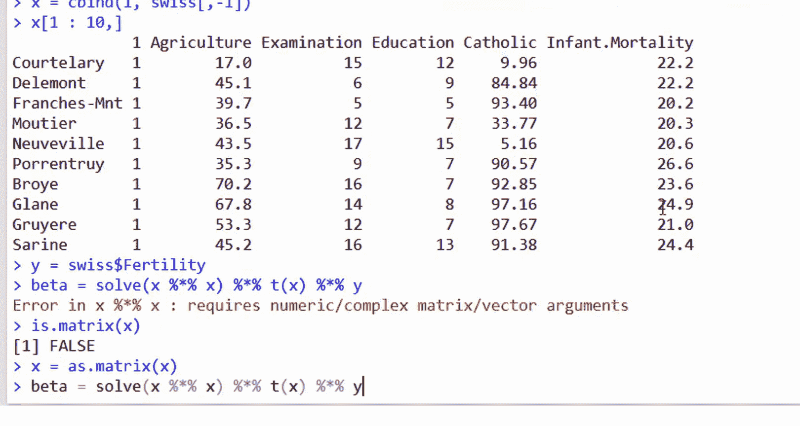

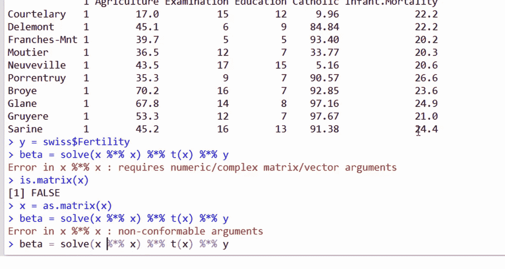

接下来，我们将在R中手动实现这个公式。

```r
# 计算 XᵀX
xtx <- t(X) %*% X

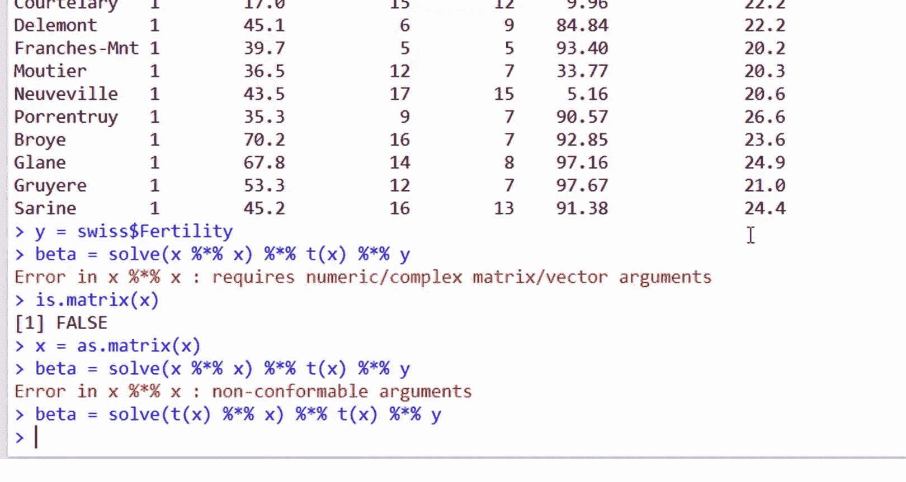

# 计算 (XᵀX)⁻¹ Xᵀy
# 方法一：直接求逆矩阵
beta_hat <- solve(xtx) %*% t(X) %*% y
print(beta_hat)
```

## 与lm函数结果对比

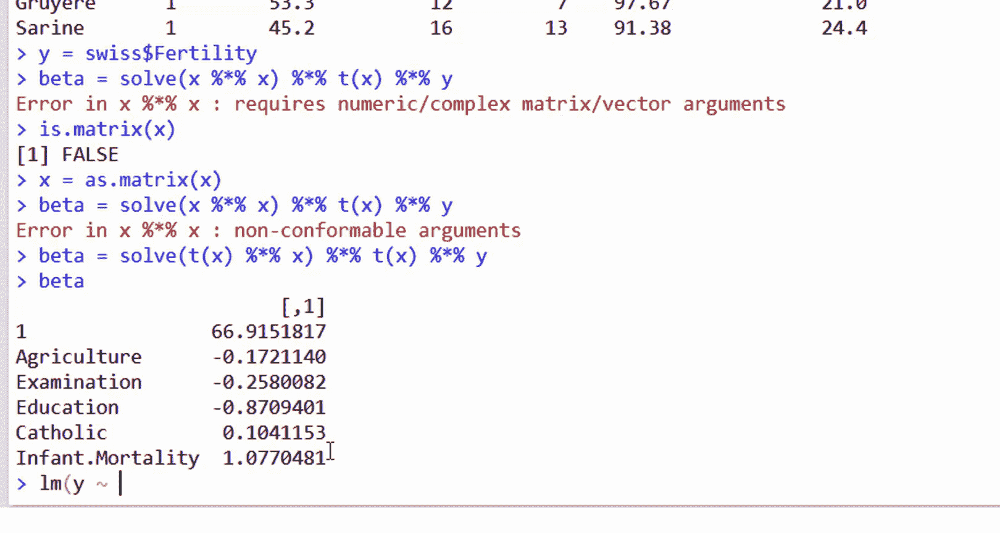

为了验证我们手动计算的结果是否正确，我们使用R内置的`lm`函数拟合相同的模型。

```r
# 使用lm函数拟合模型
lm_fit <- lm(Fertility ~ ., data = swiss)
# 查看lm函数估计的系数
summary(lm_fit)$coefficients[, 1]
```

你会发现，除了截距项可能因为设计矩阵`X`中已经包含了一个`1`的列而被`lm`函数标记为`NA`外，其他变量的系数估计值是完全一致的。这证实了我们手动计算过程的正确性。

## 计算效率的注意事项

在上一节我们手动实现了系数求解，本节中我们来看看一个关于计算效率的技巧。直接计算矩阵的逆有时在数值计算上效率较低，特别是对于较大的矩阵。

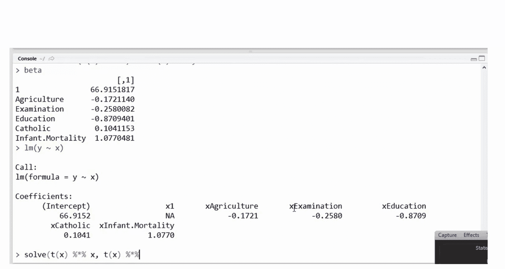

`solve`函数在接收两个参数（如 `solve(A, b)`）时，实际上是求解线性方程组 **A * x = b**，这比先计算逆矩阵 `A⁻¹` 再相乘（即 `solve(A) %*% b`）在数值上更稳定、更快速。

```r
# 更高效且数值稳定的计算方法：直接求解线性方程组
beta_hat_efficient <- solve(t(X) %*% X, t(X) %*% y)
print(beta_hat_efficient)
```

这种方法与之前的结果相同，但通常是更可取的实现方式。

## 总结

本节课中我们一起学习了如何手动实现多元线性回归的最小二乘估计。我们完成了以下步骤：
1.  准备数据，构建包含截距项的设计矩阵`X`和响应向量`y`。
2.  根据公式 **β̂ = (XᵀX)⁻¹ Xᵀy** 手动计算回归系数。
3.  将手动计算结果与R内置的`lm`函数输出进行对比，验证了计算过程的正确性。
4.  介绍了使用`solve(A, b)`直接求解线性方程组的方法，这是一种更高效、数值更稳定的计算方式。

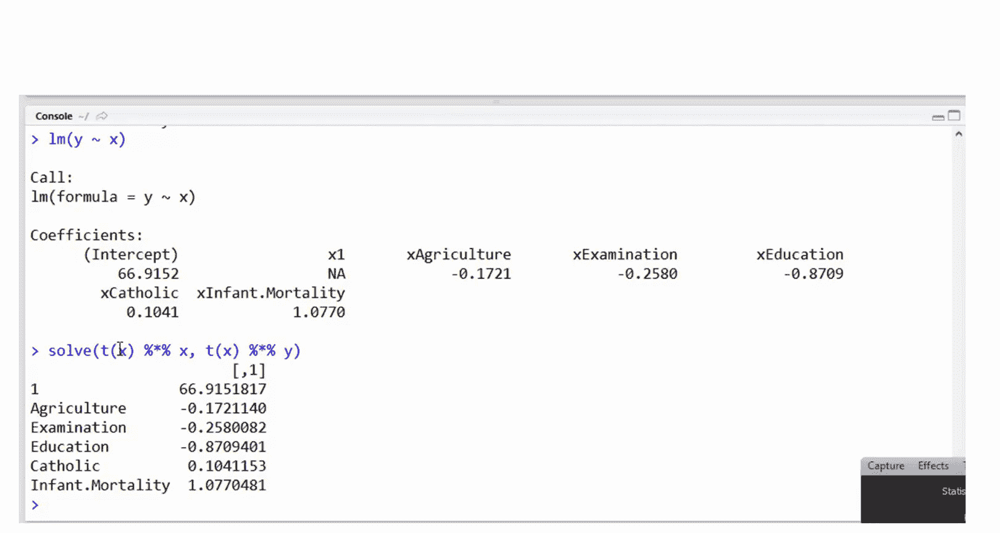

这个过程揭示了`lm`函数在拟合多元回归模型时背后所执行的核心计算步骤。