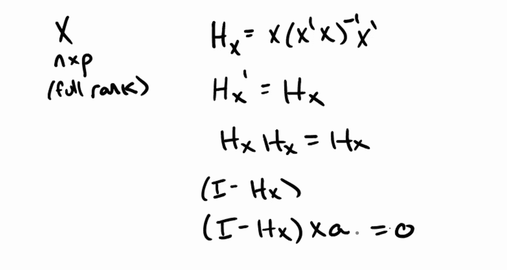
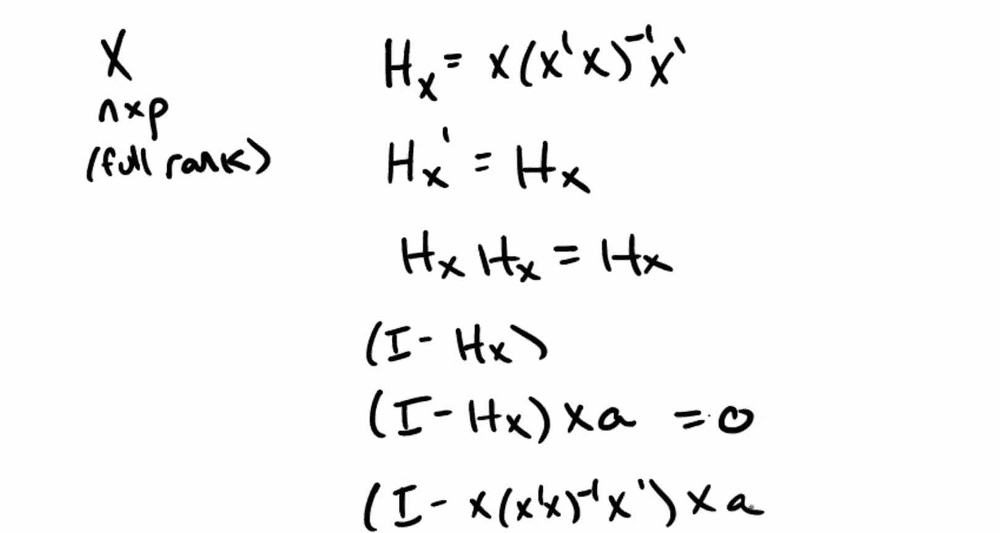
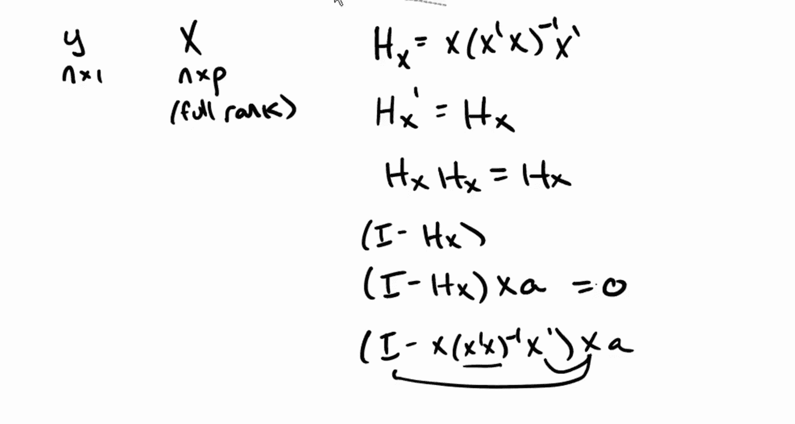
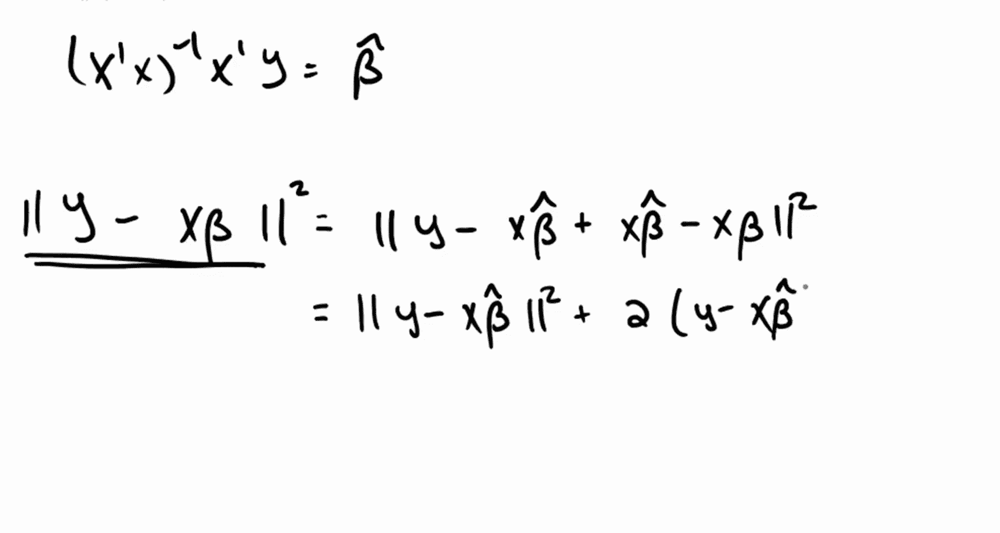
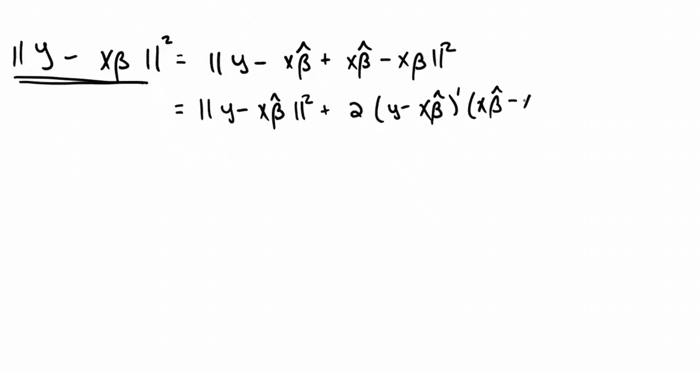
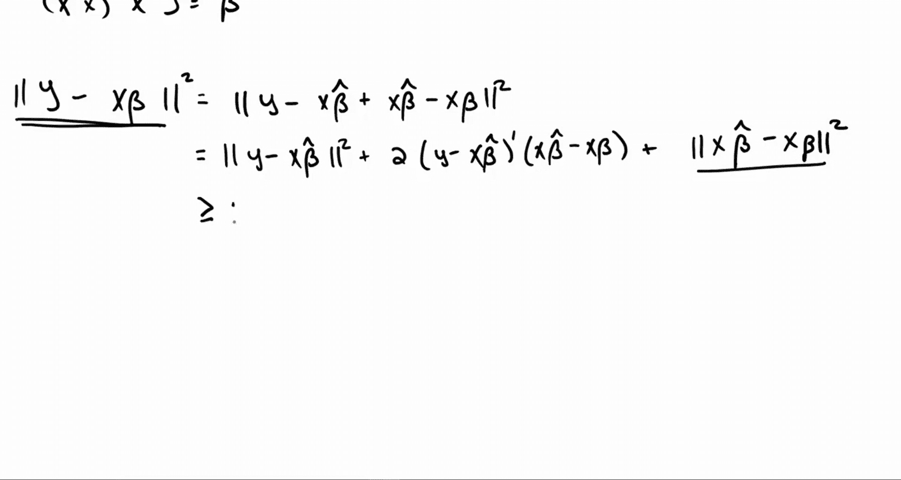
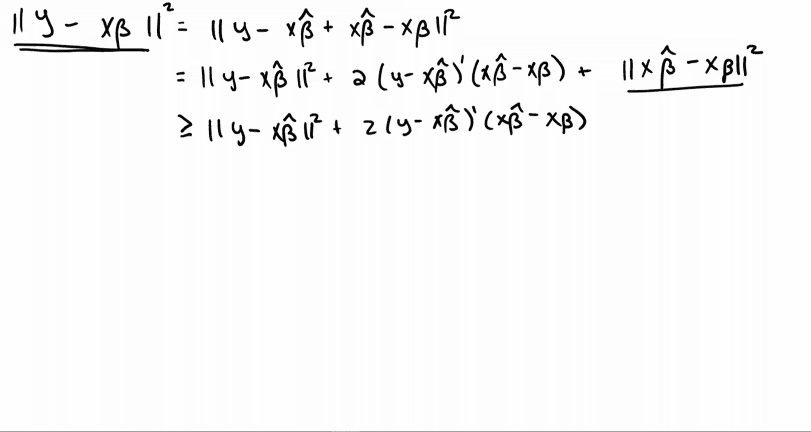
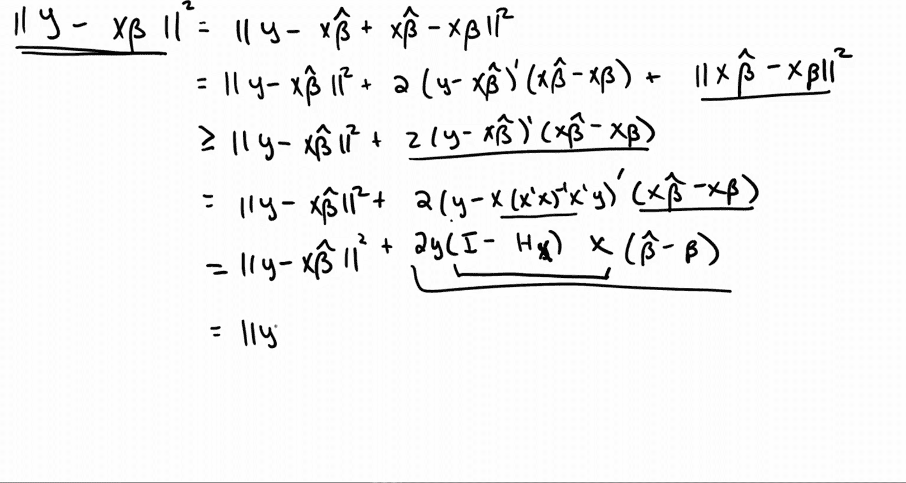
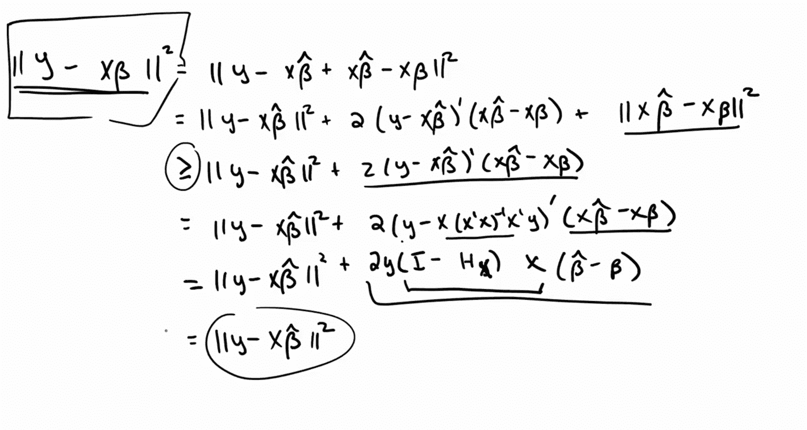

#  097：最小二乘法的第二种推导 🔍

在本节课中，我们将学习如何通过另一种几何视角，证明最小二乘回归的解为 **β̂ = (XᵀX)⁻¹Xᵀy**。我们将利用投影矩阵的性质，清晰地展示为何该解能最小化残差平方和。

---

## 问题设定与符号定义

上一节我们介绍了最小二乘法的基本目标。本节中，我们来看看如何通过矩阵运算和投影来推导最优解。

我们有以下设定：
*   **y** 是一个 `n × 1` 的观测向量。
*   **X** 是一个 `n × p` 的满秩设计矩阵。
*   我们的目标是用 **X** 的列向量的线性组合来解释 **y** 的变化，即找到 **β** 使得预测值 **Xβ** 尽可能接近观测值 **y**。这通过最小化观测值 **y** 与拟合值 **Xβ** 之间的距离（欧几里得范数）来实现。

首先，我们定义一个核心矩阵——**帽子矩阵**（Hat Matrix）或投影矩阵 **H**：

**H = X(XᵀX)⁻¹Xᵀ**

以下是关于 **H** 的几个关键性质，它们对后续推导至关重要：

*   **对称性**：**Hᵀ = H**
*   **幂等性**：**H² = H**
*   矩阵 **I - H** 同样具有对称性和幂等性。
*   对于 **X** 列空间的任意向量 **Xa**，有 **(I - H)Xa = 0**。这很容易验证：**(I - X(XᵀX)⁻¹Xᵀ)Xa = Xa - X(XᵀX)⁻¹(XᵀX)a = Xa - Xa = 0**。

---

## 最小化残差平方和

现在，我们开始最小化最小二乘准则，即残差平方和 **||y - Xβ||²**。

我们的策略是，在表达式中巧妙地加上再减去一项 **Xβ̂**，其中 **β̂ = (XᵀX)⁻¹Xᵀy**。

**||y - Xβ||² = ||(y - Xβ̂) + (Xβ̂ - Xβ)||²**

根据向量范数的展开公式（类似于 (a+b)² = a² + 2ab + b²），上式可写为：

**= ||y - Xβ̂||² + 2(y - Xβ̂)ᵀ(Xβ̂ - Xβ) + ||Xβ̂ - Xβ||²**

请注意，最后一项 **||Xβ̂ - Xβ||²** 作为一个平方范数，总是非负的。如果我们能证明中间项为零，那么整个表达式在 **β = β̂** 时取得最小值。

---

## 证明交叉项为零

让我们重点分析中间的交叉项：**2(y - Xβ̂)ᵀ(Xβ̂ - Xβ)**。

首先，将 **β̂** 的定义代入：
**y - Xβ̂ = y - X(XᵀX)⁻¹Xᵀy = (I - H)y**

其次，**Xβ̂ - Xβ = X(β̂ - β)**。

因此，交叉项可以重写为：
**2 * [(I - H)y]ᵀ * [X(β̂ - β)]**

由于 **I** 和 **H** 都是对称矩阵，所以 **(I - H)ᵀ = I - H**。于是上式变为：
**2 yᵀ (I - H) X (β̂ - β)**

回顾前面提到的性质：**(I - H)X = 0**。因此：
**2 yᵀ * 0 * (β̂ - β) = 0**

交叉项确实为零。

---

## 结论与总结

由于交叉项为零，我们得到对于任意参数向量 **β**，都有：
**||y - Xβ||² = ||y - Xβ̂||² + ||Xβ̂ - Xβ||²**

因为 **||Xβ̂ - Xβ||² ≥ 0**，所以：
**||y - Xβ||² ≥ ||y - Xβ̂||²**

等号仅在 **||Xβ̂ - Xβ||² = 0**，即 **β = β̂** 时成立。

本节课中我们一起学习了最小二乘估计的第二种推导方法。我们通过定义投影矩阵 **H**，并利用其将观测向量 **y** 分解到 **X** 的列空间及其正交补空间的性质，优雅地证明了 **β̂ = (XᵀX)⁻¹Xᵀy** 是唯一最小化残差平方和 **||y - Xβ||²** 的解。这种几何视角揭示了最小二乘本质上是将 **y** 正交投影到由解释变量张成的空间上。