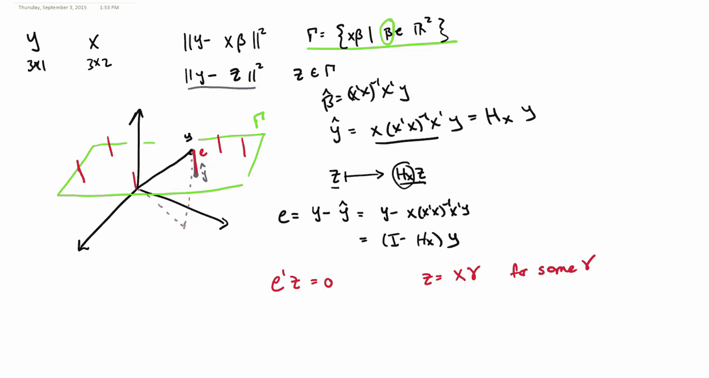
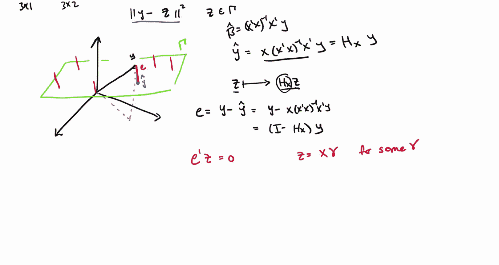
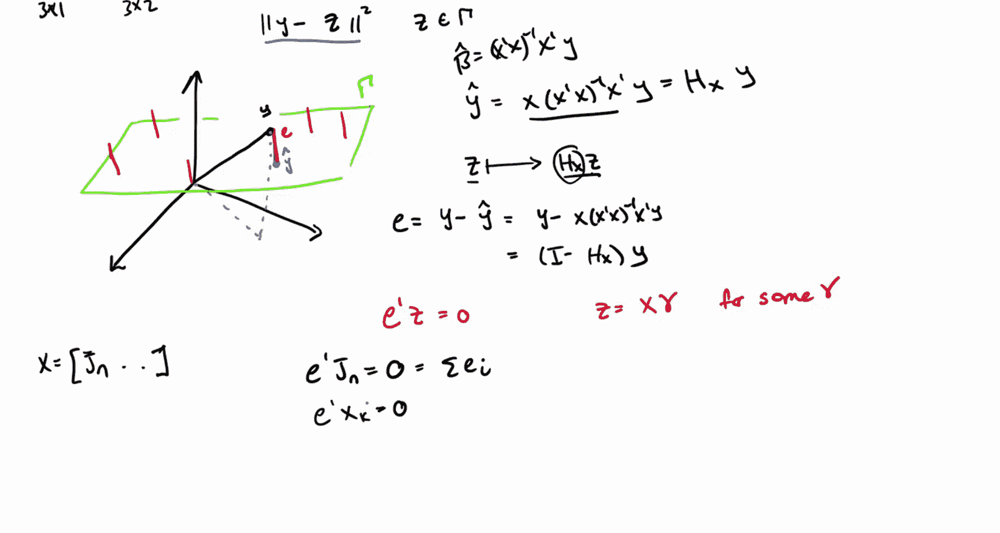

#  098：最小二乘的几何视角 🎯

在本节课中，我们将学习如何从几何角度理解最小二乘法。我们将看到，回归问题可以被视为在一个由预测变量张成的空间中寻找目标向量的正交投影。这种视角有助于我们直观地理解回归的许多性质。

## 几何视角的设定

上一节我们介绍了最小二乘的基本概念，本节中我们来看看它的几何解释。想象我们的响应变量 **y** 是一个 3x1 的向量，而我们的预测变量矩阵 **X** 是一个 3x2 的矩阵。我们只有三个数据点，并试图用两个预测变量来解释它们。虽然这个场景在实际中并不常用，但因为它可以在三维空间中绘制，所以非常适合用于几何理解。

我们的目标是最小化残差平方和：
`||y - Xβ||²`

让我们定义空间 **Γ** 为所有可能的拟合值 **ŷ** 的集合：
`Γ = {Xβ | β ∈ ℝ²}`

因此，我们的目标转化为在空间 **Γ** 中找到一个点 **ŷ**，使得它到 **y** 的距离最小。

## 投影与最小距离

现在，让我们在三维空间中绘制这个场景。点 **y** 是这个空间中的一个向量。空间 **Γ** 由二维参数 **β** 索引，并且是线性的，因此它是一个平面。

那么，**ŷ** 是什么？它是空间 **Γ** 中与 **y** 距离最近的点。从几何上看，**ŷ** 就是 **y** 在平面 **Γ** 上的**正交投影**。

以这种方式思考，能帮助我们理解多元回归应用的各个方面。

## 设计矩阵的列空间

首先，请注意，如果我们在 **X** 中包含一个冗余的列，例如 **x1**、**x2** 和一个完全冗余的列 **x1 + x2**，这个新矩阵 **X̃** 的秩仍然是 2。更重要的是，由 **X̃** 的列张成的空间 **Γ̃** 与原始的 **Γ** 完全相同。

以下是关键点：
*   进行回归并不需要设计矩阵 **X** 本身可逆。
*   我们只需要由 **X** 的列的一个线性无关子集所张成的空间。

例如，考虑以下三种设计矩阵，它们都包含截距项，但以不同方式编码分组变量。尽管矩阵不同，但它们拥有相同的列空间。因此，由这些设计矩阵计算出的拟合值 **ŷ** 将完全相同。

## 投影矩阵与帽子矩阵

我们知道最小二乘的解是：
`β̂ = (XᵀX)⁻¹Xᵀy`

那么，拟合值 **ŷ** 就是：
`ŷ = Xβ̂ = X(XᵀX)⁻¹Xᵀy`

我们通常用 **H** 来表示这个矩阵：
`H = X(XᵀX)⁻¹Xᵀ`

**H** 是一个线性算子，它将任意向量 **z** 映射为 **Hz**，这个操作正是将 **z** 投影到由 **X** 的列所张成的空间上。因此，**H** 被称为**投影矩阵**，也常被称为**帽子矩阵**，因为它给 **y** “戴上了帽子”，得到了 **ŷ**。

## 残差的正交性

最后，我们考虑残差 **e**：
`e = y - ŷ = (I - H)y`

从几何上看，残差向量 **e** 正是连接 **y** 与其投影 **ŷ** 的线段。一个关键的性质是，**e** 与空间 **Γ** 中的**任何**点都正交。

这意味着对于 **Γ** 中的任意点 **z**（即 **z = Xγ**），都有：
`eᵀz = 0`

特别地，残差与 **X** 的每一列都正交。我们可以用数学证明这一点：
`(I - H)X = X - X(XᵀX)⁻¹XᵀX = X - X = 0`
因此，`(I - H)Xγ = 0`，即 `eᵀ(Xγ) = 0`。

这个性质有重要的应用：
*   如果 **X** 包含一个全为1的截距列 **J**，那么 `eᵀJ = 0`，这意味着**残差之和必须为0**。
*   更一般地，残差与每个预测变量 **xₖ** 的协方差（或点积）也为0。

## 总结

本节课中我们一起学习了最小二乘法的几何视角。我们将回归问题理解为在由预测变量张成的列空间 **Γ** 上，寻找响应向量 **y** 的正交投影 **ŷ**。这种视角揭示了：
1.  拟合值 **ŷ** 是 **y** 在 **Γ** 上的投影。
2.  帽子矩阵 **H** 就是实现这个投影的线性算子。
3.  残差 **e** 垂直于整个列空间 **Γ**，这解释了残差和为0以及与预测变量不相关等重要性质。

掌握这种几何思维方式，能帮助你在处理实际统计问题时进行更直观的逻辑推理。