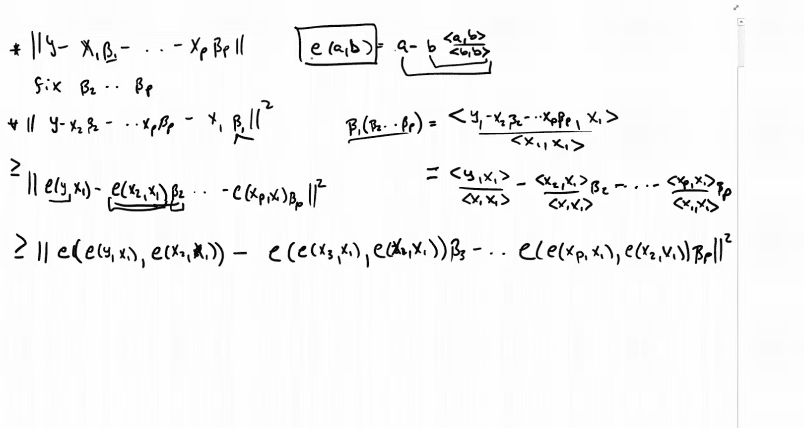
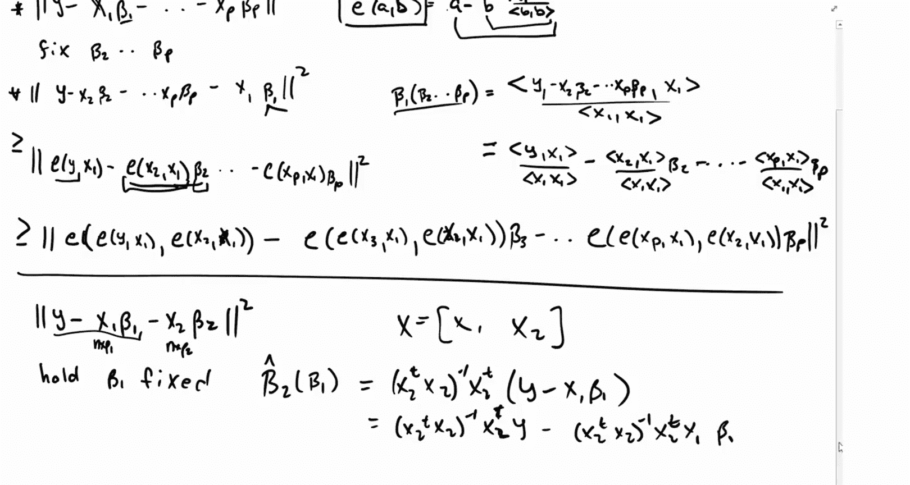
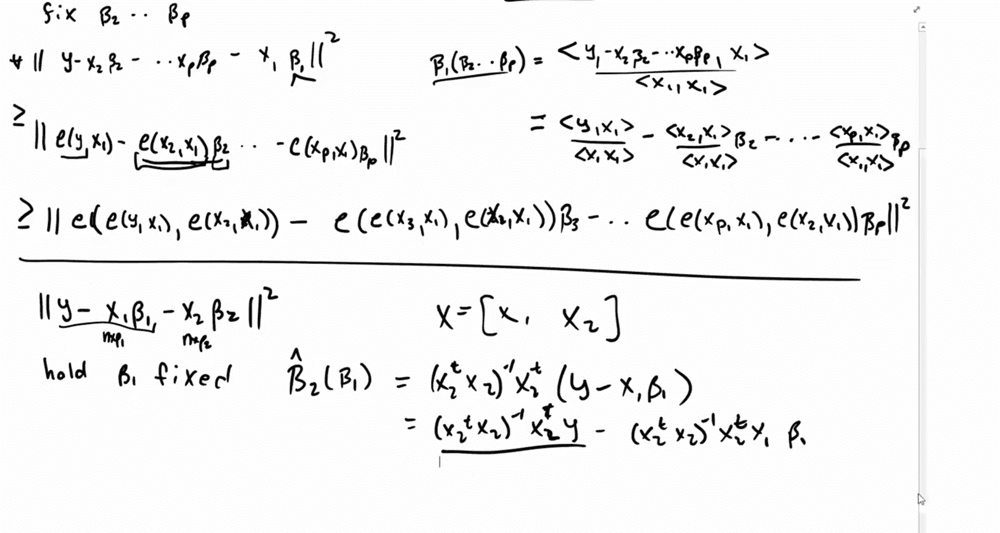
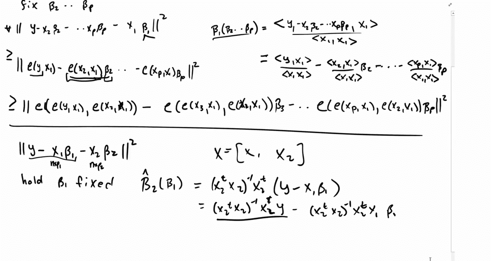
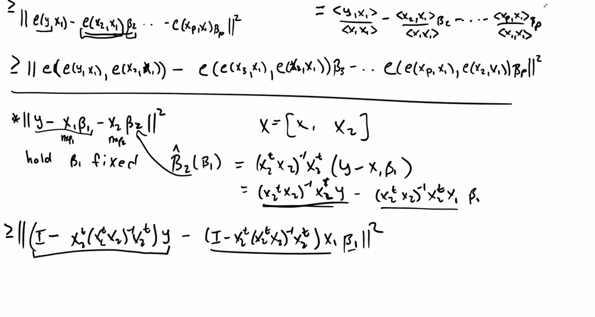

#  099：最小二乘法的第三种推导 🔄

在本节课中，我们将探讨最小二乘法的第三种推导方式。这种方式将帮助我们理解，为什么最小二乘法可以被看作一种“调整”机制。我们将通过不同的视角来书写和解析最小二乘问题，从而揭示每个系数估计值是如何在模型中“调整”了其他变量的影响。

## 概述 📋

我们将从一个包含多个预测变量的线性模型开始，逐步展示如何通过迭代地“剔除”其他变量的线性关联，来求解单个系数。这种方法不仅揭示了最小二乘法的内在调整逻辑，还提供了一种无需矩阵求逆的计算视角。

---

## 模型设定与目标 🎯

考虑一个标准的线性模型：

**公式：** `y = X1β1 + X2β2 + ... + Xpβp + ε`

我们的目标是最小化残差平方和：

**公式：** `RSS(β) = || y - X1β1 - X2β2 - ... - Xpβp ||²`

其中，`y` 和每个 `Xj` 都是 `n×1` 的向量。我们想要理解，在估计系数 `β1` 时，它如何“调整”了模型中所有其他变量 `X2, ..., Xp` 的存在。

---

## 核心工具：残差函数 🔧

在开始推导之前，我们先定义一个关键的残差函数。对于任意两个向量 `a` 和 `b`，我们定义函数 `e`：

**公式：** `e(a, b) = a - [ (aᵀb) / (bᵀb) ] * b`

这个函数 `e(a, b)` 表示什么呢？它计算的是向量 `a` 在仅使用 `b` 作为预测变量进行“过原点回归”后的残差。换句话说，它从 `a` 中剔除了与 `b` 的线性关联部分。

---

## 逐步推导：调整的思想 🔄

上一节我们定义了核心的残差函数，本节中我们来看看如何利用它来理解系数的调整过程。

### 第一步：固定其他系数

首先，我们暂时假设系数 `β2, β3, ..., βp` 是已知的、固定的值。那么，最小化问题可以重写为：

**公式：** `最小化 || (y - X2β2 - ... - Xpβp) - X1β1 ||²`

现在，我们把 `(y - X2β2 - ... - Xpβp)` 看作一个新的“结果”向量，把 `X1β1` 看作“预测”部分。这本质上变成了一个只关于 `β1` 的“过原点回归”问题。

根据过原点回归的解，我们知道最优的 `β1`（在给定其他β的情况下）是：

**公式：** `β1* = [ (y - Σ_{j=2}^p Xjβj)ᵀ X1 ] / (X1ᵀ X1)`

将这个最优的 `β1*` 代回原来的残差平方和公式中，经过一系列代数运算（主要是展开内积），我们可以得到一个新的、更小的表达式。

以下是关键的代数变换步骤：

1.  将 `β1*` 代入原式。
2.  展开内积 `(y - ΣXjβj)ᵀ X1`。
3.  利用残差函数 `e` 的定义进行重写。

最终，我们得到：

**公式：** `RSS ≥ || e(y, X1) - e(X2, X1)β2 - ... - e(Xp, X1)βp ||²`

这个结果非常有趣。它意味着，在优化掉 `β1` 之后，我们得到了一个形式完全相同但维度更低的新问题：
*   **新的结果变量** 是 `e(y, X1)`，即从 `y` 中剔除了 `X1` 的线性影响后的残差。
*   **新的预测变量** 是 `e(X2, X1), ..., e(Xp, X1)`，即每个原始预测变量 `Xj` 都剔除了与 `X1` 的线性关联。

### 第二步：迭代过程

现在，我们回到了一个与起点结构相同的问题，只是预测变量少了一个（`X1` 被消除了），并且所有变量都变成了相对于 `X1` 的残差。

我们可以对这个新问题重复完全相同的步骤。例如，接下来固定 `β3, ..., βp`，对 `β2` 进行优化。我们会发现，最优解要求我们从当前的所有变量（包括新的结果变量和剩余的预测变量）中，进一步剔除与 `e(X2, X1)` 的线性关联。

这个过程可以一直迭代下去，直到最后一个系数 `βp`。对于 `βp`，其估计值将简化为一个简单的过原点回归：

**公式：** `βp_hat` 正比于 `[e(...e(y, X1)..., X{p-1})]ᵀ * [e(...e(Xp, X1)..., X{p-1})]`

### 关键洞见

通过这个推导，我们获得了几个重要认识：

1.  **调整的本质**：估计系数 `βj` 时，最小二乘法所做的，就是先将所有其他预测变量的线性影响从结果 `y` **和** 预测变量 `Xj` 本身中“剔除”或“调整”掉，然后再对这两组残差进行简单的回归。
2.  **顺序无关性**：我们是从 `β1` 开始，然后 `β2`，直到 `βp`。但我们可以选择任意顺序。最终结果证明，无论按什么顺序进行这种迭代的残差化过程，得到的系数估计值都是相同的。这印证了最小二乘解的唯一性。
3.  **计算视角**：理论上，我们只需要反复应用简单的残差函数 `e(a, b)`，而不需要进行复杂的矩阵求逆 `(XᵀX)⁻¹`，就能得到最小二乘解。这虽然通常不是最高效的计算方法，但提供了一个清晰的概念性理解框架。

---

## 推广到矩阵形式 📈

上一节我们使用向量展示了核心思想，本节中我们来看看如何将其推广到更一般的、包含多列变量的矩阵情形，这将使“调整”的观点更加普适。

假设我们将设计矩阵 `X` 分成两块：`X = [X1, X2]`，其中 `X1` 是 `n × p1` 矩阵，`X2` 是 `n × p2` 矩阵。对应的系数向量为 `β = (β1ᵀ, β2ᵀ)ᵀ`。

我们的模型是：`y = X1β1 + X2β2`。

现在，考虑固定 `β1`，来求解 `β2`。这等价于最小化 `|| y - X1β1 - X2β2 ||²`，其中 `y - X1β1` 被视为已知结果。

`β2` 的最小二乘解（在 `β1` 固定的条件下）为：

**公式：** `β2_hat(β1) = (X2ᵀX2)⁻¹X2ᵀ (y - X1β1)`

将其拆开：
**公式：** `β2_hat(β1) = (X2ᵀX2)⁻¹X2ᵀy - (X2ᵀX2)⁻¹X2ᵀX1 β1`

这里：
*   第一项 `(X2ᵀX2)⁻¹X2ᵀy` 是 **仅用 `X2` 回归 `y` 得到的系数**。
*   第二项 `(X2ᵀX2)⁻¹X2ᵀX1` 是 **用 `X2` 分别回归 `X1` 的每一列所得到的一组系数矩阵**。

现在，将这个 `β2_hat(β1)` 代回原始残差平方和公式。经过代数整理（利用投影矩阵 `H2 = X2(X2ᵀX2)⁻¹X2ᵀ` 和残差投影矩阵 `M2 = I - H2`），我们可以得到：

**公式：** `RSS ≥ || M2 y - M2 X1 β1 ||²`

这个结果具有完美的对称性：
*   `M2 y` 是 **将 `y` 对 `X2` 回归后得到的残差**，即从 `y` 中剔除了 `X2` 的影响。
*   `M2 X1` 是 **将 `X1` 的每一列分别对 `X2` 回归后得到的残差矩阵**，即从 `X1` 中剔除了 `X2` 的影响。

因此，求解 `β1` 的问题，转化为了 **用“调整后”的预测变量 `M2 X1` 去回归“调整后”的结果 `M2 y`**。

### 最终解释

以下是这一过程的总结性描述：

1.  为了得到 `β1` 的最小二乘估计，我们首先将 **所有其他变量**（这里是 `X2`）从结果 `y` 和我们关心的预测变量组 `X1` 中都“投影出去”（即计算残差）。
2.  然后，对这两组残差进行回归。
3.  对于 `β2` 的估计，过程完全对称：先将 `X1` 从 `y` 和 `X2` 中投影出去，再对残差进行回归。

**公式（概念性总结）：**
`β1_hat` 来源于 `(M2 y) ~ (M2 X1)`
`β2_hat` 来源于 `(M1 y) ~ (M1 X2)`
其中 `Mj` 是剔除变量组 `j` 的投影矩阵。

---

## 总结 📝

本节课中我们一起学习了最小二乘法的第三种推导方式，其核心是理解回归中的“调整”概念。

*   **核心思想**：最小二乘估计每个系数时，都相当于在“调整”或“控制”了模型中所有其他变量之后，再评估该变量与结果的关系。具体操作是从结果变量和我们关心的预测变量中，同时剔除掉其他所有变量的线性影响。
*   **方法论**：我们通过定义残差函数 `e(a, b)`，展示了如何通过迭代的残差化过程来求解系数，这从概念上绕开了矩阵求逆。
*   **推广形式**：我们将此思想推广到矩阵形式，用投影矩阵 `M` 清晰地表达了“调整”的操作：`βj` 的估计基于 `M_{-j}y` 对 `M_{-j}Xj` 的回归，其中 `M_{-j}` 表示剔除第 `j` 组变量影响的投影矩阵。
*   **重要意义**：这种推导方式虽然不一定用于实际计算，但它极大地深化了我们对多元线性回归解释性的理解。它直观地展示了为什么在多元回归中，一个变量的系数可以与其在简单线性回归中的系数截然不同——因为它代表的是该变量独有的、排除了其他变量混杂后的贡献。

因此，最小二乘法不仅仅是一个数学优化过程，更是一个系统的“调整”机制，用于剥离出每个预测变量独立的线性效应。