#  100：多元回归的调整过程编程示例 🧮

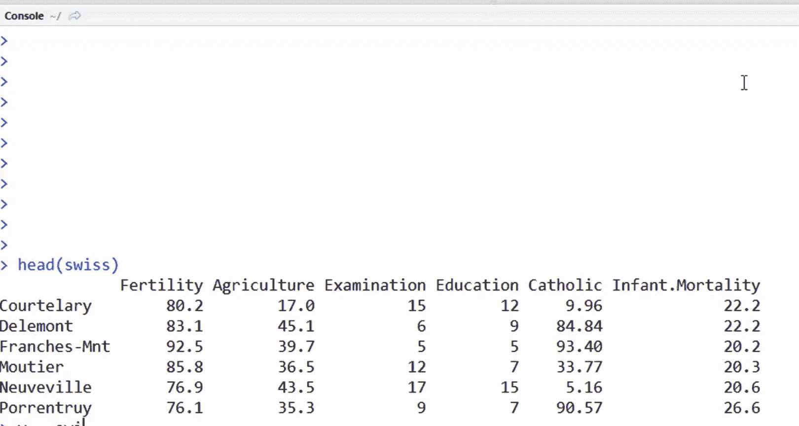

在本节课中，我们将通过一个具体的编程示例，深入理解多元线性回归中“调整”的核心概念。我们将使用R语言和经典的瑞士数据集，演示如何通过分步回归来获得与全模型回归完全相同的系数估计，从而直观地展示回归系数是如何被“调整”的。

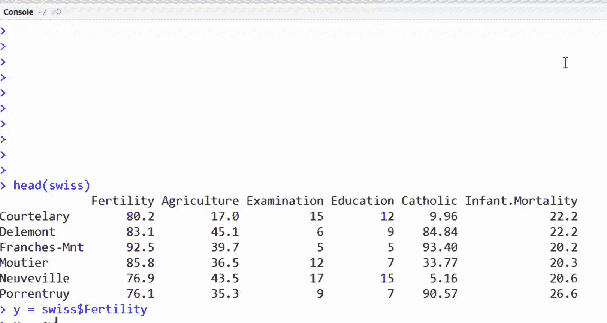

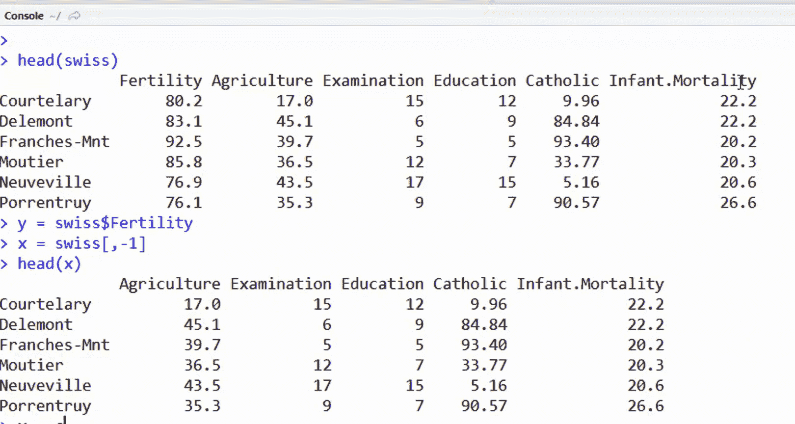

## 数据准备与变量定义

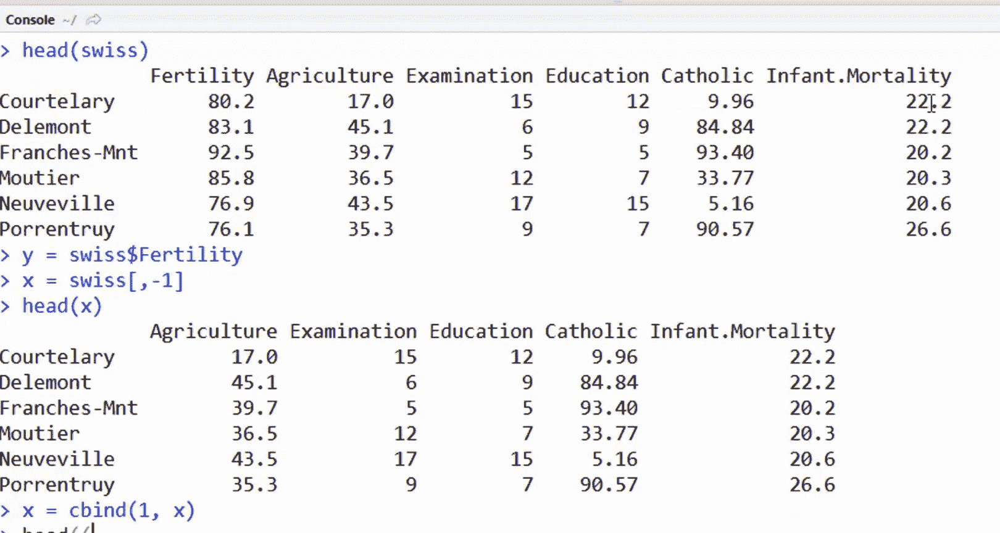

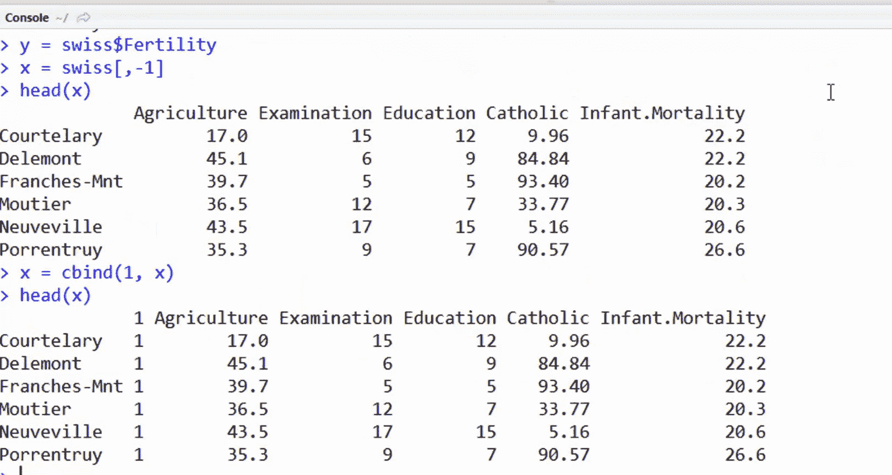

首先，我们加载并查看瑞士数据集。我们的目标是研究生育率与其他社会经济指标的关系。

以下是数据准备步骤：
*   **定义因变量Y**： 我们将生育率（`Fertility`）作为研究的因变量 `y`。
*   **定义全预测变量矩阵X**： 我们将数据集中除生育率外的所有其他变量作为预测变量，并为其添加截距项，构成矩阵 `X`。
*   **拆分预测变量**： 为了演示调整过程，我们将预测变量矩阵 `X` 拆分为两部分：`x1`（前3列，包含截距）和 `x2`（后4列）。

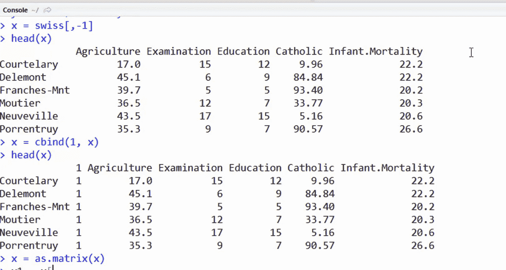

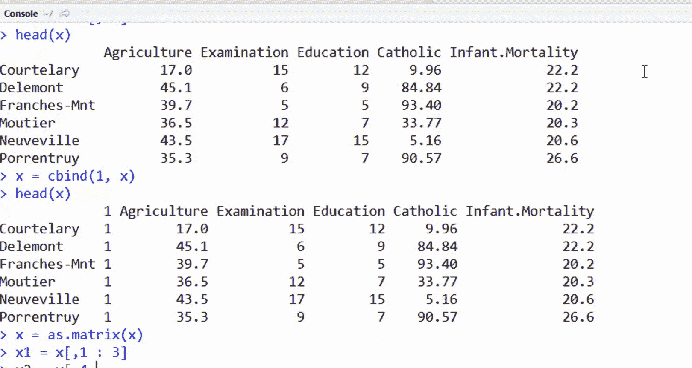

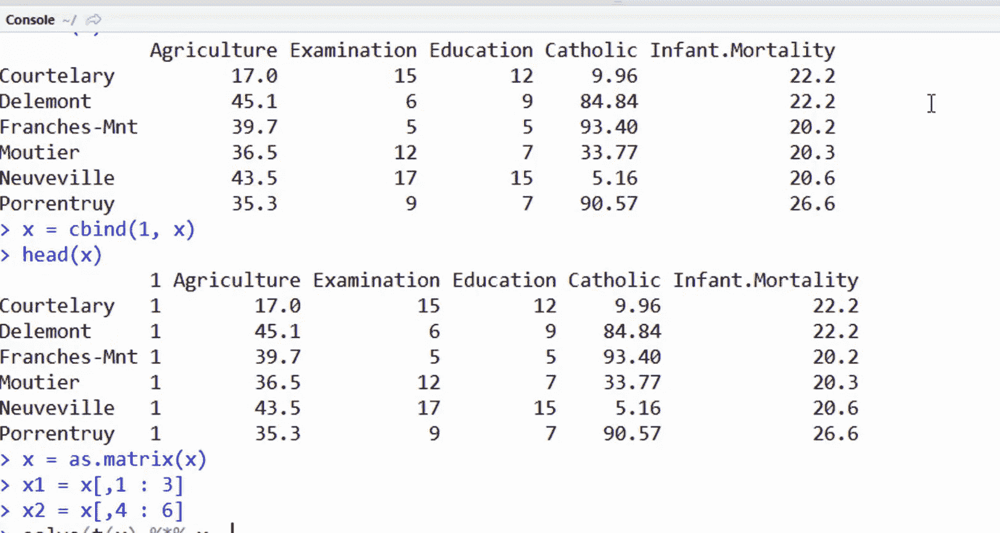

对应的R代码如下：
```r
# 加载数据
data(swiss)

# 定义因变量 y 为生育率
y <- swiss$Fertility

# 定义预测变量矩阵 X，包含除生育率外的所有变量，并添加截距列
X <- as.matrix(cbind(1, swiss[, -1]))
colnames(X)[1] <- "Intercept"

# 将 X 拆分为 x1 (前3列) 和 x2 (后4列)
x1 <- X[, 1:3]
x2 <- X[, 4:7]
```

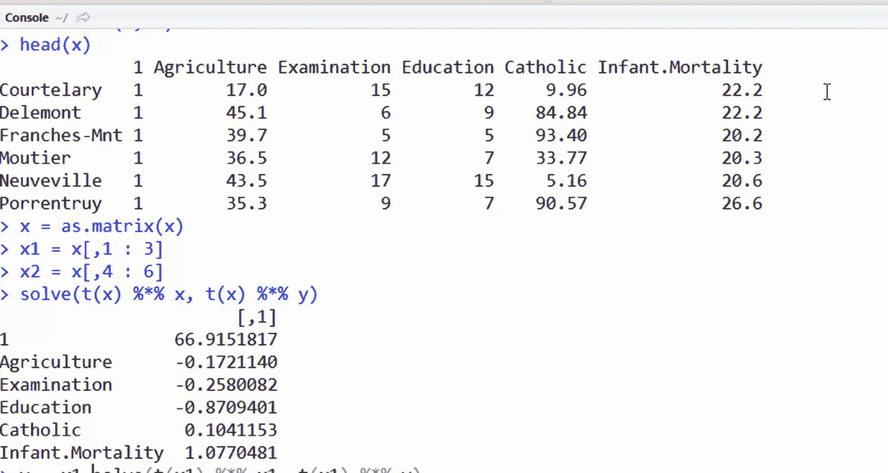

## 全模型回归估计

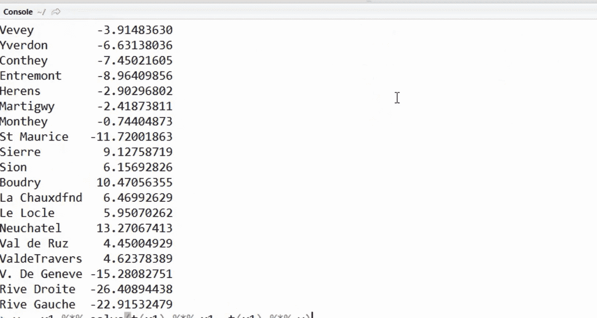

在拆分变量之前，我们先使用标准方法拟合包含所有预测变量（`x1` 和 `x2`）的完整多元回归模型。这通过求解正规方程 `(X^T X)^{-1} X^T y` 来实现。

以下是求解全模型系数的代码：
```r
# 方法1：直接求解正规方程，得到全模型回归系数 beta_full
beta_full <- solve(t(X) %*% X) %*% t(X) %*% y
print(beta_full)
```
运行这段代码，我们将得到一组回归系数估计值 `beta_full`。这代表了每个预测变量（已包含在模型中其他变量的情况下）对生育率的净效应。

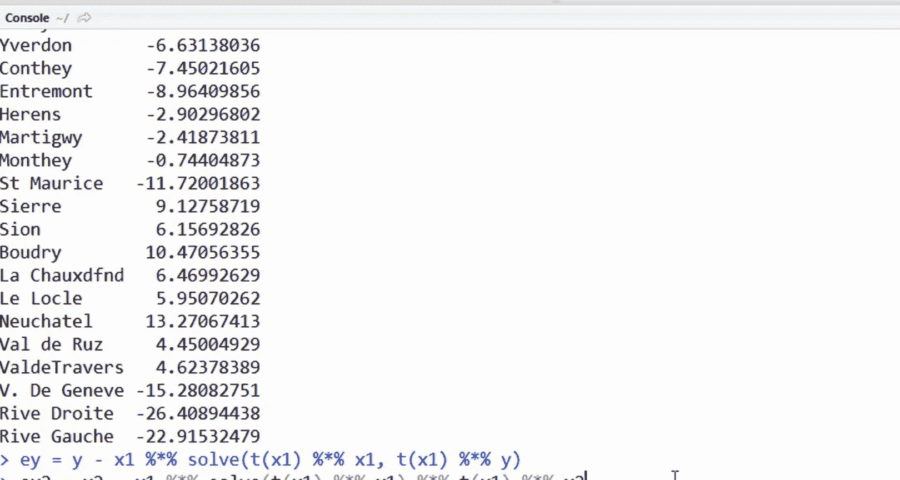

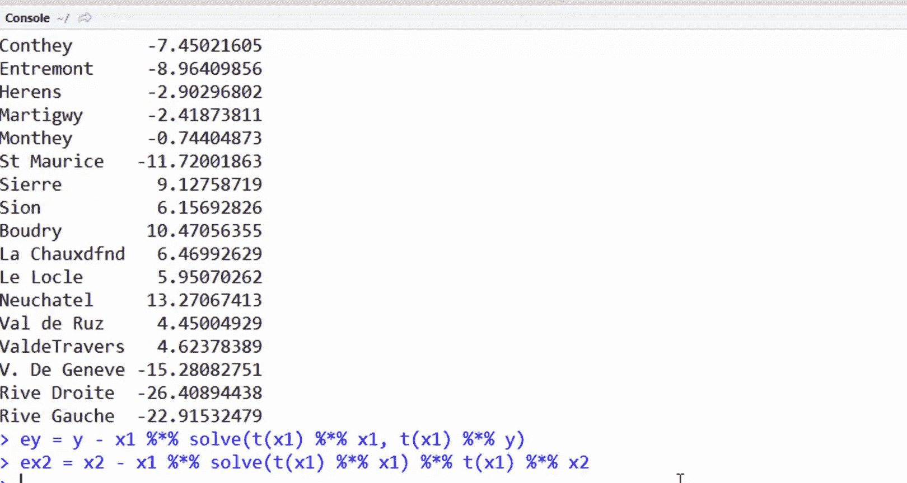

## 分步回归与调整过程

上一节我们直接计算了全模型的系数。本节中，我们来看看如何通过“调整”或“净化”变量的分步回归过程，得到与全模型完全一致的 `x2` 的系数。

核心思想是：**在考虑 `x2` 对 `y` 的影响之前，先剔除 `x1` 对 `y` 和 `x2` 的线性影响**。

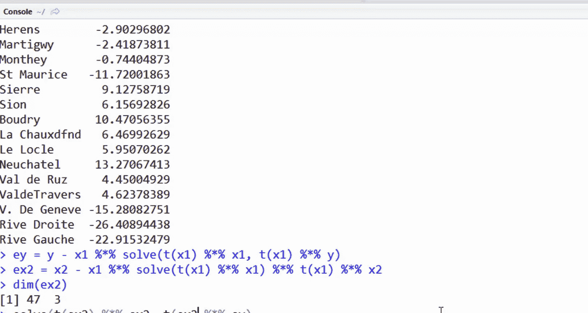

以下是实现这一过程的具体步骤：
1.  **调整因变量 y**： 将 `y` 对 `x1` 进行回归，得到残差 `e_y`。`e_y` 代表了 `y` 中无法被 `x1` 解释的部分。
    ```r
    # 计算 y 对 x1 回归的残差 e_y
    beta_x1 <- solve(t(x1) %*% x1) %*% t(x1) %*% y
    e_y <- y - x1 %*% beta_x1
    ```
2.  **调整预测变量 x2**： 将 `x2` 的每一列分别对 `x1` 进行回归，得到残差矩阵 `e_x2`。`e_x2` 代表了 `x2` 中与 `x1` 线性无关的部分。
    ```r
    # 计算 x2 对 x1 回归的残差矩阵 e_x2
    # 对 x2 的每一列进行循环回归
    e_x2 <- matrix(0, nrow = nrow(x2), ncol = ncol(x2))
    for (j in 1:ncol(x2)) {
        beta_temp <- solve(t(x1) %*% x1) %*% t(x1) %*% x2[, j]
        e_x2[, j] <- x2[, j] - x1 %*% beta_temp
    }
    ```
3.  **回归调整后的变量**： 将调整后的因变量 `e_y` 对调整后的预测变量 `e_x2` 进行回归。
    ```r
    # 将 e_y 对 e_x2 进行回归
    beta_x2_adjusted <- solve(t(e_x2) %*% e_x2) %*% t(e_x2) %*% e_y
    print(beta_x2_adjusted)
    ```

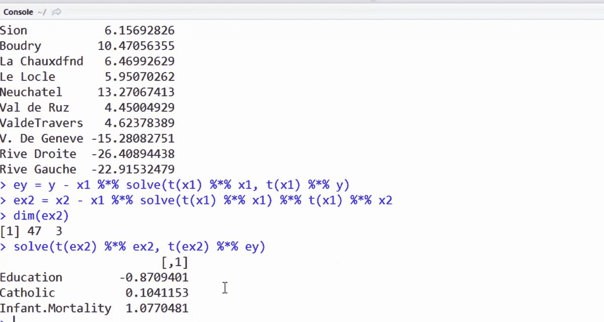

## 结果对比与核心解读

现在，让我们对比两种方法得到的结果。

运行分步回归的代码后，你会发现 `beta_x2_adjusted` 的值与全模型回归系数 `beta_full` 中对应 `x2` 部分（即第4到第7个系数）**完全一致**。例如，两者都会显示相同的数值（如-0.87, -0.87, 11.07等）。

这个结果深刻地揭示了多元回归中“调整”的含义：
*   **`x2` 的系数是调整后的**： 它们表示在移除了 `x1` 对 `y` 和 `x2` 本身的线性影响后，`x2` 与 `y` 的剩余关联。这正是在多元回归模型中，`x2` 的系数所代表的“在控制 `x1` 不变的情况下”的效应。
*   **对称性**： 同理，全模型中 `x1` 的系数也是调整了 `x2` 影响后的结果。你可以通过交换 `x1` 和 `x2` 的角色，重复上述过程来验证这一点。

因此，这个编程示例直观地证明了，多元回归本质上是一个连续的调整过程。每个变量的系数，都是在剥离了模型中其他变量的线性影响之后，该变量与结果之间纯净关系的度量。

---

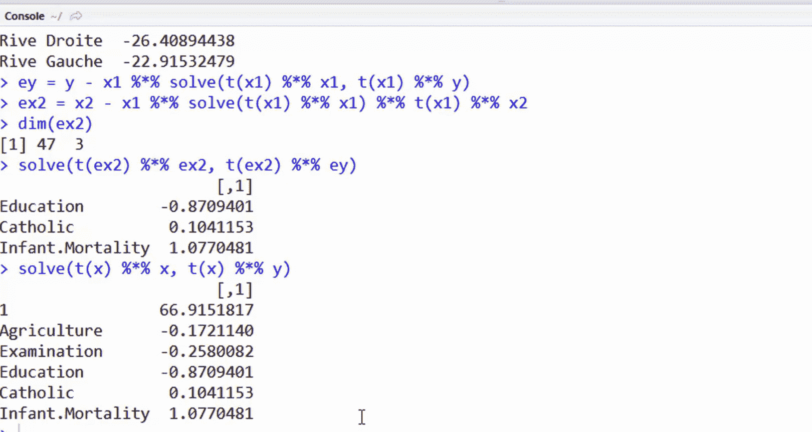

本节课中我们一起学习了如何通过编程演示多元线性回归的调整过程。我们使用瑞士数据集，首先拟合了包含所有变量的全模型，然后通过分步回归——即先分别从因变量 `y` 和部分预测变量 `x2` 中剔除另一部分变量 `x1` 的影响，再对残差进行回归——得到了与全模型完全一致的系数估计。这个过程清晰地表明，多元回归中每个变量的系数，都是在“调整”或“控制”了模型中其他变量后所得的净效应。理解这一过程对于正确解读回归分析结果至关重要。