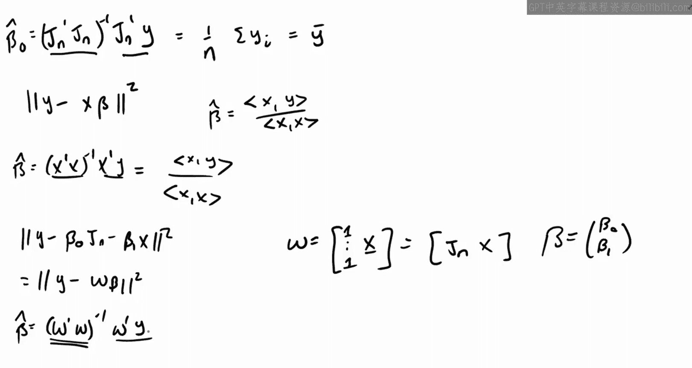
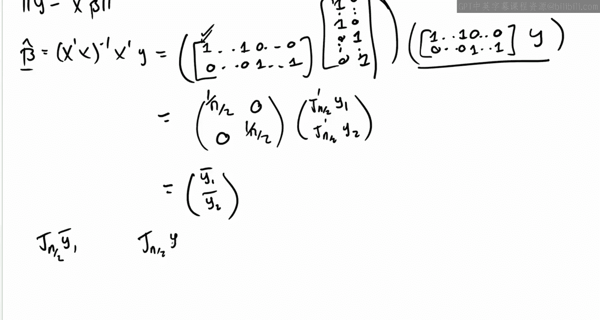
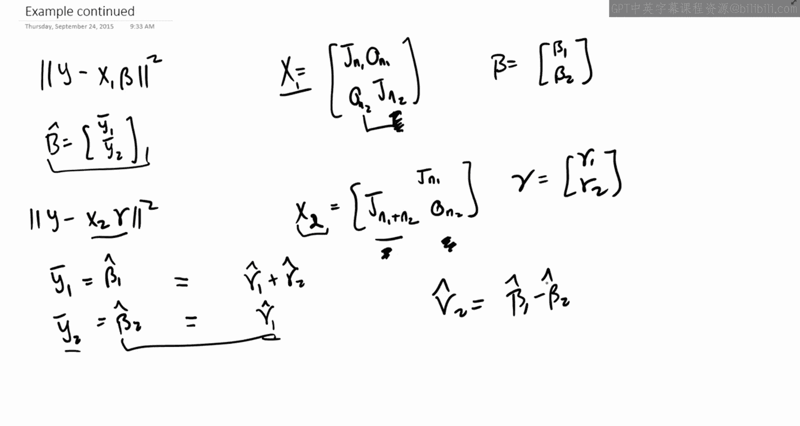
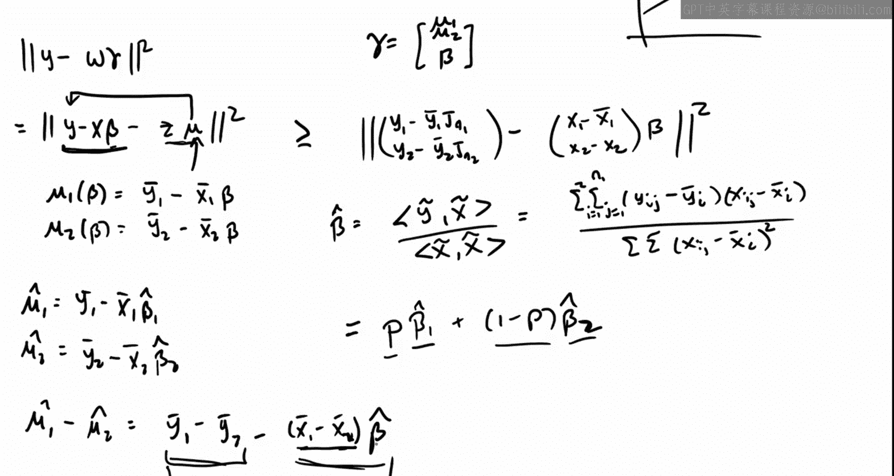

#  101：设计矩阵与拟合基础案例 📊

在本节课中，我们将学习多元线性回归模型的一些基础案例。我们将从最简单的模型开始，逐步探讨更复杂的模型，包括分组数据和协方差分析（ANCOVA）。通过理解这些基础案例，我们可以更好地掌握线性回归的核心概念和应用。

---

## 多元线性回归的基本案例

上一节我们介绍了多元线性回归的一般形式。本节中，我们来看看几个具体的、重要的特例。

### 案例一：仅含截距项的模型

最简单的模型是仅包含一个常数截距项的模型。我们的目标是最小化以下残差平方和：
\[
\min_{\beta_0} \| \mathbf{y} - \beta_0 \mathbf{J}_n \|^2
\]
其中，\(\mathbf{J}_n\) 是一个所有元素都为1的 \(n\) 维向量。

使用多元线性回归的通用公式求解：
\[
\hat{\beta}_0 = (\mathbf{J}_n^\top \mathbf{J}_n)^{-1} \mathbf{J}_n^\top \mathbf{y}
\]
计算过程如下：
*   \(\mathbf{J}_n^\top \mathbf{J}_n\) 是向量 \(\mathbf{J}_n\) 与自身的内积，结果为 \(n\)。
*   \(\mathbf{J}_n^\top \mathbf{y}\) 是向量 \(\mathbf{J}_n\) 与 \(\mathbf{y}\) 的内积，结果为 \(\sum_{i=1}^n y_i\)。

因此，最优解为：
\[
\hat{\beta}_0 = \frac{1}{n} \sum_{i=1}^n y_i = \bar{y}
\]
这个结果符合直觉：当模型只有一个常数项时，对 \(\mathbf{y}\) 的最佳拟合就是其均值。

---

### 案例二：过原点的简单线性回归

第二个案例是过原点的简单线性回归，也称为“回归到原点”。模型为：
\[
\min_{\beta_1} \| \mathbf{y} - \beta_1 \mathbf{x} \|^2
\]
其中，\(\mathbf{x}\) 是一个预测变量向量。

同样使用通用公式：
\[
\hat{\beta}_1 = (\mathbf{x}^\top \mathbf{x})^{-1} \mathbf{x}^\top \mathbf{y}
\]
当 \(\mathbf{x}\) 是向量时：
*   \(\mathbf{x}^\top \mathbf{x}\) 是 \(\mathbf{x}\) 与自身的内积 \(\langle \mathbf{x}, \mathbf{x} \rangle\)。
*   \(\mathbf{x}^\top \mathbf{y}\) 是 \(\mathbf{x}\) 与 \(\mathbf{y}\) 的内积 \(\langle \mathbf{x}, \mathbf{y} \rangle\)。

因此，解为：
\[
\hat{\beta}_1 = \frac{\langle \mathbf{x}, \mathbf{y} \rangle}{\langle \mathbf{x}, \mathbf{x} \rangle}
\]
这与我们熟知的过原点回归公式一致。

---

### 案例三：包含截距和斜率的简单线性回归

第三个案例是标准的简单线性回归模型：
\[
\min_{\beta_0, \beta_1} \| \mathbf{y} - (\beta_0 \mathbf{J}_n + \beta_1 \mathbf{x}) \|^2
\]
其设计矩阵 \(\mathbf{W} = [\mathbf{J}_n, \mathbf{x}]\)。

参数估计为：
\[
\hat{\boldsymbol{\beta}} = (\mathbf{W}^\top \mathbf{W})^{-1} \mathbf{W}^\top \mathbf{y}
\]
其中 \(\boldsymbol{\beta} = [\beta_0, \beta_1]^\top\)。通过计算这个2x2矩阵的逆，可以得到我们熟悉的截距 \(\hat{\beta}_0\) 和斜率 \(\hat{\beta}_1\) 的公式。这验证了多元回归公式在标准线性回归场景下的正确性。

---

## 分组数据的模型：方差分析（ANOVA）案例

现在，让我们考虑一个重要的特例：将线性模型应用于分组数据。

假设我们的观测值 \(\mathbf{y}\) 来自两个不同的组：
\[
\mathbf{y} = \begin{bmatrix} \mathbf{y}_1 \\ \mathbf{y}_2 \end{bmatrix}
\]
其中 \(\mathbf{y}_1\) 有 \(n_1\) 个观测，\(\mathbf{y}_2\) 有 \(n_2\) 个观测。我们想用一个模型来刻画组间差异。

我们可以构建如下设计矩阵 \(\mathbf{X}\)：
\[
\mathbf{X} = \begin{bmatrix}
\mathbf{1}_{n_1} & \mathbf{0}_{n_1} \\
\mathbf{0}_{n_2} & \mathbf{1}_{n_2}
\end{bmatrix}
\]
这里，\(\mathbf{1}_{n}\) 表示长度为 \(n\) 的全1向量，\(\mathbf{0}_{n}\) 表示长度为 \(n\) 的全0向量。模型为 \(\mathbf{y} = \mathbf{X} \boldsymbol{\beta} + \boldsymbol{\epsilon}\)，其中 \(\boldsymbol{\beta} = [\beta_1, \beta_2]^\top\)。

让我们求解参数估计 \(\hat{\boldsymbol{\beta}}\)：
\[
\hat{\boldsymbol{\beta}} = (\mathbf{X}^\top \mathbf{X})^{-1} \mathbf{X}^\top \mathbf{y}
\]

计算过程如下：
1.  \(\mathbf{X}^\top \mathbf{X}\) 是一个对角矩阵，其对角线元素分别为 \(n_1\) 和 \(n_2\)。
2.  \(\mathbf{X}^\top \mathbf{y}\) 是一个向量，其第一个元素是 \(\mathbf{y}_1\) 中所有元素的和，第二个元素是 \(\mathbf{y}_2\) 中所有元素的和。

因此，逆矩阵很简单，解为：
\[
\hat{\beta}_1 = \bar{y}_1, \quad \hat{\beta}_2 = \bar{y}_2
\]
其中 \(\bar{y}_1\) 和 \(\bar{y}_2\) 分别是两组的样本均值。拟合值对于第一组的观测是 \(\bar{y}_1\)，对于第二组的观测是 \(\bar{y}_2\)。这个结果非常直观：对每组数据最好的常数拟合就是该组的均值。

---

### 模型重参数化技巧

线性模型可以通过不同的设计矩阵来表示相同的模型结构（即相同的列空间），这称为重参数化。理解这一点非常有用。

考虑另一个设计矩阵 \(\mathbf{X}_2\)：
\[
\mathbf{X}_2 = \begin{bmatrix}
\mathbf{1}_{n_1+n_2} & \begin{bmatrix} \mathbf{1}_{n_1} \\ \mathbf{0}_{n_2} \end{bmatrix}
\end{bmatrix}
\]
对应的参数是 \(\boldsymbol{\gamma} = [\gamma_1, \gamma_2]^\top\)。模型为 \(\mathbf{y} = \mathbf{X}_2 \boldsymbol{\gamma} + \boldsymbol{\epsilon}\)。

可以验证，\(\mathbf{X}\) 和 \(\mathbf{X}_2\) 的列空间是相同的。这意味着两个模型会产生完全相同的拟合值。因此，我们可以利用从第一个简单模型（\(\mathbf{X}\)）中得到的已知解，来推导第二个模型（\(\mathbf{X}_2\)）的参数，而无需直接求逆 \(\mathbf{X}_2^\top \mathbf{X}_2\)。

已知：
*   对于模型1（使用 \(\mathbf{X}\)），拟合值：组1为 \(\hat{\beta}_1 = \bar{y}_1\)，组2为 \(\hat{\beta}_2 = \bar{y}_2\)。
*   对于模型2（使用 \(\mathbf{X}_2\)），拟合值：组1为 \(\hat{\gamma}_1 + \hat{\gamma}_2\)，组2为 \(\hat{\gamma}_1\)。

因为拟合值必须相同，所以我们有方程组：
\[
\begin{cases}
\hat{\gamma}_1 + \hat{\gamma}_2 = \bar{y}_1 \\
\hat{\gamma}_1 = \bar{y}_2
\end{cases}
\]
解得：
\[
\hat{\gamma}_1 = \bar{y}_2, \quad \hat{\gamma}_2 = \bar{y}_1 - \bar{y}_2
\]
这个技巧在方差分析类模型中非常实用，它允许我们在容易求解的参数化和具有特定解释意义的参数化之间灵活转换。

---

## 协方差分析（ANCOVA）案例

最后，我们讨论回归分析中一个极其重要的例子：协方差分析（ANCOVA）。它用于在比较组间差异时，调整一个连续型协变量的影响。

假设数据仍来自两组，但我们还有一个连续的预测变量 \(\mathbf{x}\)。我们想拟合一个模型，它允许两组有不同的截距，但共享同一个斜率（即回归线平行）。设计矩阵 \(\mathbf{W}\) 为：
\[
\mathbf{W} = [\mathbf{Z}, \mathbf{x}]
\]
其中 \(\mathbf{Z}\) 是之前的分组指示矩阵，\(\mathbf{x}\) 是协变量向量。模型参数为 \(\boldsymbol{\gamma} = [\mu_1, \mu_2, \beta]^\top\)，模型可写为：
\[
\mathbf{y} = \mathbf{x}\beta + \mathbf{Z}\boldsymbol{\mu} + \boldsymbol{\epsilon}
\]
目标是最小化 \(\|\mathbf{y} - \mathbf{W}\boldsymbol{\gamma}\|^2\)。

求解时，一个有效的方法是先固定斜率 \(\beta\)，求解最优的截距 \(\boldsymbol{\mu}\)。根据之前分组案例的结论，对于固定的 \(\beta\)，最优的组截距是组内 \(y - x\beta\) 的均值：
\[
\hat{\mu}_1(\beta) = \bar{y}_1 - \bar{x}_1 \beta, \quad \hat{\mu}_2(\beta) = \bar{y}_2 - \bar{x}_2 \beta
\]
将这两个估计代回原模型，我们得到关于中心化数据的回归问题：
\[
\min_{\beta} \| \tilde{\mathbf{y}} - \tilde{\mathbf{x}} \beta \|^2
\]
其中 \(\tilde{\mathbf{y}}\) 和 \(\tilde{\mathbf{x}}\) 分别是 \(\mathbf{y}\) 和 \(\mathbf{x}\) 按组中心化后的向量（即每个观测值减去其所在组的均值）。

这是一个过原点的回归问题，其解为：
\[
\hat{\beta} = \frac{\langle \tilde{\mathbf{x}}, \tilde{\mathbf{y}} \rangle}{\langle \tilde{\mathbf{x}}, \tilde{\mathbf{x}} \rangle} = \frac{\sum_{i=1}^2 \sum_{j=1}^{n_i} (x_{ij} - \bar{x}_i)(y_{ij} - \bar{y}_i)}{\sum_{i=1}^2 \sum_{j=1}^{n_i} (x_{ij} - \bar{x}_i)^2}
\]
一个有趣的发现是，这个共同的斜率估计 \(\hat{\beta}\)，实际上是两组各自单独回归斜率 \(\hat{\beta}_1\) 和 \(\hat{\beta}_2\) 的加权平均：
\[
\hat{\beta} = p \hat{\beta}_1 + (1-p) \hat{\beta}_2
\]
权重 \(p\) 是第一组 \(x\) 的变异（方差）占总变异的比例。这意味着，哪个组的协变量 \(x\) 变异更大，该组的斜率对总体斜率的贡献就更大。

得到 \(\hat{\beta}\) 后，我们可以回代得到截距估计：
\[
\hat{\mu}_1 = \bar{y}_1 - \bar{x}_1 \hat{\beta}, \quad \hat{\mu}_2 = \bar{y}_2 - \bar{x}_2 \hat{\beta}
\]
**调整后的组间均值差**为：
\[
\hat{\mu}_1 - \hat{\mu}_2 = (\bar{y}_1 - \bar{y}_2) - (\bar{x}_1 - \bar{x}_2)\hat{\beta}
\]
这个公式揭示了ANCOVA的核心思想：在比较组间差异（\(\bar{y}_1 - \bar{y}_2\)）时，需要减去由于协变量 \(x\) 的组间差异（\(\bar{x}_1 - \bar{x}_2\)）所造成的那部分影响，调整的幅度由共同斜率 \(\hat{\beta}\) 决定。

**实际意义**：在随机化实验中，理想情况下协变量在组间是平衡的（\(\bar{x}_1 \approx \bar{x}_2\)），那么调整与否的结果差异不大。但在观察性研究或随机化不充分时，如果协变量在组间存在差异，那么调整后的估计与未调整的估计（即直接比较 \(\bar{y}_1\) 和 \(\bar{y}_2\)）可能会非常不同。这使得ANCOVA成为控制混杂因素、进行更公平比较的强大工具。

---

## 总结

本节课中，我们一起学习了多元线性回归的多个基础案例：
1.  我们回顾了仅含截距、过原点回归等简单模型，验证了它们都是多元回归的特例。
2.  我们深入探讨了用于分组比较的方差分析（ANOVA）模型，并学习了通过模型重参数化在不同参数表示间转换的技巧。
3.  我们重点分析了协方差分析（ANCOVA）模型，理解了如何通过引入一个共同的协变量斜率，在比较组间差异时调整基线不平衡。我们推导了其参数估计公式，并解释了调整后差异的意义。

这些案例构成了理解更复杂线性模型的基础，并展示了线性模型框架的灵活性与强大之处。