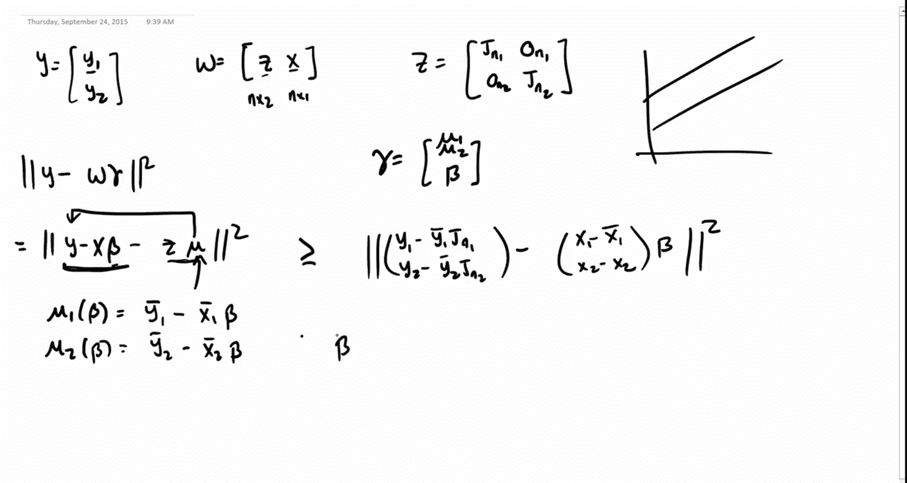
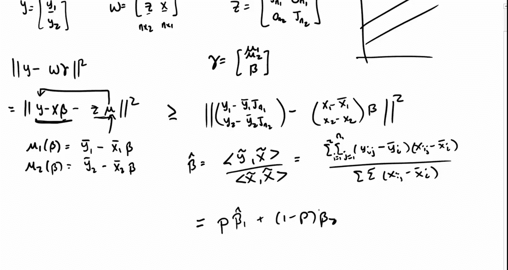
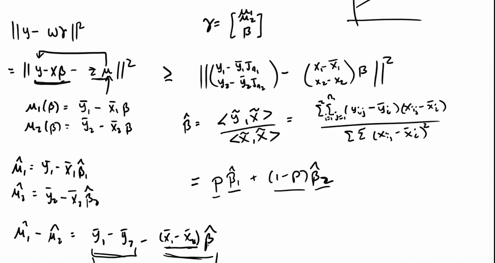

#  104：协方差分析

在本节课中，我们将要学习回归分析中一个极为重要的例子——协方差分析。我们将探讨如何通过引入一个协变量来调整两组数据的比较，并推导出相关的估计公式。

## 模型设定

想象一下，我们的响应变量 **y** 可以分解为两个向量，分别对应组一和组二。我们的设计矩阵 **W**（为了后续表述清晰而命名）由两部分组成：一个矩阵 **Z** 和一个向量 **x**。其中 **x** 是一个 n×1 的向量，而 **Z** 是一个 n×2 的矩阵。

**Z** 矩阵的形式如下：它看起来像是之前讨论过的双向方差分析矩阵，但我们在其右侧附加了向量 **x**。具体来说，**Z** 的第一列是组一的指示向量（前 n₁ 个元素为1，后 n₂ 个元素为0），第二列是组二的指示向量（前 n₁ 个元素为0，后 n₂ 个元素为1）。

当我们对这个 **W** 矩阵进行最小二乘拟合时，我们实际上是在拟合一个模型：这个模型为两个组拟合了不同的截距，但共享一个共同的斜率。**x** 前面的系数就是这个共同的斜率，而每个 **Z** 向量前面的系数则是各自组的截距。

我们的目标是最小化以下残差平方和：
`||y - Wγ||²`
其中，参数向量 **γ** 包含三个部分：μ₁（组一的截距）、μ₂（组二的截距）和 β（两组共享的斜率）。

我们可以将这个最小化问题重写为：
`||y - xβ - Zμ||²`
这里 **μ** 是包含 μ₁ 和 μ₂ 的向量。

## 参数估计推导

接下来，我们使用一个标准技巧来求解：首先固定 β，求出在此条件下 μ 的最优估计。

如果 β 固定，那么问题就简化为我们之前讨论过的双向方差分析问题。其解是各组内部观测值的均值。因此，依赖于 β 的 μ₁ 估计值必须是以下向量的均值：
`μ̂₁(β) = ȳ₁ - x̄₁β`
同理，μ₂ 的估计值为：
`μ̂₂(β) = ȳ₂ - x̄₂β`

现在，如果我们将 μ̂₁ 和 μ̂₂ 代回原残差表达式，并从 **y** 中减去，我们得到的是 **y** 的组内中心化版本。具体来说，我们得到向量 `[y₁ - ȳ₁Jₙ₁, y₂ - ȳ₂Jₙ₂]` 减去向量 `[x₁ - x̄₁Jₙ₁, x₂ - x̄₂Jₙ₂]` 乘以 β。

此时，最小化问题转化为对组内中心化后的 **y** 和 **x** 进行过原点的回归。我们知道，过原点回归的斜率估计公式为：

`β̂ = (ỹᵀx̃) / (x̃ᵀx̃)`

其中，**ỹ** 和 **x̃** 分别是 **y** 和 **x** 的组内中心化版本（即每个观测值减去其所在组的均值）。

这个公式可以展开为更具体的形式：

`β̂ = [ Σᵢ Σⱼ (yᵢⱼ - ȳᵢ)(xᵢⱼ - x̄ᵢ) ] / [ Σᵢ Σⱼ (xᵢⱼ - x̄ᵢ)² ]`

这里，下标 i 表示组别（1或2），j 表示组内的观测序号。

一个有趣的发现是，这个协方差分析得出的共同斜率 β̂，实际上是两组各自单独回归斜率的一个加权平均。具体来说：

`β̂ = p * β̂₁ + (1-p) * β̂₂`

其中：
*   `β̂₁` 是仅使用第一组中心化数据 `(x₁ - x̄₁, y₁ - ȳ₁)` 得到的回归斜率估计。
*   `β̂₂` 是仅使用第二组中心化数据 `(x₂ - x̄₂, y₂ - ȳ₂)` 得到的回归斜率估计。
*   权重 `p` 是第一组 **x** 变量的变异占总变异的比例：
    `p = [ Σⱼ (x₁ⱼ - x̄₁)² ] / [ Σᵢ Σⱼ (xᵢⱼ - x̄ᵢ)² ]`

这意味着，如果 **x** 的变异主要来自第一组，那么第一组的斜率对总体斜率的贡献就更大；反之亦然。如果两组的变异程度相同，则两组斜率的贡献也相同。

## 截距估计与均值比较

一旦我们得到了 β̂，就可以回代求出截距的估计值：

`μ̂₁ = ȳ₁ - x̄₁β̂`
`μ̂₂ = ȳ₂ - x̄₂β̂`

那么，调整后的组间均值差为：
`μ̂₁ - μ̂₂ = (ȳ₁ - ȳ₂) - (x̄₁ - x̄₂)β̂`

## 协方差分析的解释与应用

协方差分析最常见的应用场景是：我们想比较两种处理（例如两种减肥疗法）的效果，但存在一个需要调整的混杂因素（例如参与者的初始体重）。

*   如果研究成功地进行了随机化，并且混杂因素（如初始体重）在两组间是平衡的（即 `x̄₁ ≈ x̄₂`），那么调整项 `(x̄₁ - x̄₂)β̂` 会很小。此时，无论是否在模型中对基线体重进行调整，得到的组间差异估计都会非常相似。
*   反之，如果没有随机化或随机化不成功，导致混杂因素在两组间存在较大差异（`x̄₁` 与 `x̄₂` 相差很大），那么调整后的估计值与未调整的估计值（即直接比较 `ȳ₁` 和 `ȳ₂`）之间可能会有显著差异。这时，协方差分析提供的调整后估计更为可靠。

本节课中我们一起学习了协方差分析的核心思想。我们建立了一个为两组数据拟合不同截距但共享斜率的回归模型，推导了其参数估计公式，并了解到共同斜率是各组单独斜率的加权平均。最重要的是，我们理解了协方差分析如何通过调整基线协变量来更公平地比较组间差异，这在观察性研究或随机化不完全的实验设计中至关重要。深入思考这个例子，能帮助我们深刻理解回归中的“调整”概念。