#  109：残差分析导论 📊

在本节课中，我们将要学习线性回归中的一个核心概念——残差。我们将定义残差，探讨其几何意义，并推导其重要的数学性质。

---

## 残差的定义

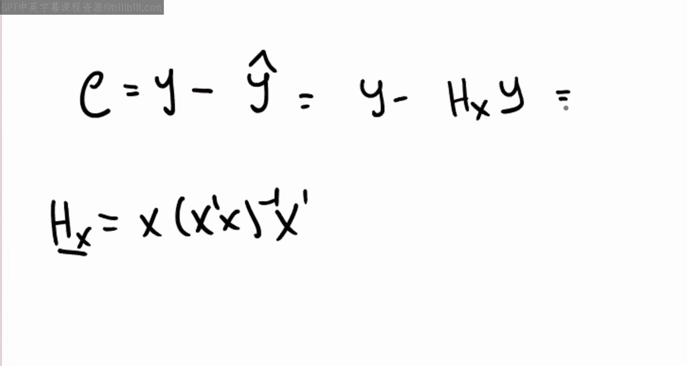

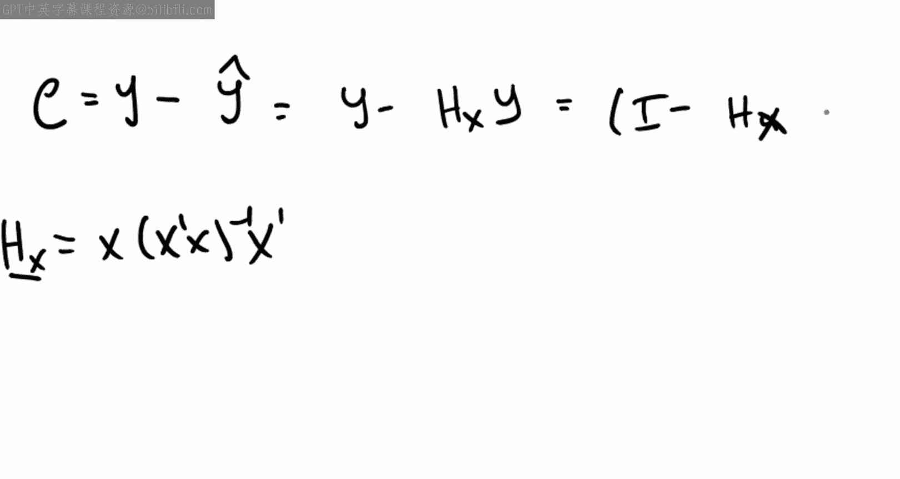

残差通常用符号 **E** 表示。其定义为观测值 **y** 与预测值 **ŷ** 之间的差值。

**公式**：
`E = y - ŷ`

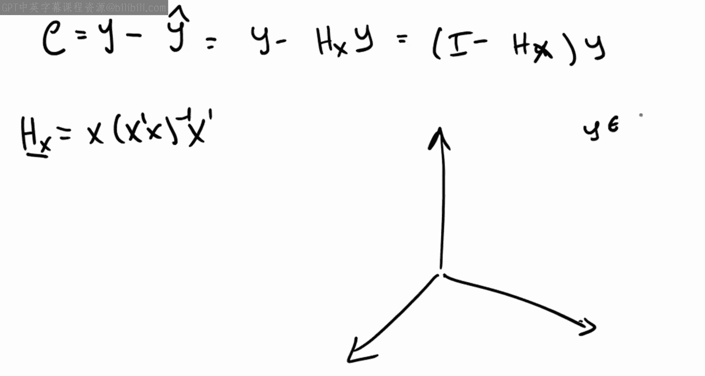

其中，预测值 **ŷ** 由帽子矩阵 **H** 与观测向量 **y** 相乘得到：
`ŷ = H * y`

帽子矩阵 **H** 的定义为：
`H = X * (XᵀX)⁻¹ * Xᵀ`

因此，我们可以将残差 **E** 重写为：
`E = y - H * y = (I - H) * y`

这里，**I** 是单位矩阵。矩阵 **(I - H)** 在后续分析中非常有用。

---

## 残差的几何解释

为了更好地理解残差，我们可以从几何角度来思考。

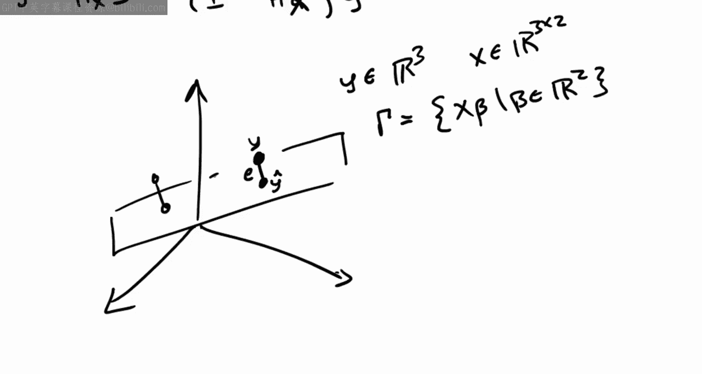

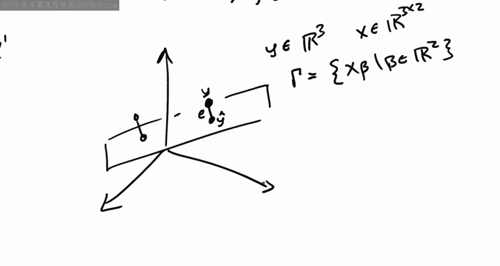

假设我们的观测值 **y** 存在于一个三维空间 **ℝ³** 中。我们的模型空间 **Γ** 由设计矩阵 **X** 的列张成。如果 **X** 是满列秩的 3x2 矩阵，那么 **Γ** 就是一个穿过三维空间的二维平面。

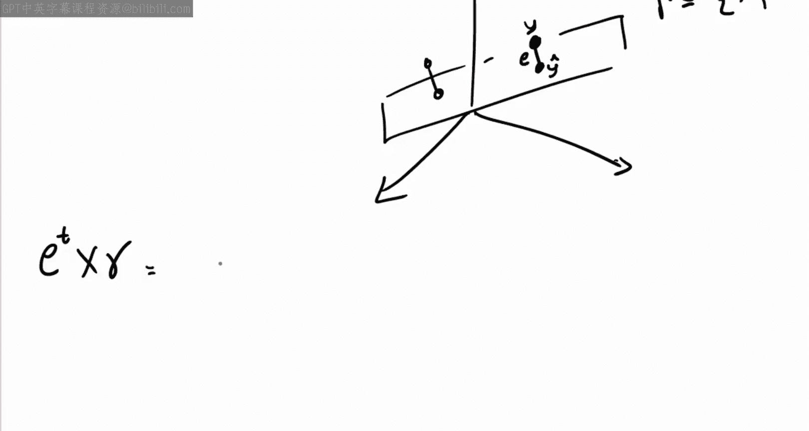

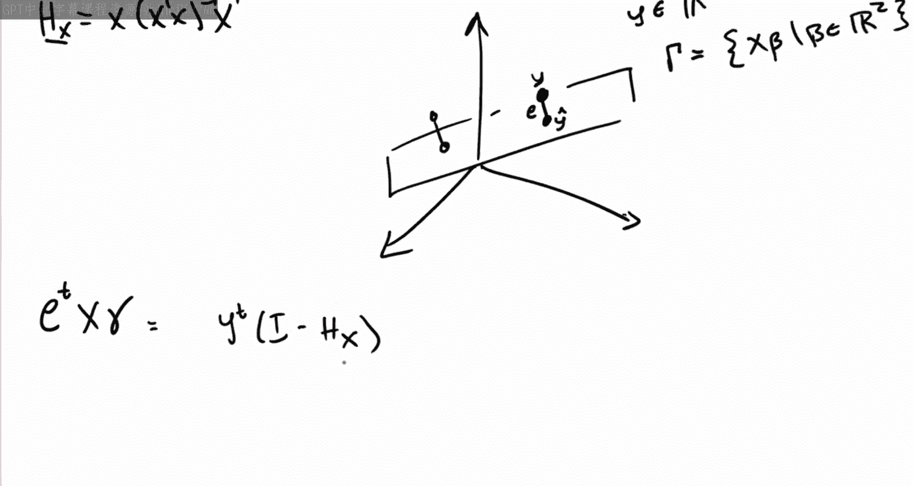

**Γ** 空间定义为：
`Γ = { Xβ | β ∈ ℝ² }`

在这个设定下，预测值 **ŷ** 就是观测值 **y** 在空间 **Γ** 上的正交投影。而残差 **E** 就是连接 **y** 和 **ŷ** 的向量，即 `E = y - ŷ`。

从几何上看，残差向量 **E** 垂直于模型空间 **Γ** 中的每一个点。换句话说，**E** 与 **X** 的列的任何线性组合都正交。

---

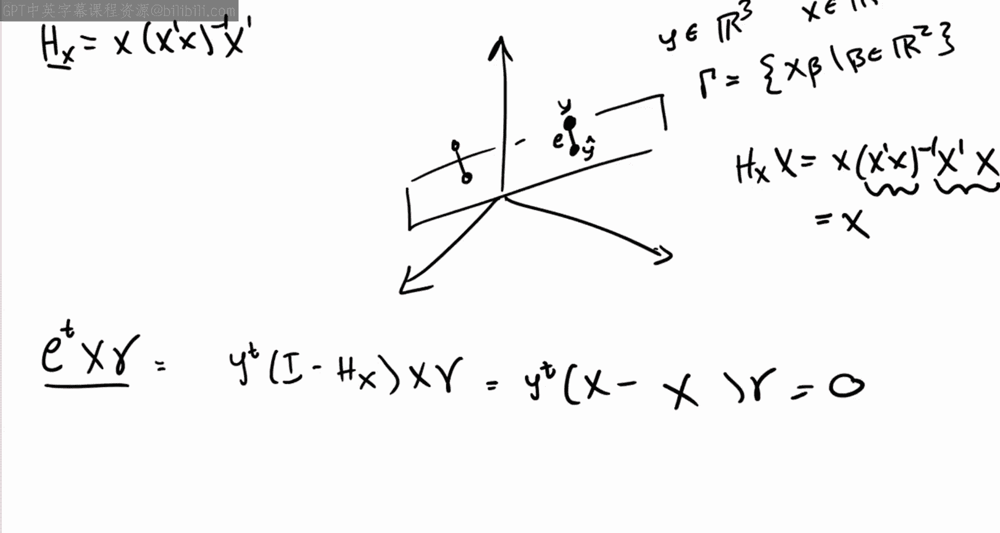

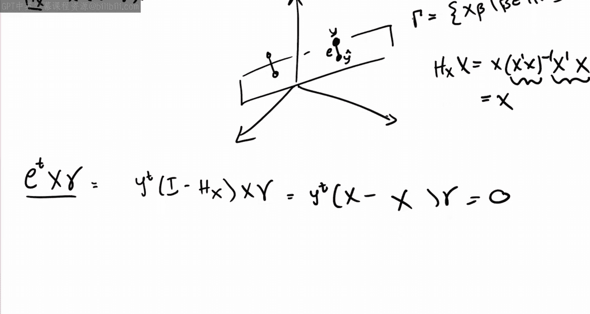

## 残差的重要性质

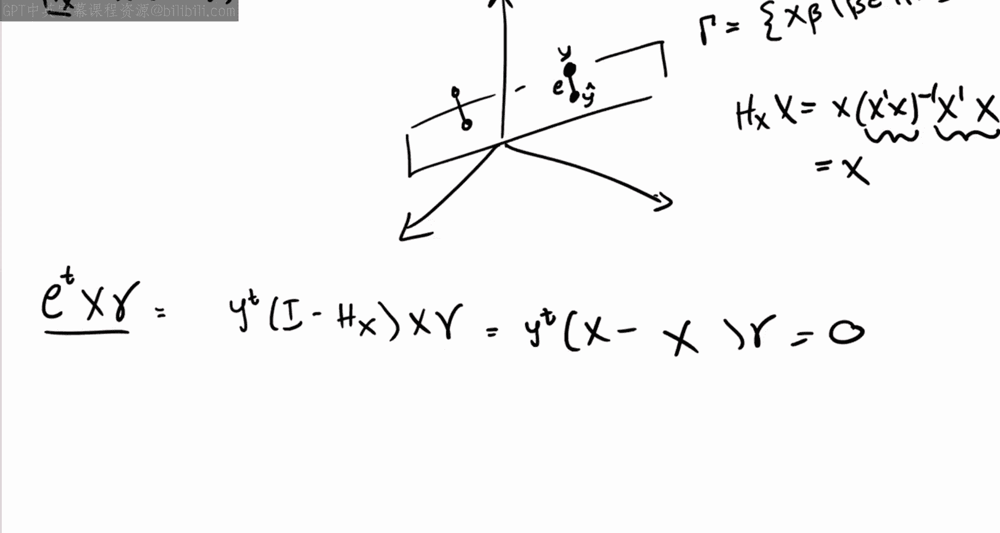

上一节我们介绍了残差的几何意义，本节中我们来看看残差的一些关键数学性质。

以下是残差的两个核心性质：

1.  **与模型空间正交**
    对于任意属于 **Γ** 空间的向量 **Xγ**（其中 **γ** 是任意向量），都有 **Eᵀ * (Xγ) = 0**。这从几何上印证了残差与模型空间的正交性。

2.  **包含截距项时，残差之和为零**
    如果设计矩阵 **X** 中包含截距项（即有一列全为1），那么残差向量 **E** 与全1向量 **J** 的点积为零：
    `Eᵀ * J = 0`
    这意味着，当模型包含截距时，所有残差的和以及残差的均值都等于零。

---

## 残差平方和

残差平方和是一个非常重要的统计量，它衡量了模型未能解释的变异大小。

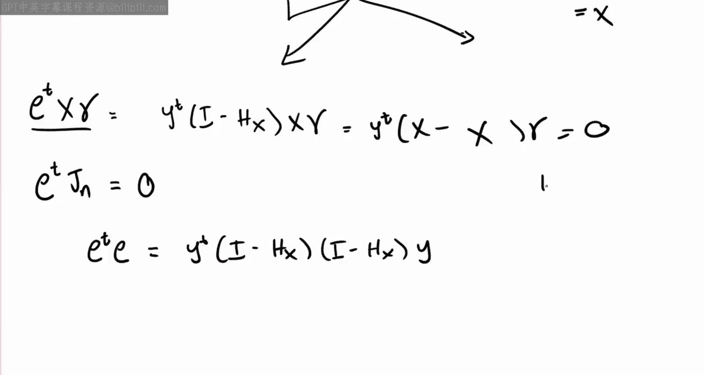

残差平方和 **SSE** 定义为：
`SSE = Eᵀ * E`

将 `E = (I - H) * y` 代入，我们可以得到：
`SSE = yᵀ * (I - H) * y`

这里用到了帽子矩阵 **H** 的一个性质：**H** 是幂等矩阵，即 `H * H = H`。由此可以推导出矩阵 **(I - H)** 也是幂等矩阵。

残差平方和 **SSE** 将以二次型的形式出现，它在后续估计残差方差等统计量时扮演着核心角色。

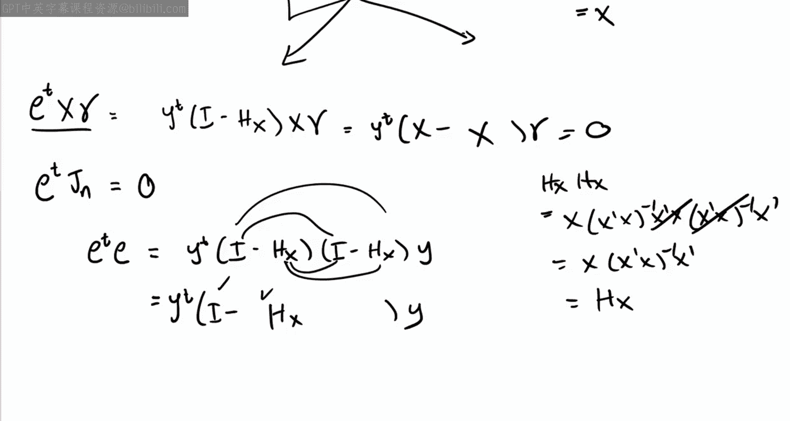

---

## 总结

本节课中我们一起学习了线性回归中残差的核心概念。

我们首先定义了残差 `E = y - ŷ`，并引入了帽子矩阵 **H** 来简洁地表示它。我们从几何角度理解了残差是观测值到模型预测空间的垂直距离。接着，我们探讨了残差的关键性质：它与模型空间正交，并且在模型包含截距时其和为零。最后，我们定义了残差平方和 `SSE = Eᵀ * E`，这是一个用于评估模型拟合优度和估计方差的基础量。

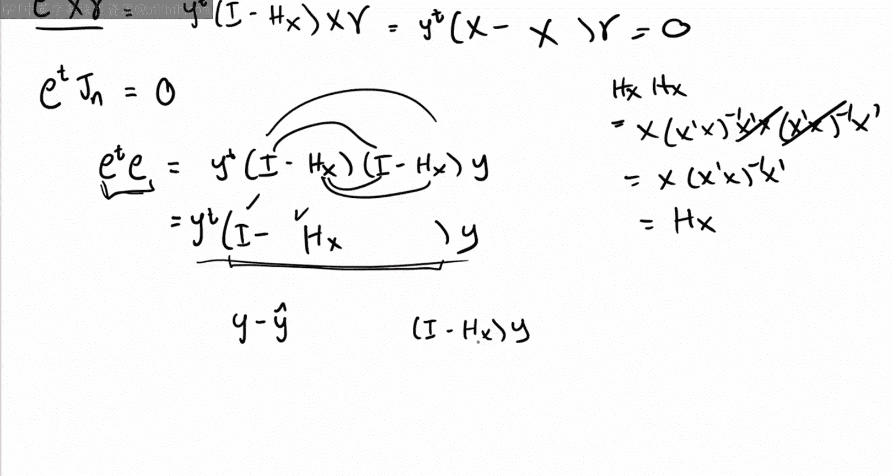

在后续课程中，我们将更深入地探讨残差的各种变体及其在模型诊断中的应用。