#  110：变异分解 📊

在本节课中，我们将学习如何分解线性回归模型中的总变异。我们将看到总变异如何被拆分为模型解释的变异和模型未能解释的残差异。理解这一分解是理解回归模型拟合优度（如R²）的关键。

---

## 模型设定与投影矩阵

首先，我们设定模型。假设设计矩阵 **X** 包含一个截距项，即其第一列是一个全为1的向量，我们记作 **J**。因此，**X** 包含截距项和其他预测变量。

我们定义两个投影矩阵：
*   **H_J** 是投影到截距向量 **J** 所张成空间上的投影矩阵。
*   **H_X** 是投影到整个设计矩阵 **X** 的列空间上的投影矩阵。

其公式定义如下：
**H_J = J (JᵀJ)⁻¹ Jᵀ**
**H_X = X (XᵀX)⁻¹ Xᵀ**

由于 **X** 包含截距项 **J**，因此 **J** 是 **X** 列向量的一个线性组合。根据上一讲的知识，对于任何属于 **X** 列空间的向量 **Xγ**，有 **(I - H_X) Xγ = 0**。特别地，令 **γ** 为选取第一列（即截距项）的向量，我们得到：
**(I - H_X) J = 0**
这等价于：
**J = H_X J**

这个结论我们稍后会用到。

---

## 定义三种平方和

接下来，我们定义回归分析中三种核心的平方和，它们都是衡量变异（方差）的指标。

以下是三种平方和的定义：
1.  **总平方和**：响应变量 **y** 围绕其均值 **ȳ** 的总变异。
    **SST = ||y - ȳ J||² = yᵀ (I - H_J) y**
2.  **残差平方和**：使用包含所有预测变量的完整模型 **X** 拟合后，剩余的、未被解释的变异。
    **SSE = ||y - ŷ||² = yᵀ (I - H_X) y**
    其中 **ŷ = H_X y** 是完整模型的拟合值。
3.  **回归平方和**：仅使用截距的模型与使用完整模型的拟合值之间的差异。它代表了因添加其他预测变量而额外解释的变异。
    **SSR = ||H_J y - H_X y||²**

直观上，由于添加了更多预测变量，**SSE** 理应小于 **SST**。**SSR** 则衡量了这部分减少的量。

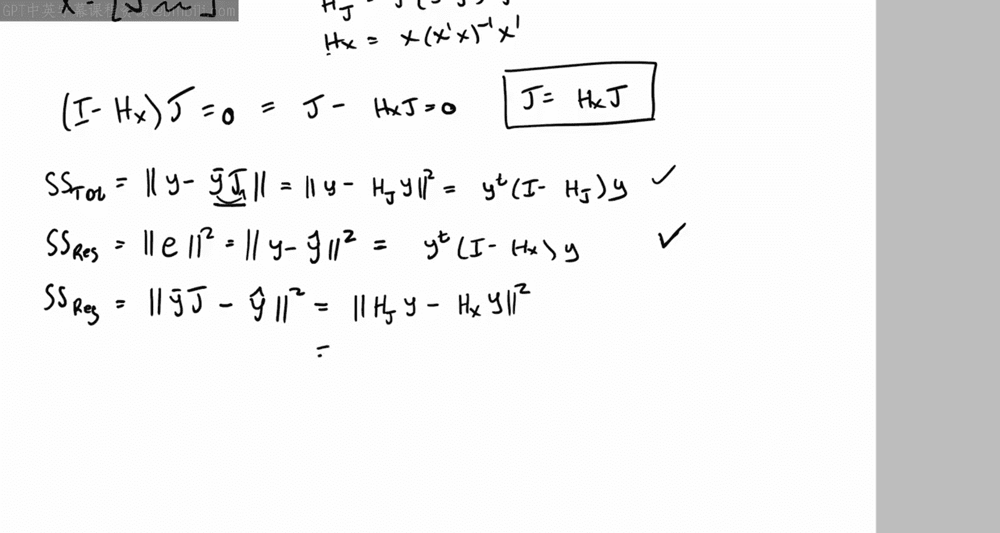

---

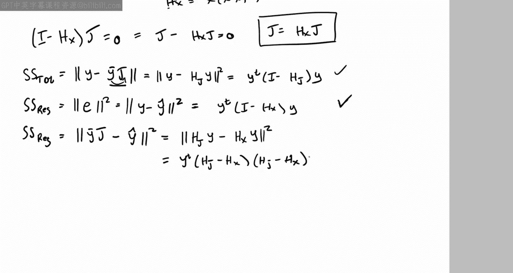

## 分解总平方和

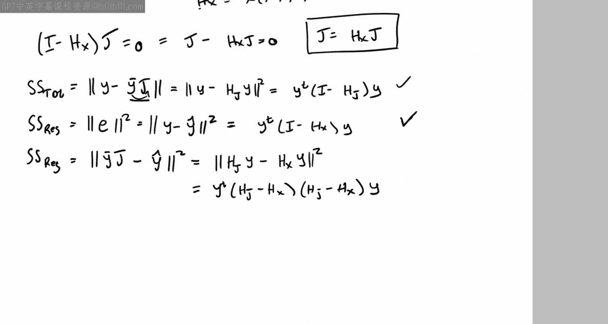

现在，我们来证明总平方和可以分解为回归平方和与残差平方和之和，即 **SST = SSR + SSE**。

我们从 **SST** 的表达式开始推导：
**SST = yᵀ (I - H_J) y**

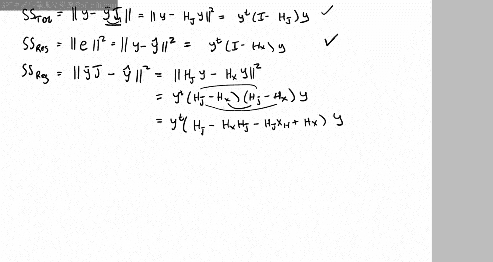

我们在中间巧妙地加上再减去一个 **H_X**：
**SST = yᵀ [(I - H_X) + (H_X - H_J)] y**

根据矩阵乘法的分配律，我们可以将其展开为两项之和：
**SST = yᵀ (I - H_X) y + yᵀ (H_X - H_J) y**

我们立刻可以识别出，第一项正是我们之前定义的 **残差平方和**：
**yᵀ (I - H_X) y = SSE**

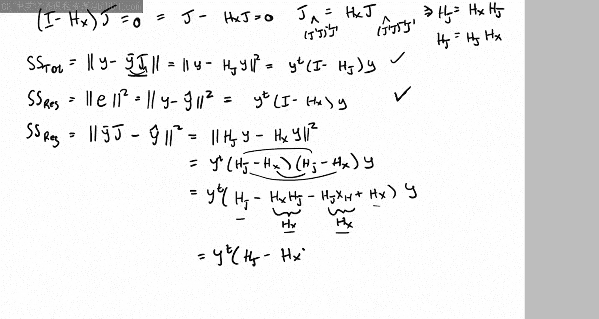

对于第二项 **yᵀ (H_X - H_J) y**，我们需要证明它等于回归平方和 **SSR**。前面我们定义 **SSR = ||(H_J - H_X)y||²**，这可以写为二次型：
**SSR = yᵀ (H_J - H_X)ᵀ (H_J - H_X) y**

由于 **H_J** 和 **H_X** 都是对称幂等矩阵，经过展开和化简，并利用之前得到的关键关系 **H_J = H_X H_J** 及其转置 **H_J = H_J H_X**，可以证明：
**yᵀ (H_J - H_X)ᵀ (H_J - H_X) y = yᵀ (H_J - H_X) y**

请注意，这里的符号是 **(H_J - H_X)**，而我们 **SST** 分解式中的是 **(H_X - H_J)**。可以证明，在二次型中，两者的结果是相等的（这可以作为课后练习）。因此，第二项就是 **回归平方和**：
**yᵀ (H_X - H_J) y = SSR**

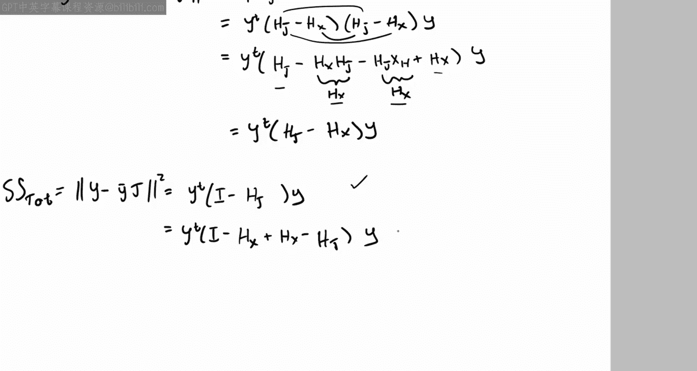

于是，我们完成了分解：
**SST = SSE + SSR**

---

## R²：模型解释的变异比例

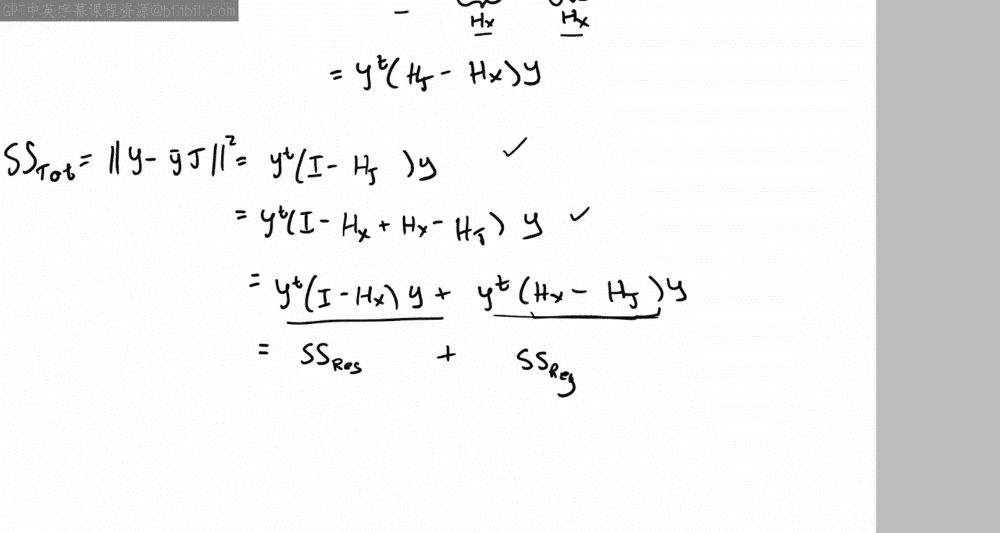

这个分解引出了一个非常重要的度量——**R²**。

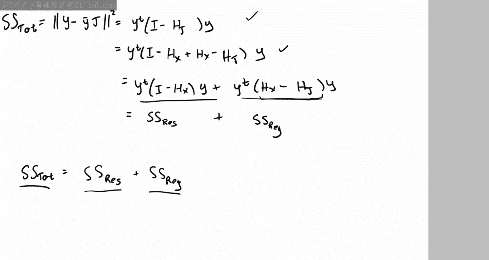

既然 **SSR** 代表了模型解释的变异，**SST** 代表总变异，那么它们的比值就衡量了模型对数据变异的解释能力。

**R²** 的定义如下：
**R² = SSR / SST**

**R²** 被解释为：**响应变量的总变异中，可由预测变量线性关联解释的百分比**。其值介于0和1之间，越接近1，表明模型对数据的拟合程度越好。

从分解式我们也能得到另一个常用公式：
**R² = 1 - (SSE / SST)**

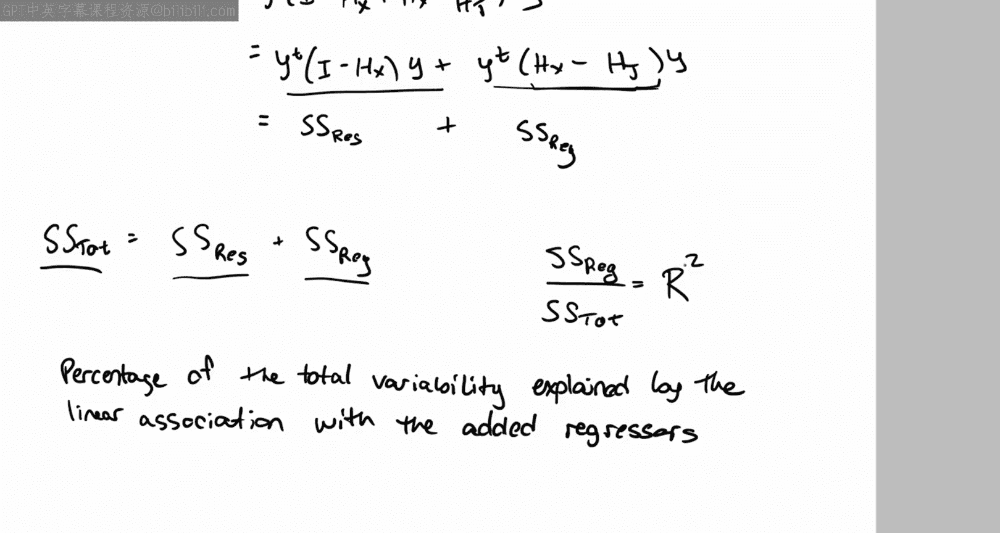

---

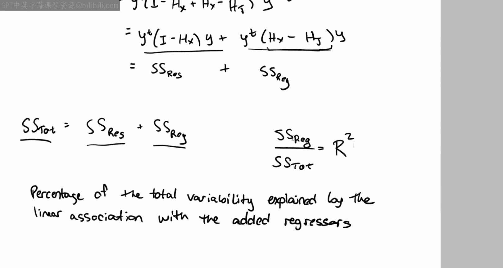

## 总结

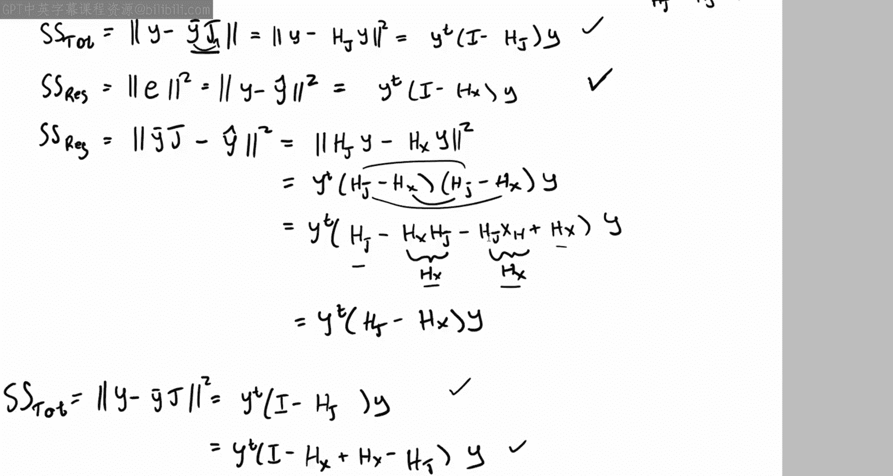

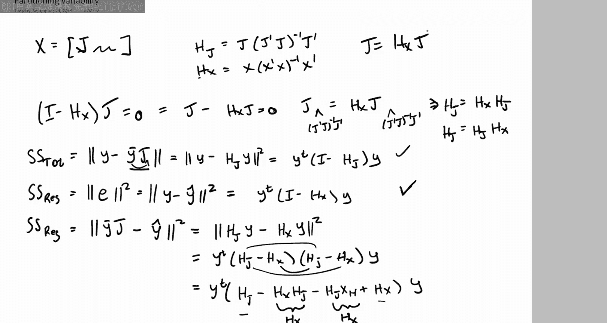

本节课我们一起学习了线性回归中变异分解的核心内容。

我们首先定义了总平方和、残差平方和与回归平方和。随后，通过巧妙地利用投影矩阵的性质，我们证明了总平方和可以精确地分解为回归平方和与残差平方和之和。最后，基于这个分解，我们引入了 **R²** 统计量，它量化了回归模型对数据变异的解释比例。

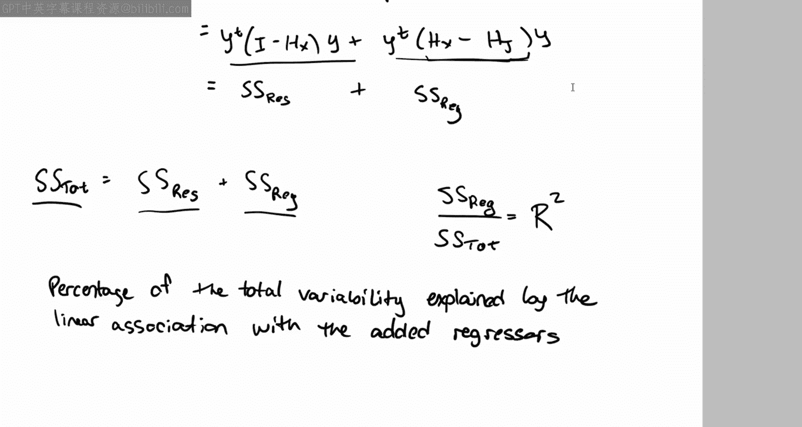

这个分解是理解回归模型拟合优度的基础，并将与我们后续课程中要学习的 **F检验** 等内容紧密关联。