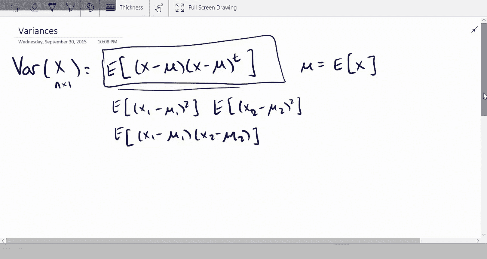
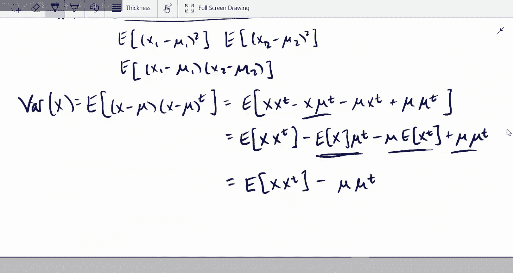
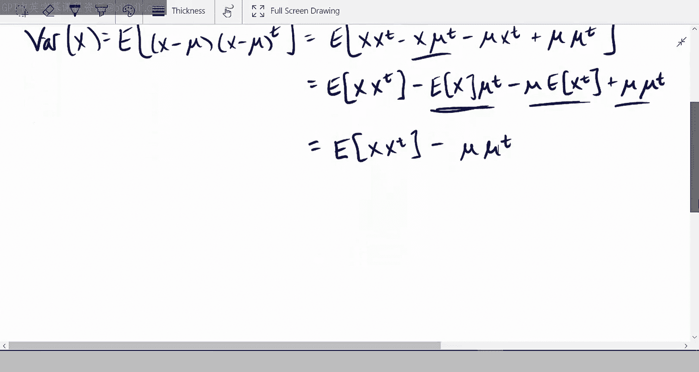
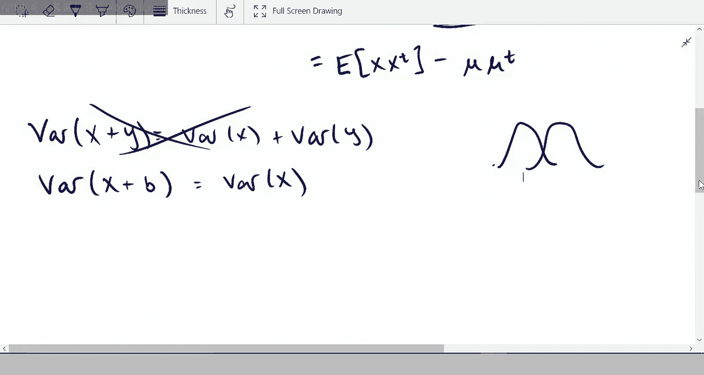
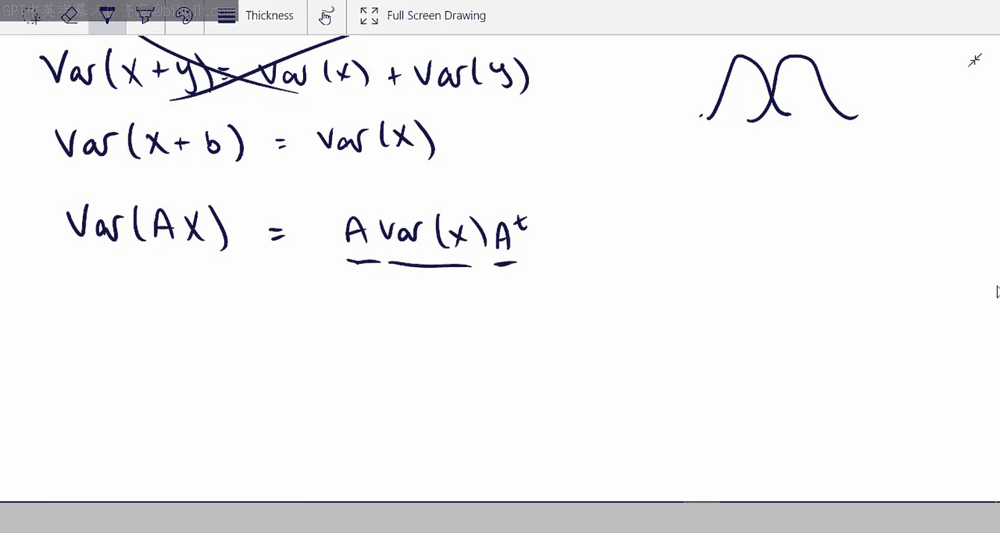
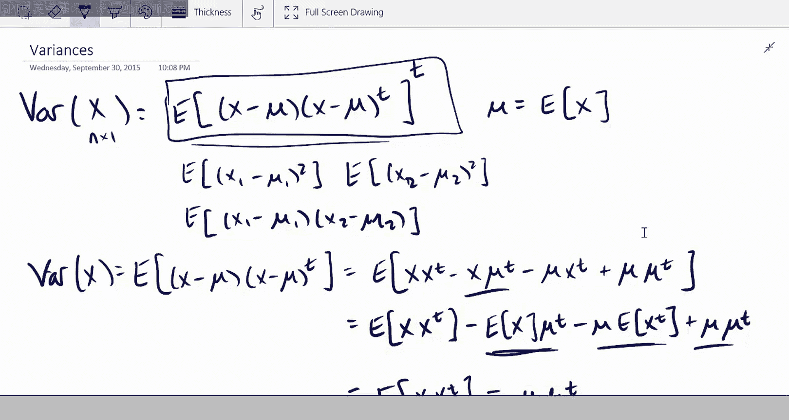
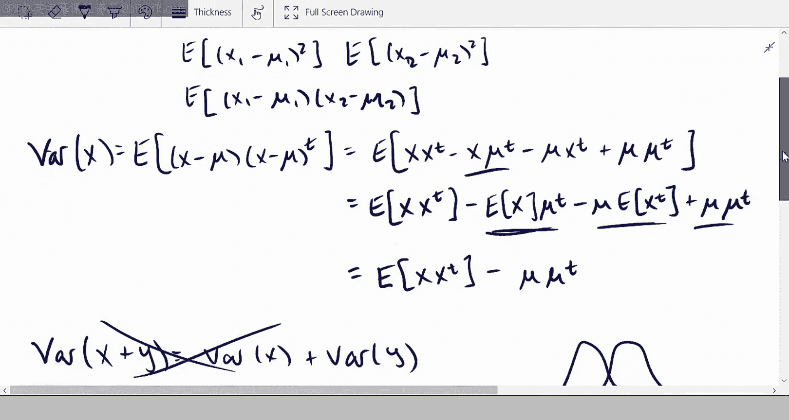
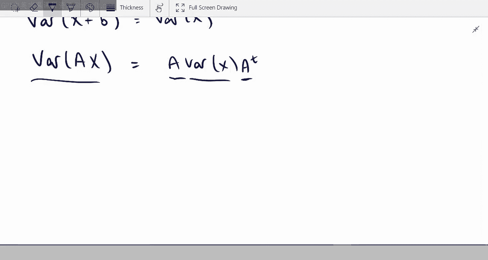

#  114：多元方差与协方差 📊

在本节课中，我们将要学习多元随机向量的方差与协方差。我们将定义方差-协方差矩阵，探讨其性质，并学习一些关键的计算公式。

---

## 方差-协方差矩阵的定义

对于一个 `n x 1` 的随机向量 **x**，其方差定义为 **x** 与其均值向量 **μ** 的外积的期望值。

**公式**：
`Var(x) = E[(x - μ)(x - μ)^T]`

其中，均值向量 **μ** 是 **x** 的期望值：`μ = E[x]`。

这个矩阵具有以下性质：
*   其**对角线元素**是各个分量的方差。例如，第一个对角线元素是 `E[(x₁ - μ₁)²]`，即第一个元素的普通方差。
*   其**非对角线元素**是不同分量之间的协方差。例如，第一行第二列的元素是 `E[(x₁ - μ₁)(x₂ - μ₂)]`，即 `x₁` 和 `x₂` 的协方差。

因此，这个矩阵的 `(i, j)` 元素就是向量 **x** 中第 `i` 个元素与第 `j` 个元素的协方差。这个矩阵被称为**方差-协方差矩阵**。

---

## 方差-协方差矩阵的简化计算公式

与一元随机变量的方差计算有简化公式类似，多元随机变量的方差计算也有一个简化的“捷径”公式。

**公式**：
`Var(x) = E[xx^T] - μμ^T`

**推导过程**：
根据定义，`Var(x) = E[(x - μ)(x - μ)^T]`。
展开括号：`E[xx^T - xμ^T - μx^T + μμ^T]`。
由于期望是线性算子，可以拆开：`E[xx^T] - E[xμ^T] - E[μx^T] + E[μμ^T]`。
其中 **μ** 是常数向量，可以提出期望：`E[xx^T] - μE[x]^T - μE[x]^T + μμ^T`。
因为 `E[x] = μ`，所以上式等于：`E[xx^T] - μμ^T - μμ^T + μμ^T = E[xx^T] - μμ^T`。

这个公式非常实用，它表明方差-协方差矩阵等于 **x** 的外积的期望减去其均值外积。

---

## 方差-协方差矩阵的性质

上一节我们介绍了方差-协方差矩阵的定义和计算公式，本节中我们来看看它的一些重要性质。这些性质与一元方差的性质有相似之处，但也有关键区别。

首先，方差不是线性算子。我们不能简单地说 `Var(x + y) = Var(x) + Var(y)`，除非向量 **x** 和 **y** 相互独立（或至少不相关）。

以下是方差-协方差矩阵的两个核心性质：

1.  **平移不变性**：给随机向量加上一个常数向量 **b**，其方差不变。
    **公式**：`Var(x + b) = Var(x)`
    这与一元情况类似，平移分布不会改变其离散程度。

2.  **线性变换**：这是最重要的性质之一。当我们用一个矩阵 **A** 乘以随机向量 **x** 时，其方差的计算规则如下。
    **公式**：`Var(Ax) = A Var(x) A^T`
    这个性质可以形象地理解为“三明治”法则：矩阵 **A** 像两片面包，将原方差矩阵 `Var(x)` 夹在中间。当你从方差计算中提出一个矩阵时，它必须以 **A** 和 **A^T** 的形式出现在两侧。

---

## 方差-协方差矩阵的对称性

最后，我们指出方差-协方差矩阵的一个明显但重要的性质：它是对称矩阵。

回顾其定义 `Var(x) = E[(x - μ)(x - μ)^T]`，如果我们对这个矩阵进行转置，由于转置可以移入期望算子内部，并且 `(M^T)^T = M`，我们会得到完全相同的矩阵。这符合我们的认知，因为协方差 `Cov(x_i, x_j)` 等于 `Cov(x_j, x_i)`，协方差算子对其两个参数是可交换的。

---

## 总结

本节课中我们一起学习了多元方差与协方差的核心概念：
*   我们定义了**方差-协方差矩阵** `Var(x) = E[(x - μ)(x - μ)^T]`，其对角线是方差，非对角线是协方差。
*   我们推导了其简化计算公式 `Var(x) = E[xx^T] - μμ^T`。
*   我们探讨了其关键性质，特别是**平移不变性**和**线性变换法则** `Var(Ax) = A Var(x) A^T`。
*   我们确认了方差-协方差矩阵是一个**对称矩阵**。

理解并熟练运用这些公式和性质，尤其是线性变换的“三明治”法则，对于后续课程的学习至关重要。