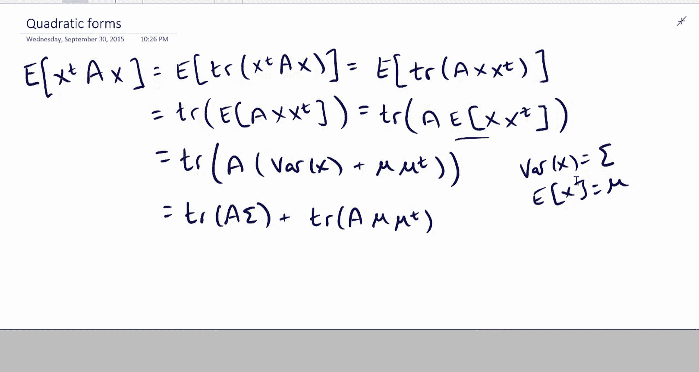
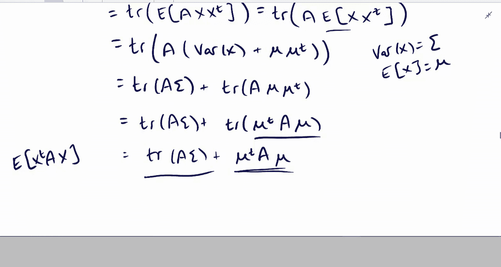

#  116：二次型的期望值 🧮

在本节课中，我们将学习一个非常有用的结果：如何计算一个由向量构成的标量量的期望值。具体来说，我们将探讨**二次型**的期望值计算，这在数据科学和统计学中是一个常见且重要的概念。

---

## 二次型期望值的推导

上一节我们介绍了期望值和方差的基本概念。本节中，我们来看看如何计算形如 **xᵀAx** 的二次型的期望值，其中 **x** 是一个 **n×1** 的随机向量，**A** 是一个对称矩阵。

计算这个期望值有一个巧妙的方法，它在本课程中会频繁用到。以下是推导步骤：

1.  **利用迹的性质**：由于 **xᵀAx** 是一个标量，其期望值等于其迹的期望值，因为标量的迹就是它本身。
    `E[xᵀAx] = trace(E[xᵀAx])`

2.  **迹的循环置换**：根据迹的性质 `trace(AB) = trace(BA)`，我们可以将表达式重写。
    `trace(E[xᵀAx]) = trace(E[Axxᵀ])`

3.  **交换期望与迹**：期望算子和迹算子都是线性算子，因此可以交换顺序。
    `trace(E[Axxᵀ]) = trace(A E[xxᵀ])`

4.  **利用方差的定义**：根据方差的定义，`E[xxᵀ]` 等于 **x** 的协方差矩阵加上其均值向量的外积。
    设 `E[x] = μ`，`Var(x) = Σ`，则有：
    `E[xxᵀ] = Σ + μμᵀ`
    因此，原式变为：
    `trace(A (Σ + μμᵀ)) = trace(AΣ) + trace(Aμμᵀ)`

5.  **再次利用迹的循环置换**：对第二项再次应用 `trace(AB) = trace(BA)`。
    `trace(Aμμᵀ) = trace(μᵀAμ)`
    注意，`μᵀAμ` 是一个标量，标量的迹就是它本身。
    `trace(μᵀAμ) = μᵀAμ`

综合以上步骤，我们得到了二次型期望值的最终公式：

**E[xᵀAx] = trace(AΣ) + μᵀAμ**

---

## 公式解读与核心要点

这个推导过程运用了几个巧妙的小技巧，例如在期望值中移入和移出迹算子。最终结果相当简洁。

*   **直观理解**：你可能会希望期望值能直接作用在两边，即 `E[xᵀAx]` 等于 `E[x]ᵀ A E[x]`（即 `μᵀAμ`）。这确实是期望值的一部分。
*   **额外项**：但除此之外，公式中还有另一个项 `trace(AΣ)`。这一项反映了随机向量 **x** 的方差（不确定性）对二次型期望值的贡献。

二次型在本课程中会经常出现，而它们的期望值计算具有非常简单的形式。

---

## 总结

本节课我们一起学习了如何计算随机向量二次型 **xᵀAx** 的期望值。我们通过一步步的推导，得到了核心公式：

**E[xᵀAx] = trace(AΣ) + μᵀAμ**

其中，**μ** 是 **x** 的均值向量，**Σ** 是其协方差矩阵。这个结果清晰地表明，二次型的期望值不仅取决于向量的均值（`μᵀAμ`），也取决于其波动性（`trace(AΣ)`）。掌握这个结论对于后续学习许多高级统计模型至关重要。