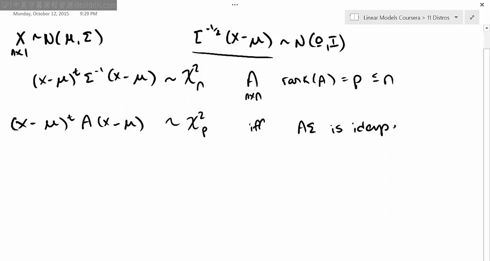
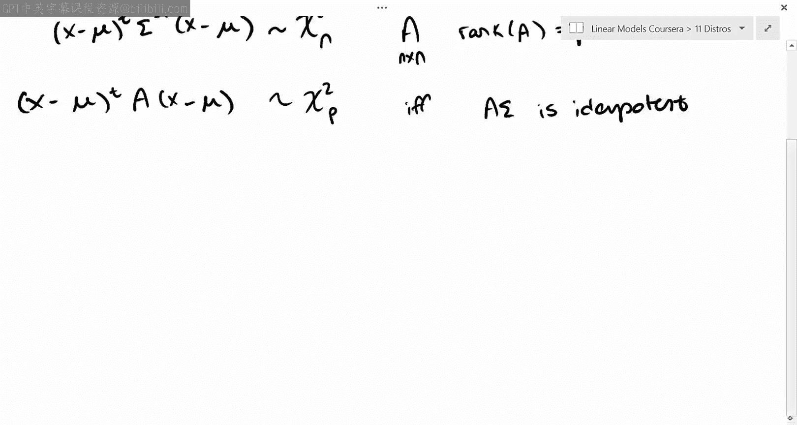
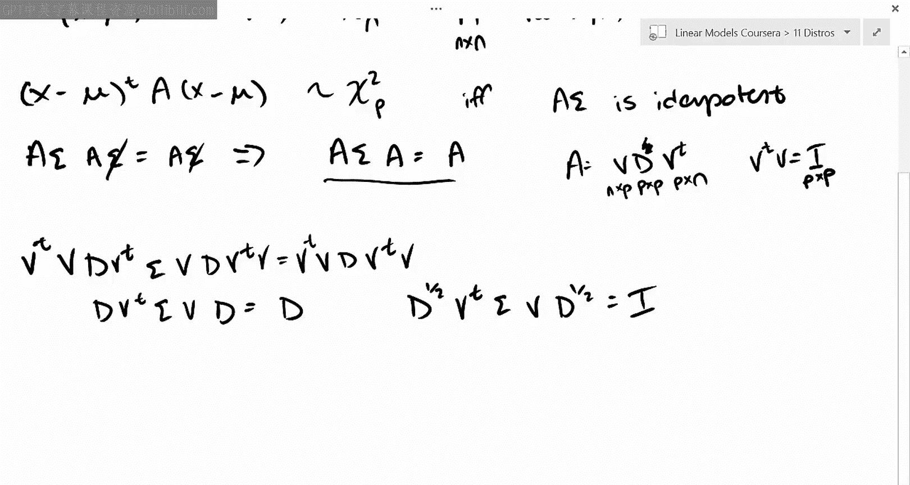
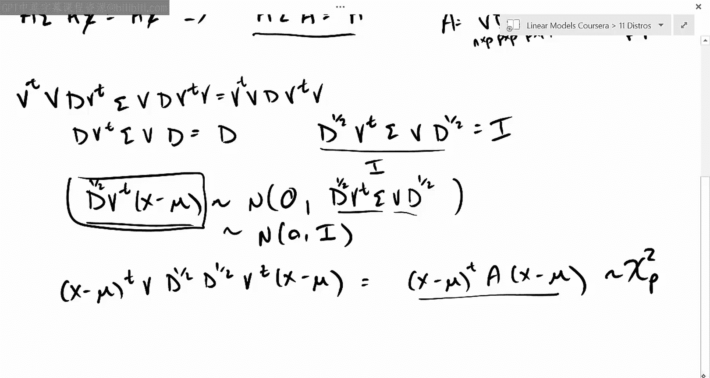
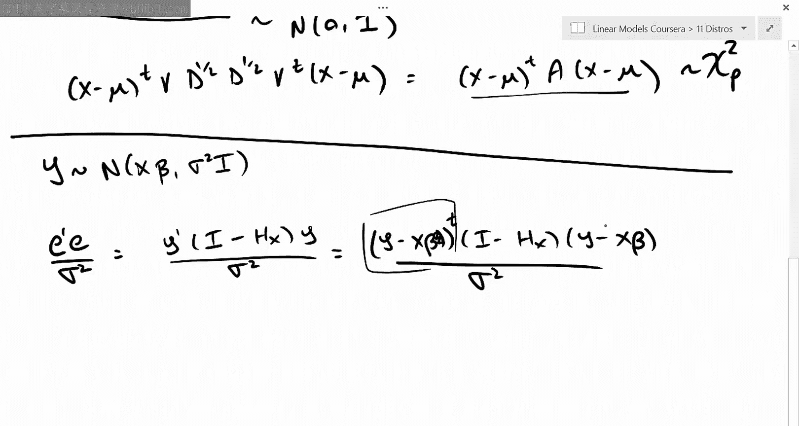
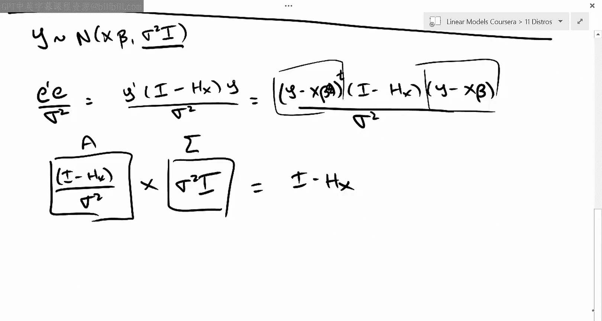
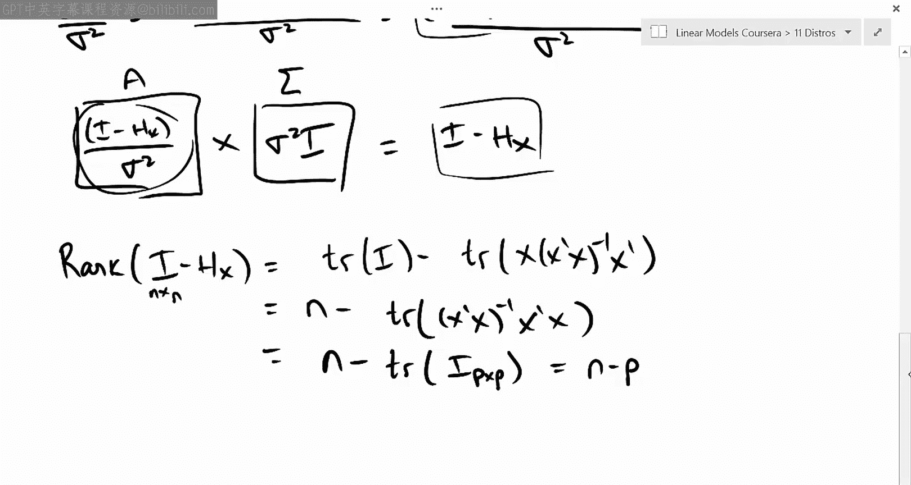
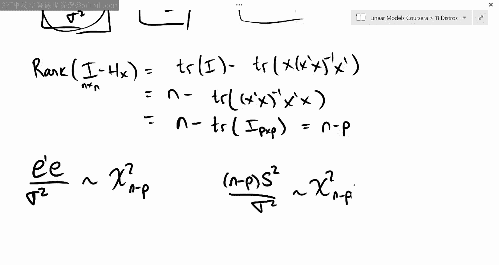

#  122：二次型的卡方分布结果 🧮

在本节课中，我们将学习关于二次型分布的一个核心定理，特别是它何时服从卡方分布。这个结果在回归分析和更广泛的统计推断中非常有用。

上一节我们介绍了正态向量的基本性质，本节中我们来看看一个更一般的情况：正态随机向量的二次型。

## 核心定理与证明

假设 **X** 是一个 **n×1** 的随机向量，服从多元正态分布：
**X ~ N(μ, Σ)**
其中 **Σ** 是正定协方差矩阵。

现在，考虑一个二次型：
**Q = (X - μ)ᵀ A (X - μ)**
其中 **A** 是一个 **n×n** 的对称矩阵，其秩为 **p**（**p ≤ n**）。

那么，这个二次型 **Q** 服从自由度为 **p** 的卡方分布：
**Q ~ χ²(p)**
当且仅当矩阵 **AΣ** 是幂等矩阵，即满足：
**(AΣ)² = AΣ**

---

### 定理证明

我们来证明定理的一个方向：如果 **AΣ** 是幂等的，那么 **Q ~ χ²(p)**。

1.  **利用幂等性**：
    由 **AΣ** 幂等可得：**(AΣ)(AΣ) = AΣ**。
    由于 **Σ** 可逆，上式两边右乘 **Σ⁻¹** 可得：
    **AΣA = A**

2.  **进行特征分解**：
    对矩阵 **A** 进行谱分解。因为 **A** 对称，可以写成：
    **A = V D Vᵀ**
    其中：
    *   **V** 是 **n×p** 的矩阵，满足 **VᵀV = I_p**（**p×p** 单位矩阵）。
    *   **D** 是 **p×p** 的对角矩阵，其对角线元素是 **A** 的非零特征值。

3.  **代入并化简**：
    将分解式代入 **AΣA = A**：
    **V D Vᵀ Σ V D Vᵀ = V D Vᵀ**
    在上式两边左乘 **Vᵀ**，右乘 **V**，得到：
    **D (Vᵀ Σ V) D = D**
    接着，两边左乘和右乘 **D^{-1/2}**（**D** 对角元素的平方根倒数矩阵），得到：
    **D^{1/2} (Vᵀ Σ V) D^{1/2} = I_p**

4.  **构造标准正态向量**：
    现在考虑一个新的随机向量：
    **Z = D^{1/2} Vᵀ (X - μ)**
    由于 **X** 是正态的，且 **Z** 是 **X** 的线性变换，因此 **Z** 也服从多元正态分布。其均值为 **0**，协方差矩阵为：
    **Cov(Z) = D^{1/2} Vᵀ Σ V D^{1/2}**
    根据第3步的结论，这个协方差矩阵正好是 **I_p**。
    因此，**Z ~ N(0, I_p)**，即 **Z** 的各个分量是独立的标准正态变量。

5.  **联系回原二次型**：
    计算 **ZᵀZ**：
    **ZᵀZ = (X - μ)ᵀ V D^{1/2} D^{1/2} Vᵀ (X - μ) = (X - μ)ᵀ (V D Vᵀ) (X - μ) = (X - μ)ᵀ A (X - μ) = Q**
    而 **ZᵀZ** 是 **p** 个独立标准正态随机变量的平方和，根据定义，它服从自由度为 **p** 的卡方分布。
    因此，我们证明了 **Q ~ χ²(p)**。

---

## 在线性回归中的应用示例

上一节我们证明了定理本身，本节中我们来看看它在经典线性回归中的一个重要应用。

假设我们有一个线性回归模型：
**Y ~ N(Xβ, σ²I)**
其中 **Y** 是 **n×1** 的响应向量，**X** 是 **n×p** 的设计矩阵，**β** 是 **p×1** 的系数向量，**σ²** 是误差方差。

考虑残差平方和（RSS）：
**RSS = eᵀe = Yᵀ (I - H) Y**
其中 **H = X(XᵀX)⁻¹Xᵀ** 是投影矩阵（或称“帽子矩阵”）。

我们关心标准化后的残差平方和：
**RSS / σ² = Yᵀ (I - H) Y / σ²**

为了应用我们的定理，可以将上式重写为：
**RSS / σ² = (Y - Xβ)ᵀ (I - H) (Y - Xβ) / σ²**
（因为 **(I - H)X = 0**，所以加入 **Xβ** 不影响结果）。

现在，我们进行对应：
*   定理中的 **X** 对应这里的 **(Y - Xβ)**。
*   定理中的 **μ** 对应 **0**。
*   定理中的 **Σ** 对应 **σ²I**。
*   定理中的 **A** 对应 **(I - H) / σ²**。

根据定理，**RSS / σ² ~ χ²(df)** 的条件是矩阵 **AΣ** 幂等。我们来验证：

**AΣ = [(I - H) / σ²] * (σ²I) = I - H**

我们知道投影矩阵 **I - H** 是幂等的，即 **(I - H)² = I - H**。条件满足。

接下来确定自由度 **p**（即矩阵 **A** 的秩）。对于对称幂等矩阵，其秩等于它的迹。

以下是计算秩的步骤：

**rank(I - H) = tr(I - H) = tr(I) - tr(H)**

*   **tr(I)** 是 **n×n** 单位矩阵的迹，等于 **n**。
*   **tr(H)** 计算如下：
    **tr(H) = tr(X(XᵀX)⁻¹Xᵀ) = tr((XᵀX)⁻¹XᵀX) = tr(I_p) = p**
    （这里利用了迹的循环性质：tr(AB) = tr(BA)）。

因此，**rank(I - H) = n - p**。由于除以标量 **σ²** 不改变矩阵的秩，所以 **A** 的秩也是 **n - p**。

---

### 最终结论

综合以上分析，我们得到线性回归中的一个核心分布结果：

**RSS / σ² = (n-p) * S² / σ² ~ χ²(n-p)**

其中 **S² = RSS/(n-p)** 是回归模型中方差 **σ²** 的无偏估计量。

这个结果的一个特例是：当模型仅包含截距项时（即 **p=1**），**RSS / σ² ~ χ²(n-1)**。这正是初等统计学中，样本方差服从卡方分布的结果。本定理为其提供了一个更一般、更严谨的证明。

---

本节课中我们一起学习了关于正态向量二次型服从卡方分布的充要条件，并证明了其关键方向。随后，我们将这个定理应用于线性回归模型，推导出了残差平方和的精确分布，即 **RSS/σ²** 服从自由度为 **n-p** 的卡方分布。这个结果是后续进行假设检验（如F检验）和构建置信区间的基础，在整个课程中都非常重要。