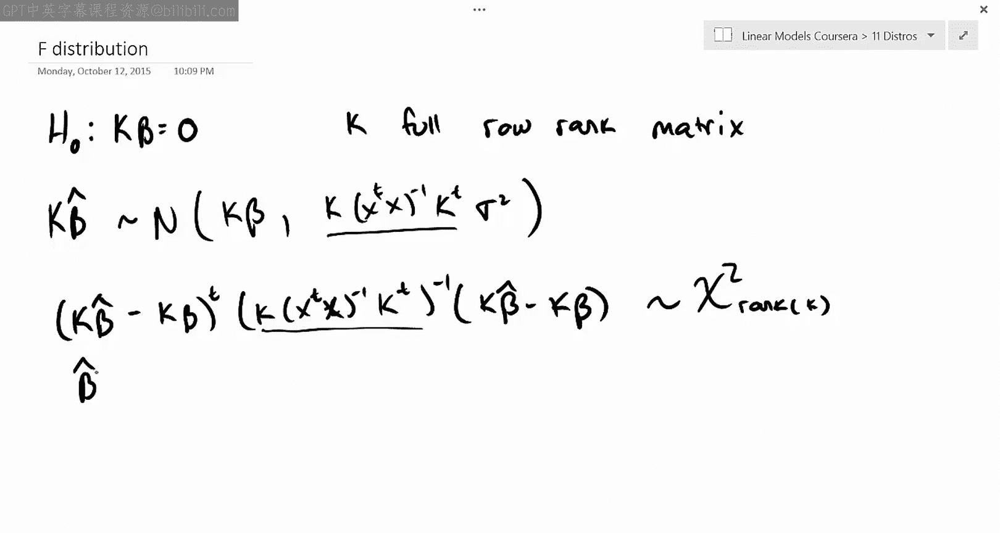
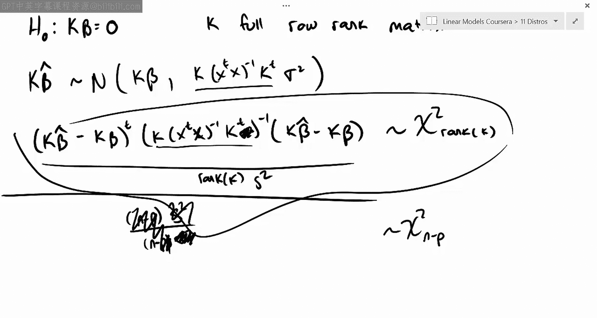

#  124：F分布 🧮

在本节课中，我们将学习F分布，并了解如何在线性回归的假设检验中应用它。我们将从一个简单的例子开始，推导出用于检验一般线性假设的F统计量。

上一节我们介绍了T分布的推导过程，本节中我们来看看如何处理更复杂的假设检验场景，即检验涉及多个系数的向量假设。

## 概述

考虑检验以下原假设：
**H₀: Kβ = 0**

其中，**K** 是一个**满行秩矩阵**。这意味着K至少有与其行数一样多的列（p列），并且其行是线性独立的。由于我们检验的是一个向量（而非单个系数），因此无法使用T分布，而需要借助F分布。

## Kβ估计量的分布

我们对于 **Kβ** 的自然估计量是 **Kβ̂**。根据之前章节的标准假设，这个估计量服从正态分布：
*   **均值**：Kβ
*   **方差**：K(XᵀX)⁻¹Kᵀ × σ²

用公式表示为：
**Kβ̂ ~ N( Kβ, K(XᵀX)⁻¹Kᵀ σ² )**

## 构建卡方统计量

我们可以基于 **Kβ̂** 轻松构建一个卡方统计量。

以下是构建步骤：
1.  取估计量与其均值的差：**(Kβ̂ - Kβ)**
2.  乘以其方差矩阵的逆进行标准化。
3.  最终形式为：
    **(Kβ̂ - Kβ)ᵀ [K(XᵀX)⁻¹Kᵀ]⁻¹ (Kβ̂ - Kβ) / σ²**

这个量服从自由度为 **rank(K)** 的卡方分布，记作 **χ²( rank(K) )**。这是因为K是满行秩矩阵，保证了方差矩阵 **K(XᵀX)⁻¹Kᵀ** 是可逆的。此外，这个卡方统计量中唯一的随机部分是 **β̂**。

## 构造F统计量

我们知道，上述基于 **β̂** 的卡方统计量与残差方差估计量 **S²** 是相互独立的。

基于此，我们可以构造F统计量。

以下是F统计量的构造过程：
1.  取上述卡方统计量除以其自由度：**χ²( rank(K) ) / rank(K)**
2.  取另一个独立的卡方统计量：**(n-p)S² / σ² ~ χ²(n-p)**，也除以其自由度：**χ²(n-p) / (n-p)**
3.  将两者相除。注意到两个 **σ²** 会相互抵消，两个 **(n-p)** 也会相互抵消。

最终得到的统计量就是用于检验一般线性假设的 **F统计量**：

**F = [ (Kβ̂)ᵀ [K(XᵀX)⁻¹Kᵀ]⁻¹ (Kβ̂) / rank(K) ] / S²**

这个统计量服从自由度为 **(rank(K), n-p)** 的F分布，即 **F( rank(K), n-p )**。

## 常见应用

一个最典型的例子是，矩阵 **K** 选取除截距项外的所有回归系数。此时，**Kβ=0** 的检验就等价于检验“所有斜率系数均为零”。这正是线性回归模型输出中标准的**整体F检验**。

## 总结

本节课中我们一起学习了F分布的推导及其在线性回归假设检验中的应用。我们证明了，在检验涉及多个系数的线性假设（**H₀: Kβ = 0**）时，可以构造一个服从F分布的统计量。其核心思想是将基于估计量 **Kβ̂** 的卡方统计量，与基于残差方差 **S²** 的独立卡方统计量相结合。现在，我们已经掌握了推导这一重要检验所需的全部工具。