#  126：预测区间 📊

在本节课中，我们将要学习线性回归中的预测区间。我们将探讨如何为一个新的观测值构建预测区间，并理解它与之前学过的回归线均值置信区间的关键区别。

## 概述

上一节我们介绍了如何为回归线在特定点的均值构建置信区间。本节中我们来看看如何为一个新的、未观测到的响应值构建预测区间。预测区间不仅考虑了回归线估计的不确定性，还包含了响应值本身的固有变异性。

## 预测与均值估计

假设我们有一个响应变量 **y** 和一个预测变量 **x**。我们已经通过最小二乘法或基于分布假设拟合了一个线性模型，得到了参数估计值 **β̂**。

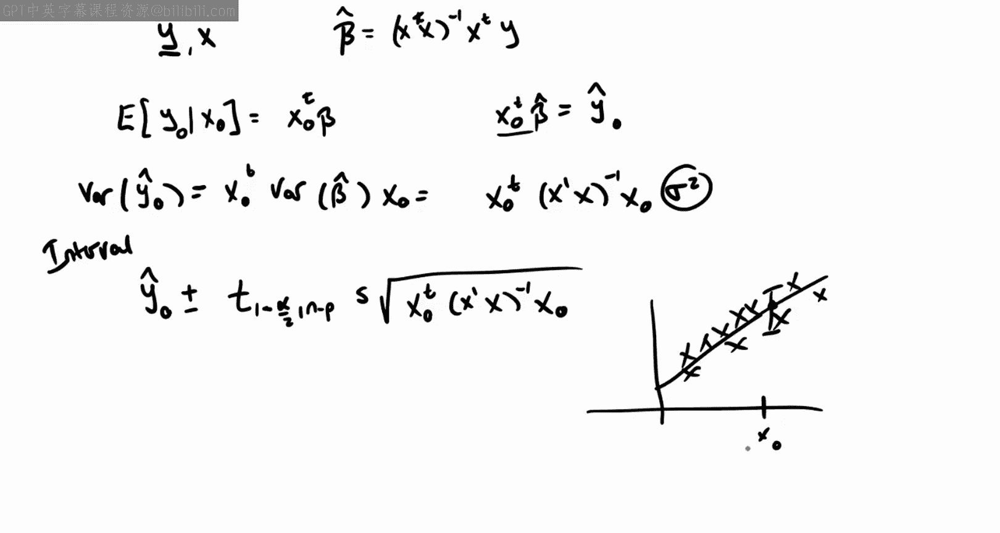

**β̂** 的公式为：
```
β̂ = (XᵀX)⁻¹ Xᵀy
```

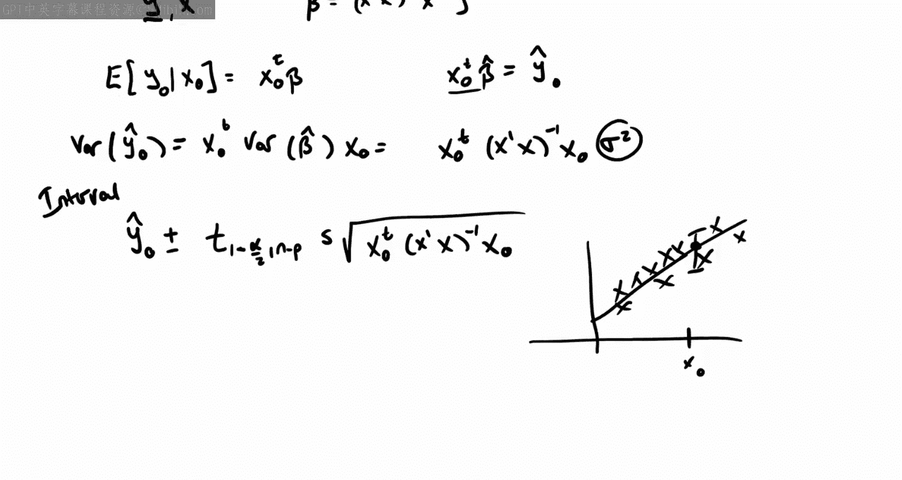

对于一个给定的 **x** 值（记作 **x₀**），**y** 的期望值（均值）是：
```
E[y | x₀] = x₀ᵀβ
```

我们对此期望值的自然估计是：
```
ŷ₀ = x₀ᵀβ̂
```

我们可以很容易地为这个估计值构建一个置信区间，因为它只是 **β** 的一个线性组合。我们已经掌握了构建此类区间的方法。

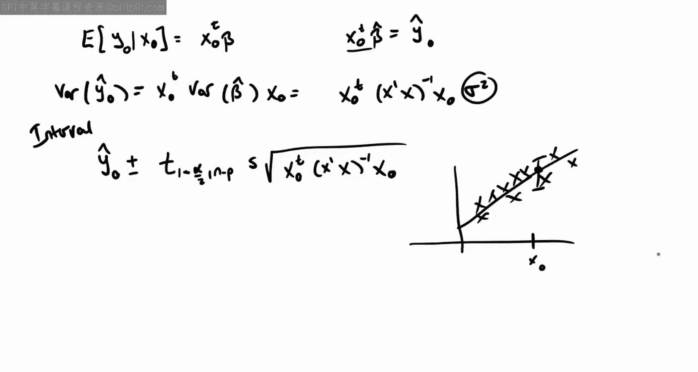

**ŷ₀** 的方差为：
```
Var(ŷ₀) = x₀ᵀ Var(β̂) x₀ = σ² x₀ᵀ (XᵀX)⁻¹ x₀
```

由此，我们可以构建一个 **t** 区间：
```
ŷ₀ ± t_{1-α/2, n-p} * s * √[x₀ᵀ (XᵀX)⁻¹ x₀]
```
其中 **s** 是残差标准差 **σ** 的估计值。

这个区间是回归线在 **x₀** 点处均值的**置信区间**。它描述了我们估计这条线的准确程度。例如，在钻石价格的例子中，它描述了我们对于特定质量钻石的平均价格估计得有多好。

## 从均值置信区间到新观测值预测区间

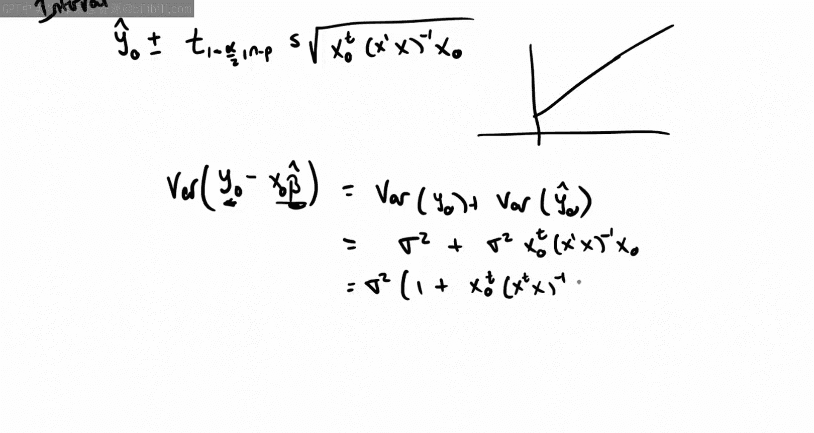

然而，如果你要出售一颗钻石，你可能更想知道的是：“对于我这颗特定质量的钻石，一个合理的价格范围是多少？” 这是一个不同的问题。

这里的关键区别在于：
*   **均值置信区间**：针对的是在特定 **x** 值处，所有可能 **y** 的平均值（即回归线本身的值）。
*   **预测区间**：针对的是一个**新的、单独的** **y** 观测值，它包含了 **y** 值自身的随机波动。

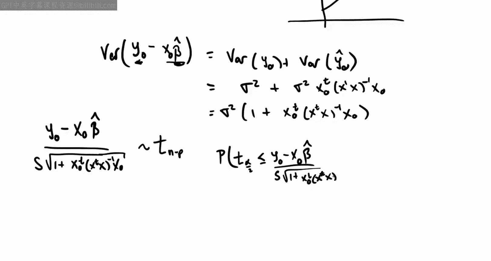

假设我们想要预测在 **x₀** 处的一个新观测值 **y₀**（我们尚未观测到它）。考虑以下差值：
```
y₀ - ŷ₀ = y₀ - x₀ᵀβ̂
```
这个差值代表了实际的新观测值 **y₀** 与我们在 **x₀** 处的预测值之间的差异。注意，**β̂** 的计算中并未使用这个新的 **y₀**，因此两者独立。

这个差值的方差为：
```
Var(y₀ - ŷ₀) = Var(y₀) + Var(ŷ₀) = σ² + σ² x₀ᵀ (XᵀX)⁻¹ x₀ = σ² [1 + x₀ᵀ (XᵀX)⁻¹ x₀]
```

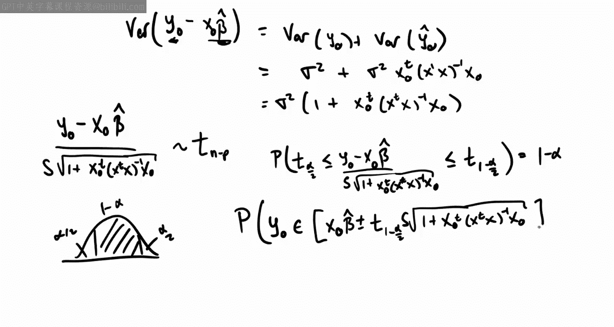

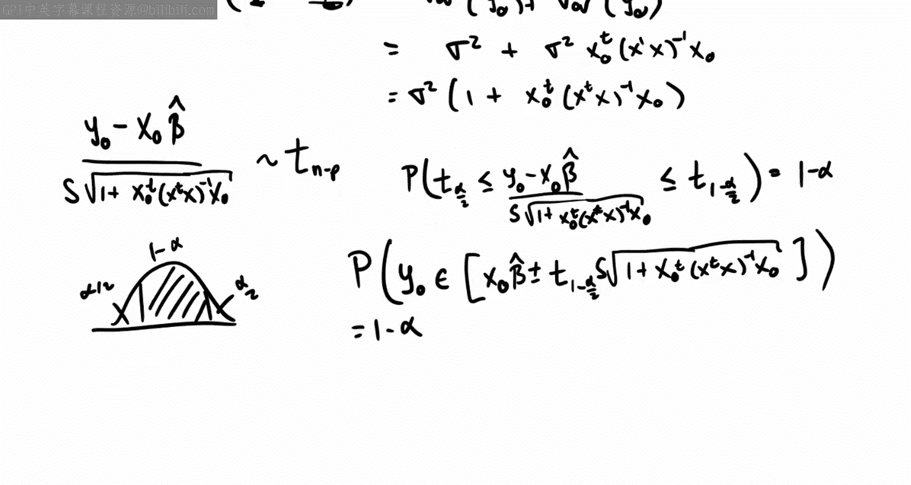

可以证明（这将作为课后练习），以下统计量服从自由度为 **n-p** 的 **t** 分布：
```
(y₀ - ŷ₀) / { s * √[1 + x₀ᵀ (XᵀX)⁻¹ x₀] } ~ t_{n-p}
```

基于此，我们可以构建一个概率为 **1-α** 的区间。经过整理，我们得到 **y₀** 的**预测区间**为：
```
ŷ₀ ± t_{1-α/2, n-p} * s * √[1 + x₀ᵀ (XᵀX)⁻¹ x₀]
```

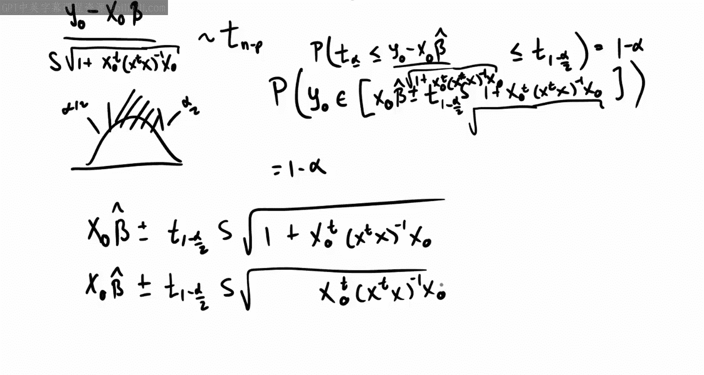

## 预测区间与置信区间的比较 🔍

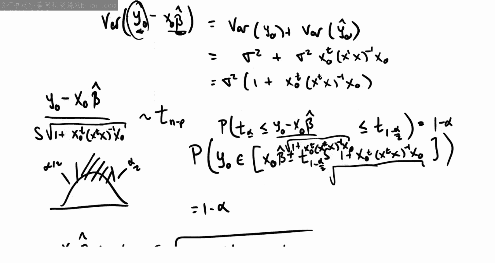

请注意，预测区间的公式与均值置信区间的公式非常相似，唯一的区别在于平方根内多了一个 **“1+”**。

这个 **“1”** 来自于新观测值 **y₀** 自身的方差 **σ²**。它体现了预测区间与均值置信区间的根本区别：

*   **均值置信区间**：随着数据量无限增加，我们对回归线的估计会越来越精确，区间会收缩到真实的均值。公式中 `x₀ᵀ (XᵀX)⁻¹ x₀` 部分会趋近于0。
*   **预测区间**：无论我们收集多少数据，对回归线的估计有多精确，响应值 **y** 围绕回归线的**固有变异性**（由 **σ²** 表示）始终存在。因此，公式中的 **“1”** 不会消失。随着数据量增加，区间宽度会趋近于 `± t * σ`，这正好代表了数据围绕回归线的自然散布范围。

严格来说，预测区间不是一个“置信区间”，因为区间所包含的对象（新的随机观测值 **y₀**）本身是随机的。但我们推导它的思路与推导置信区间是类似的。

## 核心要点总结

本节课中我们一起学习了：

1.  **回顾**：如何为线性回归在特定点的均值构建置信区间。
2.  **引入**：预测一个新观测值的问题，这与估计均值不同。
3.  **推导**：新观测值 **y₀** 的预测区间公式为：
    ```
    x₀ᵀβ̂ ± t_{1-α/2, n-p} * s * √[1 + x₀ᵀ (XᵀX)⁻¹ x₀]
    ```
4.  **关键区别**：预测区间公式中平方根内多了一个 **“1”**，它代表了响应变量**固有的、不可消除的随机误差**。这意味着无论样本多大，预测单个未来观测值的不确定性总会大于估计其均值的不确定性。
5.  **理解**：均值置信区间反映的是**估计的不确定性**，而预测区间同时反映了**估计的不确定性**和**个体的变异性**。

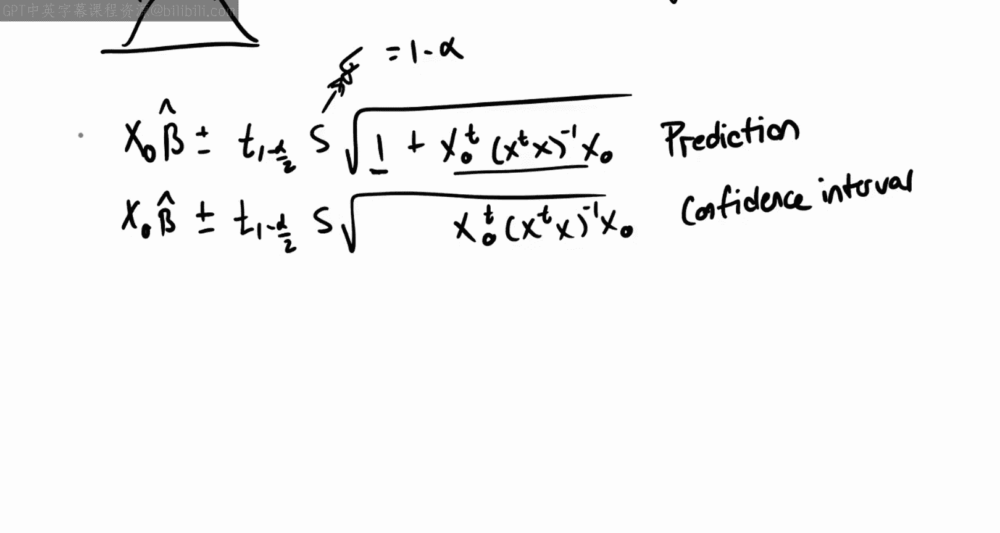

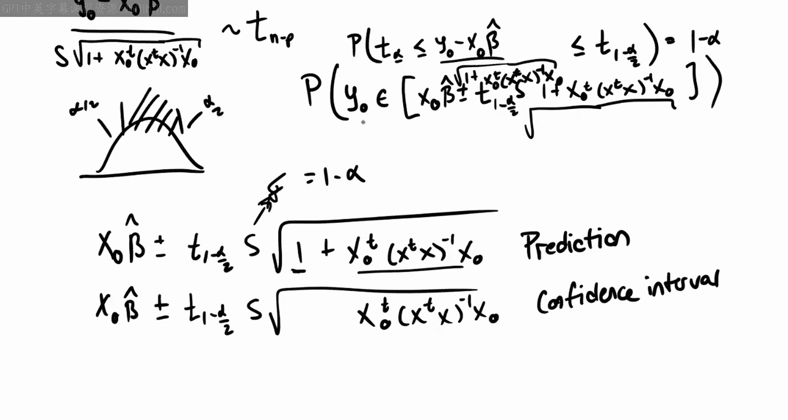

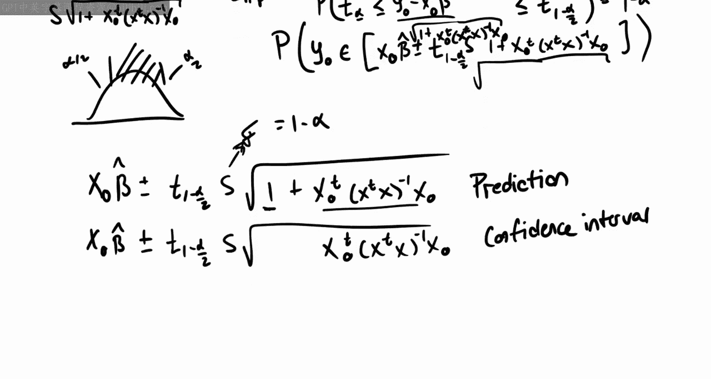

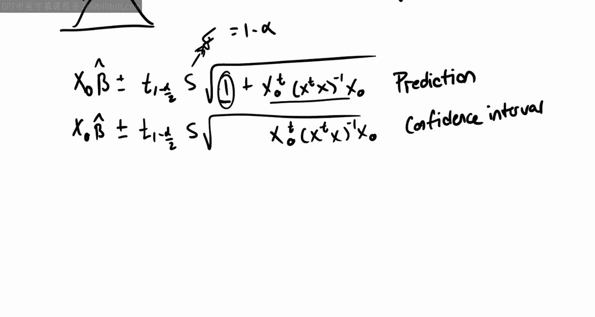

理解这一区别对于正确解释和应用回归模型至关重要。当你关心的是总体趋势（如平均价格）时，使用置信区间；当你关心的是单个个体的可能取值（如某颗钻石的售价）时，必须使用预测区间。