#  127：编程示例 🚗

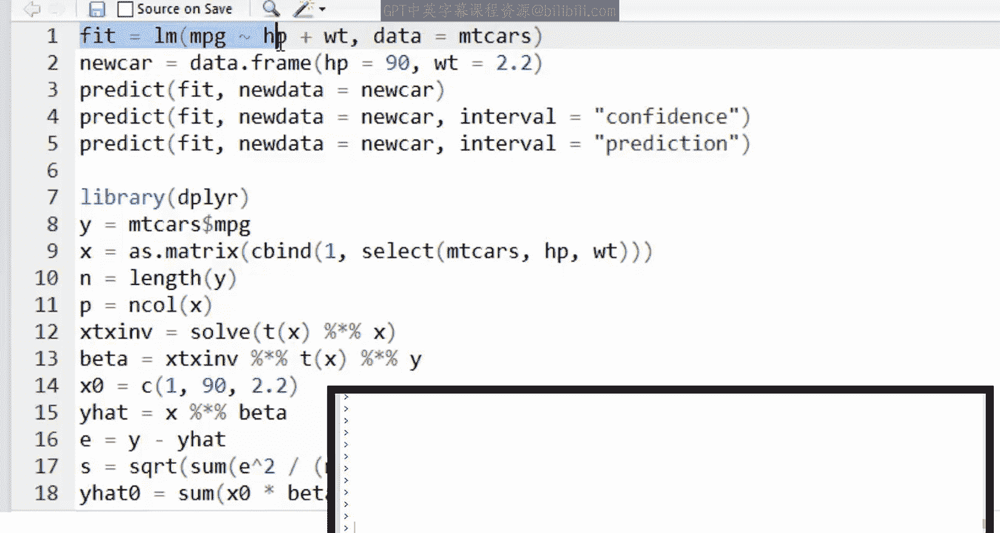

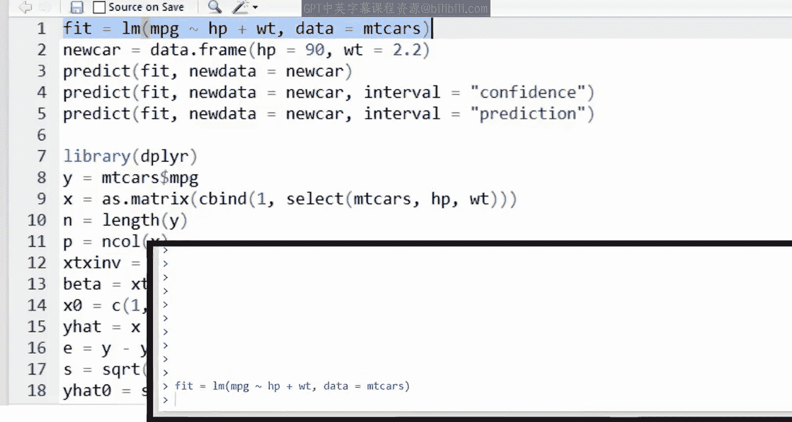

在本节课中，我们将通过一个具体的编程示例，学习如何为线性回归模型计算**置信区间**和**预测区间**。我们将使用R语言和`mtcars`数据集，手动和自动地完成计算，以深入理解其背后的原理。

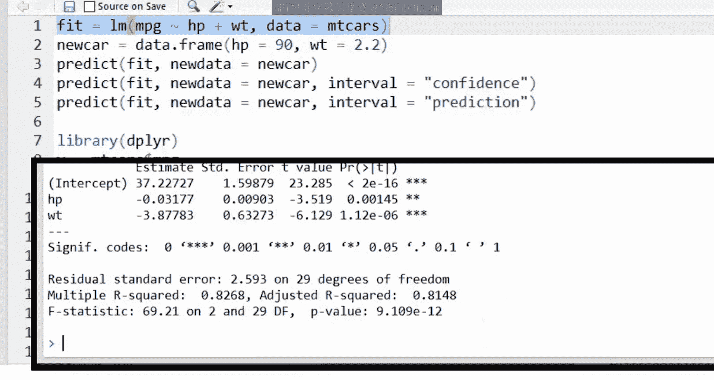

## 数据准备与模型拟合

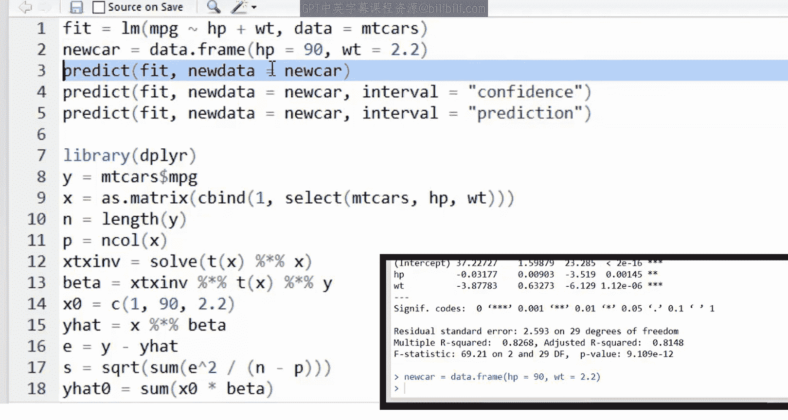

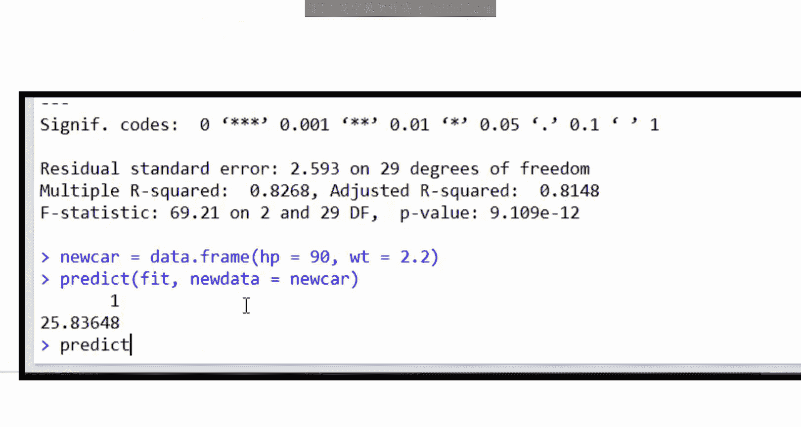

首先，我们加载数据并拟合一个线性回归模型。模型的因变量是每加仑英里数（`mpg`），自变量是马力（`hp`）和车重（`wt`），并包含截距项。

```r
# 拟合模型
fit <- lm(mpg ~ hp + wt, data = mtcars)
summary(fit)
```

运行`summary(fit)`可以查看模型的详细摘要，包括系数估计值、标准误和R方等统计量。

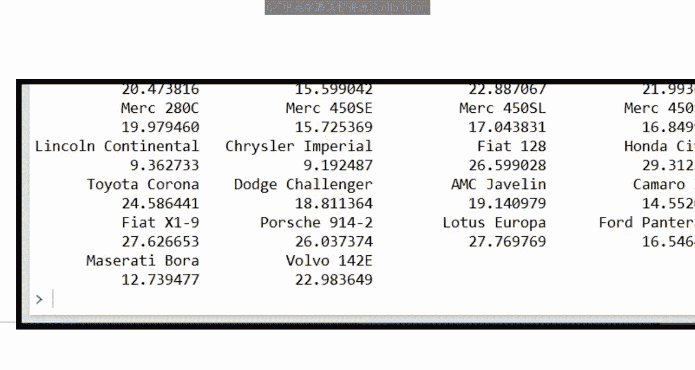

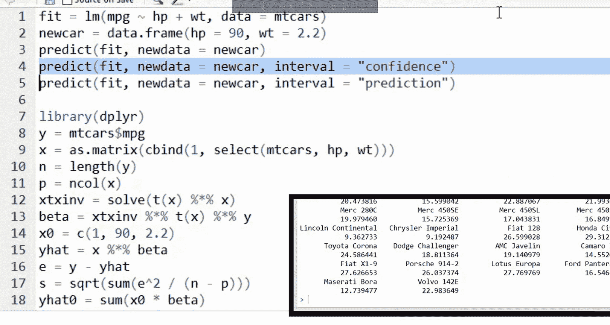

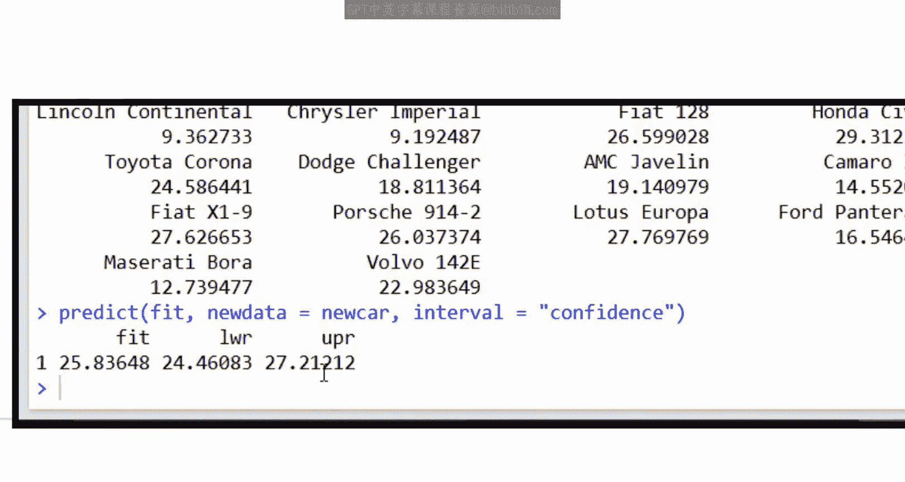

## 使用`predict`函数进行预测

上一节我们拟合了模型，本节中我们来看看如何使用它进行预测。假设我们有一辆新车，其马力为90，车重为2.2（千磅）。我们可以创建一个新的数据框，并使用`predict`函数来预测其油耗。

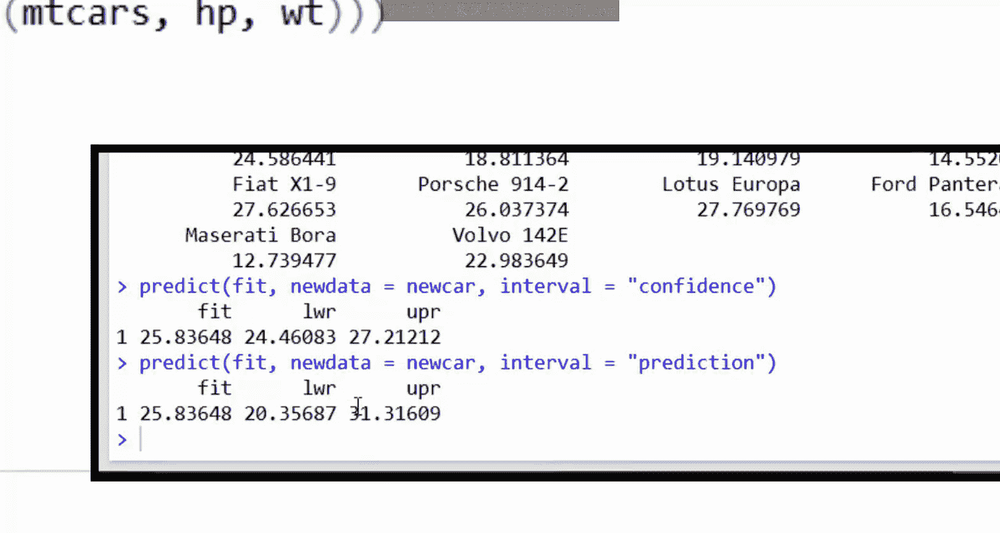

```r
# 创建新数据点
new_car <- data.frame(hp = 90, wt = 2.2)

# 进行点预测
predicted_value <- predict(fit, newdata = new_car)
predicted_value
```
输出结果约为25.8英里/加仑。

如果不提供`newdata`参数，`predict`函数会默认对原始数据中的所有观测值进行预测，即计算拟合值 $\hat{y} = X\hat{\beta}$。

## 计算置信区间与预测区间

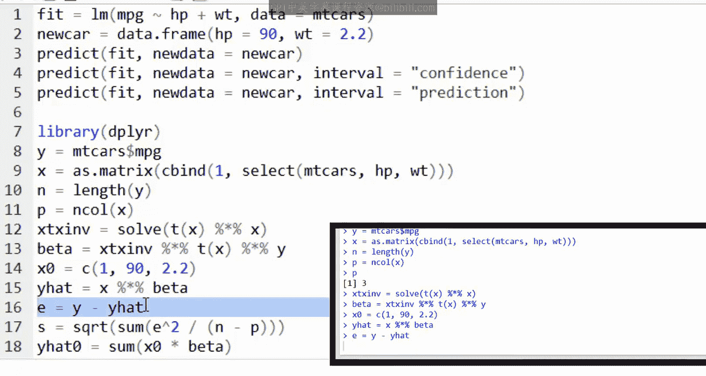

`predict`函数的一个强大功能是能够直接计算区间估计。通过指定`interval`和`level`参数，我们可以轻松得到置信区间或预测区间。

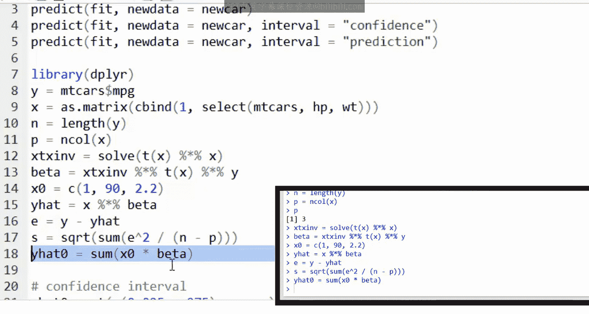

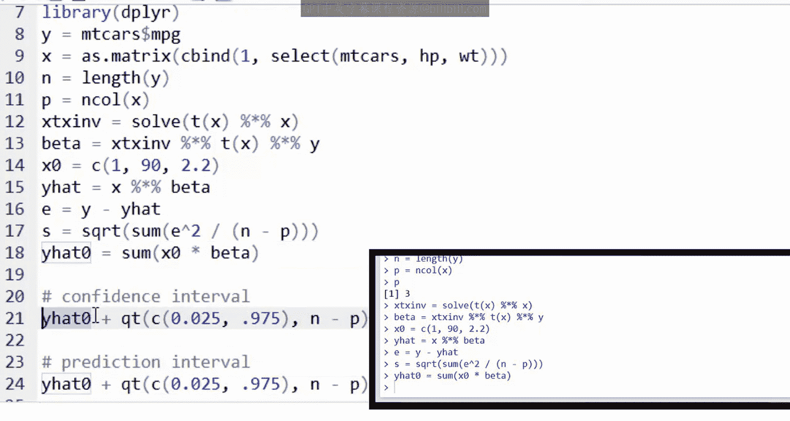

以下是两种区间的计算方法：
*   **置信区间**：用于估计**预测均值**（即回归线本身）的不确定性。区间较窄。
    ```r
    confidence_interval <- predict(fit, newdata = new_car, interval = "confidence", level = 0.95)
    confidence_interval
    ```
*   **预测区间**：用于估计**单个新观测值**的不确定性。它包含了回归线的不确定性和围绕回归线的随机误差（$\epsilon$）。因此，区间比置信区间更宽。
    ```r
    prediction_interval <- predict(fit, newdata = new_car, interval = "prediction", level = 0.95)
    prediction_interval
    ```
比较两者的结果，可以直观地看到预测区间的上下限范围更大。

## 手动计算原理

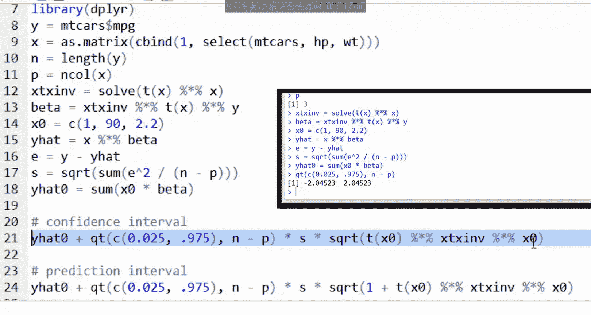

为了深入理解`predict`函数背后的数学原理，我们现在来手动计算这些区间。这有助于我们掌握每个步骤的具体含义。

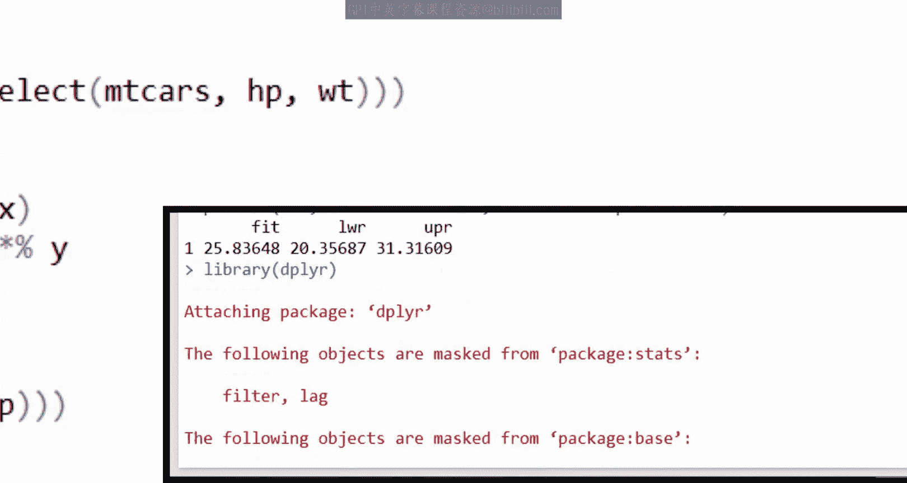

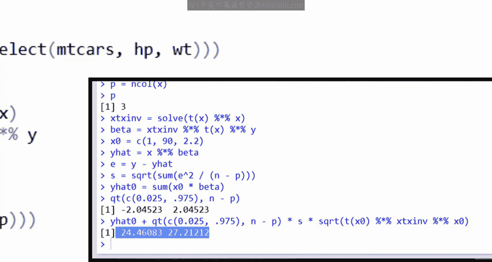

首先，我们需要提取模型的基本元素：
```r
library(dplyr)
y <- mtcars$mpg
X <- cbind(1, select(mtcars, hp, wt)) # 设计矩阵，第一列为1代表截距
n <- nrow(X) # 样本量
p <- ncol(X) # 参数个数（包括截距）
```
接下来，我们按步骤计算：
1.  **计算参数估计 $\hat{\beta}$**：
    $\hat{\beta} = (X^TX)^{-1}X^Ty$
    ```r
    beta_hat <- solve(t(X) %*% X) %*% t(X) %*% y
    ```
2.  **计算残差方差估计 $s^2$**：
    $s^2 = \frac{\sum (y_i - \hat{y}_i)^2}{n - p}$
    ```r
    y_hat <- X %*% beta_hat
    residuals <- y - y_hat
    s_squared <- sum(residuals^2) / (n - p)
    s <- sqrt(s_squared)
    ```
3.  **定义新观测点 $x_0$ 并计算点预测 $\hat{y}_0$**：
    $\hat{y}_0 = x_0^T \hat{\beta}$
    ```r
    x0 <- c(1, 90, 2.2) # 对应截距、hp=90、wt=2.2
    y0_hat <- sum(x0 * beta_hat) # 等价于 x0 %*% beta_hat
    ```
4.  **计算置信区间**：
    $\hat{y}_0 \pm t_{1-\alpha/2, n-p} \cdot s \cdot \sqrt{x_0^T (X^TX)^{-1} x_0}$
    ```r
    se_mean <- s * sqrt( t(x0) %*% solve(t(X) %*% X) %*% x0 )
    t_quantile <- qt(0.975, df = n-p)
    ci_lower <- y0_hat - t_quantile * se_mean
    ci_upper <- y0_hat + t_quantile * se_mean
    c(ci_lower, ci_upper)
    ```
    结果应与之前`predict(..., interval="confidence")`的输出一致。
5.  **计算预测区间**：
    $\hat{y}_0 \pm t_{1-\alpha/2, n-p} \cdot s \cdot \sqrt{1 + x_0^T (X^TX)^{-1} x_0}$
    ```r
    se_pred <- s * sqrt( 1 + t(x0) %*% solve(t(X) %*% X) %*% x0 )
    pi_lower <- y0_hat - t_quantile * se_pred
    pi_upper <- y0_hat + t_quantile * se_pred
    c(pi_lower, pi_upper)
    ```
    结果应与之前`predict(..., interval="prediction")`的输出一致。

## 总结

本节课中我们一起学习了线性回归中区间估计的实践方法。
*   我们使用`mtcars`数据集拟合了模型，并利用`predict`函数方便地计算了点预测、置信区间和预测区间。
*   通过手动计算，我们深入理解了置信区间与预测区间在公式上的核心区别：预测区间在根号内多了一个“1”，这代表了模型无法解释的个体随机误差 $\epsilon$ 的方差，因此其区间范围总是更宽。
*   在实际数据分析中，我们应直接使用`predict`等内置函数。手动计算主要服务于教学目的，旨在帮助我们透彻理解统计原理。

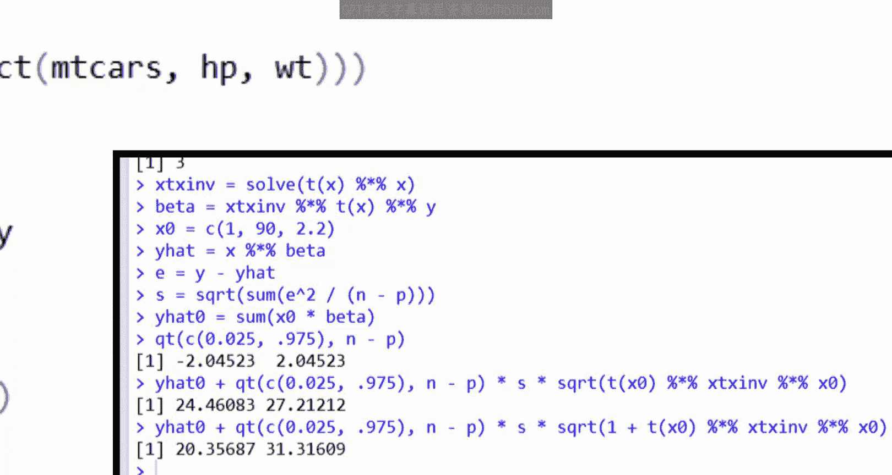

记住关键点：当你想估计**回归线（预测均值）**在某个点的位置时，使用**置信区间**；当你想预测**一个具体的新观测值**的可能范围时，使用**预测区间**。