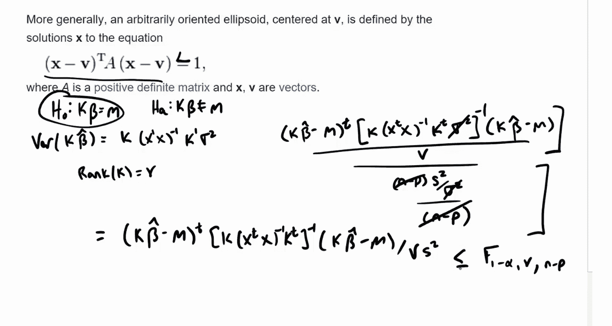
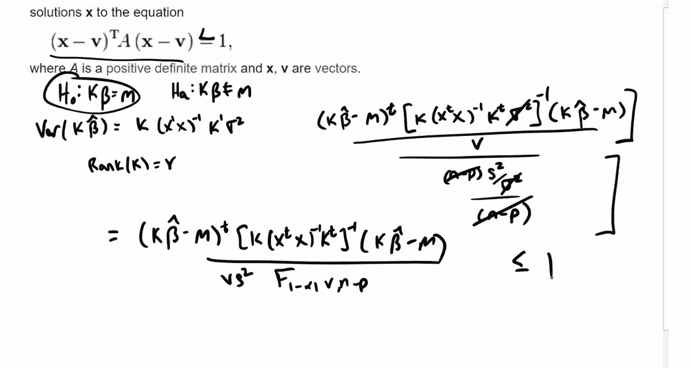
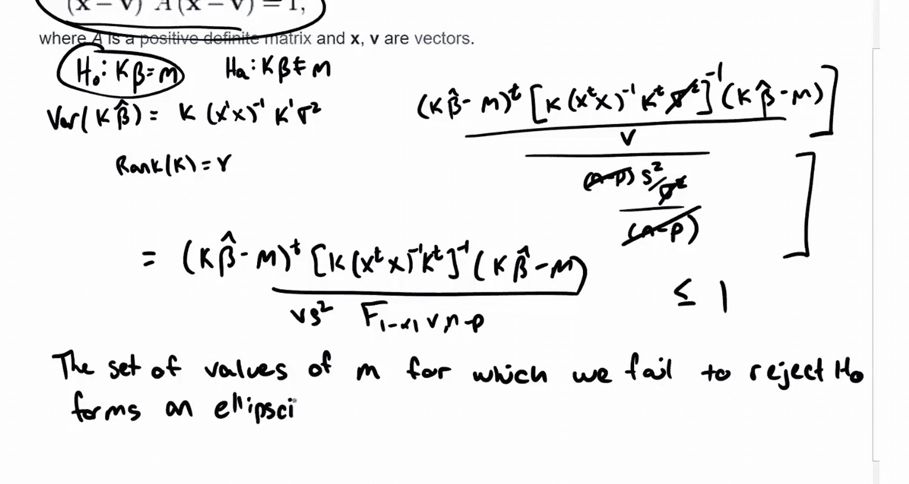
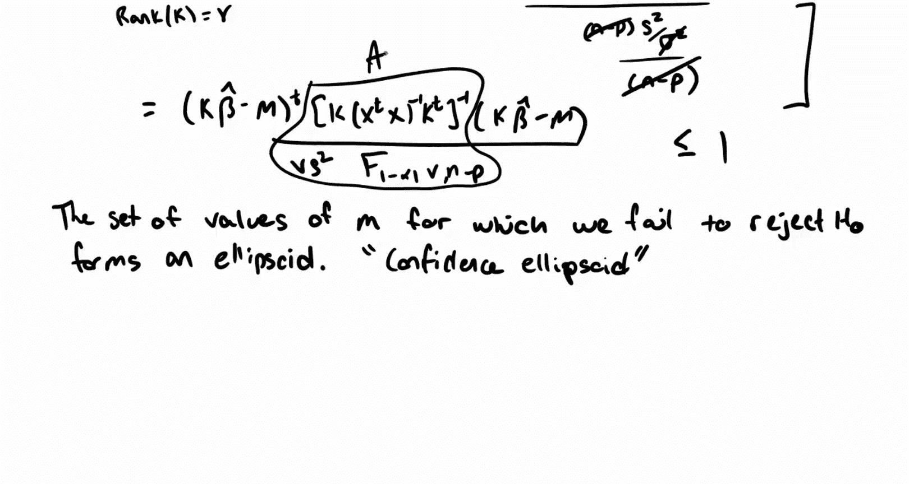
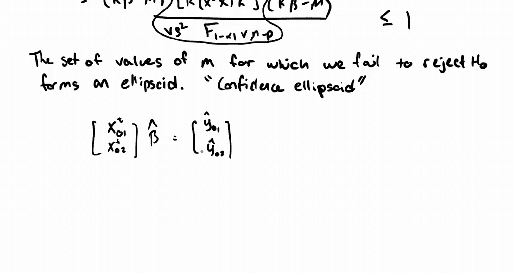

#  128：置信椭球 🎯

在本节课中，我们将学习置信椭球的概念，它是置信区间在多维空间中的推广。我们将从椭圆的数学定义出发，联系到线性回归中的假设检验，并最终推导出置信椭球的公式。

## 从椭圆定义到马氏距离

上一节我们回顾了假设检验的基础。本节中，我们来看看置信椭球的几何起源。

维基百科上关于椭圆的定义指出，一个任意方向的椭圆，其中心为 **V**，由满足以下方程的点 **x** 定义：
**（x - V）ᵀ A （x - V） = 1**

其中：
*   **V** 是椭圆的中心。
*   矩阵 **A** 的第一个特征值是椭圆长轴的长度，第二个特征值是短轴的长度。
*   满足 **（x - V）ᵀ A （x - V） ≤ 1** 的点都在椭圆的内部。

此时，你可能会注意到这个方程与 **x** 和 **V** 之间的**马氏距离**公式相同，其中 **A** 是权重矩阵。同时，它看起来也非常像 **F 统计量**的公式。

## 回顾线性回归中的假设检验

为了建立联系，让我们回顾线性回归中的假设检验。考虑假设：
**H₀: Kβ = m**  vs  **H₁: Kβ ≠ m**

我们之前讨论过，估计量 **Kβ̂** 的方差为：
**Var(Kβ̂) = K (XᵀX)⁻¹ Kᵀ σ²**

由此，我们构造的统计量是：
**（Kβ̂ - m）ᵀ [Var(Kβ̂)]⁻¹ （Kβ̂ - m） / σ² ~ χ²（v）**
其中 **v** 是矩阵 **K** 的秩（即自由度）。

此外，我们知道：
**（n - p） s² / σ² ~ χ²（n - p）**
其中 **s²** 是误差方差 σ² 的估计量，**n** 是样本量，**p** 是参数个数。

## 构建F统计量与置信椭球

上一节我们介绍了卡方分布，本节中我们来看看如何构建F统计量并最终得到椭球。

由于上述两个卡方统计量相互独立，我们可以构建F统计量：
**F = [ （Kβ̂ - m）ᵀ [K (XᵀX)⁻¹ Kᵀ]⁻¹ （Kβ̂ - m） / v ] / s² ~ F（v， n-p）**

整理后，我们拒绝原假设 **H₀** 的条件是：
**（Kβ̂ - m）ᵀ [K (XᵀX)⁻¹ Kᵀ]⁻¹ （Kβ̂ - m） / （v s²） ≥ F₁₋α（v， n-p）**

反之，我们**不拒绝**（或接受）原假设 **H₀** 的条件是：
**（Kβ̂ - m）ᵀ [K (XᵀX)⁻¹ Kᵀ]⁻¹ （Kβ̂ - m） / （v s²） ≤ F₁₋α（v， n-p）**

将不等式右边的临界值移到左边，我们得到：
**（Kβ̂ - m）ᵀ [K (XᵀX)⁻¹ Kᵀ]⁻¹ （Kβ̂ - m） ≤ v s² F₁₋α（v， n-p）**

## 定义置信椭球

现在，我们可以给出置信椭球的正式定义。

观察上面的不等式，它与本节开头提到的椭圆内部点的定义形式完全一致。因此，我们得到结论：

所有使得我们无法拒绝原假设 **H₀: Kβ = m** 的 **m** 值的集合，构成了一个**椭球**的内部区域。这个椭球被称为**置信椭球**。

以下是置信椭球的核心要点：
*   **本质**：置信椭球是单变量置信区间在多维空间中的自然推广。
*   **中心**：椭球的中心是我们的点估计 **Kβ̂**。
*   **形状矩阵**：决定椭球方向和形状的矩阵 **A** 是 **A = [K (XᵀX)⁻¹ Kᵀ]⁻¹ / （v s² F₁₋α）**。
*   **变量**：在构造过程中，**Kβ̂** 是已知的观测值，而 **m** 是变化的变量。

## 置信椭球的应用场景

理解了置信椭球的定义后，我们来看看它的实际用途。

置信椭球在数据分析中有多种应用场景：
*   **回归参数的联合推断**：例如，在线性回归中，如果你想同时为截距和斜率构建一个联合置信区域，而不是两个独立的置信区间，就需要使用置信椭球。
*   **多重预测值的联合区间**：假设有两个新的预测变量值 **x_{01}** 和 **x_{02}**，通过线性模型得到预测值 **ŷ_{01} = x_{01}ᵀβ̂** 和 **ŷ_{02} = x_{02}ᵀβ̂**。如果你希望为这两个预测值建立一个联合置信区域，也可以使用置信椭球的方法。
*   **推广**：基于这个公式，你还可以将其推广到构建**预测椭球**。

## 总结与预告

本节课中，我们一起学习了置信椭球的概念。我们从椭圆的几何定义出发，通过回顾线性回归中的F检验，推导出了置信椭球的数学形式。置信椭球为我们提供了对多个参数或预测值进行联合统计推断的强大工具。

在下一讲中，我们将通过一个具体的编码示例，展示如何在三维空间中创建和可视化一个置信椭球。使用RGL等工具，我们可以直观地观察椭球的形态，这将使理解变得更加生动和深刻。