#  129：编程示例 - 创建置信椭球体 🎯

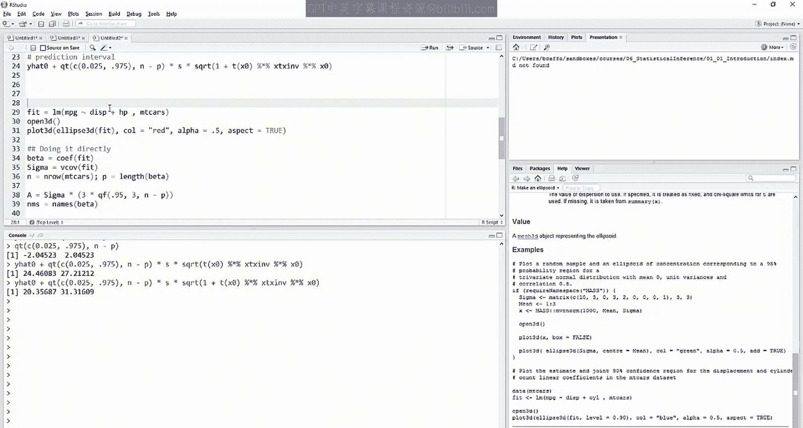

在本节课中，我们将学习如何使用R语言和`rgl`包，为一个多元线性回归模型的系数创建三维置信椭球体。我们将通过一个具体的例子，即使用`mtcars`数据集，以每加仑英里数（mpg）为因变量，排量（disp）和马力（hp）为自变量，来演示整个过程。

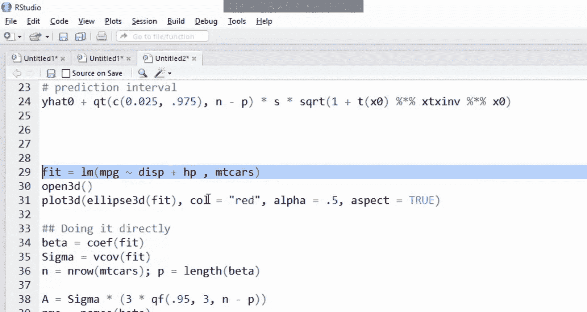

---

## 概述

我们将首先拟合一个线性模型，然后利用`rgl`包的可视化功能，绘制出模型三个系数（截距、排量系数、马力系数）的95%联合置信区域。我们将展示两种方法：一种是直接使用`ellipse3d`函数的便捷方式，另一种是更直接地根据置信椭球体的数学定义进行计算和绘制。

---

## 第一步：拟合线性模型

首先，我们使用`mtcars`数据集拟合一个线性模型。模型的因变量是`mpg`（每加仑英里数），自变量是`disp`（排量）和`hp`（马力）。

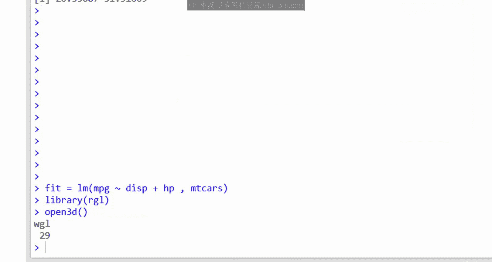

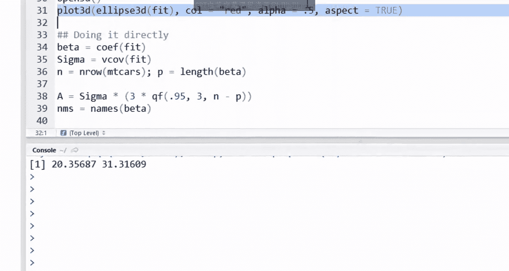

```r
# 拟合线性模型
fit <- lm(mpg ~ disp + hp, data = mtcars)
```

---

## 第二步：准备三维绘图环境

为了绘制三维图形，我们需要加载`rgl`包。请注意，`rgl`包需要本地图形硬件的支持，因此你需要在本地R环境中运行此代码，无法在网页版的RStudio服务器上执行。

```r
# 加载rgl包
library(rgl)

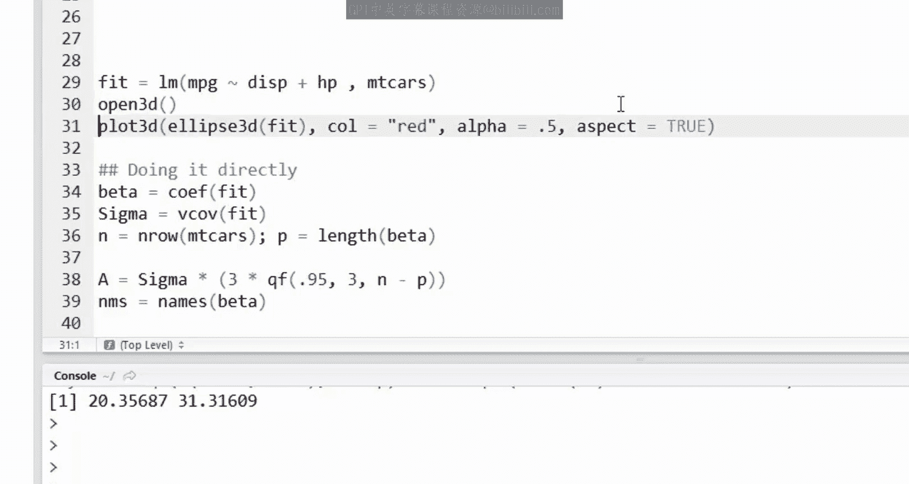

# 打开一个新的3D绘图窗口
open3d()
```

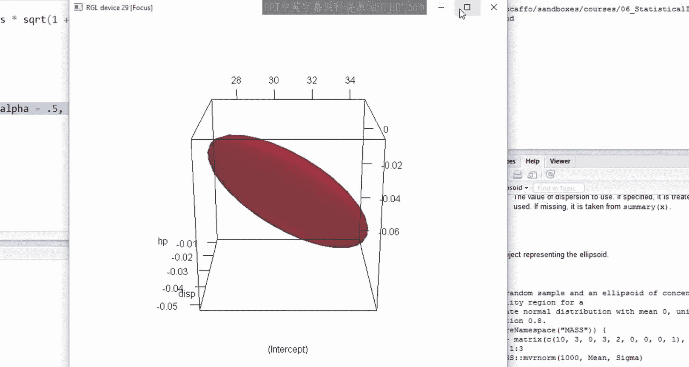

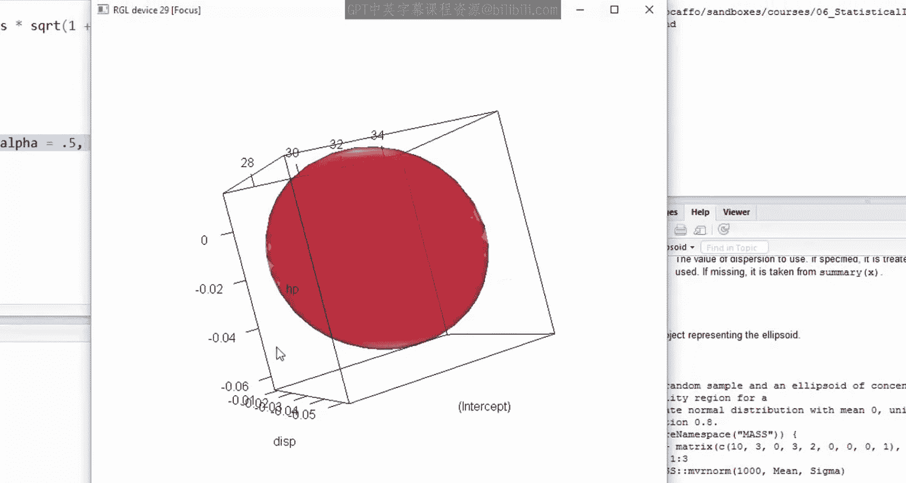

执行`open3d()`后，会弹出一个新的三维图形窗口，你可以调整其大小。

---

## 方法一：使用ellipse3d函数直接绘制

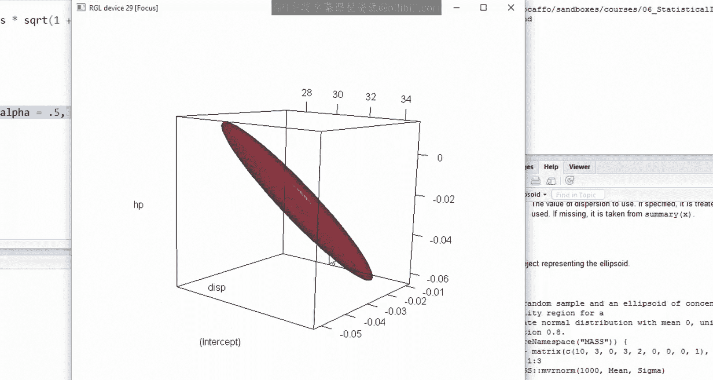

`ellipse3d`函数可以方便地从拟合的模型对象中提取前三个系数，并自动生成它们的联合置信椭球体。

以下是具体步骤和代码：

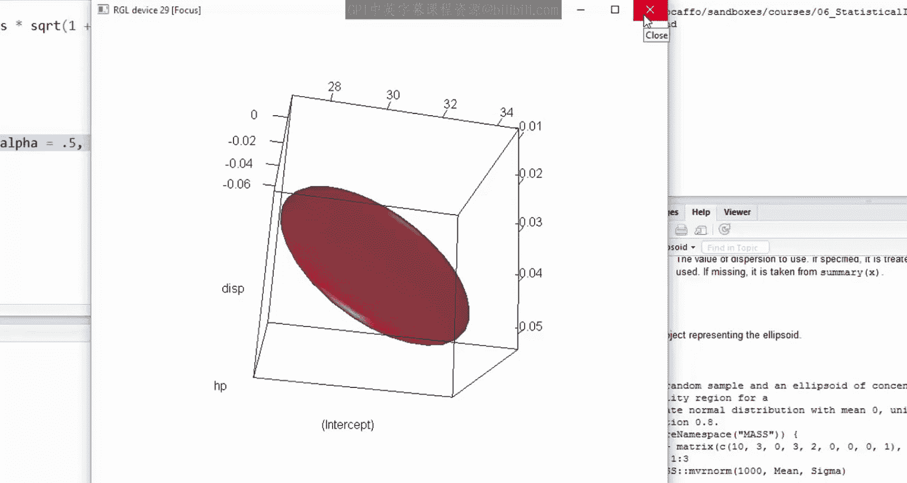

```r
# 使用ellipse3d函数绘制置信椭球体
ellipse3d(fit, level = 0.95, col = "red", alpha = 0.5, aspect = TRUE)
```

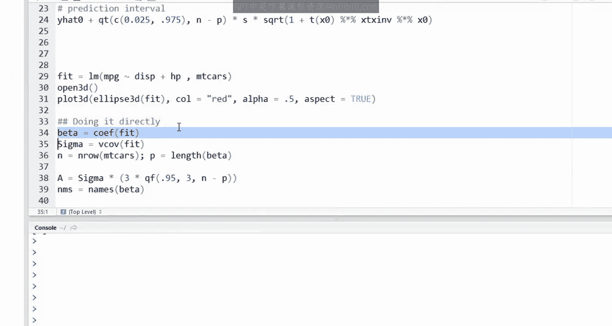

**代码解释**：
*   `fit`: 我们之前拟合的线性模型对象。
*   `level = 0.95`: 指定置信水平为95%。
*   `col = "red"`: 将椭球体颜色设置为红色。
*   `alpha = 0.5`: 设置透明度为50%，使其半透明以便观察内部结构。
*   `aspect = TRUE`: 自动调整坐标轴比例，使图形显示更协调。

运行后，三维窗口中会出现一个红色的半透明椭球体。它的三个轴分别代表模型的截距、`disp`的系数和`hp`的系数。这个椭球体定义了这三个系数真实值的一个95%联合置信区域。

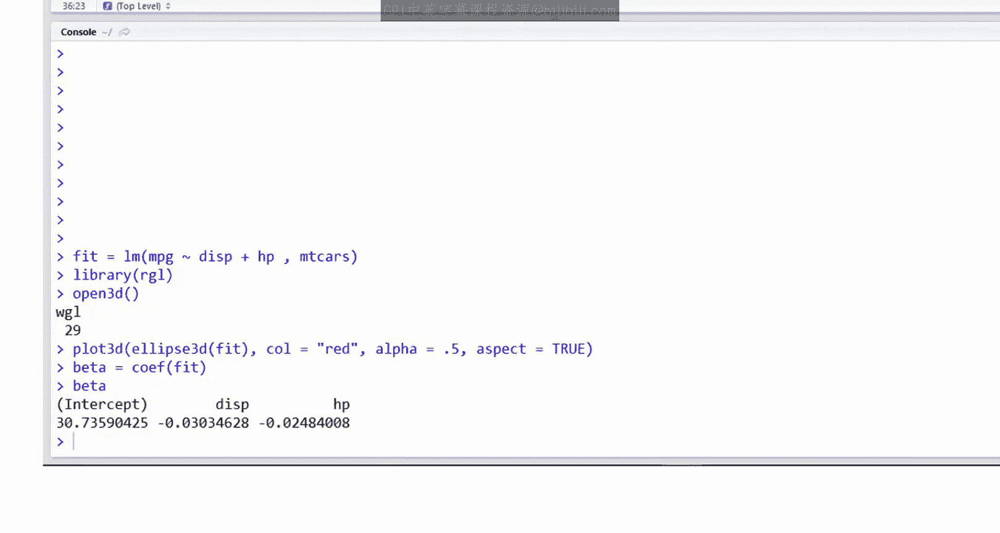

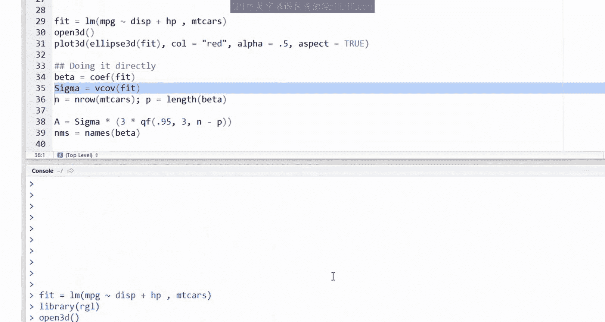

---

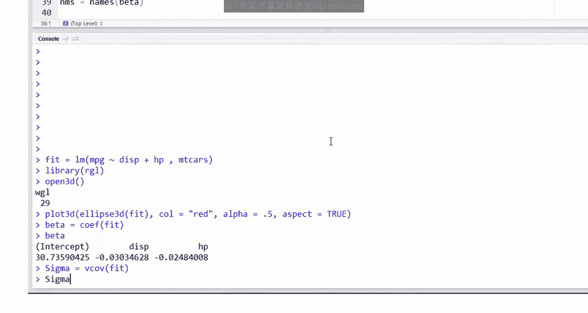

## 方法二：根据定义手动计算并绘制

上一节我们介绍了使用现成函数快速绘图的方法。本节中，我们来看看如何更直接地根据置信椭球体的数学定义来创建它，这有助于我们更深入地理解其原理。

首先，我们需要获取模型的关键参数：

```r
# 获取系数估计值向量 beta_hat
beta <- coef(fit)

# 获取系数估计的方差-协方差矩阵 Sigma
sigma <- vcov(fit)

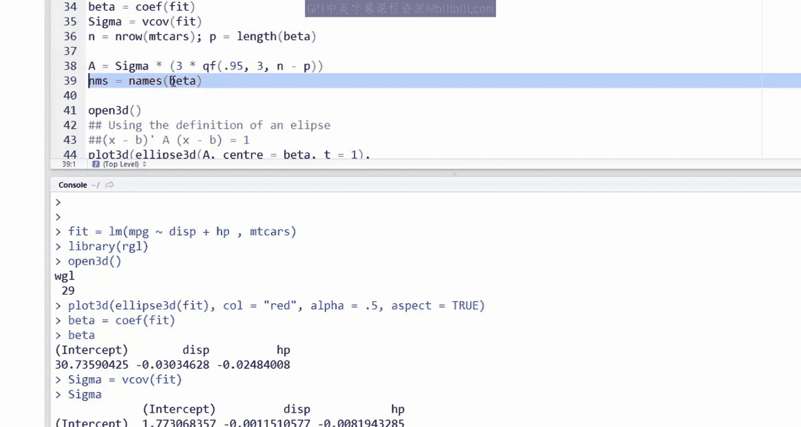

# 获取样本量 n 和预测变量个数 p
n <- nrow(model.matrix(fit))
p <- ncol(model.matrix(fit))
```

接下来，根据置信椭球体的公式计算矩阵 `A`。在数学上，置信区域由所有满足以下条件的点 `b` 构成：
**(b - beta_hat)^T * A^{-1} * (b - beta_hat) <= 1**

其中矩阵 `A` 与方差-协方差矩阵 `Sigma` 和F分布的分位数有关。

```r
# 计算用于定义椭球的矩阵 A
# 注意：此处的 A 对应理论公式中的 A^{-1}
r <- 3 # 我们关注的系数维度（截距、disp、hp）
A <- sigma * (r * (n - p) / (p * (n - r)) * qf(0.95, r, n - p))
```

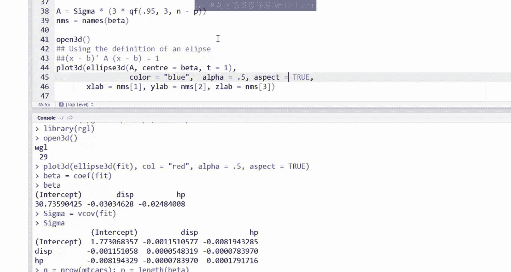

现在，我们使用计算出的矩阵 `A` 和系数估计 `beta` 来绘制椭球体。

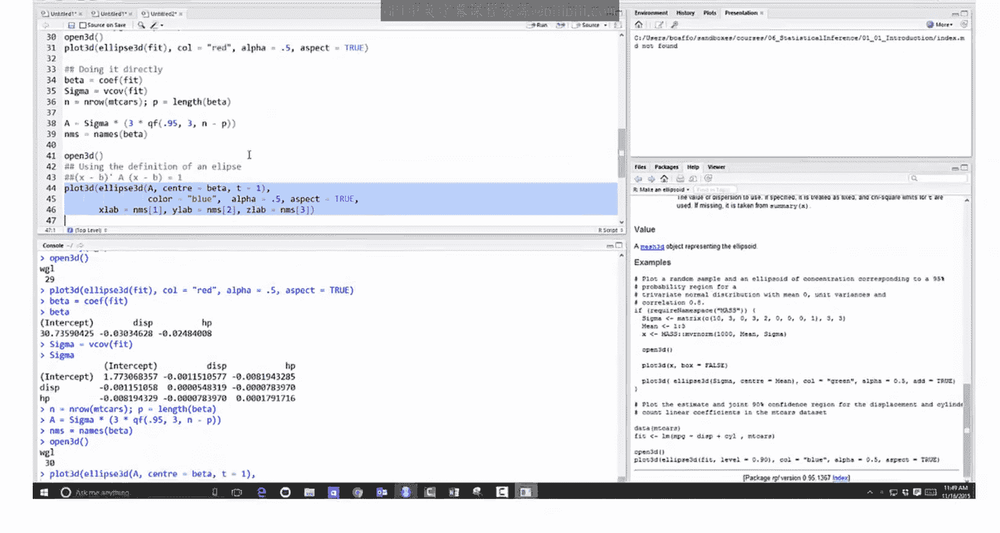

```r
# 手动绘制置信椭球体
plot3d(ellipse3d(A, centre = beta),
       col = "blue", alpha = 0.5, aspect = TRUE,
       xlab = "Intercept", ylab = "Disp", zlab = "HP")
```

**代码解释**：
*   `ellipse3d(A, centre = beta)`: 以 `beta` 为中心，用矩阵 `A` 定义椭球的形状。
*   `col = "blue"`: 将本次绘制的椭球体设为蓝色，以便与方法一的红色椭球体区分。
*   `xlab`, `ylab`, `zlab`: 为三个坐标轴设置标签。

运行这段代码后，你会看到一个蓝色的半透明椭球体。它与之前用第一种方法绘制的红色椭球体完全重合，验证了两种方法在数学上的一致性。通过手动计算，我们更清晰地看到了置信椭球体是如何从模型的标准误和协方差信息中构建出来的。

---

## 应用与总结

本节课中，我们一起学习了在R中创建和可视化多元线性回归系数置信椭球体的两种方法。

*   **核心价值**：置信椭球体提供了模型多个参数联合不确定性的直观三维表示，比单独的一维置信区间包含更多信息。
*   **方法选择**：`ellipse3d(fit)` 方法快捷方便，适合快速可视化。而基于公式 `(b - beta_hat)^T * A^{-1} * (b - beta_hat) <= 1` 的手动计算方法更基础，有助于理解原理，并且灵活性更高，可以推广到其他自定义的置信区域绘制中。
*   **典型应用场景**：除了展示系数的不确定性，这种技术更常见的用途可能是可视化对多个因变量的**联合预测区间**，这在多输出预测问题中非常有用。

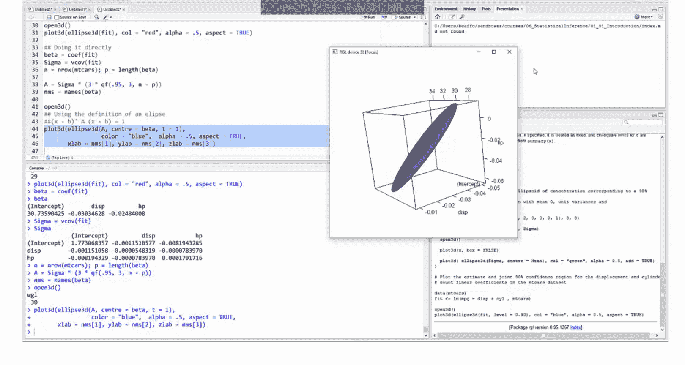

掌握这项技术不仅能加深你对多元统计推断的理解，还能让你创建出令人印象深刻的可视化图形来展示复杂的统计结果。