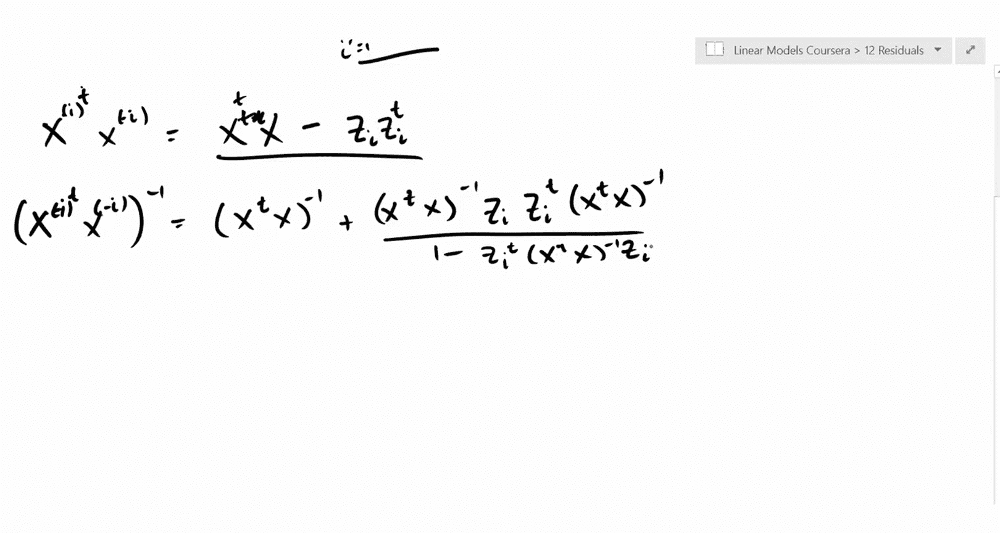
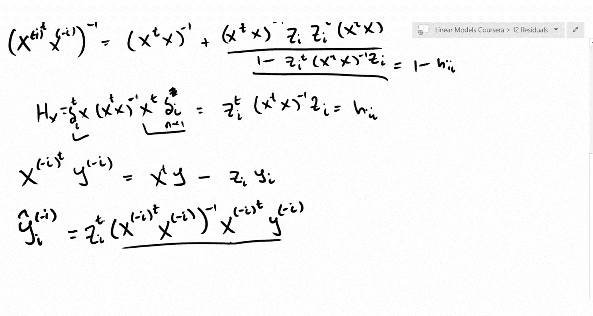
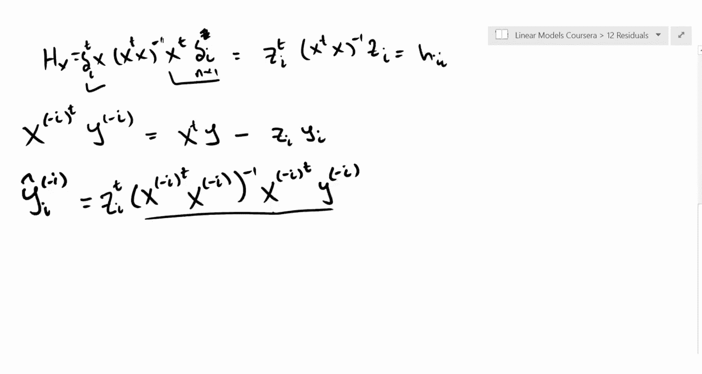
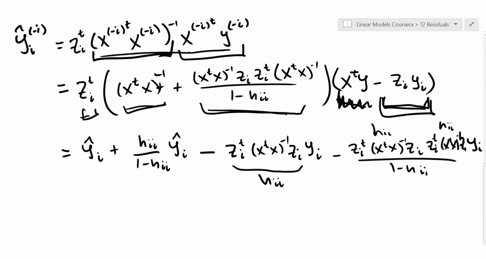
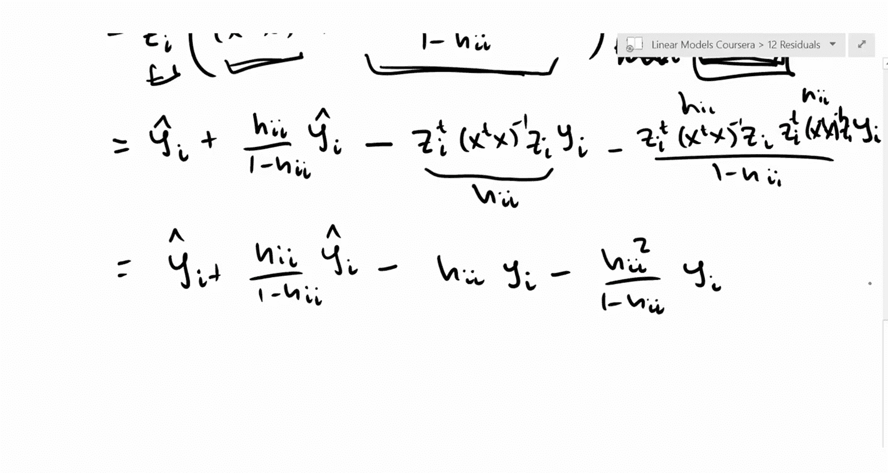
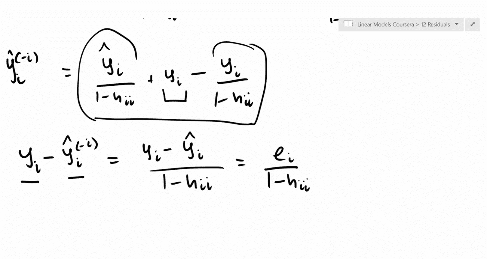

#  133：PRESS残差的计算捷径 🧮

在本节课中，我们将学习如何在不重新拟合模型的情况下，计算PRESS残差。PRESS残差是回归诊断中的一个重要工具，它衡量了模型对每个数据点的预测能力。我们将通过一些巧妙的矩阵运算技巧来实现这一目标。

---

## 1. PRESS残差的定义

PRESS残差定义为：第 `i` 个观测值的实际值，减去使用**删除该观测值后**的数据集拟合模型，并对该观测值所做的预测值。

用公式表示如下：

**PRESS残差公式：**
```
e_i (PRESS) = y_i - ŷ_i(-i)
```
其中：
*   `y_i` 是第 `i` 个观测的实际响应值。
*   `ŷ_i(-i)` 是使用删除第 `i` 个观测后的数据集拟合模型，对 `x_i` 的预测值。

上一节我们介绍了PRESS残差的概念，本节中我们来看看如何高效地计算它。

---



## 2. 核心技巧：矩阵分块与Sherman-Morrison-Woodbury定理

计算PRESS残差的关键在于两个巧妙的技巧，它们避免了为每个数据点都重新拟合一次模型。

**技巧一：按行分块设计矩阵**
通常我们将设计矩阵 `X` 按列（即预测变量）分块。但在这里，我们将其按行分块，并将每一行视为一个列向量 `z_i^T`。
```
X = [z_1^T, z_2^T, ..., z_n^T]^T
```
这样，`X^T X` 可以表示为：
```
X^T X = Σ (z_i * z_i^T)   (对所有 i 求和)
```

**技巧二：Sherman-Morrison-Woodbury (SMW) 定理**
这是一个用于计算矩阵逆的更新公式。当我们删除第 `i` 个数据点时，新的 `X^T X` 矩阵为：
```
(X^T X)_(-i) = X^T X - z_i * z_i^T
```
SMW定理告诉我们这个新矩阵的逆为：
```
[(X^T X)_(-i)]^{-1} = (X^T X)^{-1} + [(X^T X)^{-1} * z_i * z_i^T * (X^T X)^{-1}] / (1 - H_ii)
```
其中 `H_ii` 是帽子矩阵 `H` 的第 `i` 个对角元。

---

## 3. 帽子矩阵对角元的意义

帽子矩阵 `H` 定义为：
```
H = X (X^T X)^{-1} X^T
```
它的第 `i` 个对角元 `H_ii` 有一个简洁的表达式：
```
H_ii = z_i^T (X^T X)^{-1} z_i
```
`H_ii` 衡量了第 `i` 个观测的**杠杆值**，即该观测的预测变量值对自身拟合值的影响程度。它在PRESS残差的计算中扮演着关键角色。

---



## 4. 推导PRESS残差的简化公式



我们的目标是计算 `ŷ_i(-i)`。根据定义：
```
ŷ_i(-i) = z_i^T * β_hat(-i)
```
其中 `β_hat(-i)` 是删除第 `i` 个观测后估计的回归系数。

通过代入前面推导的 `[(X^T X)_(-i)]^{-1}` 和 `(X^T y)_(-i)` 的表达式，并进行一系列代数运算（主要是合并同类项和化简），我们可以得到一个惊人的简化结果。

以下是关键的推导步骤：

1.  将 `ŷ_i(-i)` 展开为包含 `(X^T X)^{-1}`、`z_i` 和 `y` 的表达式。
2.  利用SMW定理替换逆矩阵部分。
3.  将 `(X^T y)_(-i)` 表示为 `X^T y - z_i * y_i`。
4.  进行矩阵乘法，并识别出普通残差 `e_i = y_i - ŷ_i` 和杠杆值 `H_ii`。

经过化简，最终得到：
```
ŷ_i(-i) = (ŷ_i - H_ii * y_i) / (1 - H_ii)
```

---

## 5. 最终结论：PRESS残差的计算公式

将 `ŷ_i(-i)` 的简化公式代入PRESS残差的定义，我们得到：





**PRESS残差最终公式：**
```
e_i (PRESS) = (y_i - ŷ_i) / (1 - H_ii) = e_i / (1 - H_ii)
```

这个结果非常简洁且强大。它表明：
*   **PRESS残差等于普通残差除以 `(1 - 杠杆值)`。**
*   杠杆值 `H_ii` 越大（即该点对模型拟合影响越大），删除它后产生的预测误差（PRESS残差）就比普通残差放大得越多。
*   我们**完全不需要重新拟合模型**，只需利用一次完整拟合得到的普通残差和帽子矩阵，即可计算出所有数据点的PRESS残差。

这意味着，对于线性模型，**留一交叉验证的预测误差可以直接从一次模型拟合中获得**。这是一个极其有用的结果，尤其是在处理大型数据集时。

---

## 6. 总结与启示

本节课中我们一起学习了PRESS残差的高效计算法。我们回顾一下核心要点：

1.  **目标**：计算删除每个点后的预测误差，用于模型诊断和评估。
2.  **挑战**：直接计算需要拟合n次模型，计算量巨大。
3.  **方法**：通过将设计矩阵按行分块，并应用Sherman-Morrison-Woodbury矩阵求逆定理。
4.  **核心结果**：推导出关键公式 `PRESS残差 = 普通残差 / (1 - 杠杆值)`。
5.  **意义**：该公式揭示了杠杆点对预测误差的放大效应，并提供了无需重复拟合的快速计算方法，是回归诊断中一个非常实用且优雅的工具。



这个推导过程虽然涉及一些矩阵运算技巧，但最终结论简单直观，易于在统计软件中实现和应用。