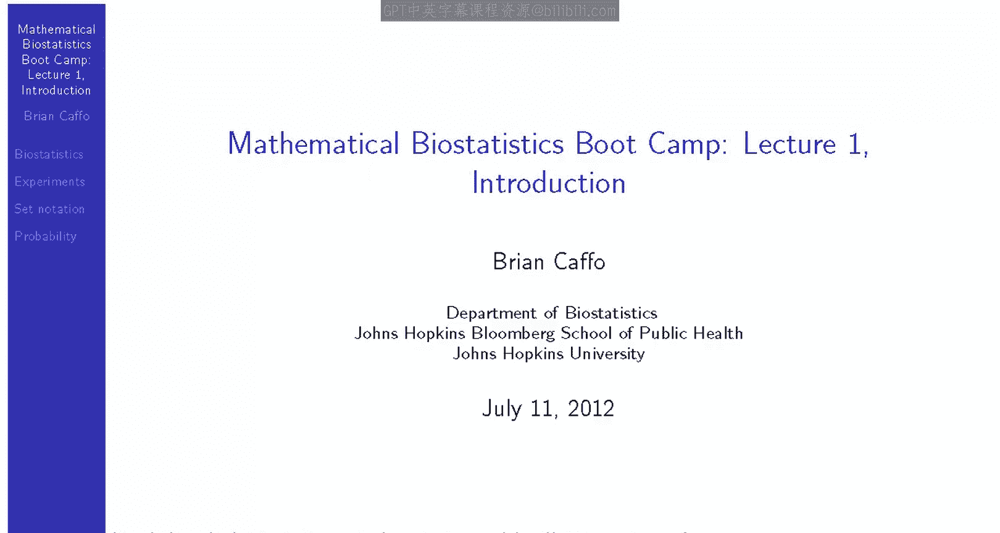
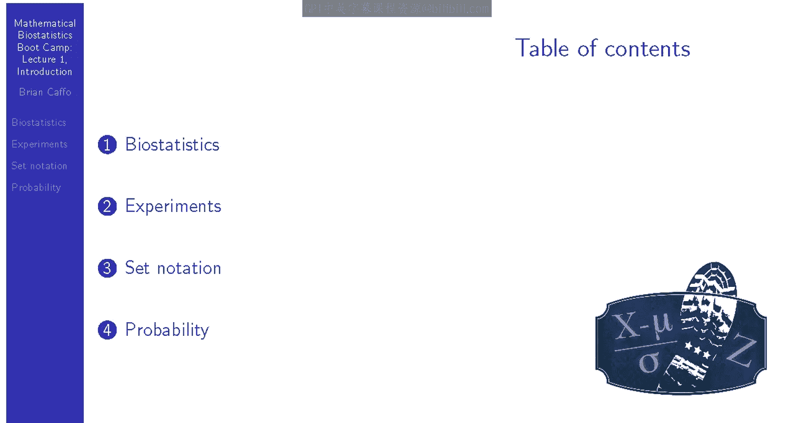
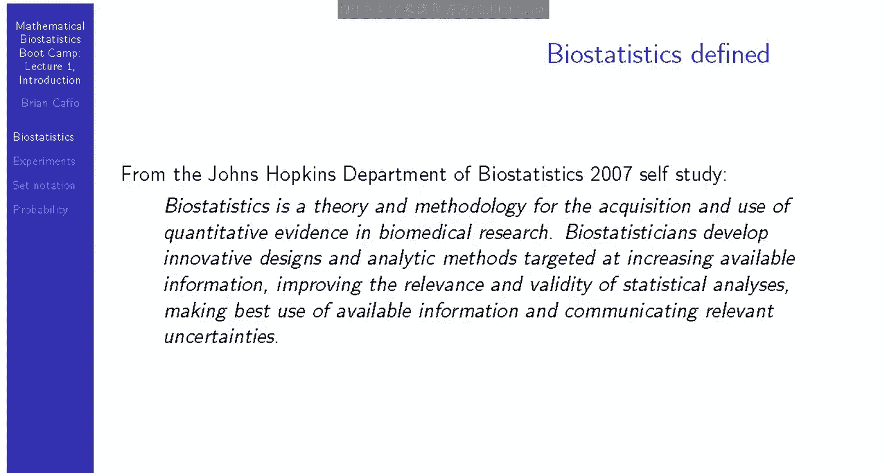
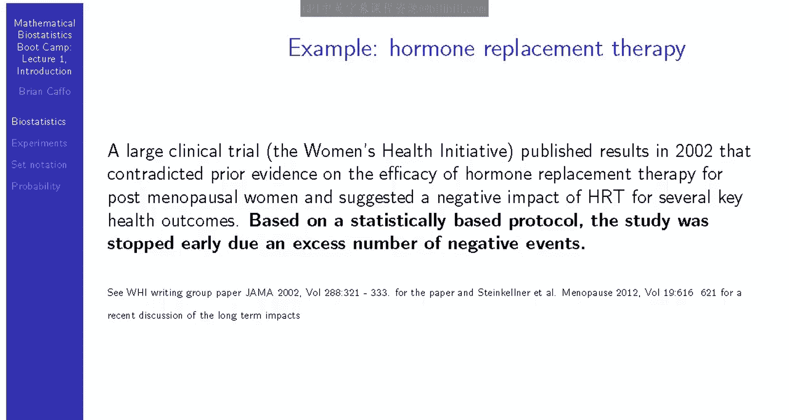
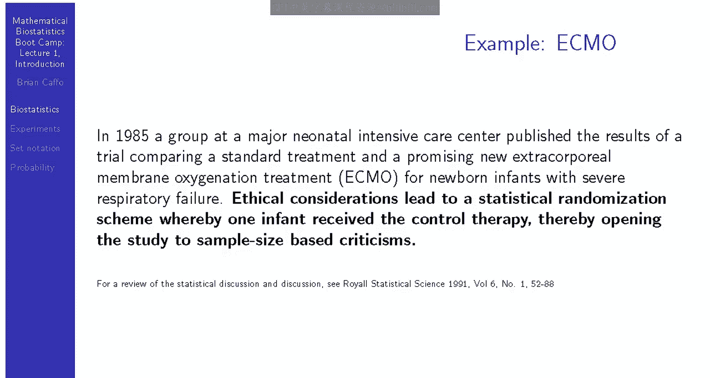
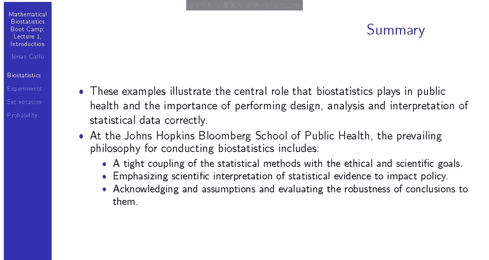
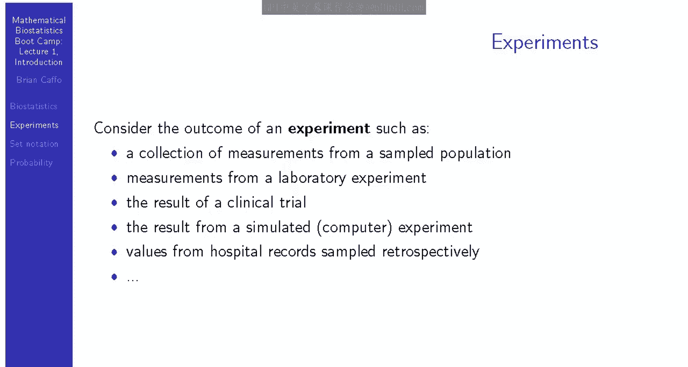

# 约翰霍普金斯大学《数据科学的高级统计｜Advanced Statistics for Data Science》中英字幕（deepseek p02 1_生物统计与实验设计.zh_en -BV1htPjeYEFH_p2-

Hi， my name is Brian Kaho。 I'm in the Department of Biostatistics at the Johns Hopkins Bloomberg School of Public Health。

 This is Mathematical Biosstatistics Boot camp。

And this is lecture one， where we'll cover some introductory material。In this lecture。

 we'll talk about the basics of biostatistics and motivate it。

We will abstract the idea of an experiment。 We'll go over some basic set notation because set notation in the context of probability has a slightly different interpretation than classical set notation。

And then we'll cover some of the very basics of probability。

Let's talk very briefly about the subject of biostatistics。My department。

 the Department of Biosstatistics in his 2007 Se study。

 we attempted to define biostatistics the definition that we came up with。

 it was actually quite difficult to get everyone to agree。

 but this is what we came up with biostatistics is a theory and methodology for the acquisition and use of quantitative evidence in biomedical research biostatisticians develop innovative designs and analytic methods target at increasing available information。

 improving the relevance and validity of statistical analysis。

 making the best use of available information and communicating relevant uncertainties Now I think there's a lot of very important topics in that definition and captures our discipline quite well。

 I have a much more simple definition of biostatistics that I like to use and the definition that I like to think of is that experimentation and empires。

are ultimately the language of science inductive reasoning based on empiricism is in my opinion。

 how the vast majority of science gets conducted， and I think of statistics as the language of empiricism。

 simply put that statistics is the the formal syntax associated with empiricism。

 and so when you're studying statistics， I think you're actually studying how to conduct experiments and quantify information from experimental and emic knowledge。

Let me give you one of the most famous recent examples where existing clinical practice was reversed by empirical evidence。

 there was a clinical trial that published its result in 2002。

 and the amazing part about this clinical trials that had contradicted prior evidence on the efficacy of hormone replacement therapy up to that point。

 hormone replacement therapy had been near universally thought of as a good treatment for post-menopausal women。

In fact， the trial evidence was exactly the opposite and suggested the possibility of some harm。

When conducting this experiment， the statisticians and the epidemiologists and et cea that designed the trial had to come up with ways in which to decide whether or not to stop the trial。

 whether or not to keep the trial going and how to quantify the evidence In this case。

 they had a statistically based protocol that they executed and the study was stopped due to an excess number of negative events。

 and I don't think I can appropriately describe how counterintuitive this was to the medical community at the time。

 but the key ingredient that I want to discuss is this bolded text here， where it was， in fact。

 a statistical decision based on probability that had to decide whether or not enough evidence had been collected at the time。

 to make a decision to stop the trial or to continue going。

 This is an incredibly important decision because it's unlikely that another trial of this scope would have been able to have been executed any time soon。

 So cutting it。Short would have the incredibly negative benefit of not having the full information available。

 however， keeping it going based on the evidence of an excess number of negative events could possibly put people at harm。

 so I just hope you understand that the central role that statistics was playing in the decision in this trial。

Another very good example of statistics kind of in the similar vein was ECcmo。

 which is extracorporeal membrane oxygenation treatment， this is a treatment for newborn infants。

 it was an incredibly promising treatment， it is currently a standard treatment and there was quite a bit of enthusiasm at the time of its creation that it would be a revolutionary treatment。

So when they conducted the trial， it is very difficult to consider how you would conduct a trial for a treatment that has such obvious。

Potential benefits。The ethical considerations in the trial wound up leading to a statistical design or randomization scheme whereby only one infant received the control therapy that。

 in turn， introduced criticisms sample size based about the design itself in this particular case because the treatment was so potentially beneficial。

 it was difficult to figure out how exactly to conduct a trial to evaluate its efficacy。

 And in this case， only one instance where they actually willing to give the control therapy to a child。

 However， then immediately the degree of evidence。To actually evaluate the therapy was very weak。

 So in this case， it wasn't just statistical considerations。

 It was ethical considerations and medical considerations all bundled together。

 So I hope these two examples illustrate the central role statistics plays in making public health decisions in making medical decisions in evaluating evidence。

Let me just summarize again Biosstatistics is playing a central role in public health in design。

 analysis and interpretation of statistical data and here at Johns Hopkins in the Bloomberg School of Public health。

 we have kind of what I would like to consider prevailing philosophy for conducting biostat that cuts across all of the departments and of these we include a tight coupling of the methods that we use with the ethical and scientific goals we pay special attention to emphasizing scientific interpretation of statistical evidence and try to use that interpretation to impact public policy and of course we try to acknowledge our assumptions and evaluate the robustness of our conclusions to these assumptions and I think these three principles underlie the majority of scientific research going on at the school this is not to say this is actually the only way to think about doing statistics think of regulatory。

Agies like the Food and Drug Administration there， they may not want a tight coupling of statistical methods with the scientific goals。

 In contrast， what they may actually want is the statistical procedures to protect consumers regardless of the scientific evidence。

 their loss function is in essence， quite different。

 they may want to actually divorce the statistical methods from the science so that they can in the most possibly unbiased way evaluate a drug。

 This is not to say this is exactly how the food and Drug Administration does things never work there。

 so I can't say with certainty， however， it's clear that different organizations in different entities would think about statistics and how it applies to scientific problems in different ways here at Hopkins in the School of Public health and at the Hopkins University more broadly we are largely a research institution we like to think of the statistics。

Statisticians and those doing statistics is being highly embedded in the scientific process and in the scientific inquiry。

So this is a very brief section but a very important section on the idea of abstracting the notion of an experiment。

 probably everyone has an idea of what an experiment is and they are probably thinking of people in white lab coats。

 say with mice and test tubes and beakers and that sort of thing in statistics we think of an experiment in a much more abstract in general way。

 basically we're going to think of an experiment as any purposeful inquiry that involves a non-trivial amount of error and randomness that we need to evaluate that is going to be our notion of experiment so。

Looking at the second bullet point， of course， something like a laboratory experiment would fall under this definition。

 but we also think of basically any collection of measurements from a sample population。 For example。

 if you wanted to study hypertension and you figured out a mechanism to sample and ask people their hypertension status that would constitute an experiment just as much as the laboratory experiment in the way that we're thinking about them。

 Now， of course， in different kinds of experiment there's different levels of evidence that come about。

 But in all of these， we're going to think of them as an experiment that requires statistical analysis。

 So another example of an experiment is a clinical trial like the women's health initiative that we just talked about and the ECmo trial。

A recent and very important kind of experiment is a simulation computer experiment。

 so in addition to being very valuable tools for performing analysis。

 computers are increasingly becoming methods of actually generating the experiment to give you a specific example of this。

 I work with colleagues across the street in the division of medical imaging physics。

And when they're evaluating a new imaging technique before they run very costly human or animal trials。

 they will actually design a computer experiment to evaluate image processing techniques。

 image analysis techniques and so on， and they have highly accurate models of the imaging system that they've built they added in randomness and other sources of variation。

 and then this produces a vast amount of data that they need a very sophisticated statistics to actually evaluate。

 and as a result， they can run quite detailed and quite accurate experiments entirely in silio。

 as they say， before they start running expensive human trials and animal trials。

Another form of experiment is the so called retrospective sampling experiment。

 so in many cases it's very difficult to follow patients over time and ascertain disease status as it comes about。

 so called prospective study。Instead， it's frequently the only possible avenue available is to study things retrospectively。

 that is to say from hospital records， or however， figure out who has a disease or a condition。

 compare them with controls who do not have the disease or condition。

 but maybe have similar ages or and demographics。 and evaluate historically what their exposures were。

 This is so calledled retrospective sampling and it is frequently done because it's the only way to study a phenomenon or the only convenient way to study a phenomenon when you're first looking at it。

 each of these different kinds of experiments offer different sources of variation。

 different sources of experimental error， different kinds of randomness to be evaluated with statistical models What we're going to talk about for the next several lectures is how we're going to connect these numbers resulting from all of these experiments and many others to。

Probability models and to do that we're going to have to understand the subject of probability at a deeper level and so that's what we're going to go over next is the basic mathematics of probability。

 but while we're doing that， keep in mind that the eventual goal is to connect these probability models to the actual data。

