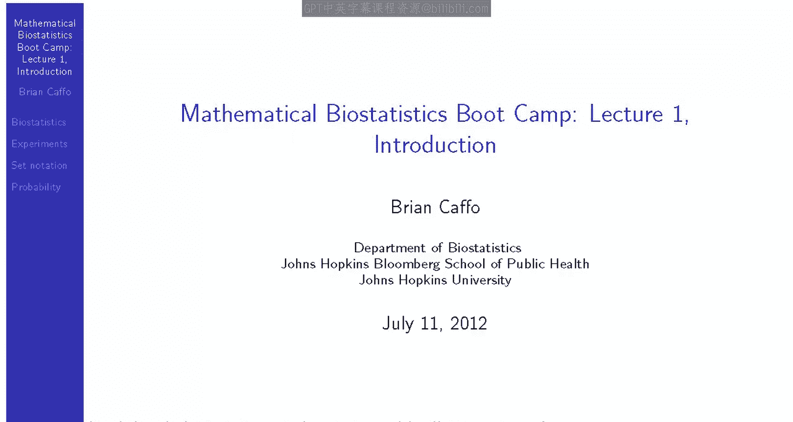
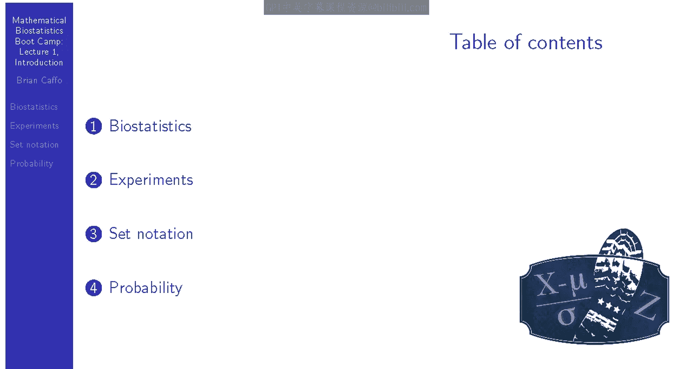
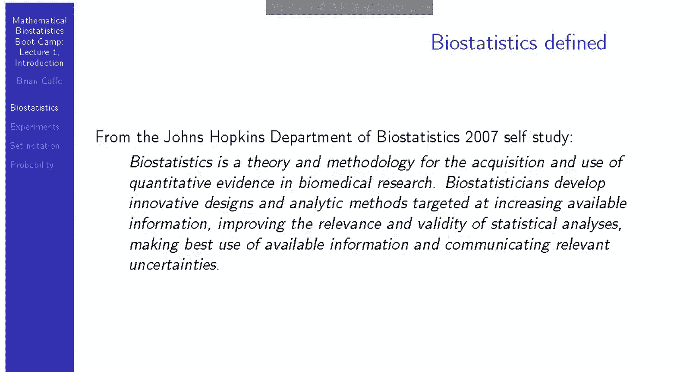
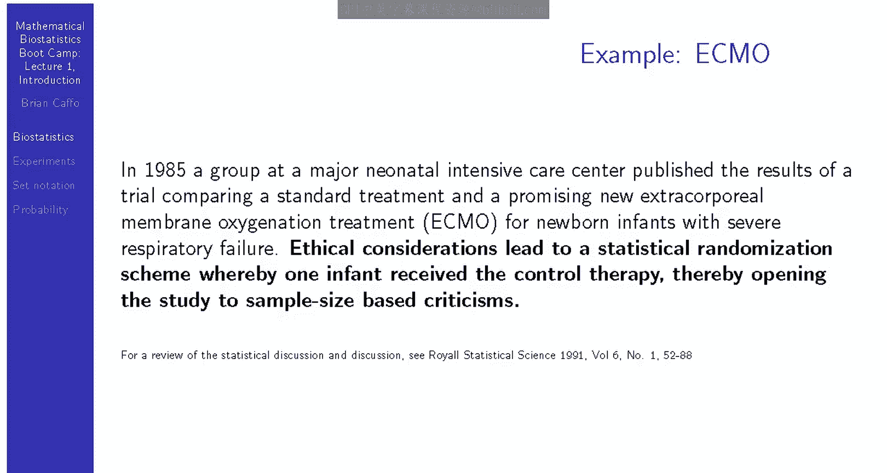
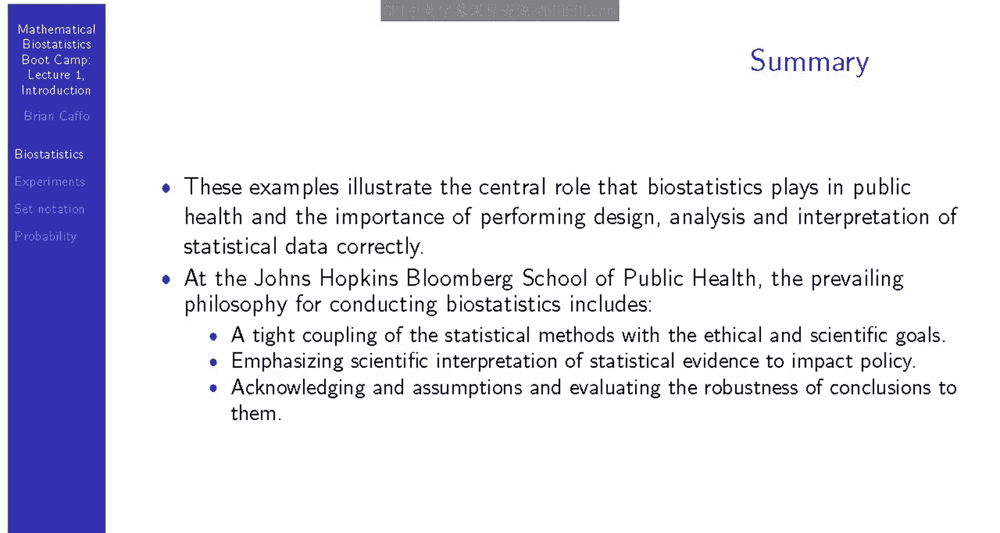
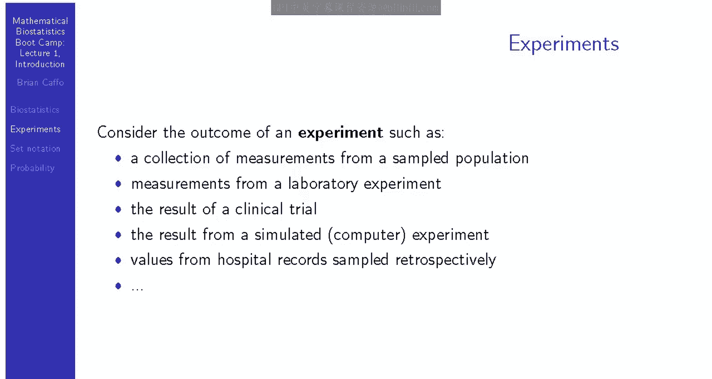

# 生物统计学与实验设计：1：引言与概率基础

在本节课中，我们将学习生物统计学的基本概念，并理解其重要性。我们将抽象化“实验”这一概念，回顾一些基本的集合论符号，并介绍概率论的基础知识。这些内容是后续深入学习统计建模和数据分析的基石。

## 生物统计学简介

上一节我们介绍了课程的整体框架，本节中我们来看看生物统计学的定义与核心作用。

生物统计学是生物医学研究中获取和使用定量证据的理论与方法学。生物统计学家致力于开发创新的设计与分析方法，旨在增加可用信息、提高统计分析的关联性与有效性、充分利用现有信息并传达相关的不确定性。

一个更简单的理解是：实验与经验是科学的最终语言。基于经验主义的归纳推理是绝大多数科学得以进行的方式。而统计学，可以被视为经验主义的语言，是与经验主义相关的形式化语法。因此，学习统计学，实际上是在学习如何进行实验，以及如何从实验和经验知识中量化信息。

## 统计学在决策中的核心作用

理解了生物统计学的定义后，我们通过两个著名案例来看看统计学如何在重大公共卫生和医疗决策中扮演核心角色。

以下是两个关键案例：

*   **妇女健康倡议（WHI）激素替代疗法试验（2002年）**：该临床试验的结果与之前关于激素替代疗法有效性的证据相矛盾。试验采用了一个基于统计的协议来决定是否停止试验。最终，研究因负面事件数量过多而被提前终止。这个决定是基于概率的统计决策，它权衡了收集足够证据与避免潜在危害之间的平衡，在当时对医学界产生了巨大冲击。
*   **体外膜肺氧合（ECMO）新生儿治疗试验**：这是一种极具前景的新生儿治疗方法。由于治疗潜在益处巨大，试验设计面临严峻的伦理挑战。最终采用的统计设计（随机化方案）导致只有一名婴儿接受了对照治疗。这引发了基于样本量的设计批评。此案例表明，统计考量需要与伦理和医学考量紧密结合。

这两个例子说明了统计学在公共卫生决策、医疗决策和证据评估中扮演的中心角色。

## 约翰霍普金斯大学的生物统计学理念

在约翰霍普金斯大学彭博公共卫生学院，我们秉持着贯穿各系的生物统计学研究理念。

以下是我们的核心原则：

*   **方法学与伦理及科学目标的紧密结合**：我们使用的方法必须服务于研究的伦理和科学目的。
*   **强调统计证据的科学解释**：并试图利用这种解释来影响公共政策。
*   **承认假设并评估结论的稳健性**：我们清楚所依赖的假设，并评估结论对这些假设的敏感程度。

需要指出的是，不同机构对统计学的应用方式可能不同。例如，美国食品药品监督管理局（FDA）等监管机构可能更希望统计程序能保护消费者，有时甚至需要将统计方法与具体科学问题适度分离，以尽可能无偏的方式评估药物。而在约翰霍普金斯大学这样的研究机构，我们更倾向于将统计学家和统计学方法深度嵌入到科学过程和科学探究之中。

## 抽象化“实验”的概念

上一节我们探讨了统计学的理念，本节中我们来看看统计学中“实验”的抽象定义。在统计学中，我们对“实验”的理解更为抽象和普遍。

我们将**实验**定义为：任何涉及需要评估的非平凡误差和随机性的有目的性探究。

根据这个定义，实验的类型非常广泛：

*   **实验室实验**：符合此定义。
*   **抽样调查**：例如，为研究高血压而从总体中抽样测量，这同样构成一个实验。
*   **临床试验**：如之前提到的WHI和ECMO试验。
*   **计算机模拟实验**：在成本高昂的人体或动物试验之前，通过计算机模型生成数据来评估新技术（如医学影像处理技术）。这些模型会加入随机性和变异源，产生需要复杂统计方法分析的大量数据。
*   **回顾性抽样研究**：当难以进行前瞻性追踪研究时，通过医院记录等历史数据，比较病例组与对照组过去的暴露情况。这是研究某些现象时常用或唯一可行的方法。

每种实验类型都引入了不同来源的变异、实验误差和随机性，需要不同的统计模型来评估。我们接下来几讲的目标，正是学习如何将这些实验产生的数据与概率模型联系起来。为此，我们必须更深入地理解概率论。

## 概率论基础：集合论

为了建立数据与概率模型的连接，我们需要掌握概率论的数学基础。首先从集合论开始，因为概率论中的集合符号与经典集合论有略微不同的解释。

集合是对象的汇集。如果元素 `x` 属于集合 `A`，我们记为 `x ∈ A`。空集是不包含任何元素的集合，记为 `∅`。

以下是基本的集合运算与关系：

*   **子集**：如果集合 `A` 的所有元素都属于集合 `B`，则 `A` 是 `B` 的子集，记为 `A ⊂ B`。
*   **并集**：集合 `A` 与 `B` 的并集包含所有属于 `A` 或属于 `B` 的元素，记为 `A ∪ B`。
*   **交集**：集合 `A` 与 `B` 的交集包含所有同时属于 `A` 和 `B` 的元素，记为 `A ∩ B`。
*   **补集**：集合 `A` 的补集包含所有不属于 `A` 的元素，通常相对于一个更大的全集 `Ω` 来定义，记为 `A^c` 或 `A‘`。

这些运算满足交换律、结合律和分配律等性质。此外，还有两个重要的定律：

*   **德摩根定律**：`(A ∪ B)^c = A^c ∩ B^c` 且 `(A ∩ B)^c = A^c ∪ B^c`。
*   **不相交集合**：如果两个集合的交集为空，即 `A ∩ B = ∅`，则称它们不相交。

## 概率论基础：概率公理

在定义了集合之后，我们可以形式化地定义概率。概率是一个函数，它为样本空间 `Ω`（所有可能结果的集合）中的每一个事件（子集）分配一个介于0和1之间的数值。

概率函数 `P` 必须满足以下三条公理：

1.  **非负性**：对于任何事件 `A`，有 `P(A) ≥ 0`。
2.  **规范性**：整个样本空间的概率为1，即 `P(Ω) = 1`。
3.  **可加性**：如果事件 `A1, A2, ...` 是两两不相交的（即对于任意 `i ≠ j`，有 `Ai ∩ Aj = ∅`），那么这些事件并集的概率等于它们各自概率之和。公式表示为：
    `P(∪_{i=1}^∞ A_i) = Σ_{i=1}^∞ P(A_i)`

从这些公理可以推导出概率的所有其他性质。

## 概率论基础：重要性质

根据上述公理，我们可以推导出一些非常有用的概率性质。

以下是几个关键性质：

*   `P(∅) = 0`。
*   `P(A) ≤ 1`。
*   `P(A^c) = 1 - P(A)`。
*   如果 `A ⊂ B`，那么 `P(A) ≤ P(B)`。
*   **加法公式**：`P(A ∪ B) = P(A) + P(B) - P(A ∩ B)`。

本节课中我们一起学习了生物统计学的基本概念及其在科学决策中的核心作用，抽象化了“实验”的统计学定义，并回顾了作为概率论基础的集合论符号与概率公理。这些基础知识是我们后续学习统计推断和数据分析的起点。在接下来的课程中，我们将以此为基础，探讨如何将实际数据与这些概率模型联系起来。