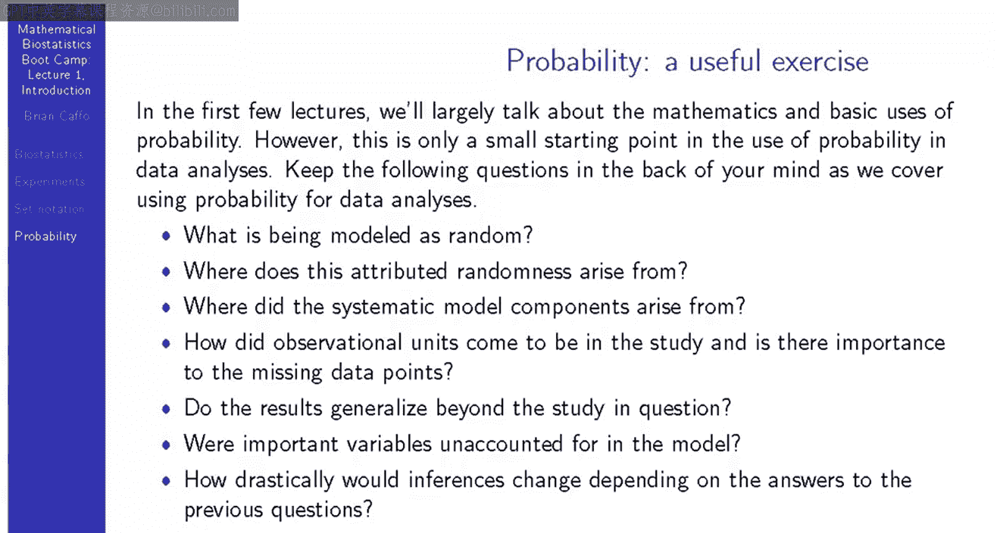

# 约翰霍普金斯大学《数据科学的高级统计｜Advanced Statistics for Data Science》中英字幕（deepseek p03 2_集合符号与概率论.zh_en -BV1htPjeYEFH_p3-

Okay， so before we begin。Discussing probability， we need some very basic mathematics。 Now。

 everyone listening to this lecture will have had set notation at some point in their life and covered it from a very basic or even more advanced mathematical perspective。

In probability， the set notation has。The same rules， of course。

 it's just a subset of ordinary set notation。 However。

 the interpretations of set notation are slightly different。

 So usually when you talk about set notation， you talk about some Uber space that contains everything。

 Well in statistics， we call this the sample space。 and that we usually denote with an uppercase。

 omega。 And this is the collection of all possible outcomes of an experiment。

 So as in a simple example， let's conduct an experiment， we roll a die。

 So the possible set of outcomes are a 1，2，3，4，5 or 6。

 where here we're not going to play the sort of mental games that the die could land on an edge or a corner or something like that。

 It has to roll on one in the numbers。 and then the sample space would be the integer from one to 6。

An event is any subset of the sample space。 So， for example。

 you could have the event that the die roll is even I。e。 that E is the set containing the numbers 2。

4， and 6。Certain kinds of events are so commonly talked about that we give them a separate name an elementary or simple event is the particular result of an experiment。

 so for example if the di row is a4， then usually we denote this for a lowercase omega omega equals4 here we don't tend to split hairs about the actual number  four and the set containing the element 4。

 but I think in the traditional definition a simple event is the actual element4 not the set containing the element 4。

 but here I don't think for our purposes that distinction will be necessary。

And then it's always useful to talk about nothing， so the null event is actually the event that nothing occurs。

 the null event or empty set， and that's usually denoted with this letter here。

 which I'll just call null。Again， the sets in probability theory follow all the same rules as ordinary set notation。

 of course， because it is exactly ordinary set notation， but just with different interpretations。

 So when we say that a elementary event is an element of an event， that that implies that E occurs。

 when W occurs， so， for example， just looking back at the previous slide if our elementary event is that the di roll is a four and the event is that it is even if you roll a four。

 then the role was even。If the elementary event is not in an event。

 that implies that E does not occur when W occurs。For example， if the elementary event is a5。

5 not being in the set of even numbers means that when you roll a5。

 you have not rolled an even number。We can follow along this logics。 for example。

 E being a subset of F implies that the occurrence of E implies the occurrence of F。 So， for example。

 let's take E is the event that the di rolls even E equals 2 comma 4 comma 6 and F is the event that the die is either even or a 5。

 hence f is the event2 comma 4 comma 6 and 5， So 2，4，5，6。

 then the occurrence of E implies the occurrence of F。 that is if you roll an even di roll。

 then you have also rolled an element of the set of even di rolls plus 5。Okay。

 if the standard set intersection E intersect F implies that both E and F occur。

 So to give you a specific example of this， imagine that E is the event that the di roll is even F is the event that the di roll is a prime number。

 So just so let's think of what the prime numbers would be in a die roll that would be 2，3 and 5。

 So E intersect F means that the di roll is both even and prime that would just be the number 2。

 So the event E intersect F occurs， means that you get it both a。Even number and a prime number。

 which of course， in this case would mean that you get a two。

E union F is the standard set notation for union， but in probabilistic interpretation it means that at least one of E or F occur。

 so in my previous example it would mean that I either get an even number or a prime number。

Or both in the case of two。If E intersect F is the null set。

That means that both E and F cannot simultaneously occur。 So imagine E is the set of even numbers。

 F is the set of odd numbers。 Then you cannot roll a die that is both even and odd。

 So E intersect F will be the nullet， and that's important enough that we give it its own name。

 So in bold here， you see its own name， that's called mutually exclusive。

 So if we say that two events are mutually exclusive， that means that they both cannot occur。

 and you frequently hear people use the phrase mutually exclusive incorrectly。

 So what it technically means things are mutually exclusive。

 if they cannot both simultaneously occur。And then the complement of an event E complement。

 or sometimes we might write E with a little bar on top of it。

 that is the event that E did not occur， so in our case where E is an even number 2，4，6。

 E complement is the odd numbers， okay，1，3 and 5。Since something and its opposite cannot simultaneously occur。

 their intersection is always the null set， so E and E complement are always mutually exclusive。

 There are some standard set theory facts that we should also just remind you of。

 There's the famous so called de Morganorgan's laws。

So A intersect B complement is a complement Union B complement。

 and the way to think about this is this little complement symbol sort of distributes itself across the parentheses to A and B。

A complement and B complement and it flips the cap into a cup and then what's nice is if you look at the second example of de Morgangan's law。

 a union B complement is a complement intersect B， the same thing happens the C distributes itself across the parentheses so you get a complement in B complement in this case the cup turns into a cap so de Morgangan's law basically says if you complement across and either intersection or union。

 the complement distributes itself， but it flips everything it flips all the cups and caps。Okay。

 so I struggled to come up with a verbal example of De Morganorgan's laws and here's the best I could do。

 Let's let A be the event that you're an alligator and B be the event that you're a turtle。

 so the event that A union B is the event that you are either a turtle or an alligator。

And then complementing that， that means if an alligator or a turtle， you are not。

Then de Morganorgan's law says that's a complement intersect B complement。

 A compliment is you are not an alligator。 Intersect B complement is you are not a turtle。

 So the set theory association with the English would be if an alligator or turtle， you are not。

 then you are not an alligator and you are also not a turtle。

 Those is the equivalentvalence between those two sentences。 I think everyone would agree。

 those two sentences agree。 Another example， for the second de Morgangan's law。

 if your car is not both hybrid and diesel。 So a is the event that your car is hybrid。

 B is the event that your car is diesel， and you complement their intersection。

 So if your car is not both hybrid and diesel， then your car is either not hybrid or not diesel。

 So a complement union B complement。 Okay， Some other small little facts that I'm sure you remember from set theory。

 A complement complement is a。 So if you do not not get an even number， you get an even number。

And A union B， quantity intersection C。Is a inters C union B intersect C。

 So the way to think about this just to remember it is think of the union as sort of plus and the intersection as sort of multiplication。

 And this little rule looks just exactly like the distributedtributive property。

 So C sort of gets multiplied by A， C gets multiplied by B。

 and it sort of distributes across the plus sign sort of the union。

 So that's the way you can sort of remember that one。So that gives you a very basic Rosetta stone。

 taking ordinary set notation and connecting it to how we think about it in probability Next we're going to actually use the set notation to develop probability。

So this is a very brief section and in this discussion we're just going to talk about probability at its very conceptual level and in the next section we'll talk about probability at its sort of mathematical foundation。

 but I wanted to spend a minute talking about where we're going with probability as a modeling tool to analyze data。

And here's a strategy that underlies much of science。And the idea is is this， for given experiment。

Attribute everything that you know to a systematic model。

 So a good example of this are things like lines and planes and hyperplanes。

 where people presume that an outcome， say something like hypertension depends on a lot of predictors in a linear fashion。

 And so that's either known or its theorized or it's assumed for sake of convenience。

 but that relates known predictors to the known outcome。

And then attribute everything else to randomness。 Now， this is a very difficult。Bullet to swallow。

 I think for many people， because in nearly all applications of probability。

 what the word random means is very difficult to tie down is example earlier on in the lecture。

 we were talking about retrospectively sampling hospital records。 and in this case。

 if you were to model the outcome of whether or not a person had a disease。

 as is predicted by their history。Where we perform some form of retrospective sampling。

It's not exactly clear where the randomness is coming from。

Or even what randomness means in this context。So even if that's the case。

 we still often use probability to evaluate the collection of unknown things in an experiment。

 treating them as if they were random。 And then we have to just be careful in how we interpret our probability statements in that context relative to what the word random is meaning in that case。

 In some other settings， people have very specific。Definitions of what random means， for example。

 sometimes people will analyze clinical trials using the randomization that was used to assign patients to treatment or control as the actual probability that their modeling in their mathematical models。

 and there they can point very directly。To what randomness they're modeling。 However。

 that has its own problems as well。 So I just want to say that that this process of using probability。

 the third point， using probability to quantify the uncertainty in your conclusions to model this randomness is actually a very delicate subject。

And as you can imagine from this discussion， all three of these first bullet points come with quite a bit of baggage in the terms of assumptions and things that you cannot evaluate at all and so。

What we'd like to do is check how sensitive our conclusions are to the assumptions in these models。

 In some cases， we can actually directly verify them。

 We can check whether the relationship between the response and the predictors looks kind of like a line。

 So we're okay modeling it as a line In other cases。

 they involve assumptions that we can't possibly check。

 They involve variables that we did not collect or variables that we do not even know。

 And in this case， we have to evaluate our sensitivity to our model in terms of unknowns。

 We have to evaluate how robust our approach is to the unknowns。

 And this comes from the study of how the data was collected， how the statistics were used。

 What exactly is probability actually modeling。In the what follows。

 we're going to both cover the mathematics of probability。

 but hopefully touch on these subjects Now I want to emphasize that these are very。

 very difficult topics that many people struggle with if thought of with sufficient depth and what we hope to do in this class is mostly get you started thinking about this and I think if you just did one thing when thinking about probability and your data that you're analyzing is when you say I have a 95% confidence interval or my P value is blank or something like this where you actually use probability in your actual data analysis。

Go through the exercise of trying to think， what is it that your modeling is random。

 What is the sources of this randomness and how good of a job do you think your probability statements do at characterizing this randomness。

This is the end of mathematical biostatistics boot camp lecturec 1 in this lecture。

 we covered basic conceptual ideas and next lecture we're going to be covering。

Much of the basic mathematics that underlies probability。

 so make sure you have plenty of coffee to get ready。

Yeah。🎼いいい。🎼。

🎼。