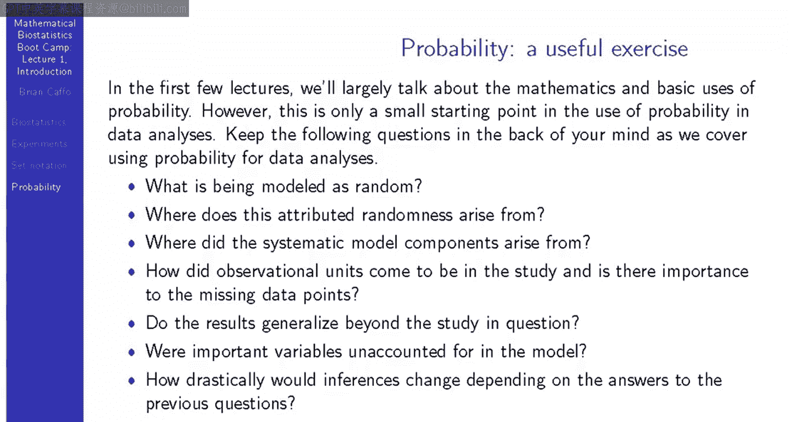

# 数据科学的高级统计：P03：集合符号与概率论

在本节课中，我们将学习概率论的基础数学语言——集合符号。我们将了解如何用集合来描述实验的可能结果和事件，并探讨这些符号在概率论中的具体含义。最后，我们会初步讨论概率作为建模工具在数据分析中的作用。

## 样本空间与事件

在讨论概率之前，我们需要一些基础的数学知识。所有听众都曾在某个阶段学习过集合符号。在概率论中，集合符号遵循相同的数学规则，但对其解释略有不同。

通常谈论集合时，会涉及一个包含一切的“全集”。在统计学中，我们称之为**样本空间**，通常用大写字母 **Ω** 表示。样本空间是一个实验所有可能结果的集合。

例如，我们进行一个掷骰子的实验。可能的结果是1、2、3、4、5或6。这里我们不考虑骰子立在边缘或角落等特殊情况。样本空间就是从1到6的整数集合。

**事件**是样本空间的任意子集。例如，事件E可以是骰子点数为偶数，即集合 **E = {2, 4, 6}**。

某些类型的事件非常常见，因此有专门的名称。一个**基本事件**或**简单事件**是实验的一个特定结果。例如，如果掷骰子结果是4，我们通常用小写ω表示：**ω = 4**。这里我们通常不严格区分数字4和包含元素4的集合。

讨论“空”总是有用的。**空事件**是指没有发生任何事件，即空集，通常用符号 **∅** 表示。

## 集合运算的概率解释

概率论中的集合遵循普通集合论的所有规则，因为这就是普通的集合符号，只是解释不同。

以下是关键概念及其概率解释：

*   **元素属于事件**：如果基本事件ω是事件E的一个元素（**ω ∈ E**），则意味着当ω发生时，事件E发生。例如，如果基本事件是掷出4点，而事件E是“点数为偶数”，那么掷出4点意味着掷出了偶数。
*   **元素不属于事件**：如果基本事件ω不是事件E的元素（**ω ∉ E**），则意味着当ω发生时，事件E不发生。例如，如果基本事件是5点，5不属于偶数集合，意味着掷出5点时，没有掷出偶数。
*   **子集关系**：如果事件E是事件F的子集（**E ⊆ F**），则E的发生意味着F的发生。例如，设E为偶数事件 **{2, 4, 6}**，F为“点数为偶数或是5”的事件 **{2, 4, 5, 6}**。那么，掷出偶数（E发生）也意味着掷出的点数属于集合F。
*   **交集**：标准的集合交集 **E ∩ F** 意味着事件E和事件F**同时**发生。例如，E是偶数事件，F是质数事件（骰子上的质数为 **{2, 3, 5}**）。那么 **E ∩ F** 意味着掷出的点数既是偶数又是质数，即结果为2。
*   **并集**：标准的集合并集 **E ∪ F** 意味着事件E**或**事件F**至少有一个**发生。在上例中，它意味着掷出的点数是偶数或质数（或两者都是，如2）。
*   **互斥事件**：如果 **E ∩ F = ∅**，意味着事件E和事件F**不能同时**发生。例如，E是偶数集合，F是奇数集合。你不可能掷出一个既是偶数又是奇数的骰子。这种情况非常重要，我们称之为**互斥**。两个事件互斥意味着它们不能同时发生。
*   **补集**：事件E的补集，记作 **Eᶜ** 或 **\bar{E}**，是指事件E**没有**发生。在我们的例子中，如果E是偶数 **{2, 4, 6}**，那么 **Eᶜ** 就是奇数 **{1, 3, 5}**。一个事件和它的补集不能同时发生，因此它们的交集总是空集，即 **E** 和 **Eᶜ** 总是互斥的。

## 重要的集合论法则

有一些标准的集合论事实我们需要回顾。

首先是著名的**德摩根定律**：
1.  **(A ∩ B)ᶜ = Aᶜ ∪ Bᶜ**
2.  **(A ∪ B)ᶜ = Aᶜ ∩ Bᶜ**

理解方式是：补集符号“分配”到括号内的A和B上，并将交集（∩）与并集（∪）互换。

为了用语言理解德摩根定律，我们来看一个例子。设A为“你是一只短吻鳄”的事件，B为“你是一只乌龟”的事件。
*   **A ∪ B** 是“你是一只短吻鳄或乌龟”的事件。
*   它的补集 **(A ∪ B)ᶜ** 就是“你不是一只短吻鳄或乌龟”。
*   德摩根定律说，这等价于 **Aᶜ ∩ Bᶜ**，即“你不是短吻鳄”**并且**“你不是乌龟”。
这两个句子在逻辑上是等价的。

另一个例子，对于第二条定律：“你的车不是同时混合动力**且**柴油的”。
*   设A为“你的车是混合动力”，B为“你的车是柴油车”。
*   “不是同时混合动力且柴油”就是 **(A ∩ B)ᶜ**。
*   德摩根定律说，这等价于 **Aᶜ ∪ Bᶜ**，即“你的车不是混合动力”**或**“你的车不是柴油车”。

其他一些有用的小法则：
*   **双重否定**：**(Aᶜ)ᶜ = A**。例如，“不是非偶数”就是“偶数”。
*   **分配律**：**(A ∪ B) ∩ C = (A ∩ C) ∪ (B ∩ C)**。可以这样记忆：把并集（∪）想象成加法，交集（∩）想象成乘法，这个规则就像乘法分配律，C被“分配”给了A和B。

以上内容提供了一个基本的“罗塞塔石碑”，将普通集合符号与我们在概率论中的思考方式联系起来。

## 概率作为建模工具

上一节我们介绍了用集合描述事件，本节中我们来看看概率如何作为建模工具来分析数据。

以下是支撑许多科学研究的策略：
1.  **对于给定的实验，将所有已知信息归因于一个系统模型**。例如，人们假设某个结果（如高血压）与许多预测因子呈线性关系。这可能是已知的、理论推测的，或为了方便而假设的。这建立了已知预测因子与已知结果之间的联系。
2.  **将所有其他未知因素归因于随机性**。这是一个很难理解的概念，因为在几乎所有概率应用中，“随机”一词的含义都很难界定。例如，在本讲座早期提到的回顾性抽样医院记录的案例中，如果我们根据患者历史来模拟其是否患病的结果，并不清楚“随机性”从何而来，甚至在此语境下“随机性”意味着什么。
3.  **使用概率来量化结论中的不确定性，以模拟这种随机性**。这是一个非常微妙的话题。正如你所见，前两点都伴随着大量的假设和一些根本无法评估的因素。

因此，我们希望检查我们的结论对这些模型假设的**敏感性**。在某些情况下，我们可以直接验证它们（例如，检查响应与预测因子的关系是否近似线性）。在其他情况下，假设涉及我们未收集甚至未知的变量。这时，我们必须评估我们的方法对于未知因素的**稳健性**。这源于对数据收集方式、统计方法使用以及概率究竟在模拟什么的研究。

在接下来的课程中，我们将既涵盖概率的数学基础，也希望能触及这些主题。需要强调的是，这些都是非常困难的话题。本课程的主要目标是让你开始思考这些问题。当你进行数据分析并说出“我有一个95%的置信区间”或“我的P值是…”时，请尝试思考：你的模型将什么视为随机的？这种随机性的来源是什么？你认为你的概率陈述在多大程度上很好地刻画了这种随机性？

## 总结

本节课中我们一起学习了概率论的基础集合语言。我们定义了**样本空间**、**事件**及其**补集**，并解释了**交集**、**并集**和**互斥**在概率中的含义。我们还回顾了**德摩根定律**等重要集合法则。最后，我们初步探讨了概率作为量化不确定性的建模工具在科学分析中的核心作用及其背后的假设。下一讲，我们将深入探讨支撑概率论的数学基础。