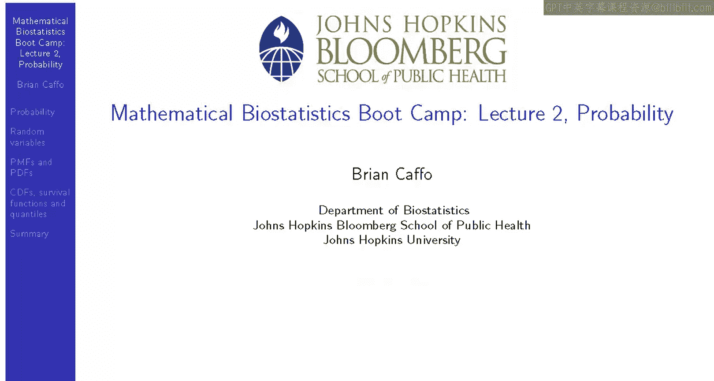
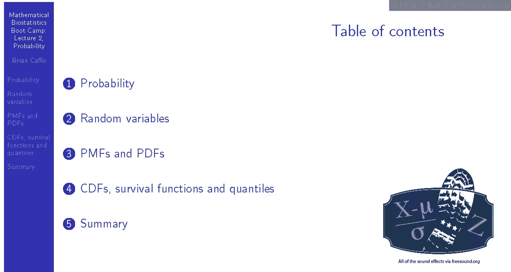
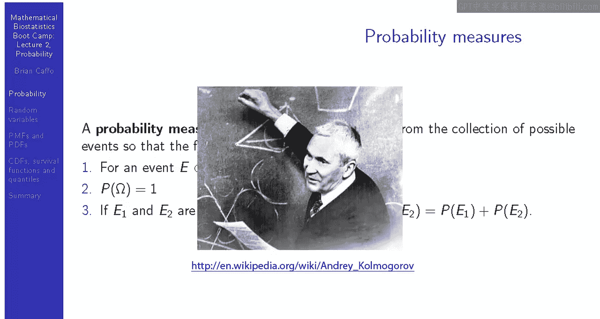
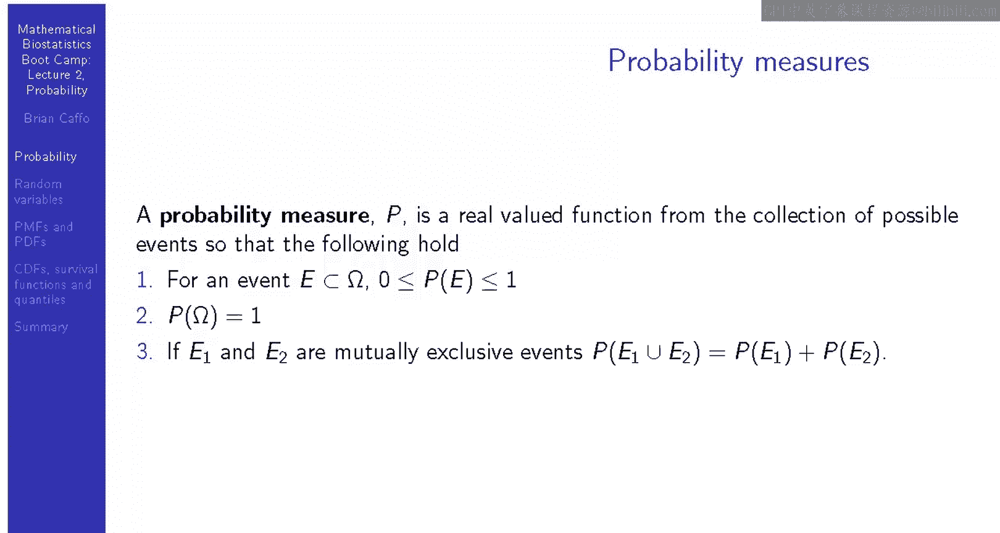
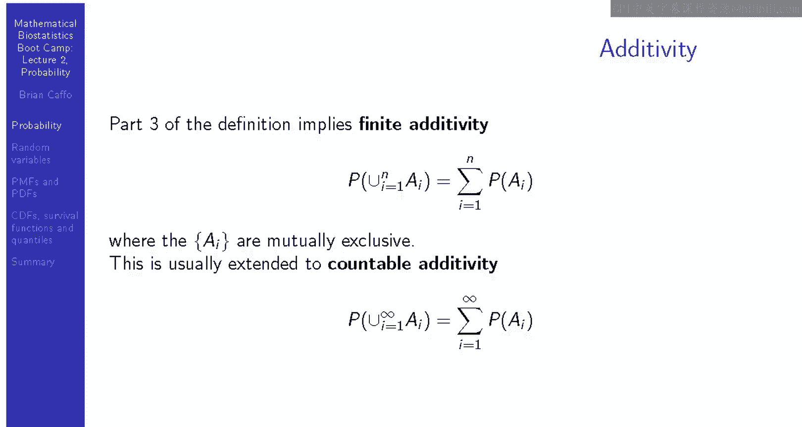
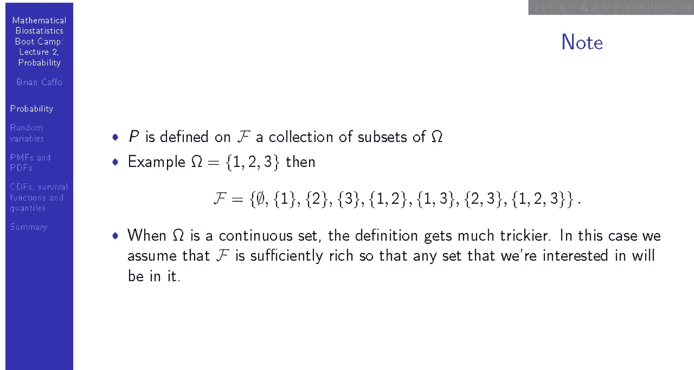
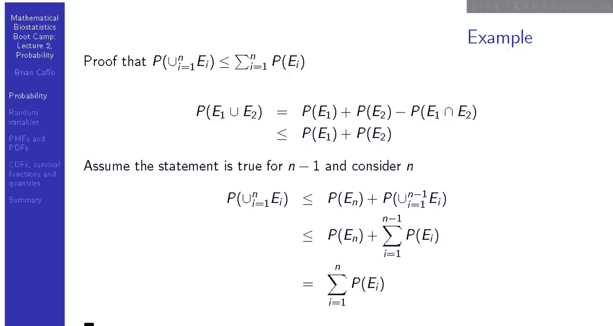
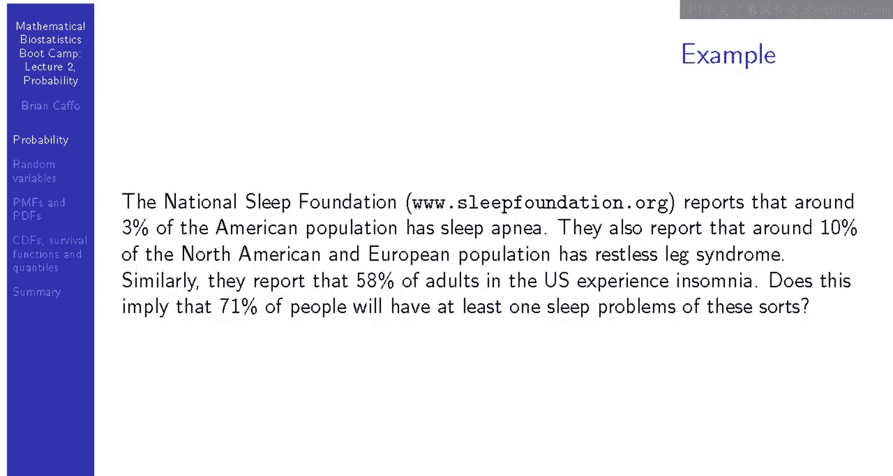
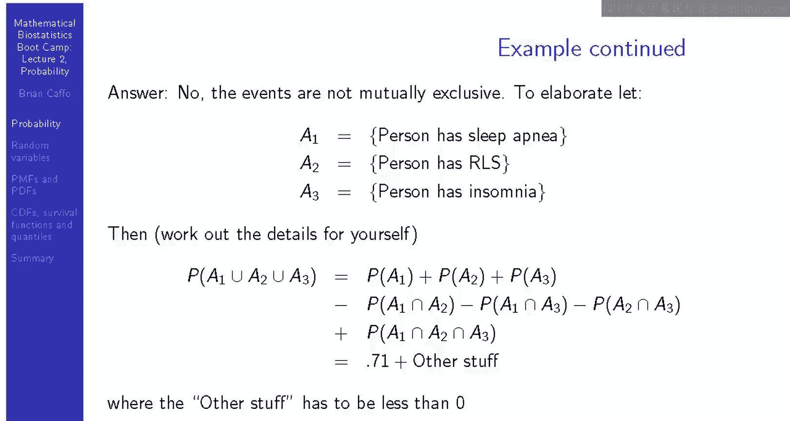

# 约翰霍普金斯大学《数据科学的高级统计｜Advanced Statistics for Data Science》中英字幕（deepseek p04 3_概率论.zh_en -BV1htPjeYEFH_p4-

Hi， my name is Brian Kaffho， and this is Le 2 of Ma Biosstatistics bootot camp。

In the last lecture we covered probability and the basics of biostatistics at a very conceptual level in this lecture we're going to get much more down to specifics。

First， we're going to cover the subject of probability， which are mathematical functions。

 so we'll talk about the specifics of those kinds of mathematical functions。Then in2。

 we'll talk about random variables。 Rand variables are just like any other variables that you've maybe encountered before。

 like in calculus， with the exception that they are random， They can take lots of different values。

In section 3， we're going to talk about probability mass functions and probability density functions these are。

Mathematical functions that map probability to random variables。In section 4。

 we're going to talk about so called cumulative distribution functions， CDFs。

 very associated things called survival functions and quantiles。

 and then we'll wrap up with a brief summary。

So a probability measure is the function that is going to govern。The rules of probability for us。

 And there's basically three rules that a probability measure has to follow。

 And these three rules and every probability textbook will give you these three rules are things that are equivalent。

 There's an interesting history behind these three rules。 The Russian mathematician Komorovrov。

 who's generally considered the father of all of modern probability。

Basically distilled everything that we thought of as in terms of things that a probability should have to follow。

 He minimized them down to the minimal set of rules that you could possibly have。

 If you delete any of these rules， you wind up with something that fails in some fundamental way to be probability And if you add any other rules。

 they turn out to be excessive。 So it's really kind of an interesting collection of research he did。

 It's also interesting to note that Komorooff tried to do something else。

 which is to figure out what exactly it is， we mean by probability。

 So he found that problem to be very hard。 And I think if you look into it。

 the theory of exactly what is randomness and exactly what is probability measure。

Is a very deep problem。 And philosophers are still debating this。

 And I question whether or not itll ever reach a resolution。 However。

 one thing that's much less controversial is what rules probability has to follow When Komorovrov just nailed it。

 It's done。

So let's go over these three rules， so a probability measure P， the letter P here in italics。

Is a function that maps events which are subsets of the sample space to numbers between 0 and 1。

 That's item 1 here。 So events E have to be mapped to numbers between 0 and one。

 So a probability is a function that operates on sets。

 The second item here says that the probability of the whole sample space has to be one。 Basically。

 what this means is that something has to happen。 The sample space has to enumerate everything possible that can happen。

 So， for example， if you're flipping a coin。 the coin can either be heads or tails。

 If the sample space is heads or tails when you flip the coin， one of those two things has to happen。

 the probability of one of them happening is one， the coin can't land on its side。

 If you want to allow for the coin to land on its side。

 then it has to be heads tails and land on its side as the sample space。The third statement。

 and we'll talk a lot about the third statement， because we're giving you an incorrect version of it。

 The third statement says that if two events are mutually exclusive and recall events are mutually exclusive。

 if they have no intersection， If two events E1 and E2 are mutually exclusive。

 then the probability of the union is the sum of their probabilities。So as an example。

 we just talked about coin flipping and we said the probability of a head or a tail has to be one。

 the probability of either getting a head or a tail has to be one。

 so let's talk about that in the context of rule 3 if E1 is the event that you get a ahead and E2 is the event that you get a tail。

 then the probability of E1 union E2， the probability that you get a head or tail winds up being the probability of getting a head。

 let's say it's 0。5 plus the probability of getting a tail which is 0。

5 which adds up to 1 exactly what we know it has to。

So in part 3， the third rule that we talked about in the previous slide。

 I said that there was some concern over it not being complete。

 so I'm going to elaborate on what I mean by that in this slide。First of all。

 let's note the following fact。 Part 3 of the previous slide。

 the fact that if you have two mutually exclusive events。

 the probability of their union is the sum of their probabilities。

 that pretty easily extends to the so called finite addivity， that instead of having two。

 if you had three or4 or 5， or let's just say an events。

 that the probability of their union equals the sum of their probabilities。 So in this case。

 I have the probability of the union of a collection of mutually exclusive events。

 AI equals the sum of their probabilities。 that pretty directly follows from the previous definition。

 just to give you a sense of how it works， if you had three events， say a1， A2 and A3 and they all。

Mutually exclusive， then the probability of a1 union A2 and A3 is the sum of the probability of a1 plus the probability of A2 union A3 right because a1 is mutually exclusive from the union of A2 and A3。

 and then that second probability the probability of a2 union A3 is then again the probability of the union of two mutually exclusive events。

 So it is the probability of A2 plus the probability of a3。

And you can formalize this with mathematical induction if you want。 So at any rate。

 the rule that I gave you implies so called finite addivity。

 And it seems like maybe that should be enough to cover everything。 Well。

 the probabilist have thought very hard。 And they said， well。

 maybe we think it should be countable addivity。 instead of N， it should go up to infinity。

 And it's not the case that the definition that we gave implies countable addivity that if you had an infinite collection of mutually exclusive events that the probability of the union is the sum of the probabilities。

 which requires ideas of limits and other things that we're not going to cover so much in this class。

So at any rate， it's the case that finite addivity does not imply countable addivity。

 but of course countable addivity implies finite addivity。

So in standard probability classes in the more theoretical probability classes。

 they make quite a bit of hay out of this distinction， they discuss it a lot。

 and the general definition gives countable addivity rather than finite addivity。

If you take a more advanced measure theoretic probability class。

 they will deal with this issue at length。 In this class。

 this will be the last time we discuss this in general， finite addivity will work just fine for us。

In the next slide， we're going to talk about more details about what the probability function operates on。

 and again it's going to be a rather important but maybe unnecessary detail for this class。

 so again it's going to be another thing that we cover very briefly and then tend not to think about for the remainder of the lectures。

Recall that our probability function operates on events。

 which are subsets of the sample space and maps them to numbers between 0 and 1。

 So we need an appropriate domain of our function， Our domain is not an event。

 It's a collection of events。 So let me go through an example to make this idea a little bit more clear。

 So let's suppose the sample space is simply the numbers 1，2 or3。

 Imagine somehow if you had a three sided die that you are rolling。

 Then the probability function operates on all possible events that are subsets of that sample space。

 So in this case， the null event， the event that you get a1， a2， a3， a one or2， a1 or three。

 a two or three。 or the whole sample space， a one， two or three。And this is fine。

 pretty much whenever you have a finite set， the domain of the probability function will operate on all possible subsets of the sample space。

 in this case， we're using the letter script F denote this so called domain。

When the sample space is a continuous set， it actually gets a lot harder。And。

You can no longer say things like the probability operates on the set of all possible subsets of a continuous set。

And it turns out that that is an incredibly deep mathematical problem。

 The mathematician Cantor thought about measure and sets in a very deep way。

 And if you want to read about an interesting character in the history of mathematics。

 you should read about Cantor， he came up with interesting sets that， for example。

 you just can't reasonably include in the definition of a probability。So in this class。

 we're not going to think about this at all， But I wanted to raise it just for those students that go on to take some of these more advanced classes so that you'll be prepared for some of these admittedly kind of strange ideas that come up when you try to talk about the set of sets that probabilities operate on for our purposes。

When our sample space is continuous set， we're mostly going to be concerned with things like intervals or unions of intervals。

 and in that case， the definitions are very easy， so our definition of the domain that the probability operates on。

 we're just going to assume that anything that we can think of and since none of us are cantor probably we won't think of anything too crazy。

 anything that we can think of is just fine and that definition will work really well for this class。

In this slide， we're going to give a laundry list of properties that a probability function has to have by virtue of its three definitions。

 So you should find it kind of interesting that the three definitions。

 then imply all of these things that we know probabilities have to have。

 So take this first bullet here。 The probability of the null set is 0。

 Basically the probability that nothing happens is 0。 So if you say you're going to roll a die。

 you actually roll a die。 If you say you're going to flip a coin， you actually flip a coin。

 That's basically what the probability of the null set being 0 is。

The second bullet says the probability of an event is one minus the probability of its complement。

In other words， for example， if E is the probability that you get ahead when you flip a coin。

The probability of getting a head is1 minus The probability of getting a tail。 And that's， of course。

 true on a fair coin where the probability of a head is 0。5 and the probability of a tail is 0。5。

 But let's suppose you have an unfair coin。 Maybe you glued together a nickel and a US dime and made a funny shaped coin that you didn't know whether or not the probability of a head was 0。

5， let's suppose the probability of a head in that case was 0。3。 Well。

 this would say if the probability of a head is 0。3， then the probability of a tail has to be 0。7。

The next bullet says that the probability of the union of two events is the probability of their sum。

 And that's all we would have to say if the events are mutually exclusive。

 But we have to subtract off the inter。 If they are not mutually exclusive。

 And the intuition behind this statement is something like this。 When you added the probability of a。

 you've added the probability of a， which includes the part of A that intersects B and the part of A that does not intersect B。

 And then you've added the probability of B， which includes the part of B that inters A and the part of B that does not intersect A。

 So you have then just added the part of A that inters B and the part of B that intersects A。

 In other words， A intersect B， you've added it twice。 Once when you added probability of A。

 once when you added probability of B， you've added it twice， you only want to add it once。

 So subtract it out。 That's how the rule works。The next bullet point is a pretty simple point。

 If a is a subset of B， then probability of a is less than or equal to the probability of B。

 So this is analogous to saying if I'm rolling a die and a is say the event that I get a1 and B is the event that I get a1 or a two。

 then the probability of getting a one is less than the probability of getting a1 or a two。

 And so this rule， I think， makes a lot of sense。From De Morganorgan's laws。

 we get probability of a union B is one minus the probability of a complement intersect B complement。

 The next bullet point is kind of along the lines of subtraction。 So a intersect B complement。

 That set is sort of like subtracting B out of a。 The component of a that has nothing to do with B。

 So the probability of a removing B is the probability of a minus the probability of a intersect B。

 So that works out to be a nice rule that sort of set level subtraction works out to be equivalent to subtracting the probabilities。

 The next bullet talks about the probability of the union of events。 Again。

 this says the probability of the union of a collection of events is less than or equal to the sum of the probability of the events。

Now， again， if the events are mutually exclusive， then the probability of the union has to equal to sum of the probabilities。

 so this rule doesn't violate that rule whatsoever。

 but it also accounts for the times when the events are not mutually exclusive。

The final rule talks again about unions of events。 In this case。

 the probability that the union of events is bigger than the probability of the maximum of the collection of probabilities。

 Again， this rule holds。 if the events are mutually exclusive or not。

 But there's intuition behind this that's very easy。

 The union is everything that's in any of the events， E1 to E N。

 So it contains anything The probability of that has to be bigger than any of its component events。

 I think that makes quite a bit of sense。 So just let me give you an example。

Go back to our di roll if E1 is the event that you get a 1， E2 is the event that you get a 2。

 E3 is the event that you get a 3。The probability on the left hand side of the equation is the probability that you get a1。

2， or3 on the right hand side。 It says that it's the maximum probability。

 If you're talking about a standard die， probability of a one is one6。 probability 2 is 16。

 probability 3 is 16。 So the maximum of them is 16 on the left hand side。

 the probability of the union is the probability of a1，2 or3， which is one half。

 So one half is definitely bigger than 16。So let me give you an example of one of these proofs。

 So let's take a simple one， the probability。Of an event is one minus the probability of its complement。

So consider line 1， recall that the probability of the whole sample space is one。But again。

 the sample space for any event is equal to the union of that event and its complement so。

Omega equals E union E complement。Then consider the next line。

 An event is always mutually exclusive with its complement。

 Something cannot simultaneously occur and not occur。

 So events are always mutually exclusive with their complement。

 So E and E complement are mutually exclusive events。

 So we can take the probability of the union and turn it into the sum of the probabilitybabilities。

 probability v plus the probability V complement， And then that's simply a restatement of what we want to prove。

 One equals probability V plus the probability V complement。😊。

Let's do a more complex example of the consequences of the probability rules。

So recall that we discussed that the probability of the union of a collection of events is less than or equal to the sum of the probabilities。

 And recall that less than or equal to is an equality if the events are mutually exclusive。

 So let's prove this using mathematical induction。 The way mathematical induction works is you prove it for some small statement 1 or 2。

 Then you assume that it's true for， say， n -1， and then prove that it's true for N。

 That's how mathematical induction works。 So let's consider just two events。

 probability of E1 union E2。Well， that's by one of the other consequences of the probability rules that we investigated。

 that's equal to probability of E1 plus the probability E2 minus the probability of E1 intersect E2。

 And here I'm assuming that we've gone ahead and that one as well。

 So this final term here thats subtracted off minus probability E1 E2。

 we are subtracting off a number that has to be positive。 Remember。

 probabilities have to be between 0 and 1。 So they have to be non negative， at least。

 So if we throw away that final term， What's left can only get bigger。 right。

 So if we're subtracting off a positive number and we throw it away， then it's got to get bigger。

 So then we've established the result for the case when we have two events。

Now let's assume the result is true when we have n minus1 events and let's consider n events。

So we want to demonstrate that the probability of the union of the EI is less than or equal to the sum of the probabilities。

So let's write out the probability of the union of the EIs as E union with the union of the rest of them。

 So the union of the rest of them， I equal 1 to n -1 is a single set。 We've already done that。

 That's just two sets， E and the union of the remainder are two separate sets。

 we already worked it out for two sets。 so we can say that the probability of the union E1 to E is less and equal to the probability of E plus the probability of the remainder。

Now consider the next line。In the next line， we have the probability of E from the previous line。

And then we can say that we have only gotten bigger by our induction hypothesis by the fact that we assume that this statement is true for n -1 events。

 So there， if we switch this probability from the probability of the union to the sum of the probabilities。

 we've only made it bigger so we can maintain that inequality， then just collecting the terms。

 then we just have that this is the sum of the probabilities。

 And just to give you a sense of notation I use， when I write equals on this last line， I mean。

 it equals the previous line， not that it's equal to the first line。

 So I'm assuming that it's less than or equal to less than or equal to and equal to。

Implying that the final statement is less than or equal to the first statement。

 but equal to the previous lines。 So that's notation that I commonly use。

So you should be able to prove all of these probability statements that we outlined on the previous slide。

 this particular one， let's go ahead and take a step back from the mathematics and try and put some of this within a context。

So the National Sleep Foundation reports that around 3% of the American population has sleep apnea。

 This is a sleep disease where the upper airways collapses。

 They also report that around 10% of the North American and European population has restless leg syndrome。

 For the purpose of our discussion。 Let's just assume that this is 10% of the American population has restless leg syndrome。

 Similarly， they report that 58% of adults in the US experience insomnia。

So imagine if you were a sleep physician and you wanted to know the probability that a random American has any of these three sleep disorders。

 Can you simply add these three probabilities，3%，10% and 58% and get 71%。

Of people have at least one of these sleep problems。

So this question is nothing other than a restatement of the probability relationship that we just proved。

So here I'm using A instead of E， but maybe that's a good thing to do just so you get used to not using the same letter for everything。

 So let's let A1 be that the person has sleep apnea。

 A2 be the event that the person has restless leg syndrome and A3 be the event that a person has insomnia。

And I'm going to gloss over the details。 but the probability that a person has at least one of these diseases is we're talking about the union A1 union A2 union A3。

 So we want to know the probability of the union。 Well。

 that's only equal to the sum of the probabilities right， When a1 A2 and A3 are mutually exclusive。

 Otherwise， it's the probability of a1 plus the probability of a2 plus the probability of a3。

 And we have to subtract out other things。 And in this case。

 I give you the exact equation for relating the probability of the union of three events to the probability of A1 A2 and A3。

 And so it works out to be 071。 But then there's all this other stuff that a1 intersect A2。

 A1 intersect A3， A2 intersect A3。 and then you have to add in the triple inter A1 intersect A2 intersect A3。

 And would suggest you go through and figure out why exactly it is。This formulaula works out。

But the point is that other stuff is non trivial and it's always there unless A1。

 A2 and A3 are mutually exclusive。And so you can't simply add these other things。 And in fact。

 in this case， from a scientific perspective， I mean。

 we're talking about it from a mathematical perspective， but from a scientific perspective。

 it's probably the case that there's a nontrivial intersection of people with sleep apnea and restless leg syndrome and a nontrivial intersection of people with restless leg syndrome and insomnia and so on。

 so that probably this 。71 is not close at all。So that ends our whirlwind tour of the basics of probability mathematics next we're going to talk about random variables。

