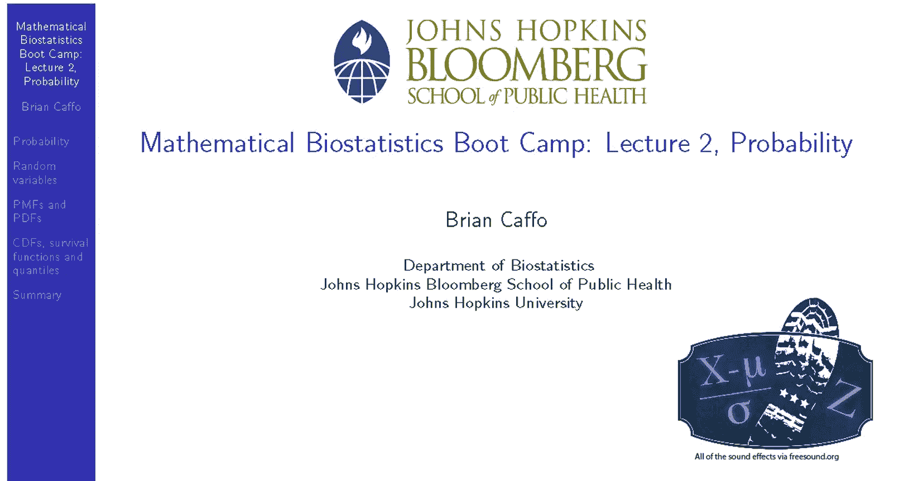
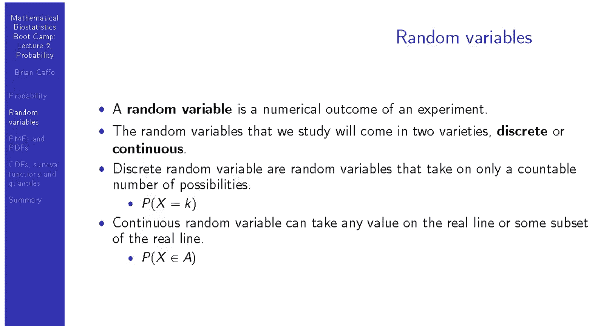
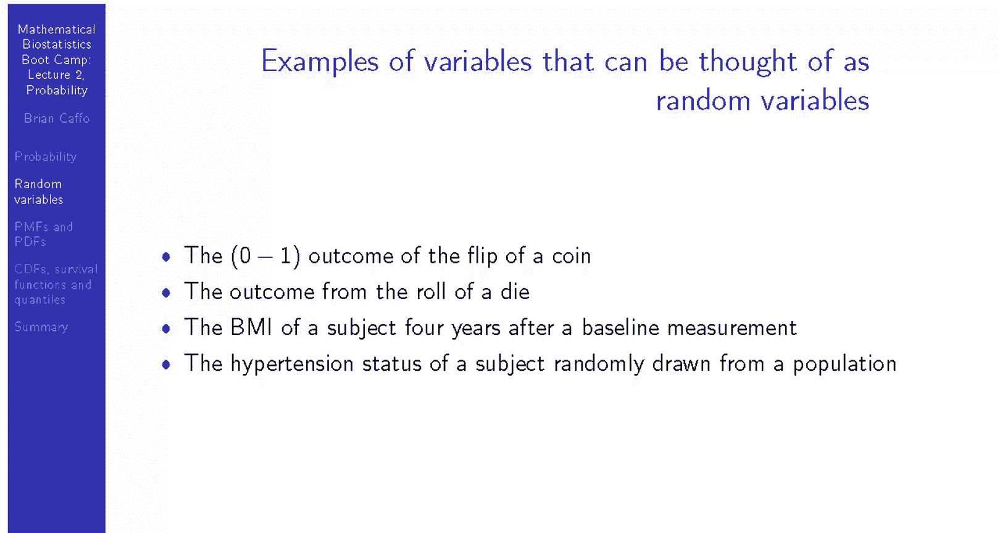

# 约翰霍普金斯大学《数据科学的高级统计｜Advanced Statistics for Data Science》中英字幕（deepseek p05 4_随机变量.zh_en -BV1htPjeYEFH_p5-

So welcome back Rerus to Le2 of Mathematical Biosstatistics boot campamp。

 and now we're going to talk about random variables。So random variables， as the slide says。

 is simply a numerical outcome of an experiment。 their random variables are just variables like you see in calculus。

 but they have probability distributions associated with them。

 We're only going to talk about two kinds of random variables。

 discrete or continuous random variables， discrete random variables are any random variables that can take just accountable number of possibilities。

 So even if it's infinite， if you can enumerate the collection of values that a random variable can take。

 it's going to be discrete。 So what I mean by even if it's infinite。

 if you have a random variable that is the number of people that show up at a bus stop， Well。

 I suppose there is a theoretical limit to that， but it might be useful mathematically to model that is if that count can go all the way up to infinity。

 But the point is is that we can count them， we can count one person， two people，3 people。

 four people and so on。If the random variable can take any possible value on the real line or a subset of the real line。

 then we'll call the random variable continuous。 and we'll have to have a slightly different treatment of continuous versus discrete random variables。

 But I think when we go through it will try to draw the similarities between how they're treated。

 This list of random variables， either being discrete or continuous is non exhausthausive。

 You can actually have a random variable that is both discrete and continuous to give you an example。

 Let's think of a good way to generate a continuous random variable。

 or something at least that could conceptually be viewed as a continuous random variable。

 Suppose you were to draw a line on a piece of paper that goes from 0 to 2。

 You label one end of the line 0 and another end of the line 2， and then you draw your pencil。

 and it hits a random point in between 0 and 2。And you were to measure the distance between 0 to 2。

 how far that point is。 Well， maybe you can argue you can only measure to so fine of a scale。

 But let's forget about issues like that。 Honestly。

 you would model this as sort of a continuous random variable。

 That distance you can measure to several decimal places。

 And so we'll think of it as sort of a continuous one。

So let's think about how could you possibly generate a random variable that's both discrete and continuous。

 Well， let's suppose， so we have our little experiment where we can generate something that's continuous or continuous enough for us to think of it as continuous。

 And then we have another example， say， just。Rolling a die that generates 1，2，3，4，5。

6 clearly generates a discrete random variable。 Suppose then you were to flip a coin。

 And if the coin comes up heads， you use your pencil to get this continuous random variable。

 And if the coin comes up tails。 you use this die to get your discrete random variable。 Well。

 the resulting random variable could have possibly have been continuous。

 or it could have been discrete。 So that random variable， if we were to describe its behavior。

 we would have to describe it as potentially being both discrete and continuous。

 So we won't deal too much with random variables like that。

 I would add that they're not entirely useless。 let me give you an example of a random variable that's kind of。

Both discrete and continuous， but is used in practice。

 So imagine if you're looking at expenditures of some sort。

 Let's say youre an insurance company and you are looking at how much you had to pay out in terms of insurance。

 Well， for some people that never got sick。 you paid out 0。 It's a discrete number， exactly 0。

 for everyone else， you may be paid out a certain amount and that remainder would probably be best model by a continuous random variable。

 because you have to account for it down to the fraction of a penny or something like that。

 So in that case， if youre the insurance company and you are evaluating the distributional behavior of expenditures。

 you might want to model that with a random variable that can both take the discrete value 0 and can take the continuous values for all expenditures beyond 0。

 So at any rate， this is a longwined discussion of random variables that werere not going to consider in this class。

 Ones that are both discrete and continuous。 But I just wanted to raise the point that the kinds of random variables that we're going to describe are nonexhausive。

Let's go through some simple examples of variables that can be thought of random variables。

 So if you flip a coin， the head or tail 0 or1 outcome of a coin flip is clearly a random variable。

 if you roll a die， the 1，2，3，4 5，6 outcome from rolling a die could be modeled as a random variable。

 And again， I should say could be modeled as a random variable。 if you say it is a random variable。

 then you get into this discussion of well is a coin flip really random。

 maybe if you knew exactly how much pressure the person applied to the coin and we're not going worry about that kind of extremely conceptual thinking in this class。

 we're going to say practically， we'd like to model a coin as random， practically。

 we'd like to model a die as if it were random。 but practically we'd like to model lots of other things as if they were random too。

 So， for example， if we have a random selection of subjects and we take their body mass index of baseline and then take it four years later。

 we might want to model that change in Bmi or the Bmi after a amount of time as being a random。

Same thing with hypertension。 We might want to model their hypertension status。

 whether they have hypertension or not as a random variable and。

This latter point also reminds us of why coinin flipping is very important。

 Coin flipping seems like a trivial random variable， but it forms the basis for a lot of analysis。

 We think of a lot of things as if they were coin flips。 So we might model， for example。

 the prevalence of hypertension。 We might think of the data going into that modeling as if they were a bunch of coin flips in the idea of a coin fliplip will help conceptualize a model that we're formulating。

