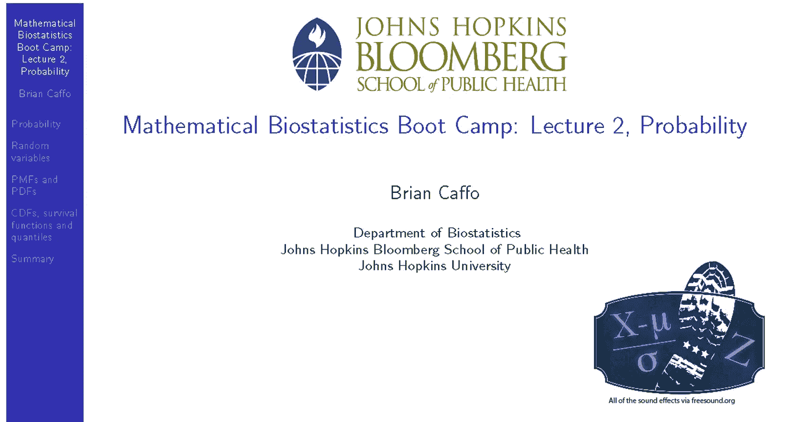
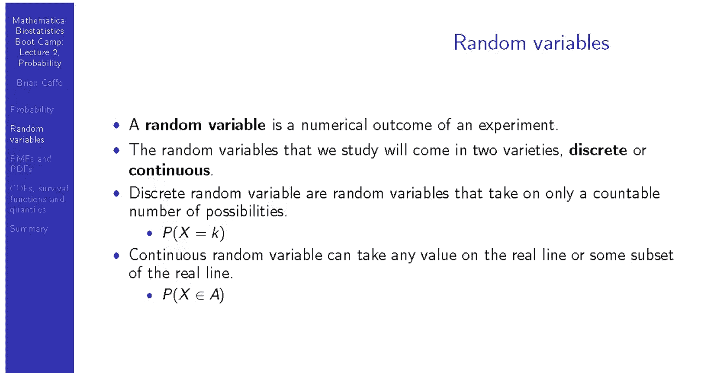
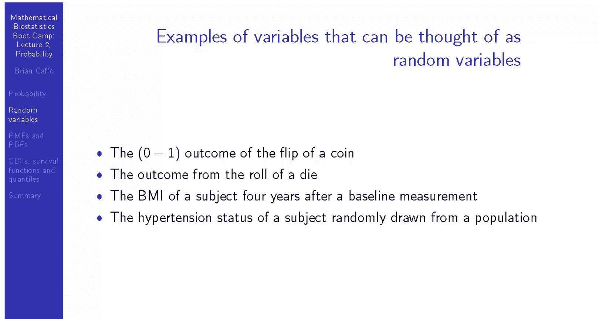

# 高级统计：第4章：随机变量 🎲

在本节课中，我们将要学习随机变量的基本概念。随机变量是概率论与统计学的核心，它为我们提供了一种将随机实验的结果进行量化的数学语言。我们将探讨随机变量的定义、分类，并通过一些简单的例子来理解其应用。

---

## 随机变量的定义

随机变量，正如幻灯片所说，**是一个实验结果的数值化表示**。它们就像你在微积分中看到的变量，但与之不同的是，随机变量有与之相关联的概率分布。

上一节我们介绍了概率的基本概念，本节中我们来看看如何用随机变量来描述随机现象。

---

## 随机变量的类型

我们主要讨论两种类型的随机变量：**离散型**和**连续型**。

### 离散型随机变量

离散型随机变量是指**可能取值的数量是可数的**随机变量。即使这个数量是无限的，只要这些值可以被一一列举出来，它就属于离散型。

以下是离散型随机变量的关键点：
*   **可数性**：即使理论上可以取无限个值（例如，到达公交车站的人数），只要这些值可以按1、2、3……的方式计数，它就是离散的。
*   **例子**：掷骰子的结果（1, 2, 3, 4, 5, 6）、抛硬币的结果（0或1，代表反面或正面）。

### 连续型随机变量

连续型随机变量是指**可以在实数轴或其子集上取任意值**的随机变量。这意味着它的可能取值是不可数的。

以下是连续型随机变量的关键点：
*   **不可数性**：其取值可以精确到任意小数位。
*   **例子**：测量一条从0到2的线段上随机点的距离。虽然实际测量有精度限制，但在数学模型中，我们将其视为可以取0到2之间任意实数值的连续变量。

---

## 离散与连续的混合情况

需要指出的是，离散型和连续型的分类并非详尽无遗。实际上，存在**同时具有离散和连续特性的随机变量**。

让我们通过一个思想实验来理解这一点。假设你抛一枚硬币：
*   如果硬币正面朝上，你测量上述线段上随机点的距离（得到一个连续值）。
*   如果硬币反面朝上，你掷一个标准的六面骰子（得到一个离散值1-6）。

那么，这个实验的最终结果**既可能来自连续分布，也可能来自离散分布**。因此，描述这个随机变量的行为需要同时考虑离散和连续两种特性。

虽然本课程不会深入探讨这类混合型随机变量，但它们在实践中是有用的。一个常见的例子是保险公司的赔付支出建模：
*   对于从未生病的客户，赔付额为**精确的0**（一个离散点）。
*   对于发生赔付的客户，赔付额可能是**任意金额**（最好用连续变量建模，因为需要计算到分甚至更小的单位）。

因此，保险公司在分析赔付支出的分布时，可能需要使用一个在0点离散、在正数区间连续随机变量模型。

---

## 随机变量的实例

理解了基本分类后，我们来看看一些可以被视为随机变量的简单例子。

以下是几个常见的随机变量实例：
*   **抛硬币**：以0（反面）或1（正面）表示的结果。
*   **掷骰子**：结果为1到6之间的整数。
*   **生物测量**：在一项研究中，随机选取的受试者其**基线身体质量指数（BMI）**，或**四年后BMI的变化值**。
*   **疾病状态**：受试者的**高血压状态**（是或否）。

这里需要强调一点：当我们说某事物“是”一个随机变量时，通常是指**在实践中我们倾向于将其建模为随机变量**。我们并不深究硬币翻转在物理上是否绝对随机，而是从实用角度出发，利用随机模型来理解和分析现象。

最后一点也提醒我们，看似简单的**抛硬币模型**非常重要。它构成了许多分析的基础。例如，在建模高血压患病率时，我们可以将收集到的每个数据点（某人是否患高血压）**概念化为一枚硬币的翻转结果**。这种简单的二元随机模型，能帮助我们构建和理解更复杂的统计模型。

---

## 总结

本节课中我们一起学习了随机变量的核心概念。我们了解到随机变量是将随机实验结果数值化的工具，主要分为**离散型**和**连续型**两种。离散型变量的取值是可数的，而连续型变量的取值则充满一个区间。我们还认识到存在混合型随机变量，并在实际中有其应用。通过抛硬币、掷骰子等实例，我们看到了随机变量如何作为构建更复杂统计模型的基石。理解随机变量是学习概率分布、期望值、方差等后续高级主题的关键第一步。