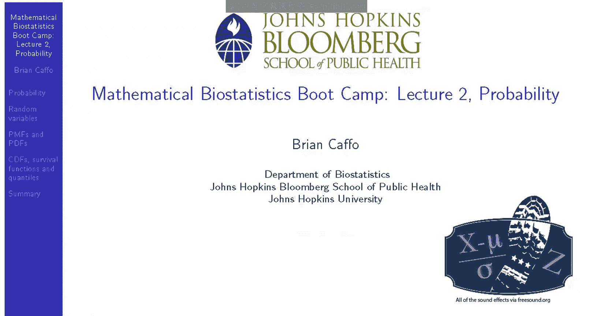
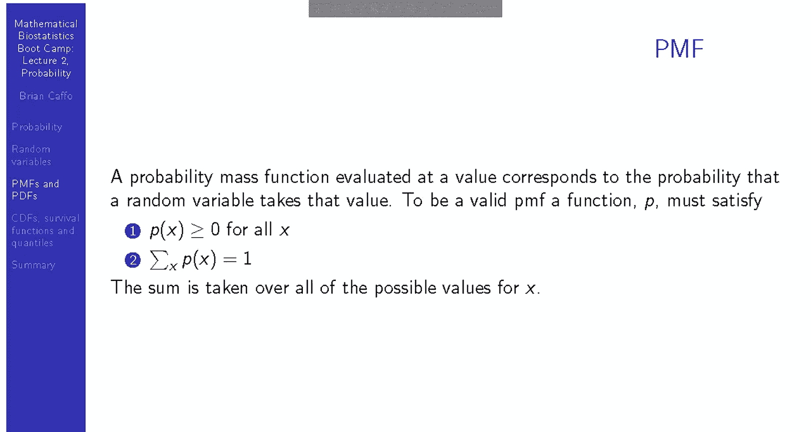
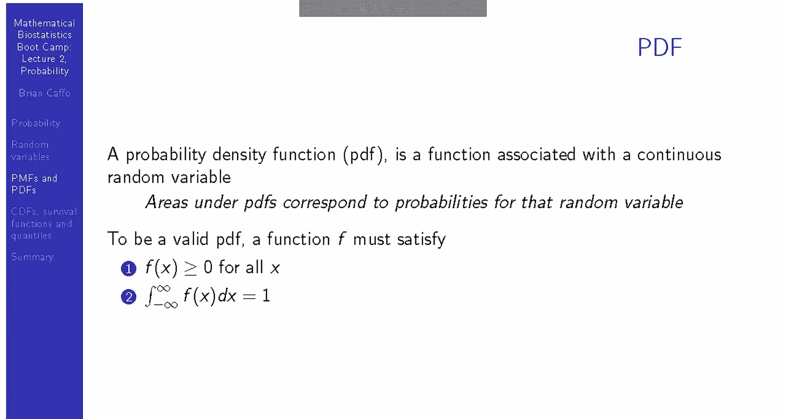
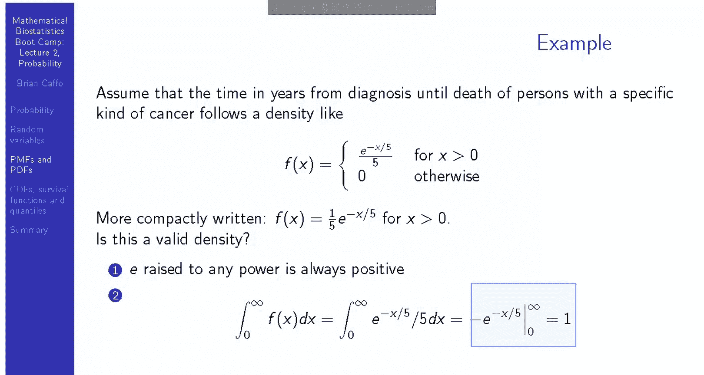
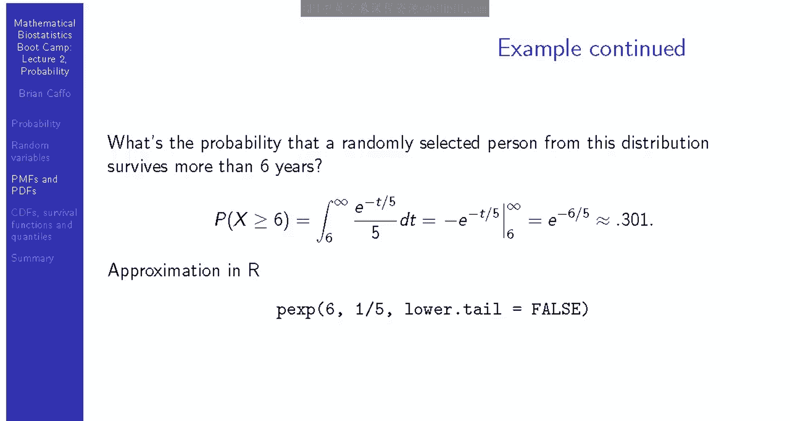
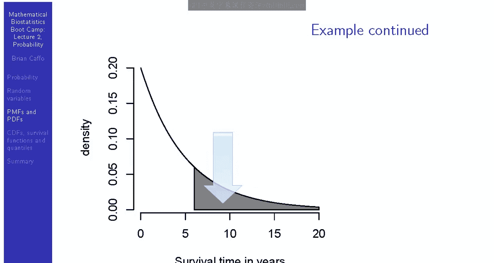

# 约翰霍普金斯大学《数据科学的高级统计｜Advanced Statistics for Data Science》中英字幕（deepseek p06 5_概率质量函数与概率密度函数.zh_en -BV1htPjeYEFH_p6-

So we've described some examples， some very basic examples of random variables。

 so what we need is a mathematics of random variables to use them。

And we have a mathematics of probability， and we've acknowledged we're at least willing to think of kinds of variables as if they're random。

 we'd like to put those two ideas together。So we need functions that map the rules of probability to random variables。

 and so for discrete random variables， the kind of functions that we're talking about are so called probability mass functions。

So a probability mass function is simply a function that takes the values that a random variable can take and maps it to their associated probabilities。

So for a die， the probability of p of 1 would be 16， for example。

 and it turns out quite a few functions satisfy the definition of being a probability mass function。

 In fact， you only have to satisfy two rules if you'd like to be a probability mass function。

The first rule is that you have to be bigger than0 for all of the arguments where here x is the collection of possible values that a random variable can take。

And the second rule is that if you sum over all possible values。Then you get one。

 This is just exactly analogous to our probability statement that the probability of the whole sample space has to be one。

 But here we've put it in the terms of a probability mass function。

I want to talk a little bit about this notation。 Notice here I have this small X。

 And when we defined random variables two pages previously。We used a Capital X。

So this is very common and maybe slightly unfortunate notation， but it's used everywhere。

 So you might as well just get used to it instead of fighting it， that we use an uppercase letter。

 typically to represent the random variable as a conceptual entity。 So if we say capital X。

 we're talking about a di roll that we could have。When we use a lowercase X or a lowercase Y or a lowercase letter of any sort。

 we tend to be talking about realized values of the random variable。

 So the x lowercase should be something that you should be able to plug a number into where capital X is a conceptual random variable。

 It's a conceptual flip of a coin。 It's a conceptual role of a die。 lowercase x is1 or2 or3 or 0。

 okay and its slightly unfortunate notation。 it takes a little bit of getting used to。

 but I think for everyone who works in statistics or probability。

 they've gotten used to it and everyone does it。 So you might as well do it too。

Let's go over an example of constructing a probability mass function。

 let's take the simplest possible example， a coin flip。

So let's let X be the result of a coin flip where0 represents tails and one would represent a head。

So we want the function。 and let's assume that the coin is fair。

 So we want a function that maps 0 to1/2 and one to12。

 And there's infinitely many ways you could write down that function。 Well。

 we're gonna to pick1 here we write it as  one half raised to the power x times one half raised to the power 1 minus x。

 and notice that if you plug in x equals 0， you get1 half。 And if you plug in x equal 1。

 you also get one half。 Now， let's go to a slightly more complicated example where we assume that the coin is potentially bias。

 I that it's not fair。 So let's let theta be the probability of a head。 in this case。

 expressed as a proportion between 0 and1。 So just as an example， imagine if theta was 0。3。

 instead of a half， then we would think that the probability of a head is 0。

3 and the probability of a tail is 0。7。 But let's leave it as theta for right now。

 So we want a function that says probability of a 0。

Is one minus theta and the probability of a1 is theta。 And then we see our function here。

 theta to the x，1 minus theta to the 1 minus x exactly satisfies these properties。

 This is another common notation in the field of statistics that Greek letters like theta represent things that we don't know that we would like to know。

 So imagine if you had a coin。 And you didn't know whether or not it was fair。

 We would represent that unknown probability of head as theta。

So I want to give you a sense of where we're going。In this case。

 the probability mass function is the entity that governs the population of coin flips。

And so if we wanted to know theta。We're going to collect data to estimate it and then to evaluate the uncertainty in that estimate。

 and the way we're going to evaluate uncertainty in that estimate is using this probability distribution。

 So all the probability distributions we're going to talk about are conceptual models of populations。

And they are the entities that are going to tie our data to the population。So at any rate， right now。

 this may sound a little heady， and we'll discuss this in much more detail throughout the entire class。

 but the one rule I want you to remember right now is that unknown things that we want to know。

 like in this case， what would be the probability of a head are generally denoted in Greek letters。

These are called parameters， usually。I also want to note one other thing。

 why is it among all the possible ways that we could have written out this probability mass function。

 did we choose theta to the x 1 minus theta to the1 minus x。

 There's lots of different ways we could have done this。

 You can try and figure some of them out yourself。Well， it turns out。

 and we'll discuss this at length that improbability multiplying is very useful。

And so we want probability mass functions that make multiplication very easy so if we take things and raise them to powers。

 then multiplying becomes easy and that's a general rule and we'll tell you you'll see later on why this is the case。

 but anyway this is why we choose this particular form of the probability mass function when you could write it so many different ways。

 but I want to say people have thought about this a lot。

 and this is definitely the most useful way to write out this particular probability mass function。

So consider again the unfair coin， our probability mass function satisfies p of 0 equals 1 minus theta and p of 1 equals theta。

Let's just go through the exercise to prove to ourselves that this is， in fact。

 a probability mass function。 It's greater than0 because it's one minus theta for 0 and theta for1。

 and in this case， theta is between 0 and1， so it's going to be greater than 0 for x equals 0 and 1。

 and then the sum of the probabilitybabilities， probability of0 plus the probability1 in this case the theta plus 1 minus theta which is1。

 So it satisfies the two rules that probability mass functions have to satisfy。

So that covers our principal entity that we're going to use to model discrete random variables。

 probability mass functions， so now we need to cover our principal entity that we're going to use to model continuous random variables。

 which are called probability density functions。So probability density functions are abbreviated Pdf。

 by the way。 So it stands for probability density function， not portable document format。

 which is what lots of people think of as Pdfs， but in statistics， no one thinks of Pdfs that way。

 I want you to remember one very important rule。 and I put it in italics just to make sure everyone remembers it。

 And by the end of the course， this will be second nature to you。 But if you haven't seen it before。

 it might seem a little odd。 But the way that probability density functions work are that areas under probability density functions correspond to probabilities for the random variable。

 And there's definitely one undisputed king of all Pdfs。And that is the so called bell curve。

 So if you ever wondered what a bell curve was， if you hear it talked about a lot。

 the so called normal density function， you might wonder what in the world is a bell curve accomplishing well。

Areas under bell curves correspond to probability。 So if you're modeling something as if the population it belongs to follows a bell curve。

 then you are saying that that probabilities associated with that random variable are governed by areas under that bell curve。

That's just one example of a PDFf。 There's lots of different kinds of PDFs。

 So just like probability mass functions have to follow two rules。

 probability density functions have to follow two rules to be a valid probability density function。

 They have to be positive for all the possible values that the random variable can take。

 That's called the support usually and their integral has to be one。

 I would also say as a small point here， we define probability density functions as if they operate on the whole real line。

 So even if your random variable can only take values say between 0 and 2。

 like we talked about earlier with the pencil experiment。 even if that's the case。

 we define the probability density function as0 below0 and0 above two so that there's no associated probability。

 but we've defined the probability on the whole real line so that we define its integral from minus infinity to plus infinity。

And I think in this class we tend to be a little bit fuzzy about sometimes operate on minus infinity to plus infinity。

 and other times we'll just write out0 to 2， discarding all the area where the function is zero。

 and I hope from the context it'll be clear what we're doing。This final property property。

 too here that the integral over the whole real line of the probability density function has to be one is simply again saying that the random variable has to take some value。

 that it has to be in some interval in the whole real line。

Let's go through a specific example of a P Df。 And let's put it in a context。

 So let's assume that the time in years from diagnosis until death with a specific kind of cancer follows the density that looks like this F of x equals E to the negative x over 5 divided by 5 for x greater than 0。

 The greater than 0 being contextually clear because you can't have negative time from diagnosis。

 And the person is presumably alive at the time of diagnosis， so。

This is a very restricted example of a density that's commonly used in these sorts of analyses of things like survival times。

 It's called the exponential density function。And again。

 here you see that we have f of x written as E to the negative x over 5 over 5 for x bigger than 0 and 0 otherwise。

 like I talked about in the previous slide， we often just ditch that 0 and just talk about f of x being the kernel of the function and just either explicitly right or sometimes will fudge a little bit that x has to be greater than 0 if it's clear from the context that that has to be the case。

 In this case， it would be clear from the context。Is this a valid density。

 Could we model survival time after diagnosis with this density？ Well， first of all。

 we know that the function is positive because E raised to any power is always positive。

 And then let's just check whether or not it integrates to 1。

 So we want the integral from minus infinity to plus infinity， But like we said。

 the all of the meat of the distribution starts at 0 and goes to infinity。

 So let's just say the integral from 0 to infinity， F of x D x is in this case。

 the antider is negative E to the negative x over 5。

 which when evaluated from 0 to infinity yields 1。

Let's go through an example of using this probability density function to assign probabilities。

So imagine if we were to model this population as if it followed this specific exponential probability distribution。

 and imagine if someone asked us the question， what's the probability that a randomly selected person from this population survived more than six years？

So if x is the conceptual value that a random person takes。

 we want to know what's the probability that x is greater than or equal to 6 as represented by this probability statement。

Remember， again， the golden rule for。Probability density functions that areas under the curve correspond to probabilities。

 So if we want the probability X is greater than 6。

We want the integral from sticks to infinity of the probability density function。

 and you can go through the calculus here to get that that works out to be about 30%。

In the statistical programming language R， you can do this automatically。

 It just does the integral for you。 It uses a numerical approximation。

And you just write px6 for the fact that we want the probability of6 or larger。

1 fifth represents this parameter 5 that you see in the exponential distribution。

 Lower dot tail equals false means that we want the probability being larger than 6。

 rather than the probability being smaller than 6。 So lower dot tail equals true would give you 6 or smaller。

 Low dot tail equals false will give you 6 or larger。I want to elaborate on that point， by the way。

 for a continuous random variable。 The probability that it takes any specific value is， in fact，0。

 Now， that seems strange， but it's true。 So remember。

 areas under probability density functions correspond to probabilities。 So what's the area of a line。

 It's 0。 Now， you might say， well， that doesn't make any sense at all。

 specific values have to take probabilities because we see specific values when we actually observe variables。

The point is， is that our probability density function is a model。

 and it is defined on continuous random variables。 continuous means measured to infinite precision And so when we observe things。

 we never measure them to infinite precision。 we measure them to finite precision。

 and probability density functions are perfectly happy with saying the probability that x is 6。

01 to 5。99 in assigning a perfectly valid probability to that。

 But the probability that it's exactly 6 is 0。 because remember， exactly 6 means 6。0。

 followed by an infinite trail of  zeros or 5。99， followed by an infinite trail of 9s。 Either way。

 that's the idea behind what probability density functions are getting at their modeling truly continuous random variables。

 So just remember that when we observe data， we of course， measure them with finite precision。

 but our。😊，Continuous model is exactly that。 It's a model。

 We find it far more useful in many circumstances to model random variables。

 as if they were truly continuous than to account for all the potential specific values they could take。

 So in this specific example， a person will only measure how long they survive to the year。

 maybe to the month， maybe to the day， maybe to the hour to the minute， to the second。

 but probably not much further than that。 And so we're only going to measure to finite precision。

 None， it still is much more useful to model that as if it was continuous because we don't want to have to assign probabilities to every single value。

 we want to assign a general function。 And that's why。

Continuous random variables are so intrinsically useful。

 So my the belaed point I'm trying to make about this， by the way。

 is that whether or not you write probability x being greater than or equal to 6 or the probability of x being strictly greater than 6。

 In this case doesn't change this calculation whatsoever， you get 0。301 either way。

And so it also doesn't make difference in the probability exponential for the R example。

 It doesn't matter whether you specify lower tail or upper tail。

 whether you're thinking about whether or not that includes 6， it doesn't care about that。 However。

 for discrete random variables， it makes a big difference， right。

 because specific values have actual probabilities assigned to it。 So a die can take the value 1，2，3。

4，5 or 6。 So in R， if you're using these probability functions。

 So Px are probabilities from the exponential distribution。

 P byome or probability from the binomial distribution。

 P Poson or P O I for Poisson is probabilities from the Poisson distribution。

 P gamma probabilities from the gamma distribution， R follows that rule pretty neatly。

 If it's a discrete random variable， you have to be careful about whether or not it's including the 6 for continuous random variable。

 you can be very sloppy about it。

So here I'm just depicting the area that we're calculating this gray area is the survival time from6 to infinity。

 this is simply the integral that we're actually calculating and I'll put the R code to generate exactly this figure in the files for the course。

