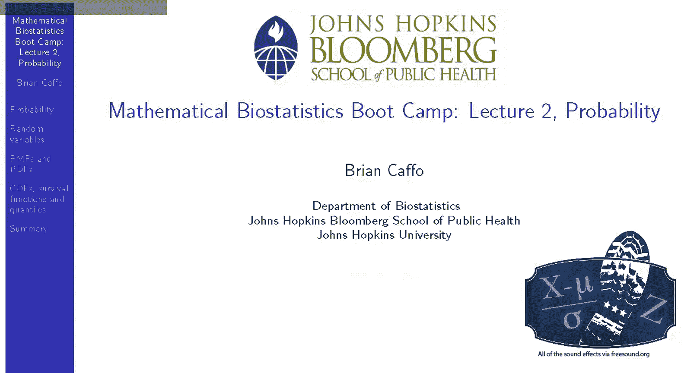
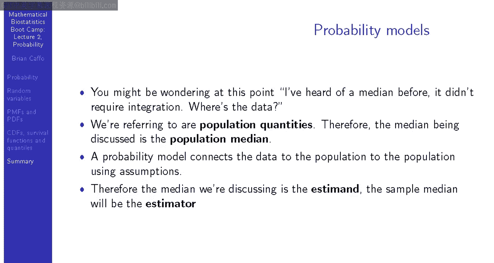

# 约翰霍普金斯大学《数据科学的高级统计｜Advanced Statistics for Data Science》中英字幕（deepseek p07 6_累积分布函数、生存函数与分位数.zh_en -BV1htPjeYEFH_p7-

So in that specific example， we looked at what's the probability that the random variable was larger than6。

But we might want to look at what's the probability the random variable is larger than 7 or smaller than 6 or smaller than 5 or smaller than 4。

3 or so on。 So if you take a random variable， you could construct a function that when you plug in a value returns the probability that the random variable is less than that value and you could construct a function that when you plug in a value returns the probability that the random variable is larger than that value。

 And these things are so inherently useful that we give them names。

 So the cumulative distribution function。 Cf is simply a function that takes any specific value and returns the probability that the random variable is。

Less than that value。 And again， if it's continuous。

 it doesn't matter whether it's less than an equal to or less than。

 but the cumulative distribution function is defined for both continuous and discrete random variables。

 So let's be specific and say that it's less than or equal to。The survival function is the opposite。

 namely that it is exactly the probability that a random variable is larger than any specific value。

 So if you plug in x into the survival function， it returns the probability that the random variable is larger than x。

So if on our previous slide， this figure， imagine if on the horizontal axis， instead of looking at6。

 I was looking at some arbitrary value x， the gray area would be S of x and the white area to the left of x and to the vertical axis would be F of x。

Notice in this case that F is the probability of being less than or equal to x。

 S is the probability being strictly greater than x。

 so that S of x and f of x have to add up to1 because their probabilities of complementary events。

 probability x is less than or equal to x and the probability x is strictly greater than x。

 So if you've calculated the cumulative distribution function。

 you have also calculated the survival function， because all you have to do is one minus it。

 Conversely， if you've calculated the survival function。

 then you've calculated the cumulative distribution function。

 Next we'll just go through our previous example and calculated exactly the survival function and the CDF。

Let's actually go through an example of calculating the survival function and cumulative distribution function just from the exponential density that we considered before。

Let's calculate the survival function first。So recall the survival function is that probability the random variable strictly greater than the value lowercase x。

So further recall that to calculate probabilities， we need to calculate areas under the probability density function。

In this case， we want the probability of being x or larger。

 So let's take the integral from x to infinity of a probability density function。 Here。

 I use the dummy variable of T for integration。 The integral or the anti derivative of E to the minus t over 5 divided by 5 is just negative E to the negative t over 5。

 We want to evaluate that from x， which yields the value E to the minus x over 5 and then subtract off the value as it limits to infinity。

 which is 0。 So we just wind up with E to the minus x over 5。

Now we could also go through the example of calculating the cumulative distribution function。

 which would instead of calculating the integral from x to infinity。

 we would just be calculating the integral from 0 up to x。

 but because we've already calculated the survival function。

 we know that it's 1 minus their survival function， so it's 1 minus e to the minus x over 5。

So the cumulative distribution function is the integral from minus infinity to x of the probability to density function again。

 here we're just doing zero because the integral from minus infinity to 0 is 0。

And so we can just apply the fundamental theorem of calculus and note that the derivative of the CDf is exactly the density again。

 so if we take just to go through our specific example。

1 minus E to the negative x over5 and take the derivative of that。

 we get exactly e to the negative x over 5 divided by5。 so we get the P back。

 So derivatives of the cumulative distribution function。

 exactly yield the probability density function back。

Quantiles are properties of distributions or density functions equivalently。

 when I talk about a distribution or density in general，'ll just maybe say the word distribution。

 So if I want to talk about the bell curve or the associated distribution。

 I'll just talk about the Gaussian distribution or the normal distribution and so on。

 and then when we're talking about the mathematics I'll be more specific。

The alpha quantile of a distribution。Is the point。So that the probability of being less than that point is exactly alpha。

 So we want if x of alpha is the alpha of quantile of the distribution。

 we want the probability of being less than or equal to x of alpha to be exactly alpha。

 So let's just take as a specific example， if alpha was 0。25 x sub 0。

25 is that point such that the probability of being less than it is 25%。 So， for example。

 in our cancer survival example， the 0。25th quantile of that distribution。

Is the time of survival so that 25% of the people survive less than that time。

The percentile is merely the quantile expressed as the percent， so the 25th percentile is the 0。

25th quantile。And then the median， the population median is exactly the 50th percentile。

Let's just go through these concepts again with our density that we've been looking at。

 this exponential density。Suppose we wanted to find the 25th percentile of the exponential survival distribution。

What we want is to find the point x on the horizontal axis so that the white area to the left of it is 0。

25。So let's actually go through this calculation。In order to find the point so that the area to the left of it is 0。

25， we just want to solve the equation， 0。25 equals f of x。

We'll recall in this problem A couple of slides ago。

 we solve that F of x is 1 minus E to the negative x over 5。 And if you just simply solve that for x。

 we wind up with a solution。 x equals minus log 075 times 5， which is about 1。44。 How is that 1。

44 interpreted。About 25% of the subjects from this population live less than 1。44 years。

You can get quantiles directly from R by the Q function。

 QX in this case because we're talking about the exponential P。

 so QX gives you quantiles from the exponential PDF。

 Px gives you survival or CDF probabilities from the exponential and Dx gives you the density itself and that rule R follows for most of the common distributions。

The median to remind you is the 05th quantile， the 50th percentile。

And the quantile that we just figured out， the 0。25 quantile is generally called the lower quartile。

And you might have said， well， I've heard of the median before。

 maybe I've heard of what a lower quartile is before。 And what those things are to me。

 is that they're the middle of the data or the point in the data so that 50% of the observations are lower than it or the lower quartiles is that point in the data so that 25% of the observations are below it。

 What in the world is Brian talking about at this point。

So when we talk about the median that we're discussing in this lecture。

We're talking about the population median and when you collect data and you take a sample median。

 that's an estimator of something， so we should talk about what that's an estimator of， right。

 it's an estimator， it has to have an est in the same way if we take a sample mean of data。

 that's an estimator of something， it has to have an estimate。

And so what we're talking about in this lecture is one way to construct estimatess of these quantities。

 In this case， the median， if you take the sample median。

 it is hopefully trying to estimate the population median that point in the population so that the probability of being less than it is 50%。

And you'll find in this class that there's this simple rule。

 Sample things tend to estimate population things。 So sample medians estimate population medians。

 sample variances estimate population variances， sample medians estimate population means and so on。

 And what we're going to see is this probability modeling and the associated assumptions。

 These are the things that connect our data to the population so that we can actually have estimatess。

 If we didn't go through this exercise。 We would be able to take a median， but， you know。

 that would just be an entity in the sample。 The whole point of probability modeling。

 is then it connects your sample to this population so that now your sample median now has a population median that it's trying to estimate。

 now， and this is kind of a very difficult concept。 I think the sample median is a very easy concept。

 It's saying， you know， you have a list of observations， take the middle one after you order them。

The population median is a much more difficult concept， it's saying。

 I have described a population via this distribution。

And this distribution has a point so that 50% of observations lie below it。

 and that's the population median。And I think it's a good idea whenever you're talking in this class to put the word population or sample in front of it to remind yourself。

 Now， people who work in statistics do this so much that they just kind of。

Forget about these distinctions， even though they know them。

 They just forget about them because they become sort of second nature。

 But when you're first learning this， it seems quite odd。 And I also want to mention， you know。

 the sample median is the well defined quantity that doesn't require tons of assumptions。

 It's the probability modeling that's the delicate part that requires assumptions。

 So if you're going to say that the sample median estimates the population medians。

 where the assumptions that need to be taken into account for that to be true。

 And especially if you want to do inference with your sample median or evaluate its uncertainty。

 And that's basically we're going to spend nearly all of this class discussing is how are we going to connect these probability and population concepts to sample data。

Thanks recruits， This was Ma Biosstatistics Boot camp Lec 2 in the next lecture。

 we're going to expand on probability modeling and defining characteristics of probabilities。

 and I look forward to seeing you。

🎼。🎼い。

🎼嘀嘀哩。