# 约翰霍普金斯大学《数据科学的高级统计｜Advanced Statistics for Data Science》中英字幕（deepseek p08 7_期望值.zh_en -BV1htPjeYEFH_p8-

Hi， my name is Brian Kafa I'm in the Department of Biosstatistics at the Johns Hopkins Bloomberg School of Public Health。

 and this is Mathematical Biostatistics Boot Camp Le 3 on Expectations。

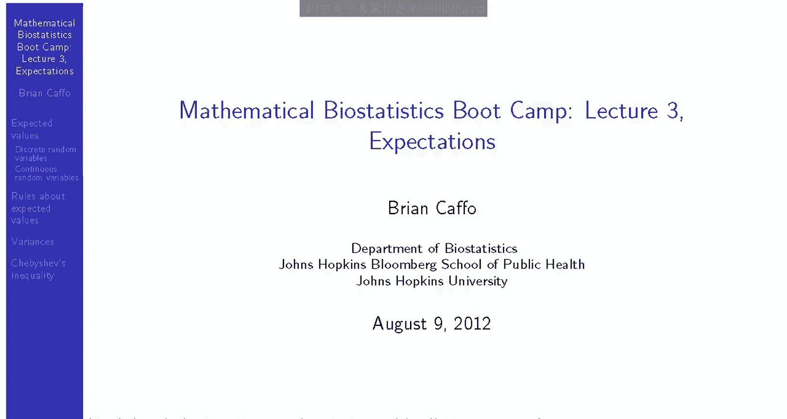

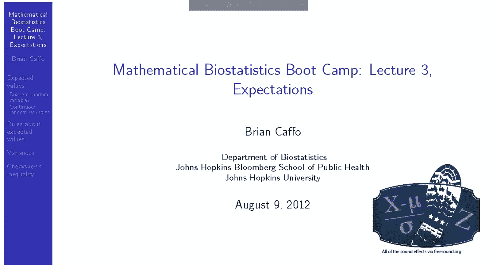

Expected values are ways of summarizing probability distributions in the same way last lecture we talked about quantiles to summarize probability distributions。

 So we'll talk about the rules that expected values have to follow。

 We'll talk about the basic mechanics of how you calculate expected values for discrete random variables and continuous random variables and we'll talk about important subclasses of expected values。

 the mean variances and we'll talk about how to interpret variances because they're a little bit trickier with chubby Che's inequality。

 the expected value or mean of a random variable is the center of its distribution。

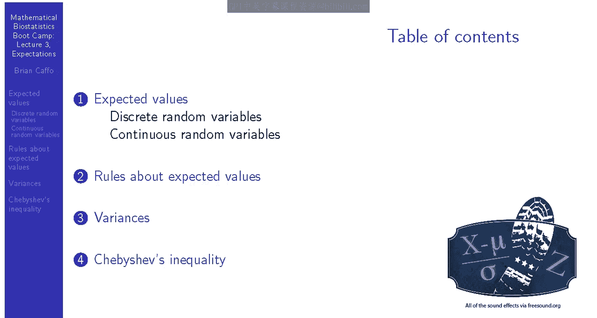

It's in essence， a particular definition of the middle of a distribution。

 there's more than one definition of the middle of a distribution， for example。

 the median would constitute a different definition of the middle of a distribution。

But the mean is a particular one and we'll talk about the intuition behind it in a minute。

And consider how you would calculate the mean for an example for a discrete random variable。

 we denote the mean with this capital E here， which stands for expected value。

And then usually for whatever the reason we tend to use square brackets for expected values rather than parentheses。

 and so we might write expect value of x here again we're using a capital x because we're talking about a conceptual value of the random variable。

This in the case of a discrete random variable is the sum over all possible values that x can take of x times p of x Now note here。

 if we didn't have this x out in front of the P of x， this would just sum to1 because the PMF。

Ss to1 by the definition of a PMF。 So this x out in front is what turns it into an expected value Here we are just talking about the expected i of x。

 but if we wanted the expected a of x squared， it would be the sum over x。

 and we would have a little square in front of the x right here that we're summing over。

 So sum over x squared times P of x。E of x， one way to think about respect value of x is that it represents the center of mass if the x's are locations and the P of x's are weights and I have kind of a schematic here on the next slide that shows an example。

 so imagine if。

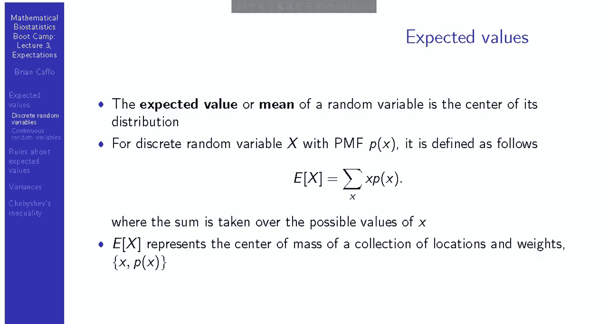

On the horizontal lines here， let's suppose the leftmost line is at the point0。

And it's just a real line extending in the positive direction。

 and each location of a line here is the value that x would take。So in this case。

 x takes four possible values， two low values and two high values。

 and the height of the bars is p of x， so in this case p of x is equal for each of the four bars so because p of x is a probability。

 mass function， each of these four bars would have to take value one quarter。

So the expected value then would be the center of this distribution。

 the point at which you would balance this out if this was， say， for example。

 four little bars and you wanted to put your finger on the horizontal bars so that it would balance out and here of course。

 because the bars are all the same height and you have two on the left side and two on the right side placed in the same configuration the geometric center of mass would be right in the middle Well what would happen。

 Consider the one next to the right， what would happen if you had three all squashed up on the right- hand side and one really far on the left hand side。

 Well， the one really far on the left hand side would pull the mean away from the center of the three just to a little bit outside of it。

And then I go through two other cases over here where I vary the heights of the bars and their configuration in each of these cases。

 thefululcrum point at the bottom is exactly where you'd have to put it to balance out the bars and that's where the expectation gets its definition from it actually draws exactly from the physics definition of center of mass。

 and in this case it's exactly just another property of a probability mass function。

In order to characterize it， let's talk about how you calculate the expected value for a coin flip。

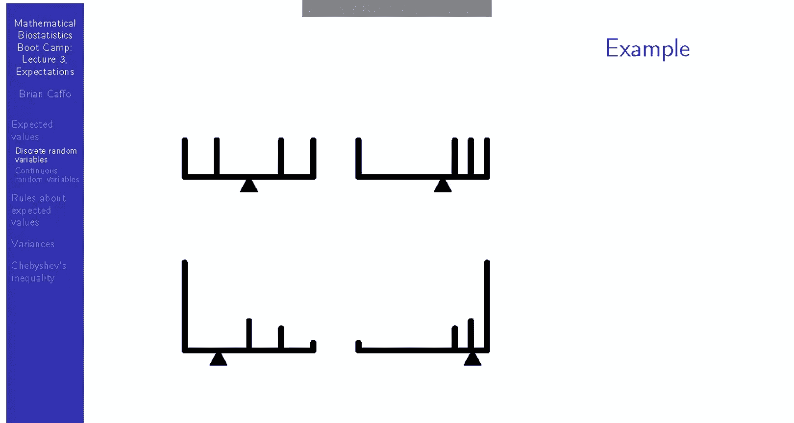

In a coin flip， our sample space is heads or tails and will define our random variable as being zero four tails and one for heads。

Let's calculate the expected value for the probability mass function from a fair coin that is it's a 50% chance of tails and 50% chance of heads。

 so let's plug directly into the formula。The expected value of the coin flip X。Is 50% 。

5 probability of a tail times the value we've assigned for a tail 0 plus 0。

5 times the value we've assigned for a head1， add those up and you get 0。

5 So the expected value of a coin flip is 0。5 this exactly makes sense if you think back to our previous page if you had a bar at 0 and a bar at one and they were both equal height。

 you would put your finger right at the 0。5 to balance out that bar。So in maps intuition。

 also note the expected value does not have to be a value that the random variable can take。

 in this case the random variable can only take value 0 or 1， but the expected value is 0。5。

 which is between the two。

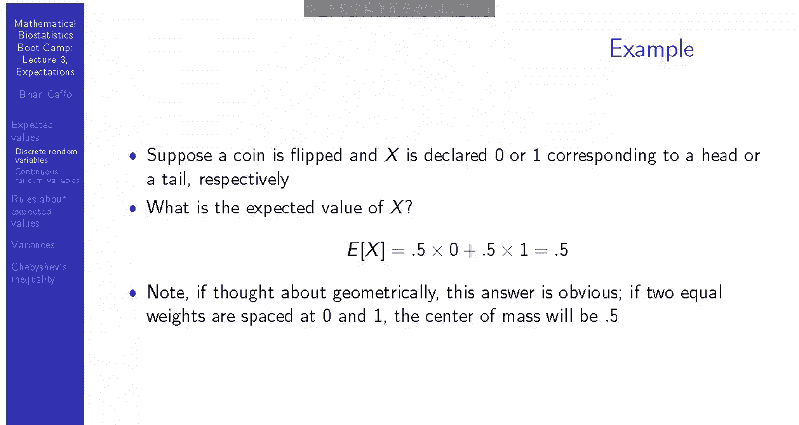

Okay， let's go through the same exercise， but now instead of a coin let's talk about a die here the possible values that the die can take are 1。

2，3，4，5 and6， we're going to assume that the die is fair。

 so all of the numbers have probability 16 of occurring what's the expected value of that die roll。

So we denote the expected value again by E bracket x here。

 we have one times the probability of getting a 116 plus 2 times the probability of getting a 216 and so on。

 And if you add them all up， you get 3。5 again， this makes perfect sense。

 You have  six bars of equal height， one at position  one， one at position 2， one it position 3。

 one at position 4， when at position5 and when it position 6 and of course。

 if you were to balance that out with your finger， you'd put it right in the middle of those numbers is 3。

5 that covers discrete random variables， at least two examples of discrete random variables let's talk about how you do continuous random variables Well again。

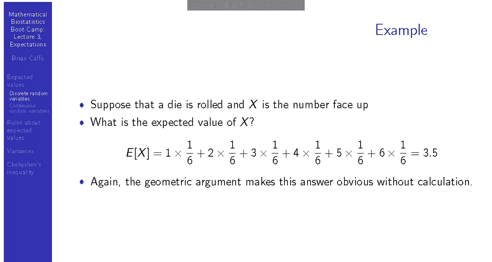

The definition follows exactly from the physical definition of center of mass。

 and in this case the expected value of a random variable x is the integral from minus infinity to plus infinity of Tf of T dt and here T is just the dummy variable of integration so it's pretty much the same formula here if you omit this value T right here。

Then the integral just works out to be1 again because f is a probability density function。

 so it's putting the T there that turns it into expected a value。

 if you wanted the expected value of x squared， then it would be integral minus infinity to plusfin t squared f of T dt。

And this just borrows from the definition of center of mass for a continuous bodies rather than the center of mass of a group of discrete bodies exactly from physics。

 and again it's just a description or it's a useful summary of the density function F。

 which is a complicated functional construct， it reduces it down to one number which is a property。

 which is what we kind of think of this as some at least one of the definitions of the center of the density F Let's go through an example of calculating the expected value of a particular kind of random variable。

 one that we have not encountered before。

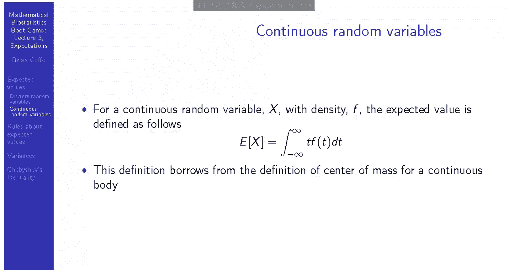

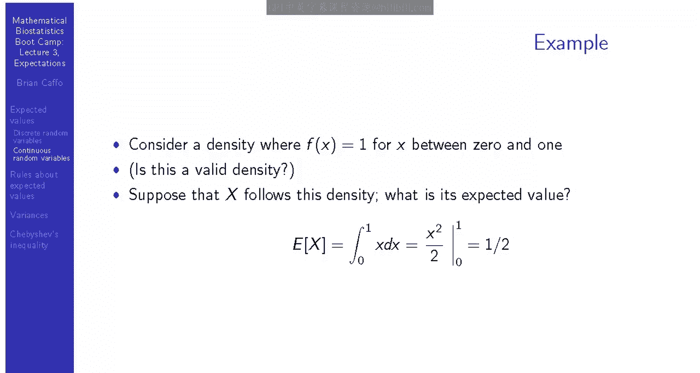

So let's think of a very simple density。 The density is such that it's0 below zero constant at the value of1 between 0 and 1 and it's0 above the value 1。

 So let's mentally just real quick verify that this is in fact， a valid density。 Well。

 this density is exactly a brick starting at 0 ending at1 with height 1。

 you don't even need calculus to verify that this integrates to1 because it's just a square。

 it's area is the length of the base， which is1 times the length of the height， which is1。

1 times1 is1。 so it's a proper density， It's also positive everywhere because it's zero below0。

0 above1 and the value 1 between 0 and 1， so it's positive everywhere。 So it's a valid density。

 This is， in fact actually an extremely important density， it's pretty simple one。

 but it's an extremely important density and it's called the standard uniform density。

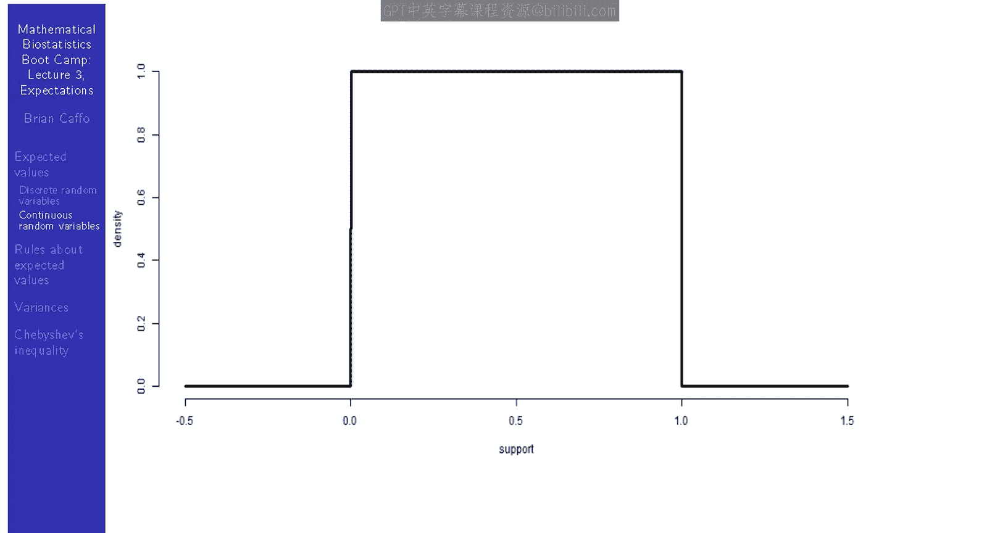

It sort of represents the idea that if any value between zero and1 is sort equally likely it's so imagine if you were to drop a pencil on a line between0 and1 and you were dropping that pencil in such a way that it was equally probable to land anywhere between zero and1。

 this density would represent that process Well let's go ahead and calculate its expected value。

Now again， we already know what the answer is from the geometric argument。

 it's a brick that starts at zero and ends at 1， the answer has to be 0。

5 because if you wanted to balance that brick out， you would have to put your finger right in the middle。

So let's just verify that calculation here our expected value of our uniform random variable x is the integral from 0 to 1。

 and again we have x right in the previous slide I had t but let's just use x in this slide times the density which in this case is just the constant one so I just didn't write it down then dx the variable of integration and so that integral is x squared over 2 evaluated the bound0 to1 which works out to be1 half exactly what we would have thought Incidentally I just want to remind everyone of this notation。

 the capital x in the expected value represents conceptual value of the random variable。

 whereas the little x in this equation represents the dummy variable of integration a value that's actually getting numbers plugged into it so it wouldn't have mattered for this little x if we had used x or t or z or W or whatever however it's important that we kept it at capital x that's what we've assigned this random variable the value capital x。

So it's a small point， but keep that in mind So I wanted to talk about something that always comes up in my in-person classes when I talk about this。

 so here we calculated expect value of x and I told you that expected value of x squared well you would just calculate integral from0 to1 x squared dx and a question that always comes up in class is well wait a minute I could calculate expected value of x squared that way。

 or I could figure out what the distribution of the square of a uniform actually is a uniform random variable is a random variable representing some process so the square of that has to be a random variable and it itself must have a density。

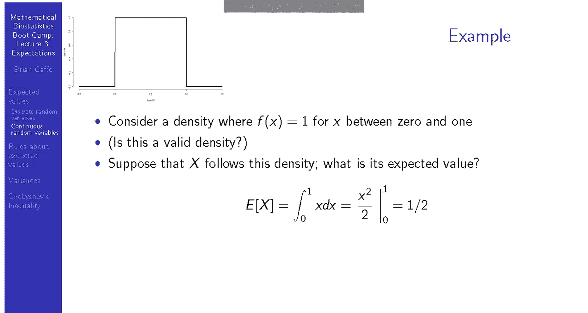

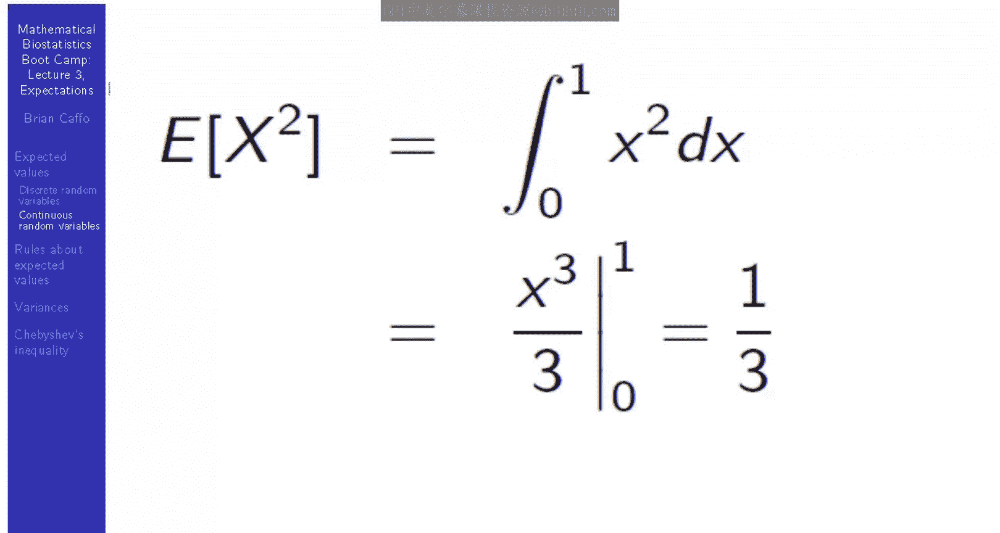

So I should be able to calculate the expected value from that density and it should be the expected value of y。

 let's say if y is x squared。Do I get a different answer if I figure out what the density associated with the square of a uniform random variable is。

 do I get a different answer if I calculate the expected value that way or if I calculate the expected value this way by just putting a square into the expected value calculation from the original uniform density。

 at any rate you'll be happy to know that you get exactly the same answer。And in fact。

 I would also add that it's a lot easier to just put the square in this integral equation because we automatically know off the top of our head what the。

Density of a uniform random variable is。 We may or may not know what the square of a uniform random variable is。

 So this should give you some basic。Examples of calculating discrete and continuous expected values。

In the problems， you'll have both harder and easier examples to work out。And in the assessment。

 we'll have harder ones in the next section， we'll talk about rules that expected values have to take。

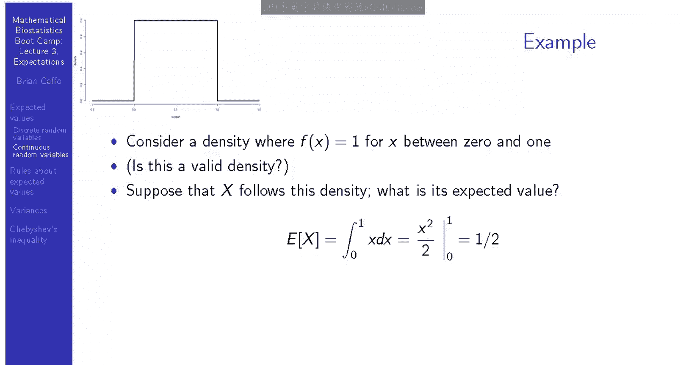