# 高级统计学：第8讲：期望值 📊

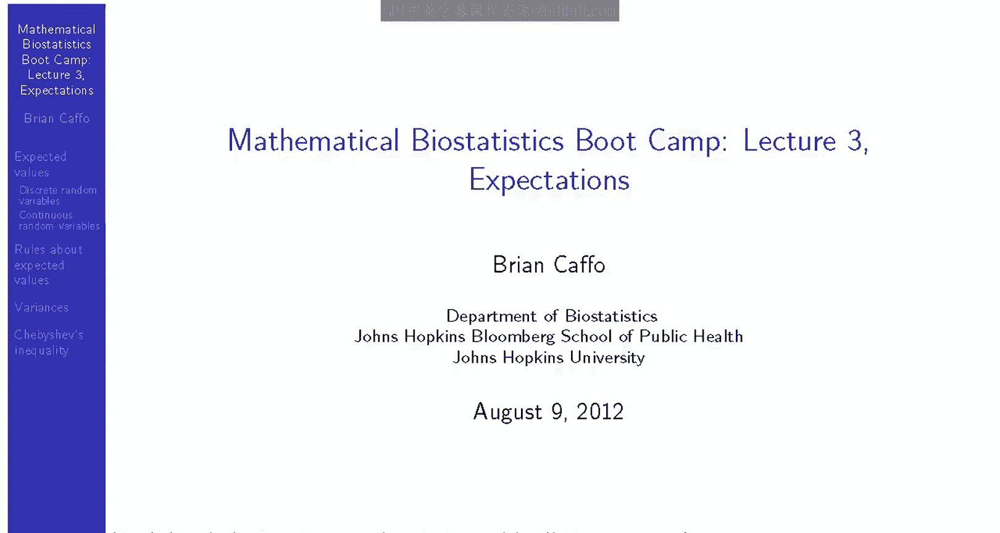

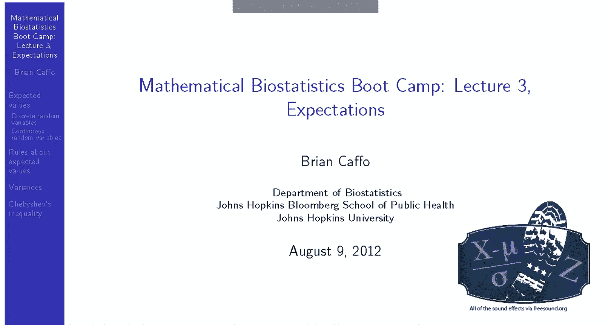

在本节课中，我们将学习期望值的概念。期望值是总结概率分布的一种方式，就像上一讲我们使用分位数来总结概率分布一样。我们将讨论期望值必须遵循的规则，学习如何计算离散和连续随机变量的期望值，并探讨期望值的重要子类——均值和方差。我们还将讨论如何解释方差，并介绍切比雪夫不等式。

## 期望值的定义与直观理解 🎯

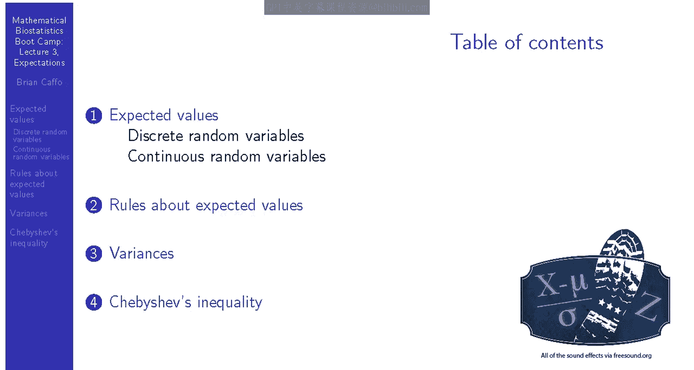

上一节我们介绍了分位数，本节中我们来看看另一种总结概率分布的方法——期望值。

期望值或随机变量的均值是其分布的中心。本质上，它是分布“中心”的一种特定定义。分布的中心可以有多种定义，例如中位数就是另一种定义。但均值是其中一种，我们稍后会讨论其背后的直观理解。

我们用大写字母 **E** 表示期望值，通常使用方括号而非圆括号。对于一个随机变量 **X**，其期望值写作 **E[X]**。

对于离散随机变量，期望值的计算公式为：
**E[X] = Σ x * p(x)**
其中，求和遍历 **X** 所有可能的取值 **x**，**p(x)** 是概率质量函数。如果没有前面的 **x**，**Σ p(x)** 将等于1，因为概率质量函数的定义就是所有概率之和为1。前面的 **x** 将其转化为期望值。

思考期望值的一种方式是将其视为“质心”。如果 **x** 是位置，**p(x)** 是权重，那么期望值就是平衡这些权重的支点。下图展示了几个例子：

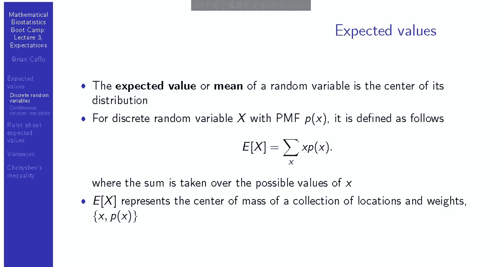

在第一个例子中，**X** 有四个可能值，概率质量函数 **p(x)** 对每个值都相等（均为1/4）。由于左右两侧的“权重条”对称且等高，其质心（期望值）正好在中间。

如果三个值挤在右侧，一个值在左侧很远的地方，那么左侧的那个值会将均值（质心）从右侧三个值的中心拉向左侧一点。

期望值的定义直接借用了物理学中“质心”的概念，它是概率质量函数的一个属性。

## 离散随机变量的期望值计算 🎲

了解了期望值的定义后，我们来看看如何具体计算离散随机变量的期望值。

以下是计算离散随机变量期望值的步骤：
1.  列出随机变量所有可能的取值。
2.  确定每个取值对应的概率 **p(x)**。
3.  将每个取值乘以其概率。
4.  将所有乘积相加，得到总和即为期望值 **E[X]**。

让我们通过两个例子来实践。

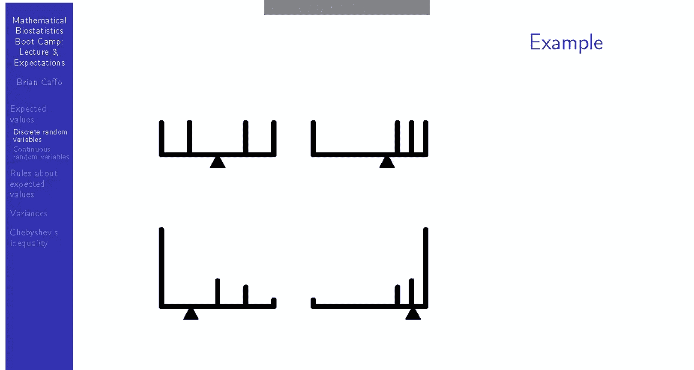

### 抛硬币的例子

在抛硬币中，样本空间是{正面， 反面}。我们定义随机变量：反面为0，正面为1。假设是一枚公平的硬币，正反面概率各为50%。

根据公式计算：
**E[X] = 0 * P(反面) + 1 * P(正面) = 0 * 0.5 + 1 * 0.5 = 0.5**

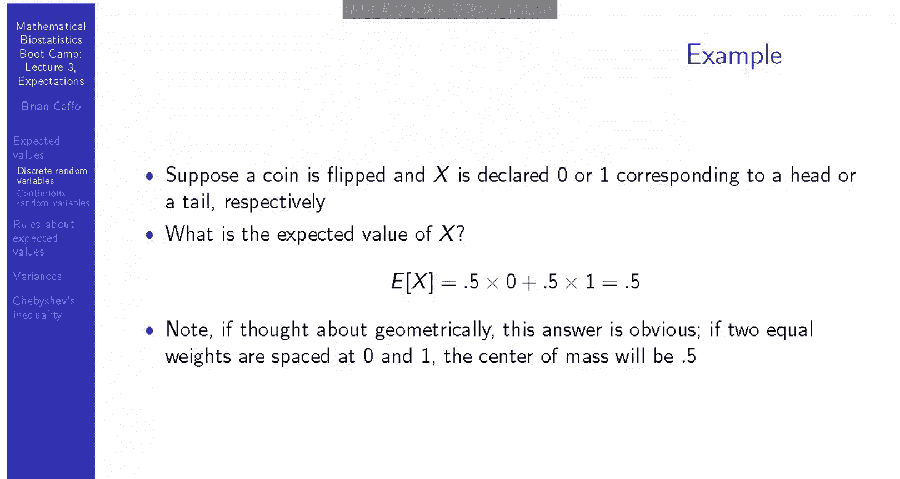

因此，抛硬币的期望值是0.5。这很符合直觉：如果在0和1处各有一个等高的“权重条”，平衡点就在0.5处。

需要注意的是，期望值不一定是随机变量可以取到的值。在这个例子中，随机变量只能取0或1，但期望值0.5介于两者之间。

### 掷骰子的例子

现在考虑一个公平的六面骰子。可能的取值是1, 2, 3, 4, 5, 6，每个数字出现的概率都是1/6。

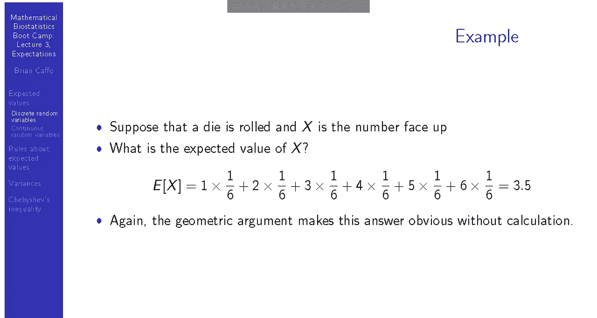

计算其期望值：
**E[X] = 1*(1/6) + 2*(1/6) + 3*(1/6) + 4*(1/6) + 5*(1/6) + 6*(1/6) = 3.5**

这同样符合直觉：在1到6的位置上有六个等高的“权重条”，平衡点就在它们的几何中心3.5处。

## 连续随机变量的期望值计算 📈

上一节我们计算了离散随机变量的期望值，本节中我们来看看连续随机变量的情况。

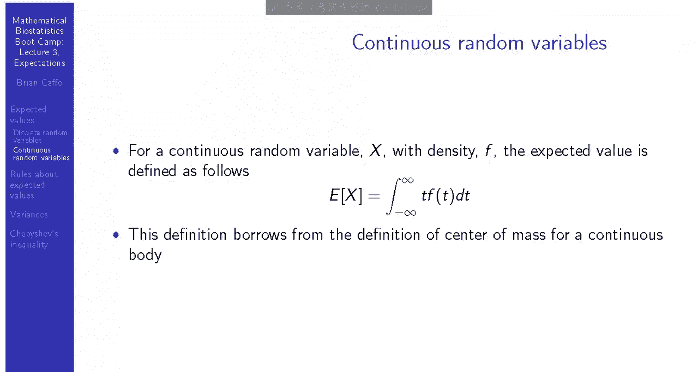

对于连续随机变量，期望值的定义同样遵循质心的物理概念。其计算公式为：
**E[X] = ∫_{-∞}^{∞} t * f(t) dt**
其中，**f(t)** 是概率密度函数，**t** 是积分变量。如果没有这个 **t**，积分结果就是1，因为概率密度函数积分为1。放入 **t** 后，就变成了期望值。

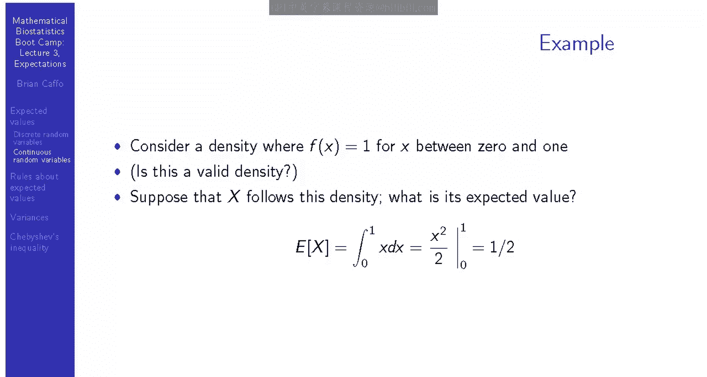

如果想计算 **X²** 的期望值，公式则为：
**E[X²] = ∫_{-∞}^{∞} t² * f(t) dt**

这借用了连续物体质心的定义，它将复杂的密度函数 **f** 概括为一个数字，即分布的中心属性。

### 均匀分布的例子

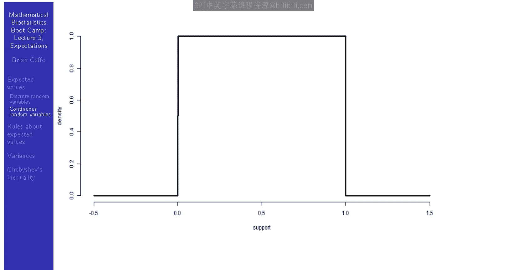

让我们计算一种特定随机变量的期望值——均匀分布。

考虑一个非常简单的密度函数：在0以下为0，在0到1之间为常数1，在1以上为0。快速验证这是一个有效的密度函数：它就像一个从0到1、高度为1的“砖块”。其面积是底边长（1）乘以高（1），等于1。它在所有地方都是非负的。因此，这是一个有效的密度函数。

这实际上是一个极其重要的密度函数，称为标准均匀分布。它表示0到1之间的任何值出现的可能性相等。

从几何角度我们已经知道答案：这块从0到1的“砖”，其质心必须在中间，即0.5。让我们验证一下计算：

**E[X] = ∫_{0}^{1} x * f(x) dx = ∫_{0}^{1} x * 1 dx = [x²/2]_{0}^{1} = 1/2**

结果正是我们预想的0.5。

这里需要注意符号：期望值 **E[X]** 中的大写 **X** 代表随机变量的概念值，而积分中的小写 **x** 代表积分变量（虚拟变量）。使用 **x** 或 **t** 或其他字母作为积分变量都可以，但重要的是我们保持随机变量为大写 **X**。

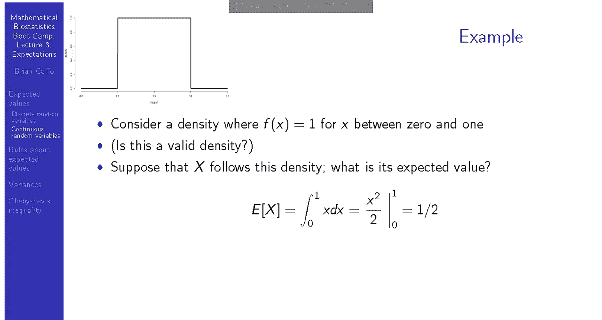

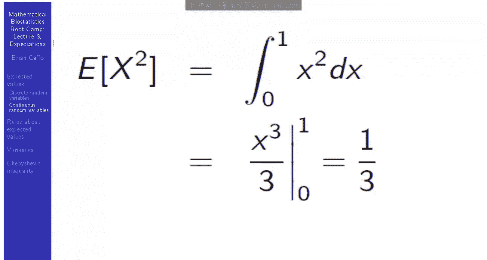

### 关于计算 **E[X²]** 的说明

一个常见的问题是：计算 **E[X²]** 有两种方法。一种是直接利用原始密度函数计算：**E[X²] = ∫_{0}^{1} x² dx**。

另一种是先找出 **Y = X²** 这个新随机变量的概率密度函数，然后根据这个新密度计算 **E[Y]**。

重要的是，这两种方法会得到完全相同的答案。而且，通常第一种方法（直接代入平方计算积分）要简单得多，因为我们通常已经知道原始均匀分布的密度函数，但可能不知道其平方的分布是什么。

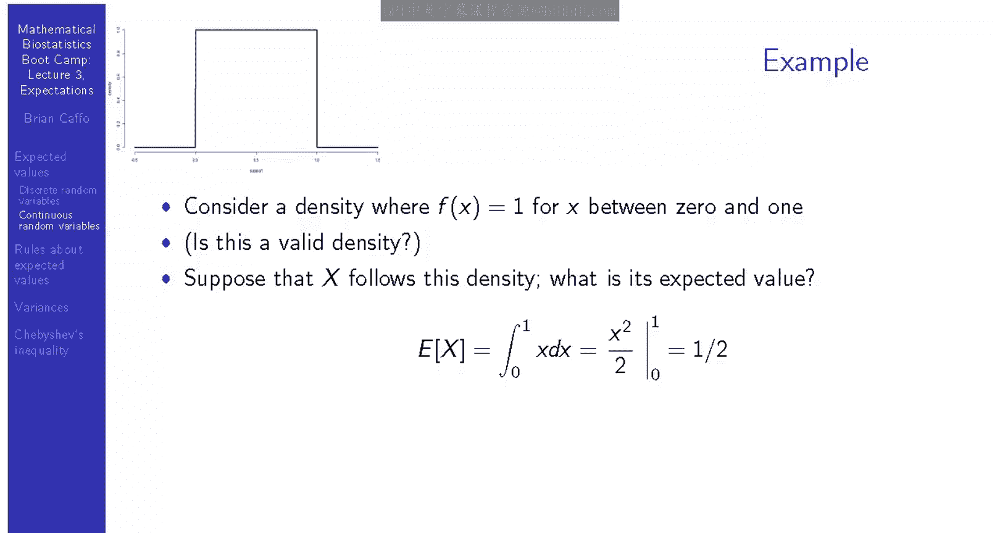

本节课中我们一起学习了期望值的核心概念。我们了解到期望值是概率分布“中心”的一种度量，其计算基于质心的物理原理。我们分别学习了离散和连续随机变量期望值的计算公式，并通过抛硬币、掷骰子和均匀分布等例子进行了实践。我们还明确了期望值不一定是随机变量可能的取值，并且计算函数（如平方）的期望值时，可以直接利用原始分布进行计算。