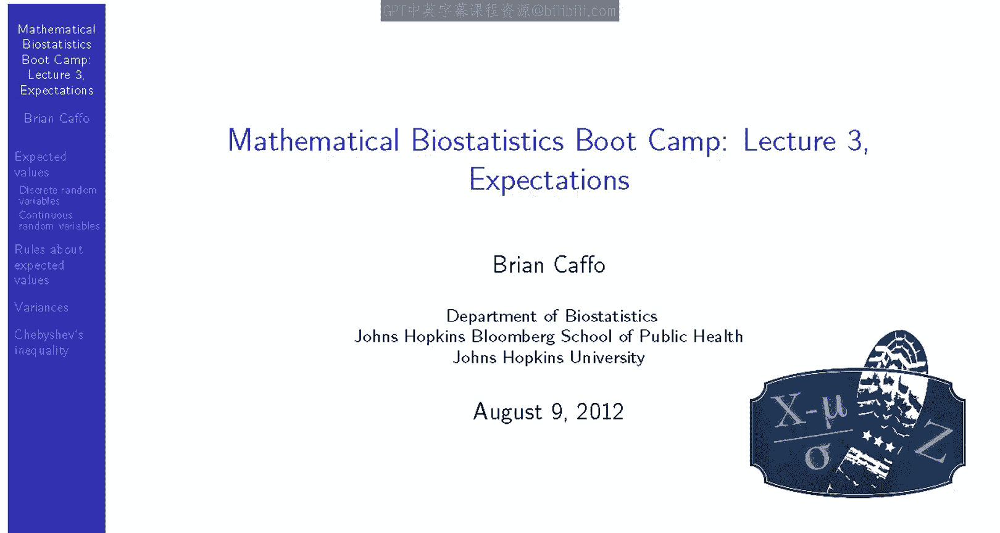
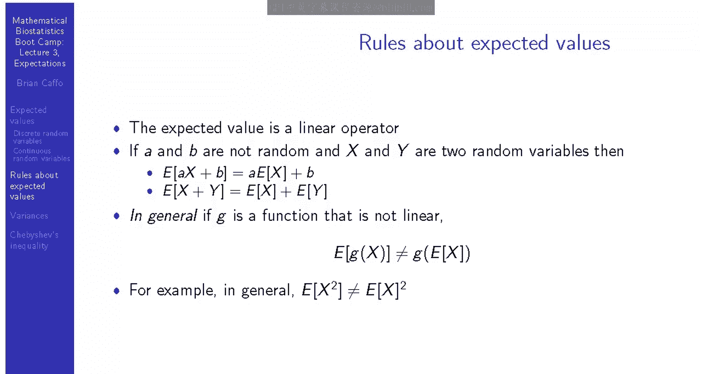
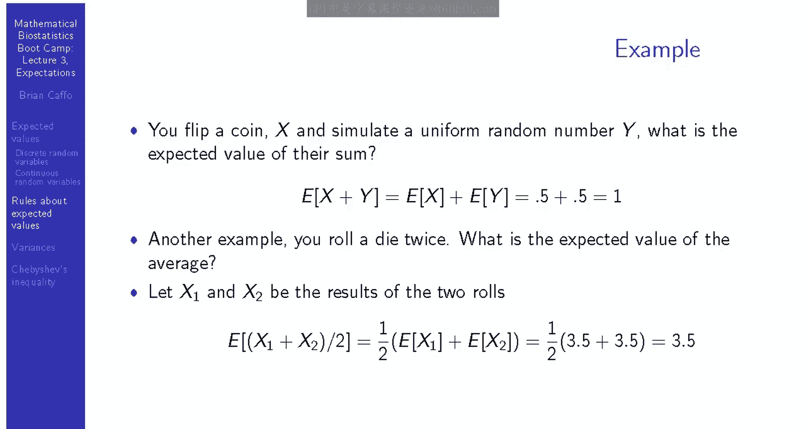
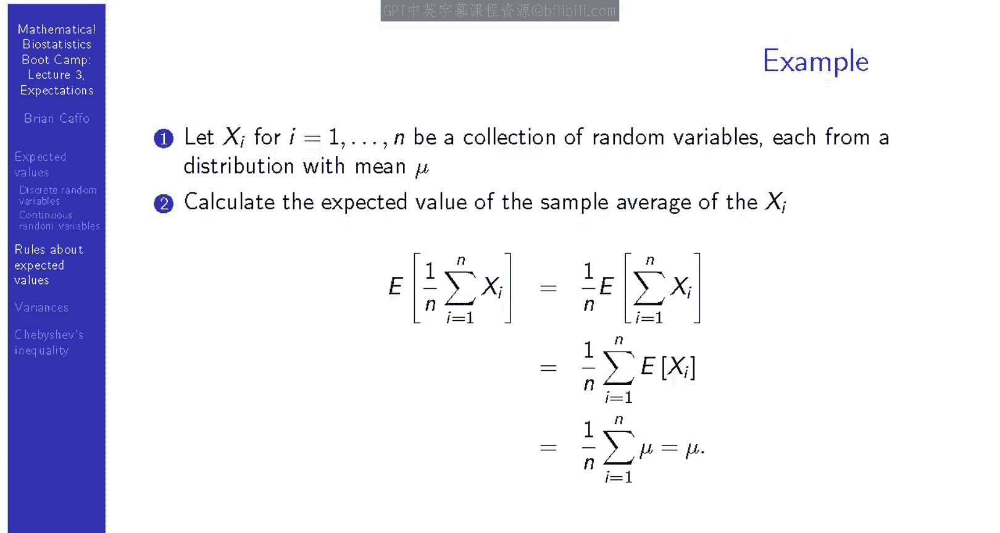
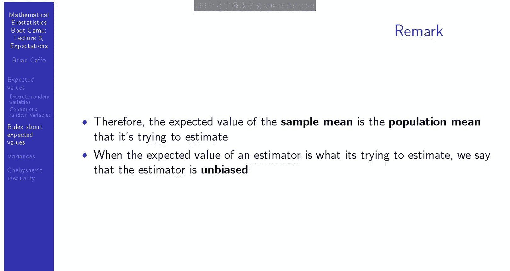

# 约翰霍普金斯大学《数据科学的高级统计｜Advanced Statistics for Data Science》中英字幕（deepseek p09 8_期望值运算规则.zh_en -BV1htPjeYEFH_p9-

So previously we talked about expected values and their properties and a little bit of how to calculate them now let's talk about the expected value operator itself and the expected value operator is in fact a linear operator and that'll greatly simplify calculating expected values for some relatively complicated things。

So let me assume that A and B are not random numbers。

 so when you think about A and B you think a is something like5。

 it's this number that you can plug in and x and y are actually two random variables。

 then expect value of a x plus B works out to be a expected value of x plus B exactly what you'd hope it to work out to be an expected value of x plus y works out to be expected value of x plus the expected value of y。

And the reason it works out in these cases is because the expected value is a linear operator。

 it is not always the case that expected value of g of x is equal to g of expected value of x where g is some general function that's not linear。

This can happen with specific random variables and specific values of G。

 but in general it's not the case， the most sort of famous example where it's not the case is that expect a value of x squared is not equal to expect a value of x whole thing quantity squared。

Now let's talk about what the difference of these two entities is What do we mean by the difference between these two things here x is a random variable x squared is the random variable you obtain by squarearing x。

 so for example， if x is a di roll， it can take values 12，3，4。

56 x squared then can take the values 1，4，9， and it takes those values with probability 16 each。

So the expected value of x squared represents the expected value of the squared random variable。

 on the other hand， expect a value of x quantity squared represents what you obtain if you first calculate the expected value of x and then square the result。

And these two things are not equal This is a wellknow example where expected value of g of x is not equal to G of expect value of x and we'll see in a couple of slides why it is a well-know example of that property。

 but in general， I would like you to remember that if G is not a linear function。

 then you can't just commute expected values outside of G to the inside of G。

And that that rule will generally hold if it's， if it's linear， if G is a linear function。

 then you can always do it if G is not linear， just in general。

 think that you cannot the expected value rules。

Hold， no matter what constitutes x and Y， X could be discrete， continuous， mixed。

 discrete and continuous Y could be discrete， continuous and mixed， and the rule still hold。

 So let me go through an example。 Suppose you flip a coin X and as we normally do x is 0 if its tails and one if its heads and you simulate a uniform random number Y the random number is between0 and1。

 what's the expected value of their sum。 Well， the sum of a coin flip and a uniform random variable is a weird distribution。

 It's not obvious， especially if all you've had is the handful of lectures from this class。

 how you would calculate that distribution。 And then from that distribution。

 then calculate the expected value。 However， we do know how to calculate the expected value of a uniform random variable and the expected value of a coin flip。

 And so the expected value of their sum is the sum of their expected value we know the expected value of the coin flips 05。

 we know the expected value of the uniform random variable is 0。5。 So that expected value is1。And。

So you can see how these expected value operator rules make calculating things associated with expected values a lot easier Another example is suppose you roll a die twice What is the expected value of the average of two die rolls so you often roll two dies when you're playing a board game for example。

Okay， let's let x1 be the result of the first die and x2 be the result of the second die。

Now the variable that we're interested in， let's call it y equal to x1 plus x2 divided by 2。

Now one way you could calculate the expected value of y is to figure out what the distribution was of the average of two die rolls。

 so let me give you a sense of this really quickly。

The reason we think the distribution of a single die roll is 16 at each number is if you roll a die a lot of times。

 you get about1/6 of the di rolls or 1， 16 or two，16 or3。

16 or four and so on and then kind of geometrically we're modeling the process if they're all equally likely。

 and so that's why we're going to model the population of di rolls as having probability。

 16 on each number。Now this implies a distribution on the average of two di rolls， right。

 the smallest number it could take is one right  one plus one divided by two。

 the average of if you were to get two ones and the largest it could take is6 plus6 divided by two or6。

 if you were to roll two6es， but it takes different values in between and it's not equally likely。

For all the numbers in between， one has probability 136。

 but some of the middle values have higher probabilities。So this any rate。

 our variable y itself has a distribution， and you could get a pretty good sense of it。

 maybe you could do this by taking two dies， rolling them， taking the average， rolling them again。

 taking the average， doing that over and over and over again。

 and plotting a bar plot of the frequency of the averages that you get and that'll give you a good sense of what the population distribution is or you could work it out on pen and paper as to what the distribution actually is。

And then once you get that worked out， then you could use your expected value formula to calculate the expected value of y directly by doing summation over the possible values of y times p of y and calculate its expected value Another way to do it is to directly use the expected value is a linear operator rules。

 so in this case expected value of x1 plus x2 divided by 2 is one half expected value of x1 plus the expected value of x2 because the one half is a non-random variable that we can just pull out and the expected value goes across the two sums here to get expected value of x1 plus the expected value of x2。

That then yields 3。5 plus 3。5 divided by 2 which is 3。

5 Now you might be wondering after hearing this is oh， that's interesting。

 the expected value of the average of two die rolls is the exact same as the expected value of an individual di roll。

And that is exactly the case， but you're probably thinking maybe does this extend beyond that is the expected value of the average of n di rolls equal to the 3。

5 as well and the answer is yes， that's exactly true in fact that's a nice segue into our next slide where we actually derive the property that we were hinting at in the previous slide namely that the expected value of the average of a collection of random variables from the same distribution is the same as the expected value of the individual random variables so let's let X for I equal1 to n be a collection of random variables each each from a distribution with mean mu just want to also point out that we tend to use Greek letters to represent population quantities in this case the population mean of the distribution is mu so let's calculate the expected value of the sample average of the X well we want the expected value of the sample average which is one over n summation I equals1 to n。

The X's， the one over n pulls out because it's not random。

 the expected value commutes across the sum。And the expected value of each of those Xs is itself mu。

 so we get the summation i equal one to n of mu， we get mu added up n times then。

 which is n mu divided by n on the outside so we get mu。

So what this says is it doesn't matter what the distribution of the individual x's is。

The distribution of the mean of the x has the same mean as the individual means。

So let me just summarize one more time。The expected value of the sample mean。

Is the population mean that it's trying to estimate？

The population mean of the distribution of the sample mean of n observations is exactly the population mean that it's trying to estimate。

And so when this happens when the expected value of an estimator is what it's trying to estimate。

 that's a good thing we say that the estimator is itself unbiased so sample means are unbiased estimators of population means and again there were some assumptions for this to be true right all the x's have to be from a distribution that has mean mu mu being the value you want to estimate and then the sample mean is an unbiased estimator of the population mean and we're finally getting to the point where we can talk about how we're going to connect our probability modeling to the data that we observe we're not quite there yet but we're getting closer and closer to this and I want you to remember that we're throwing around the term mean a lot。

And so if you get confused， I want you to remember to qualify the mean that you're talking about it。

 whether it's a population quantity。A component of the probability distribution or a sample quantity。

 an empirical quantity that you connect from the data。

 and remember our goal in probability modeling is to connect our sample observations to the population using our probability model。

