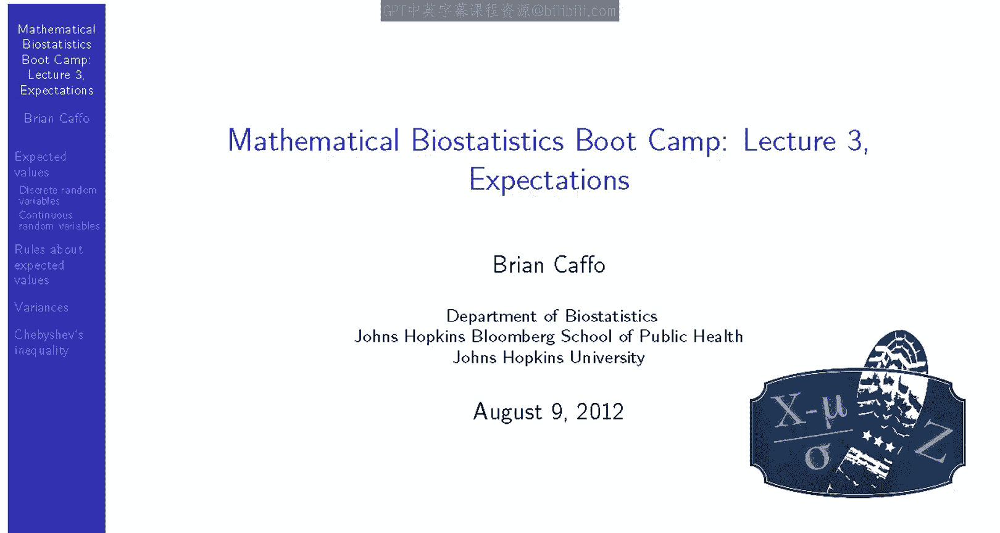
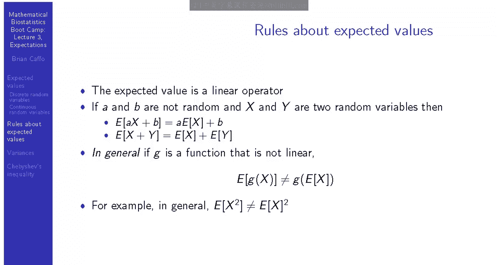
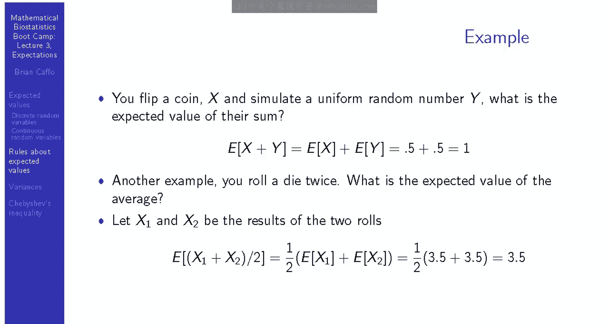
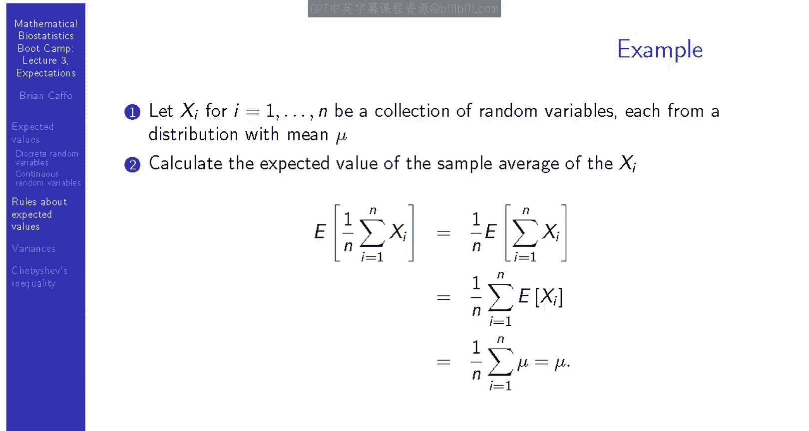
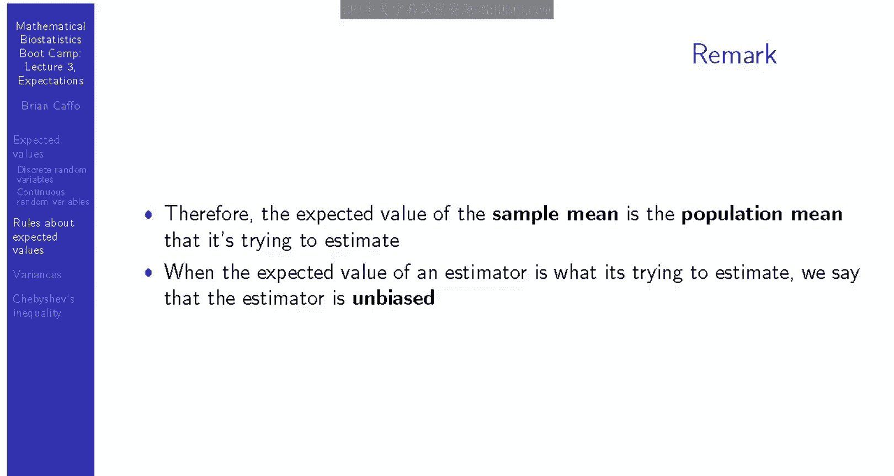

# 数据科学的高级统计：09：期望值运算规则 📊

在本节课中，我们将要学习期望值算子的运算规则。我们将看到，期望值算子是一个线性算子，这一特性将极大地简化许多复杂随机变量期望值的计算过程。

## 期望值的线性性质

上一节我们介绍了期望值的概念及其基本性质。本节中，我们来看看期望值算子本身的一个重要特性——线性。

假设 `a` 和 `b` 是常数（非随机数），而 `X` 和 `Y` 是两个随机变量。那么，期望值算子满足以下线性规则：

*   **常数倍规则**：`E(aX + b) = aE(X) + b`
*   **加法规则**：`E(X + Y) = E(X) + E(Y)`

这些规则之所以成立，正是因为期望值是一个**线性算子**。

## 非线性函数的期望值

然而，并非所有函数都能与期望值算子自由交换。对于一般的非线性函数 `g`，以下等式**通常不成立**：

`E[g(X)] ≠ g[E(X)]`

一个最著名的反例是平方函数。对于随机变量 `X`，`E(X²)` 通常不等于 `[E(X)]²`。

以下是这两个量的区别：
*   `E(X²)` 表示随机变量 `X²` 的期望值。例如，如果 `X` 是掷骰子的结果，`X²` 可能取值为 1, 4, 9...，其期望值是对这些值按概率加权平均。
*   `[E(X)]²` 表示先计算 `X` 的期望值，再将结果平方。

这两者通常不相等。请记住一个通用原则：如果 `g` 是线性函数，你可以将期望值算子移入或移出函数；如果 `g` 是非线性函数，则通常不能这样做。

## 线性规则的应用示例

期望值的线性规则非常强大，它适用于任何类型的随机变量（离散、连续或混合）。让我们通过几个例子来理解其应用。

### 示例一：硬币与均匀随机数之和

假设你抛一枚硬币，`X` 表示结果（0为反面，1为正面）。同时，你生成一个在 [0,1] 区间上的均匀随机数 `Y`。计算 `X+Y` 的期望值。

直接计算 `X+Y` 的分布可能很复杂。但利用线性性质，我们可以轻松求解：
`E(X + Y) = E(X) + E(Y) = 0.5 + 0.5 = 1`

### 示例二：两次掷骰的平均值

假设你掷一个标准的六面骰子两次。`X1` 是第一次结果，`X2` 是第二次结果。我们关心平均值 `Y = (X1 + X2) / 2` 的期望值。

一种方法是先找出 `Y` 的分布（其取值从1到6，但概率不均等），然后直接计算 `E(Y) = Σ y * P(Y=y)`。但利用线性规则更简单：
`E(Y) = E[(X1 + X2)/2] = (1/2) * [E(X1) + E(X2)] = (1/2) * (3.5 + 3.5) = 3.5`

有趣的是，两次掷骰平均值的期望值 (3.5) 与单次掷骰的期望值相同。这引出了一个更一般的结论。

## 样本均值的期望值

现在，我们来推导上一节暗示的一个重要性质：来自同一分布的随机变量，其样本均值的期望值等于该分布的总体均值。

令 `X1, X2, ..., Xn` 为一组随机变量，它们均来自均值为 `μ` 的同一分布（`μ` 是总体参数，通常用希腊字母表示）。样本均值定义为 `X̄ = (1/n) Σ Xi`。

计算样本均值的期望值：
`E(X̄) = E[(1/n) Σ Xi] = (1/n) E[Σ Xi] = (1/n) Σ E(Xi) = (1/n) Σ μ = (1/n) * (nμ) = μ`

这个结果非常重要。它表明，**无论单个 `X` 的具体分布是什么，其样本均值的期望值总是等于总体均值 `μ`**。

## 无偏估计量

让我们再总结一次：样本均值的期望值，等于它试图估计的总体均值。

当一个估计量的期望值等于它所要估计的参数时，我们称这个估计量是**无偏的**。因此，**样本均值是总体均值的一个无偏估计量**。

当然，这需要一些假设：所有 `X` 必须来自具有相同均值 `μ` 的分布。

我们正在逐步将概率建模与我们观察到的数据联系起来。在这个过程中，我们会频繁使用“均值”这个词。为了避免混淆，请务必明确你指的是哪一种均值：
*   **总体均值**：概率分布的一个参数，是一个理论值。
*   **样本均值**：从实际数据中计算出的经验值。

我们概率建模的目标，正是利用概率模型将样本观测值与总体联系起来。

---

**本节课中我们一起学习了**：期望值算子的线性性质，以及如何利用该性质简化计算。我们重点推导并理解了样本均值是总体均值的无偏估计量这一核心结论，这为我们后续连接概率模型与观测数据奠定了重要基础。