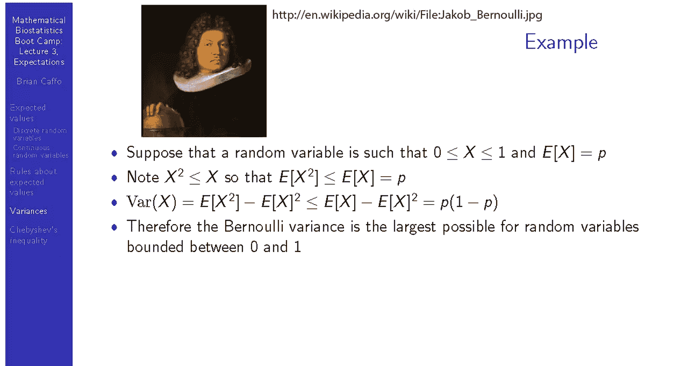
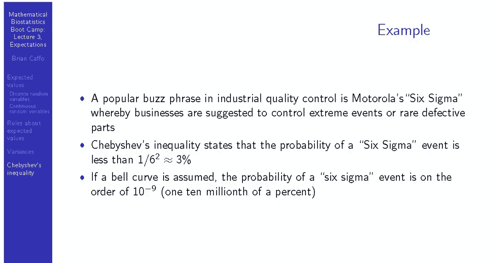

# 约翰霍普金斯大学《数据科学的高级统计｜Advanced Statistics for Data Science》中英字幕（deepseek p10 9_方差与切比雪夫不等式.zh_en -BV1htPjeYEFH_p10-

So the variance of a random variable is another expected value property of a distribution。

 recall the mean measured the center of a distribution， the variance measures how spread out it is。

 so if x is a random variable and it has mean mu ie expect value of x equals mu。

 then the variance of x is defined as the expected value of quantity x minus mu whole thing squared and the expected value。

So what does that mean so the expected value is in essence an average right so it's sort of the average or the typical value that the random variable takes。

 it's the center of the distribution。On the other hand， the。

The variance is sort of the average distance the random variable is from the mean。

 so what that means is sort of higher variances imply that variances are more what that implies is that is that random variables with higher variances come from distributions that are more spread out than ones that have a lower variance。

嗯。That makes sense and I'm just kind of thinking of thatfulcrum point still。

 but if things are widespread out there's going to yeah exactly， exactly great all right。And so。

Let me just remind you what this formula， the variance formula means again。

If you were to take the random variable X。And figure out what the distribution was if you were to subtract off its population mean。

 which turns out to be the exact same distribution just with all the possible values of x shifted by the value mu。

 and then it has mean zero。And then I were to take that random variable and figure out what the distribution of the square of it is。

hen take the expected value of the resulting random variable and that's hard。

 so we don't ever calculate the variance that way， we typically calculate the variance by a convenient shortcut and that is that the variance of a random variable is the expected value of x squared minus expected i of x quantity squared and again this expected value of x quantity squared is just mu squared。

This shortcut formula then requires you to calculate the expected value of x squared， but again。

 the kind of typically the more convenient way to do that is to use if it's discrete。

 the summation of say t squared p of t where p is the probability mass function or if it's continuous use integral t squared f of T where f is the density function。

It would be nice for you as an exercise to show that this original variance calculation。

Equals this shortcut variance calculation just by expanding the square and using the expected value rules。

It would be convenient if the variance operator was also linear， it's not。As an example。

 the variance， if you pull a random variable out of out of the variance it gets squared。

 so variance of a times x where a is not a random variable is a squared variance of x。

 the square root of a random variable is called the standard deviation and the reason we use standard deviation often instead of the variance is that the standard deviation has the same units as the random variable So let's say x as a random variable has units in inches The variance has units inches squared whereas the standard deviation has units inches。

 So it's often quite convenient to talk about the spread in the same units as the random variable itself。

 so the standard deviation is a very common summary of the variance。

Well let's let's calculate a sample variance what's the sample variance from a toss of a die so in this case expect value of x is 3。

5 we've covered that already and expect value of x squared let's calculate that Well we have one squared times a 6 plus 2 squared times of6 plus 3 squared times of 6 plus 4 squared times of 6 plus5 squared times of6 plus 6 squared times of6 that works out to be 15。

17。And then you subtract。15。17 minus 3。5 squared and that works out to be about 2。92。

Let's go through a very important formula。Let's suppose we flip a coin。

But let's make it slightly more interesting instead of the coin having probability one half of a head。

 let's say that it has probability P of a head。So here。

 the expect I x equals0 times the probability of a tail。

 which is 1 minus p plus 1 times the probability of a head， which is p。

 so it works out to be p as the expected value， and of course this agrees with our calculation when the p happens to be1 half for a fair coin。

Now let's calculate the expected value of x squared Well。

 actually it's kind of interesting in this case， it's pretty easy to do that because x takes only the values0 and 1 and if you square0。

 you get zero and if you square1， you get1， so x squared is in fact exactly x。

So expect y of x squared is equal to the expected y of x， which we already calculated is p。

So the variance of x in this case is expect a value of x squared。

 minus expect a value of x quantity squared， which is p minus p squared。

 which works out to be p times 1 minus p， which is a formula you may have encountered before。

It's interesting to note that this variance formula is maximized when p is 0。5。

 so just simply plot the function p times 1 minus p between 0 and 1 so plot this function between 0 and1 and you'll see that it maximizes a 0。

5 so the most variable coin flip can be is in fact exactly a fair coin it's interesting to note that the most variable a random variable can be in general is if you shove all its mass to 2 end points。

And equally distribute it between those two end points。

 that's so if you have a continuous random variable and you want to make it more variable。

 kind of chop out the middle and spread it out equally distributed between the two ends。And in fact。

 let's。Let's talk about this in greater detail， Suppose that you have any random variable like a uniform random variable that's between zero and1。

And its expected value is p now since the variable takes values between0 and 1。

 p has to be a number between0 and1。And then notice if x is a random variable that's between0 and 1。

 x squared has to be less than or equal to x。Because if you take any number between zero and1 and square it。

 you get a smaller number。And so expecttive value x squared has to be less than or equal to expective value of x。

 which is P。Therefore， the variance of x， which is expected value of x squared minus expected value of x quantity squared。

hass to be less than or equal to the expected value of x minus the expected value of x squared。

Which is p times 1 minus p。And basically， this is then just a proof。That the Bernoulli variant this。

Binary variance where the random variable can only take the value 0 or1 is the largest possible for a random variable that has expected value of p and then we also noted that we earlier that the maximum value that you can get is when p is in fact 0。

5， so this basically just shows that this is basically a simple little proof that the random variable that the largest variance that you can get for a random variables that you sort of shove its mass to two endpoints and the closer you can get to an equal mass and both the endpoints。

 the larger the variance is。Yeah。I'm not sure if I've mentioned this previously。

 but I called the variable a coin flip that can take heads with probability P。

 I called it a Bernoulli random variable。 This is named after the mathematician Jacob Berulli who is one of the fathers of probability and Jacob Bnoulli is an interesting character you should read up on him the Bernouls were a very famous mathematical family they came up with lots of lots of discoveries。

 Jacob was a particularly influential member of the Bernoulli family and he discovered quite a bit of probability theory very very early on At any rate。

 when you have a random variable that takes the value zero1 with probability P then we call that a Bernoulli random variable So here we are back。

Talking about variances and variances are kind of difficult things to understand and equivalently standard deviations。

 I prefer to interpret standard deviations。Intuitively。

 we know that the bigger variances mean distributions are more spread out。

 but but we need some way to actually interpret what bigger at what bigger means now in the context of a specific distribution。

 we might learn。The kind of quantities associated with that distribution to know that， well。

 what does one variance mean or two standard deviations mean， three standard deviations mean？

And that's particularly true of the Gaussian or bell shaped density。

 we know we tend to know the values associated with those variances sort of by heart。

But there is a general rule that applies to all distributions and it's so called Chevychv's inequality after the Russian mathematician Chebychv。

So any rate， Chebychev gives a really useful inequality for interpreting variances。

Basically the inequality says the probability that a random variable is k standard deviations from its mean or more is less than or equal to1 over k squared。

 so let me repeat that because it's so important the probability that a random variable is more than k standard deviations from its mean is less than or equal to 1 over k squared。

And let's just look at some simple benchmarks for K。Yeah。

The probability that a random variable is more than two standard deviations from its mean is。

25% or less， the probability of the random variable is three standard deviations from its mean is 11% or less。

 and the probability of the random variables four standard deviations from its mean is 6% or less。

And again， note that this is a bound on the probability statement， it's not inequality。

 so it's the worst that it could possibly be lots of distributions the probability of being four standard deviations or more beyond the mean is far lower than 6%。

 but 6% is the worst it can be so it's unlikely say， for example。

 that you will if you observe a random variable， it's unlikely that you will see that random variable be。

 say six standard deviations from the mean that's quite unlikely has probability less than1 over 36 regardless of the distribution。

What's interesting about Chevy Chev's inequality is that it's quite easy to prove。

And so let's just go through the proof really quickly， well。

 let's look at this probability statement， the probability that a random variable is more than k standard deviations from its mean。

😊，And let's do it in the continuous case， let's just do it in the continuous case。

 so you can prove it more generally， but this just gives you the intuition behind the proof。Well。

 that's the integral over the set of x where it's more than case standard deviations from the mean。

 where here now the little x in the domain of integration is a dummy variable of integration。

 f of x dx， and this could be we could replace this by another letter over on the right hand side。

 but on the left hand side it has to be capital x。We' notice notice that x minus mu over k sigma。

 absolute value x minus mu over k sigma has to be bigger than one， so if we square that。

It has to be bigger than one as well， if you take a number that's bigger than one and squared。

 it's still bigger than1， so we can multiply by x minus mu squared over k squared sigma squared。

And we've only made the integral bigger， right， so we can replace this equality with an inequality where here the alligators chomping the bigger part。

Okay， so now we have this quantity here。And we'll only make it bigger yet。If we。

 instead of integrating over this restriction of the domain。

 we integrate over the whole thing from minus infinity to plus infinity because everything the x minus mu squared is strictly positive。

 so we'll only make it bigger。And then notice now that this sure that the k squared sigma part is a scalar that we can just factor out。

 and then we have minusfinity to plusfinity x minus mu squared minus infinity plus infinity integral of x minus mu squared f of xdx。

 well that's just exactly the definition of the variance。And that so that equals sigma squared。

 the sigma squares cancel and you get1 over k squared。

So we see that the probability that x is more than k standard deviations from the mean。

We started out with an equal sign， we got bigger， we got bigger than we've had a final equality。

 so the whole thing is less than or equal to one over k squared。

 so I find it remarkable that Chebychev's inequality。

 this powerful result that applies to all distributions has such a simple little proof。

Let's go through some numerical examples just to。Show why this result is useful。

So intelligence quots。And you know actually I would recommend that you look up intelligence quots are often called Benay scales there they have a very rich and interesting history that intersects with statistics in several other fields in psychology and so on it's really quite an interesting literature on intelligence quotient。

 so I would highly recommend you look it up just because it's quite fun。

 but let's kind of skirt that discussion and just say let's suppose intelligence quots really are distributed with a mean of 100 in a standard deviation of 15。

What's the probability that a randomly drawn person from this population of people that have IQs with mean 100 and standard deviation issue of 15。

 what's the probability of drawing a person with the IQ higher than 160 or below 40 and of course I picked the 160 or 40 specifically？

Well， 160 is。4 standard deviations above the mean and 40 is four standard deviations below the mean。

 so Chevi has inequality that this will be no larger than 6% in if in fact the IQ distribution is bell shaped or is Gaussian。

This bound is very， very conservative。Just to give you a sense of how conservative。

 the probability that a random draw from a bell curve being four standard deviations from the mean is not 6% but on the order of 10 to the minus fifth。

 100th of 1%， which again it doesn't violate chvy Chev's inequality。

 10 to the minus fifth is less than 0。06， so it's fine， but it's quite a bit less。

 so just to give you a sense of how conservative chevvy Chev's inequality can be。

Let me go through another example， so a buzz phrase in industrial quality control is Motorola's so-called six Sigma。

 and I have to admit to being largely ignorant of exactly what the six Sigma industrial protocol is。

 but the gist of it as far as I understand is that businesses are suggested to control extreme events are rare or rare defective parts and the idea that you go out six standard deviations。

Let's as an intellectual exercise， maybe you on your own can go look up what exactly the six sigma protocol is let's it as an intellectual exercise talk about what the probability of six sigma events are。

 the idea of having a random variable that lies six standard deviations above the mean wells by chby Chev's inequality six standard deviations above or below the mean by Chebychv's inequality that's eithers the probability of such an occurrence is less than one over six squared which is about 3% so it's highly unlikely but again remember chby Chevs is a bound that applies to all distributions if you know something about the distribution for example。

 if you know the distribution is a bell curve then the probability of a six sigma event is on the order of 10 to the minus ninth which is I calculate it is1 10 millionth of a percent so again that doesn't violate。

Chahevychvs inequality， 10 to the 9 is less than 0。03， so it doesn't violate Chevyachev's inequality。

 but anyway rate that's what a six Sigma event is discussing。

🎼。

🎼。