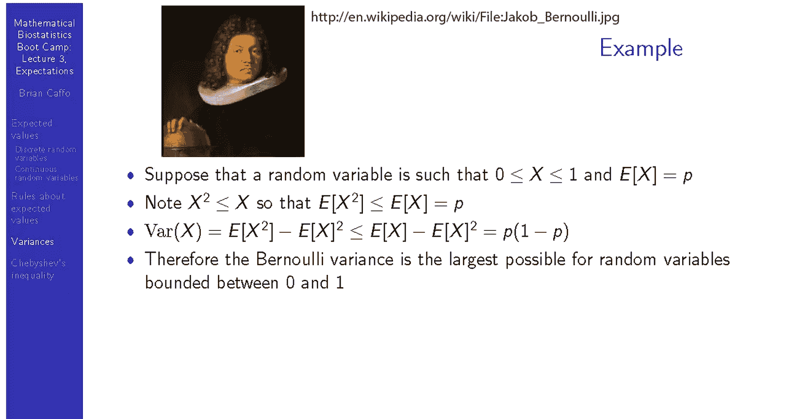
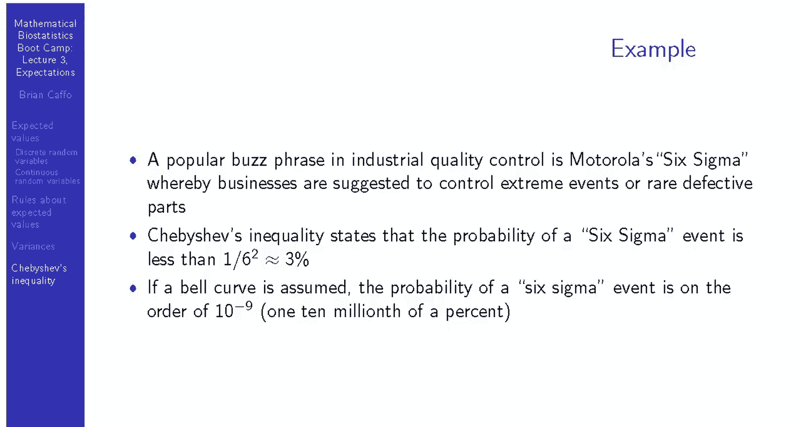

# 数据科学的高级统计：9：方差与切比雪夫不等式

在本节课中，我们将要学习随机变量的方差，这是一个衡量分布离散程度的重要指标。我们还将介绍一个强大的工具——切比雪夫不等式，它可以帮助我们理解方差的实际意义，并估计随机变量偏离其均值的概率。

## 方差：衡量分布的离散程度

上一节我们介绍了期望值，它衡量了分布的中心位置。本节中我们来看看方差，它衡量的是分布的离散程度。

随机变量X的方差定义为：**Var(X) = E[(X - μ)²]**，其中μ是X的期望值（E[X] = μ）。

这意味着方差本质上是随机变量与其均值之间距离平方的平均值。方差越大，表明随机变量的取值越分散；方差越小，则取值越集中。

计算方差通常使用一个更便捷的公式：**Var(X) = E[X²] - (E[X])²**。

以下是计算步骤：
1.  首先计算期望值E[X]。
2.  然后计算E[X²]。对于离散随机变量，公式为 **∑ t² * p(t)**；对于连续随机变量，公式为 **∫ t² * f(t) dt**。
3.  最后，将E[X²]减去(E[X])²即可得到方差。

方差的平方根称为**标准差**，记作σ。标准差与随机变量具有相同的单位，因此在实际应用中，用标准差来描述离散程度往往更为直观。

## 方差的性质与计算示例

方差算子不是线性的。例如，对于常数a，有 **Var(aX) = a² * Var(X)**。

让我们通过两个例子来具体计算方差。

**示例1：掷骰子**
已知掷一枚公平骰子的期望值E[X] = 3.5。
计算E[X²] = (1² + 2² + 3² + 4² + 5² + 6²) / 6 = 91/6 ≈ 15.17。
因此，方差 Var(X) = E[X²] - (E[X])² = 15.17 - (3.5)² ≈ 2.92。

**示例2：伯努利随机变量（有偏的硬币投掷）**
设随机变量X表示一次投掷，正面（记为1）的概率为p，反面（记为0）的概率为1-p。
其期望值 E[X] = 0*(1-p) + 1*p = p。
由于X只能取0或1，所以X² = X，因此E[X²] = p。
根据方差公式：**Var(X) = E[X²] - (E[X])² = p - p² = p(1-p)**。
这个方差在p=0.5时取得最大值。这意味着在所有期望值为p的、取值在0和1之间的随机变量中，伯努利随机变量（即质量均匀分布在两个端点0和1上）具有最大的可能方差。

## 切比雪夫不等式：理解方差的威力

仅仅知道方差的大小还不够，我们需要一个通用的规则来解读它的含义。切比雪夫不等式提供了这样一个强大的工具。

**切比雪夫不等式**指出：对于任意随机变量X（具有有限均值μ和有限标准差σ>0），以及任意实数k > 0，有：
**P(|X - μ| ≥ kσ) ≤ 1/k²**

这个不等式的含义是：随机变量X的取值偏离其均值至少k个标准差的概率，不会超过1/k²。

以下是几个常用的基准值：
*   当k=2时，偏离至少2个标准差的概率 ≤ 1/4 = 25%。
*   当k=3时，偏离至少3个标准差的概率 ≤ 1/9 ≈ 11.1%。
*   当k=4时，偏离至少4个标准差的概率 ≤ 1/16 = 6.25%。
*   当k=6时，偏离至少6个标准差的概率 ≤ 1/36 ≈ 2.78%。

需要注意的是，这是一个非常宽松的上界。对于许多常见分布（如正态分布），实际概率远小于这个上界。

## 切比雪夫不等式的应用实例

让我们通过两个例子看看如何应用这个不等式。

**实例1：智商分数**
假设某人群的智商分数均值为100，标准差为15。根据切比雪夫不等式，随机抽取一人，其智商高于160或低于40（即偏离均值至少4个标准差）的概率不超过6.25%。实际上，如果智商服从正态分布，这个概率远小于0.01%。

**实例2：六西格玛**
在工业质量控制中，“六西格玛”是一个著名概念。从统计角度理解，一个“六西格玛事件”是指观测值偏离均值至少6个标准差。根据切比雪夫不等式，这样的事件发生的概率不超过约2.78%。如果过程服从正态分布，这个概率更是低至约十亿分之一。这体现了控制极端罕见事件的高标准。

## 总结

本节课中我们一起学习了方差与切比雪夫不等式。
*   我们首先定义了方差 **Var(X) = E[(X-μ)²]**，它衡量了随机变量分布的离散程度，并学习了其计算方法和性质。
*   接着，我们引入了切比雪夫不等式 **P(|X-μ|≥kσ) ≤ 1/k²**。这是一个适用于所有分布的强大工具，它为我们理解标准差（方差的平方根）提供了直观的概率解释，即随机变量取值不太可能偏离其均值太多个标准差。
*   最后，我们通过智商分布和六西格玛的例子，看到了如何应用切比雪夫不等式来对现实世界中的问题进行概率估计。