# 约翰霍普金斯大学《数据科学的高级统计｜Advanced Statistics for Data Science》中英字幕（deepseek p100 26_编程示例.zh_en -BV1htPjeYEFH_p100-

Recall the Swiss data set。So， here's。The first couple of variables。 And I want it why to be。

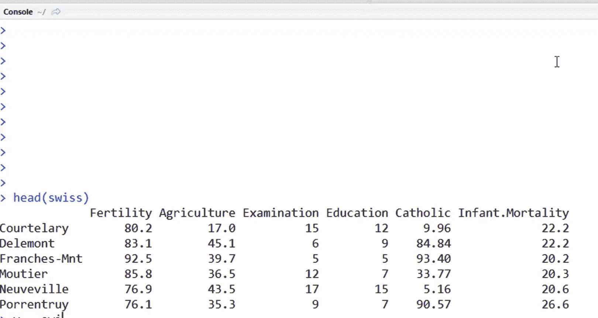

The fertility variable。 And I'm going to let x be everything， except the fertility variable。

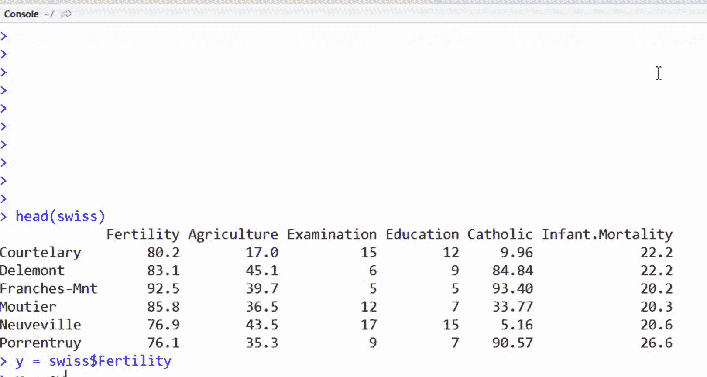

I'm going to define x1。

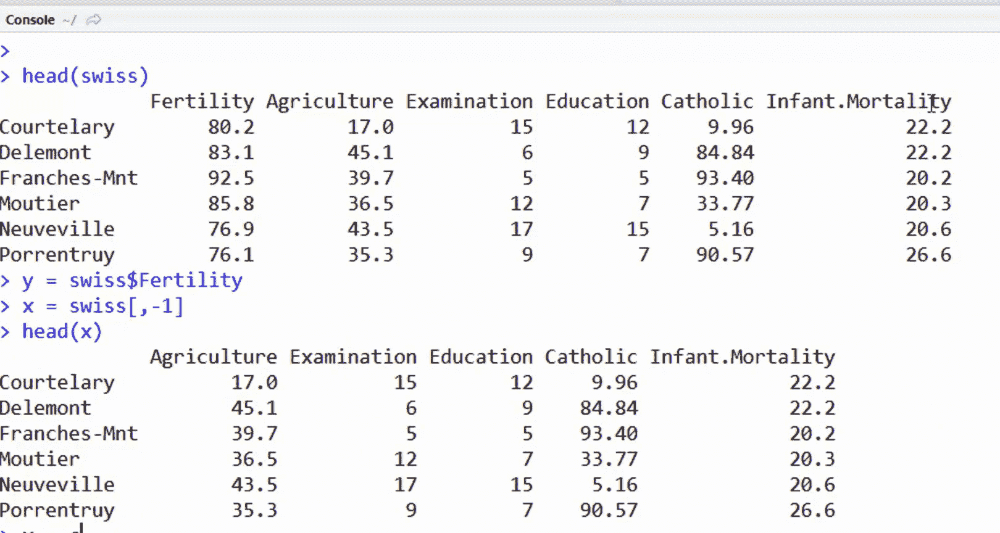

I want to intercept in there。

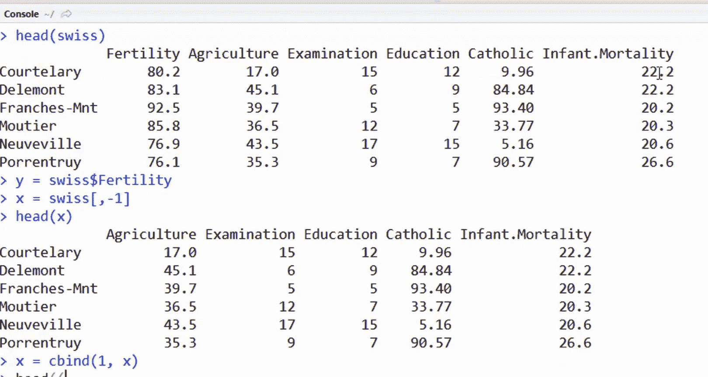

There now， X has an intercept。And I want X。 make sure it's a matrix。

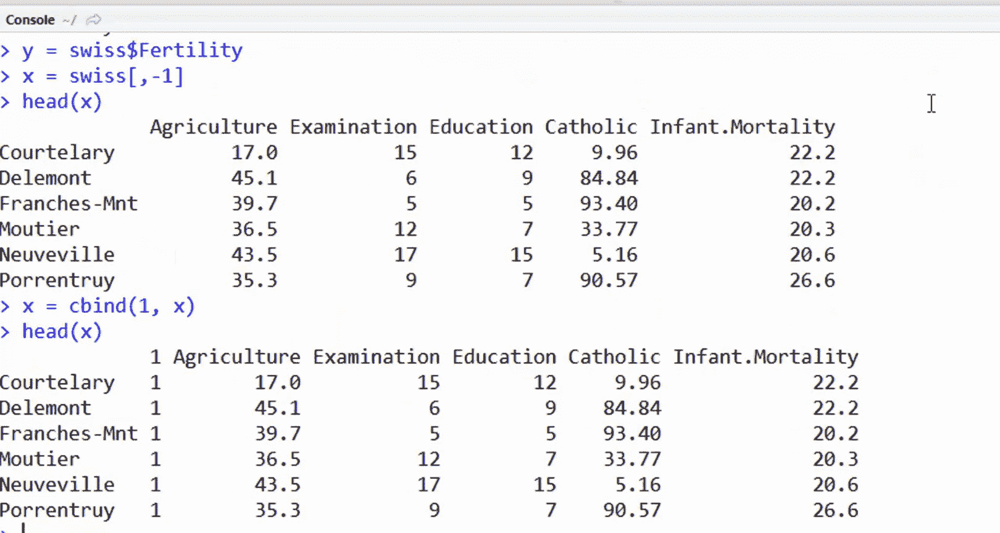

And then let me let x1 be equal to。X columns 1 to 3。 And let me let x 2 be equal to x columns 4 to 6。

 The final four columns。 So， first of all， let's look at the。

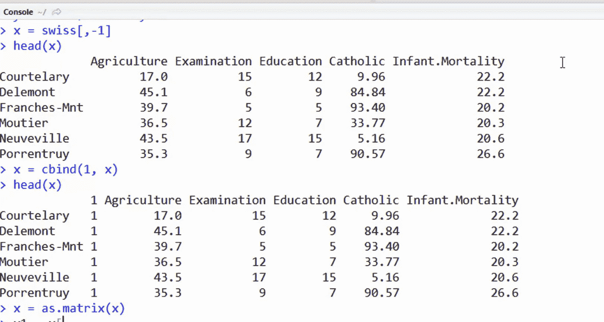

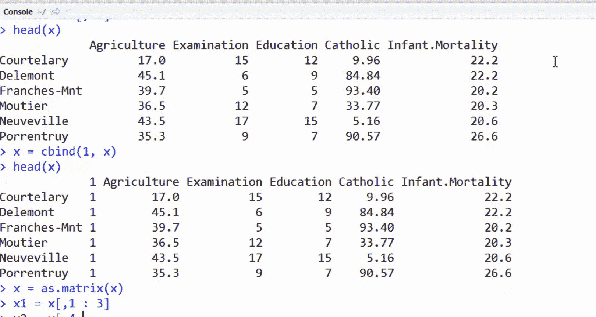

Solve。

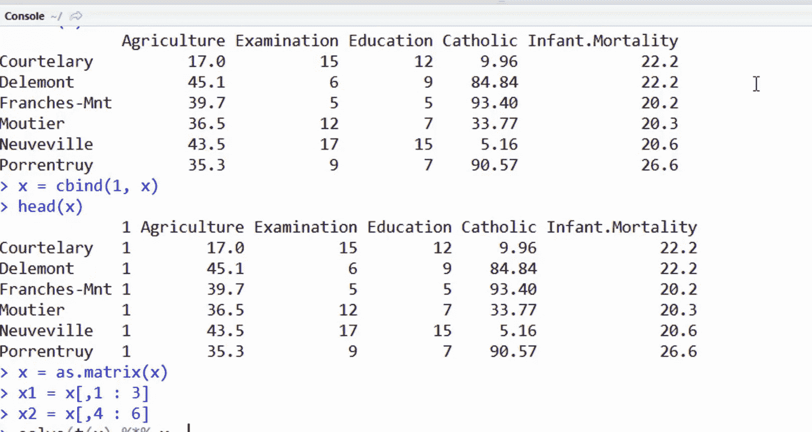

There is the estimates， the beta that I get if I numerically solve the equation。

 the normal equations。And now let's show that these are equivalent if I take the residual having removed x1 from everything and then take x2。

 So if I do solve。T of x1。Star。X 1。And T of x。Star Y， if I do that。

 that's going to give me my regression estimates for just x1 fitted as the predictor M Y as the outcome。

And。So， I want those times。X1， I want the residual， so I want y minus。X 1。

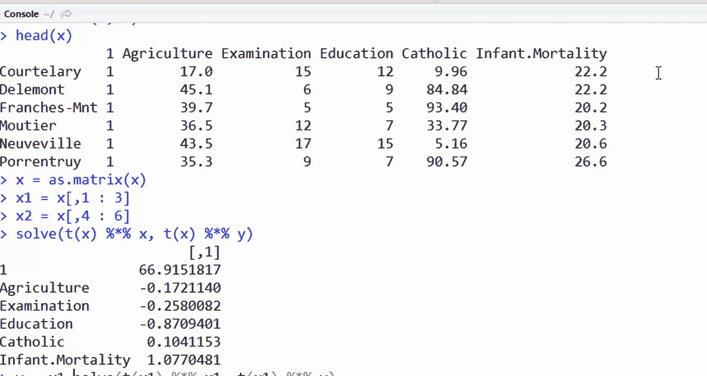

Times that os。And I want to solve that， set that to a variable。 Let's call that E Y。

 The residual of y having removed x1 is called E Y。 Now， E， E X。

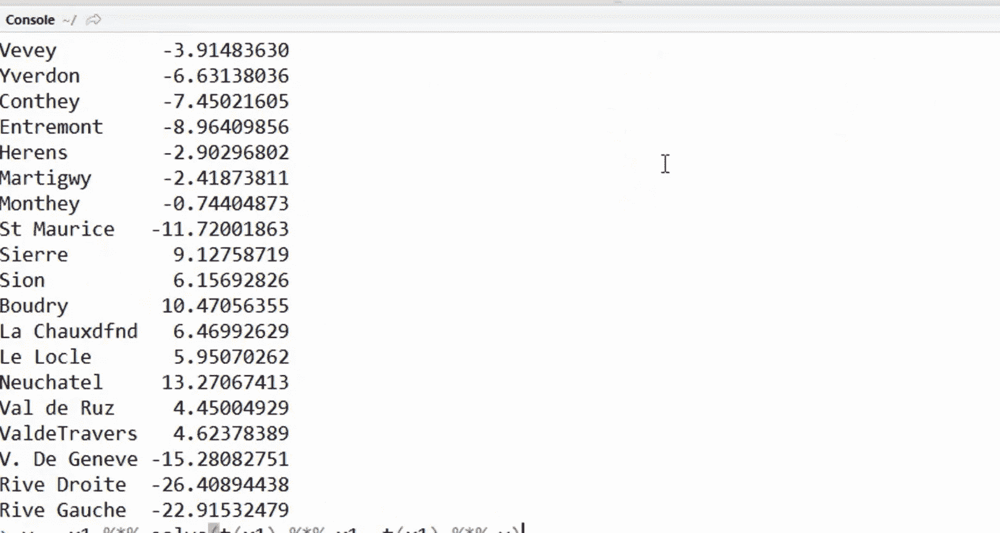

X2， right， I want to be the residual of x2， having a out x1。So that's going to be x1。And then。Okay。

So it's x。 Let me just double check。 So it's x 2。minusinus x1 times x1 transpose x1 inverse x1 transpose times the what I'm treating as the outcome in this case is x2。

 Okay， so now if I then。

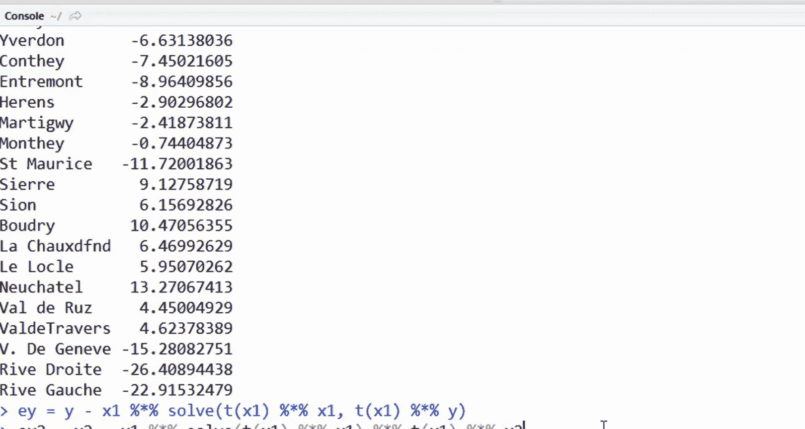

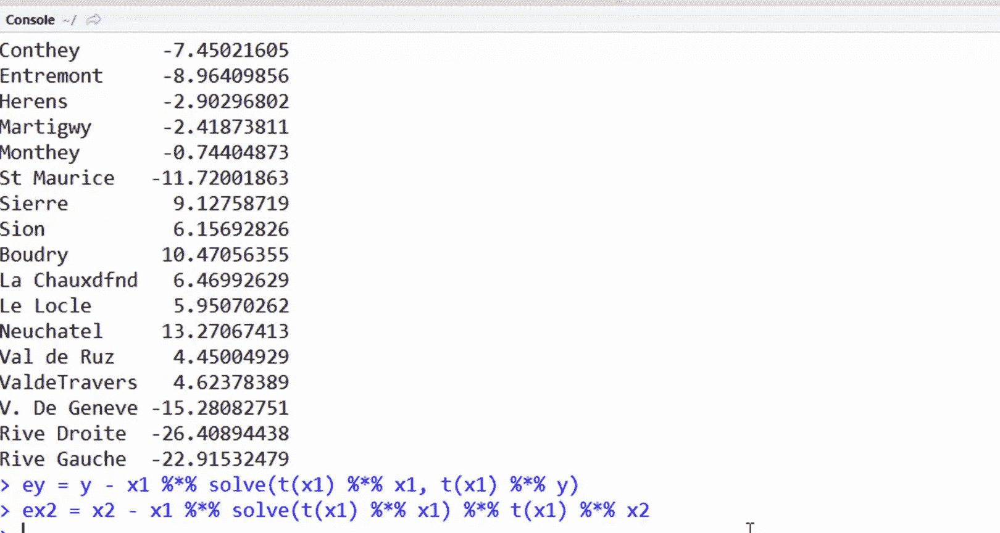

Let's take them E X 2。Okay， that's the right dimension。

And so now my claim is if I take the regression with E Y as an outcome and E X2 as a predictor。

 I should get the same regression estimates that if I did the full multivariable regression with x1 and x2 included in the model。

 Okay， so now I want to do solve。Yi。X 2。E， X 2。E， X 2， E， X 2。Yiwei。And then。

Forgot my transpose there， okay。

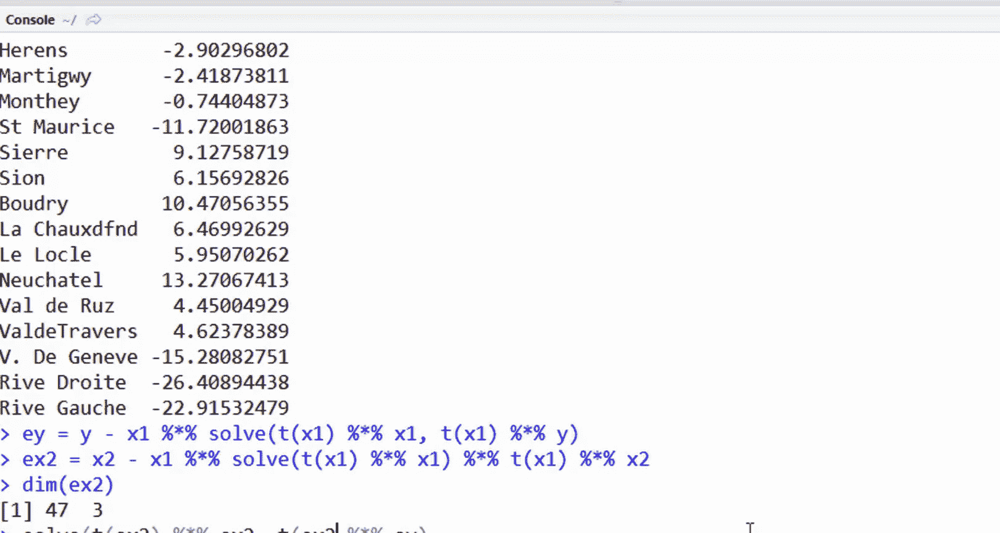

And then I get these three coefficient。 Now， let's， let me compare that back to when I。

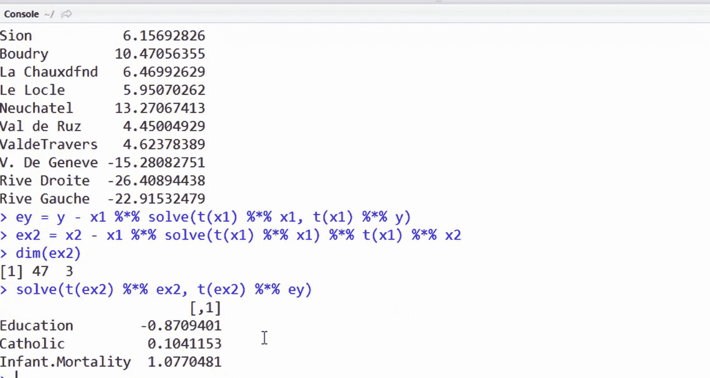

Got y by itself。 Okay， and notice they're identical negative。87， negative 。87。11。07。

 And what this is highlighting。Is that if I take my x2 column and if I take my x2 matrix and I regress x1 out of every column and if I take my y factor and I regress x1 out of it。

 and then I do regression treating those sets of residuals as the。Outcome and predictor respectively。

 Then I get the same answer。 If I just fit the whole thing。

 And that really highlights how it is that multivariable regression is doing adjustment。

 The coefficients for x2 are adjusted in the sense that the linear association with X1 has been removed from everything。

Before considering x2 and conversely the same thing holds true for x1。

 the coefficients for x1 are adjusted for x2 in the sense that x2 has been removed from everything before you consider the the regression of x2 on y so that to me。

 this really highlights in what sense regression is doing adjustment。

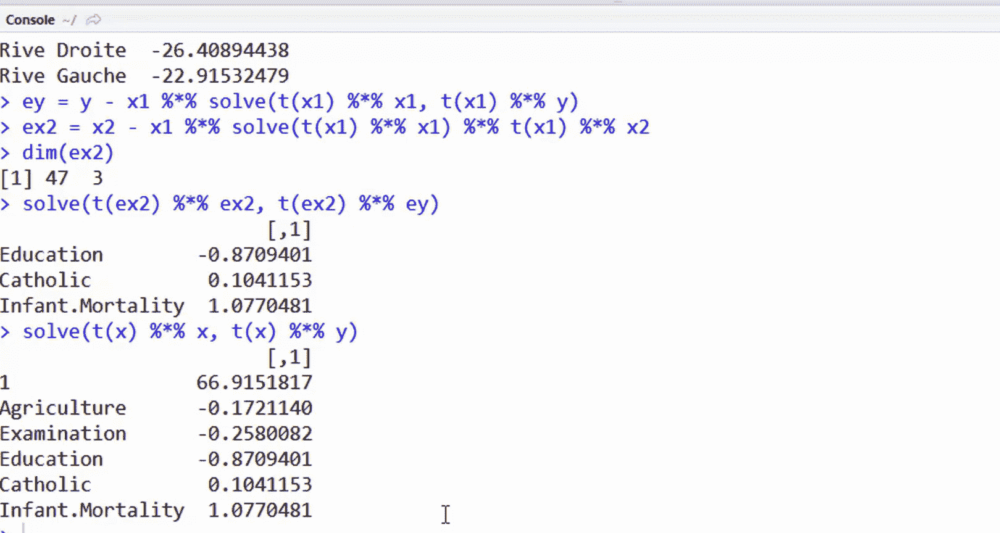