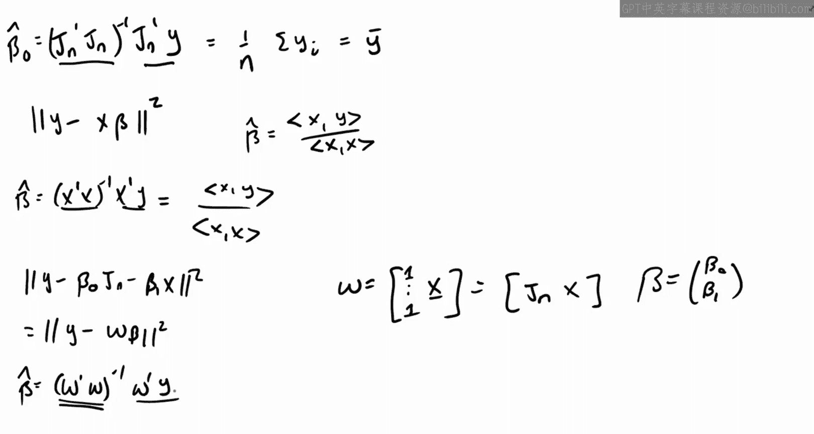
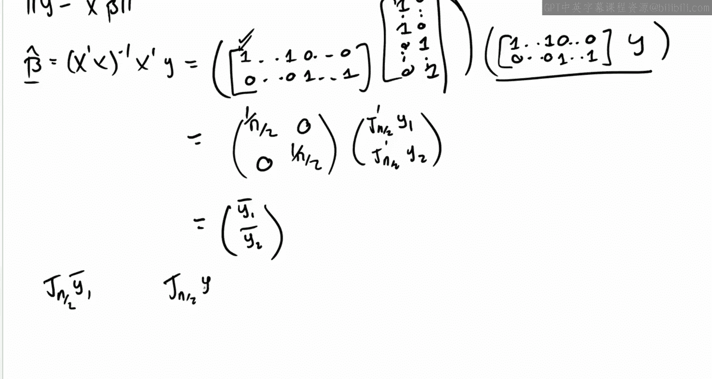
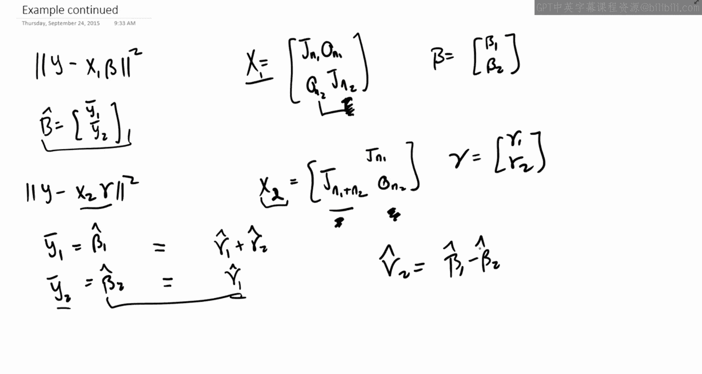
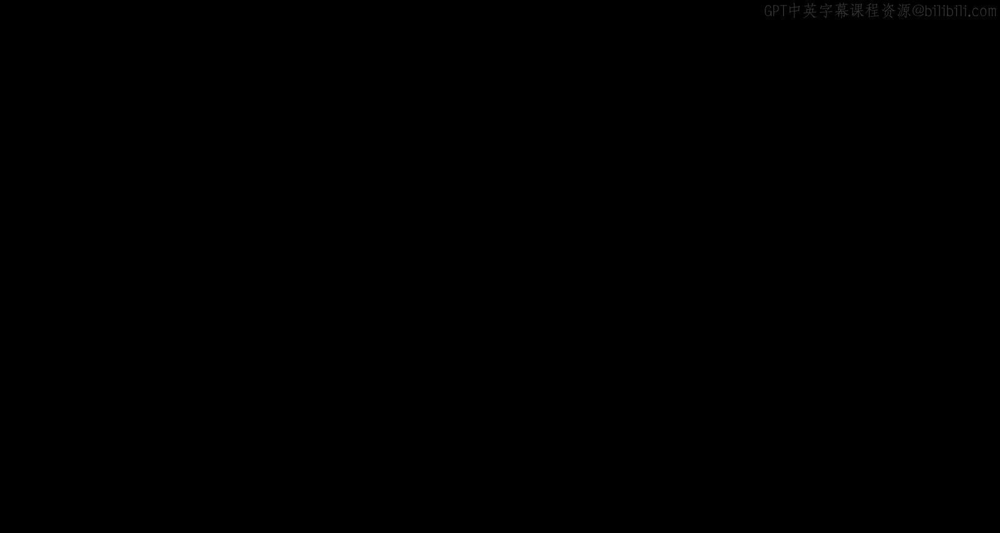
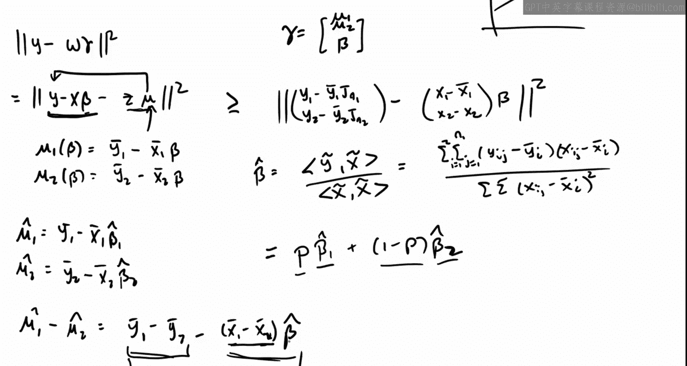

# 约翰霍普金斯大学《数据科学的高级统计｜Advanced Statistics for Data Science》中英字幕（deepseek p101 27_设计矩阵与拟合基础案例.zh_en -BV1htPjeYEFH_p101-

Let's cover some basic examples of multivariable linear regression models。

 so we've already covered a bunch and perhaps the simplest one is where we want to just minimize y minus constant vector times in intercept and we saw that the minimizer of this led to beta n。

Hat equal to Y bar。And of course， we can do that using multi or multivariable regression formula by looking at the solution。

Beta not hat， which should just be the JN transpo JN。

Inverse JN transpose y Okay so this term right here is just the inner product of a vector ones with itself。

 so one times 1 is just1。 so we're just adding up a bunch of ones and then taking the inverse so that's equal to1 over n and this is just a bunch of ones times y so that's just going to be the elements of y added up so that's times the summation of the elements of y or y bar。

The second case that we looked at is the instance where we have y minus x beta where x is a vector also squared where we want to minimize the least squares criterion like that。

 this is so-called regression to the origin and of course the regression to the mean is a special case of that where x is just a vector of ys。

And we saw already that the result of that was inner a product of x and Y over。X with itself。

 That was beta hat。 Well， let's just show that that agrees is a special case of multivariable regression。

 So we have our beta hat is equal to x transpose x inverse x transpose y。

 Well x transpose x inverse is just inner product of x in the event that x is a vector and x transpose y is just the definition of in a product of x and y when x is a vector。

 Okay， so so two of our special cases are clearly are obviously variations of linear regression。

 The next one， I'm going to ask for you to do on your own because we've kind of worked on it a lot and shown it in different ways。

 but in the event that we want to do linear regression。

 beta not times Jn plus beta1 times a vector x。So our design matrix in this case。

 let me just call this。Trying to minimize y minus， let's say， W beta。

Squared where w is a vector of ones。And the vector x。

 so or I should probably just write it out like this Jn and the vector x。

So what I'd like you to try and show is now when you are beta hat。We're beta here again。

 I'm defining as beta n beta 1。Our beta hat is going to be W transpose W inverse W transpose y So what I'd like you to show is that this works out to be the standard definitions for the linear regression intercept and slope this winds up being a two by two vector so the inverse you can actually calculate just look up the inverse of a two by two and this is fairly straightforward to do as well that winds up being a two by one vector so it's a little bit tedious in terms of bookkeeping but you can show that the just direct use of the least multivariable least squares solution winds up in the same results in the three other cases that we spent a lot of time talking about so。

Let's consider another important special case of。Linear models applied in a in a pretty general setting。

 So imagine if our y looks something like this。 It's y 1，1 up to y 1。And over2。And why 2，1。

Up to y2 and over2。 So in other words， our y is really equal to two vectors。

 let's say y1 and y2 of two where the first comes from one group and the second comes from another group。

 so we might think of a setting where we're plotting y and we have group1。Group 2。You know。

 something like a box plot。 So in some instance like that。

Where you're interested in modeling the fact that there's two groups using these squares。

 So we could do this with y minus， let's say x。Beta minimizing that least squares criteria where x is equal to a bunch of ones。

And a bunch of zeros， and then a bunch of zeros and a bunch of ones。

So that and so x has n over two ones in the first vector and n over two ones in the second vector。

Now。Let's work out what beta hat works out to be in this case。 So beta hat。Works out to be。

Exactly equal to， of course， x transpose x inverse x transpose y。 But x transpose x。 Okay。

 so that's just a vector of ones。And zeros。Eectctor of zeros and ones。Times。1s。And zeros。And zeros。I。

嗯。We want that。Inverse。What of this。And then our next component is x transpose y。

 which is the vector of ones。And zeros and zeros。The ones。And times y。O。So looking at this matrix。

 this is gonna be。N over two， because when I multiply this matrix， this vector times this vector。

 it's going to just add up the number in that first group。

 When I multiply this vector times this vector it willll just be0。

 same thing for this other diagonal and this one will be n over 2。

 And there's nothing in particular about having。Equal numbers in the two groups。 they。

 they could have been。And N1 and n2 there I just did n over two just in the balanced case where there's an equal number in both groups Now let's look at this statement right here。

 this first one is going to be the sum of the first group， So let's just call that。JN over2。

Times y1 and the second one is just going to be J transpose n over 2 times y2 and so and I'm sorry that's inverted。

And the inverse is pretty easy because then it's just one because it's a diagonal matrix。

 So it's just one over both of those。 And then so what we get is that y1 bar。

And Y2 bar are the slope estimates。For beta， which is what we would imagine should happen if we have an effect one for group one and a second effect for group two。

 the likely estimate would have to have turned out to be the average for group one and the average for group two so the fitted values。

The fit of values in this case。Is just going to be if you're in group one。

 it's going to be JN times y y1 bar I'm sorry Jn over2 times y1 bar if you're in group one and JN。

Over two times y2 bar if you're in group two。

Now， remember last time we were considering a setting where we wanted to do y minus。

 let's say x1 beta。And minimize that where x was， let's say J。And one。And then a bunch of zeros。

And then a bunch of zeros。And J， N2。Where J is again， a vector of one。Let's say x1 is like that。

 And we found so we have two groups of data， and we found out that our estimates then works out our beta。

Hat works out to be y1 bar， y2 bar。where again， our beta is equal in this case， to beta 1 and beta 2。

Now， consider。Y minus x2 gamma。Consider minimizing the model where x1 is equal to a vector J n1 plus n2。

 and then a vector that's JN1。And then a bunch of zeros。 Let me just write it as 0 and 2。

Meaning a vector of zeros of length and 2。Now， so this is0 and2。And this is zero。So。and this is x2。

 I'm sorry。 and then gamma is equal to gamma 1。Yeah the two。Now， notice if I add these two columns。

I get this column right here。And similarly， if I take this column and I subtract this one。

Then I get the second column here。 So what we see is that x1 and x2 contain the same column space。

They have an identical column space， and what we know from a projection argument is that the fitted values from both the models have to be the same。

Will the fitted values for Model 1。If for any observation in group1。

 the fit of value is going to be y1 bar。And for any observation in group2 is going to be y2 bar。

 so we know that beta 1 hat equals y1 bar and beta 2 hat equals y2 bar we know that because we worked it out in the last example where we figured it out。

Okay。Now， look at x2 times gamma。Well， the fitted values。For anyone in group one。Are now。

 if I multiply x2 times gamma， it's going to be gamma 1 hat plus gamma 2 hat。

 And then for anyone in group 2， it's got to just be。Gamma， one hat。By itself。

So we know that the fitted values have to satisfy these equations。

And they have to agree because the column space of the two is the same。So what we know then。

 is that beta 1 hat， which is y1 bar， has to equal to gamma 1 hat plus gamma 2 hat， and beta 2 hat。

 which is equal to y 2 bar， has to equal to gamma 1 hat。 We can use that to now solve4。

Gamma1 hat and gamma2 hat without actually having to go through the trouble of inverting this matrix。

 Now it's a two by2 matrix， so it shouldn't be that hard to invert。

 but let's suppose you had a little bit harder of a setting then it would be a little bit harder to invert。

 let's suppose we just had 10 columns。 And this is kind of a common trick in these anovava type examples where you can reparameterize to the easy case where you get a bunch of block diagonal1 vectors like in the case of x1 in which case x transpose x works out to be a diagonal matrix and then very easy to invert。

 And then if you want any different reparameterization。

 which would result in an x transpose x that's hard to invert you can use the fact that you know that the fitted of values have to be identical to convert between the parameters after the fact so in this case you know you know you know that gamma1 hat has to be equal to beta 2 hat and then you know that。

Gamma2 hat， then just plugging in with those two equations has to be equal to beta 1 hat minus beta 2 hat。

Okay。And so that gives you a very quick way to go between parameters in equivalent linear models with different specifications。

 with just different row organization。Okay， so it's a useful trick when you're trying to work with these ennovava type models。

Now， let's discuss what I think of as one of the most important examples in regression。

So imagine that my y breaks down into two vectors， a group one and a group two。And my design matrix。

 which I'm going to call W， which will become clear for reasons later， is equal to a matrix called Z。

And a vector called x where x is in n by1 and z is an M by2 and z looks like this。

 Z looks like JN1 and then an n1 vector of zeros and then an N2 vector of zeros I'm sorry and then an n1 vector of zeros and then JN2 so the z matrix looks like the two way ennova matrix from previously。

 but we've appended an x onto it as well， an x vector So this is the example if we do least squares with this w。

 we are interested in fitting models where we have a regression line。A regression line。

 but separate separate intercepts for two groups， right。

The coefficient in front of the x is the common slope。

 and then the coefficient in front of each Z vector is the intercept for each of the groups。Okay。

 so we want to minimize y minus。W。And I'm not going to call it beta。

 let me call it gamma quantity squared， where gamma is equal to mu 1， the intercept for group1， mu 2。

 the intercept for group  two， and beta， the common slope across the two groups。

So we can write this as y minus x beta。Minus。Z。Let me just call it mu as the vector of mu1 and mu2。

Okay so we can write it out like that and then let's figure out what this works out to be。

 so let's use our standard trick where we hold beta fixed and we come up with the estimate for mu condition that as it depends on beta。

Well， if。If beta is held fixed， that's just a vector。

 and this is just the two way a no problem that we discussed previously。

 remember that the two way a No problem。Worked out to the solution worked out to be the mean in group one and the mean in group two。

 so the estimate for mu1 as it depends on beta has to be the mean of this vector right here。

So that has to be y1 bar， the group1 mean for the y is minus x1 bar beta。And then mu2， the mean。

For group 2， as it depends on beta has to be y2 bar minus。X2 bar。Times beta。

Now if I were to plug those back in for mu1 and mu2 into here。And subtract them off from why。

What I get is nothing other than the centered versions of y， so I get y1 minus y1 bar times Jn1。

Y2 minus y2 bar times Jn2。That vector。Minus。X minus。X1 minus x1 bar。

X2 minus x2 bar I didn't define x1 and x2， but let me just say those are just the group components of x。

 x1 is the first n1 measurements of x and x and x2 is the n2 latter measurements of x。

 and that should be times beta。Okay。So oops， and I shouldn't say equal。

 It should be has to be greater than or equal to， because we've plugged in the optimal estimates from mu1 and mu2 for a fixed beta。

 Well， this is now nothing other than。Reggression to the origin with the group centered version of Y and the group centered version of x。

So we know that the estimate of beta。Beta hat。The best beta hat that I can get。

Has to work out to be the regression to the origin estimate from these data。

 So that's just summation。 Let me write it out this way， the。the double sum。Of well， here。

 probably the easiest way to write it out first is y tilde。

 the inner product of y tilde and x tilde over the inner product of x tilde with itself。

Where why Tilda。Is the group centered version of y and x tilde is the group centered version of x。

 in other words， by group centered， I mean each observations with its group mean subtracted off。

And you can show， and I have this in the notes。Okay， and you can show， well。

 let's just do it do it really quickly here。 What is this work out to be。

 This works out to be the double sum， let's say over I and J of y。I J minus y bar I。

 so I equal 1 to 2 and j equal1 to n sub I。X， I， J minus x。Bar I。All over。The double sum。

X I J minus x bar I， and let me just explain my notation here。 So Y Ij is the J component of's say。

 let's say y11 is the first component of the vector y1， y12 is the second component of vector y1。

 Y21 is the first component of vector， y2 and so on。So we can write this out。

 and I think this is probably the nicest way to write it out as for i equal 1。

 we can write this out as P times beta1 hat。Plus，1 minus P times beta 2 hat。Where beta 1 hat。

Is the regression estimate。The regression estimate for only group  one。

 if you only had the x1 and y1 data， the centered x1 data and the centered yY1 data and beta 2 hat is the regression estimate if you only had the。

 the centered y2 data and the centered x2 data。Okay。

 so it is interesting to note out to note that the。Slope from Ancovo works out to be。An average。

 a weighted average of the individual group specific slopes， where in this case。

 P works out to be the summation of X I J minus x。Smation of x1 J minus x1 bar。Over。

S up in this should be then squared， sorry about that， the double sum of x1 J minus x1 bar。Okay。

 so P works out to be the percentage and。And。Yeah， X I J minus x bar I。

 so P works out to be the percentage of the total variation in the x's。From group one。

 So if most of your variation in your x's is in your group1。

 then the group one slope gets at gets contributes more to the overall Anova slope。

 and if the group two。Is more variable than the group2 contributes more。

 And if they're equally variable， then both of them contribute equally。Okay， so let's go back。To now。

 once we have our beta hat， we can figure out what our mu 1 hat and our mu 2 hat is。

 so mu 1 hat is equal to y1 bar minus x1 bar beta 1 hat。

And mu 2 hat is equal to y2 bar minus x2 bar beta 2 hat。Okay。

 so the difference in the means mu 1 hat minus mu 2 hat works out to be y1 bar minus y2 bar minus x1 bar minus x2 bar beta hat。

Now， so one way to think about this， the most common way to think about An COVA is the instance where you want to compare a treatment。

 say treatment one versus treatment two， but you have some confounding factor that you need to adjust for。

 say， for example， you're looking at a a weight loss treatment。

And your confounding factor is the initial weight of the person。Okay。

 and so if the initial starting weight of the people receiving the one diet one weight loss treatment is different than the initial weight of the other weight loss treatment。

 then you'd be worried about just directly comparing the two means so this shows you what in addition to the two means you need to subtract off if you model the data as an AnCO model。

 most interestingly is if you。Randomize。And your randomization is successful in the sense of balancing thisobserved this observed covariate。

 the baseline age， then the group 1 average should be pretty close to the group 2 average。

 So this difference in means should be quite small so that whether or not you adjust for baseline weight or omit baseline weight from the model and just do straight to group1 No。

 the estimate should be very similar。 However， on the other hand。

 if you happen to not have had some randomization and had to have and have an imbalance so that the average for group 1 is very different from the average for group 2。

 then the difference between the unadjusted estimate and the adjusted estimate can be quite large。

Okay， so that's sankcovi that's an important example， I have some more written about it in the notes。

 but I think you can actually learn a lot about regression and adjustment just by thinking about this one example。

