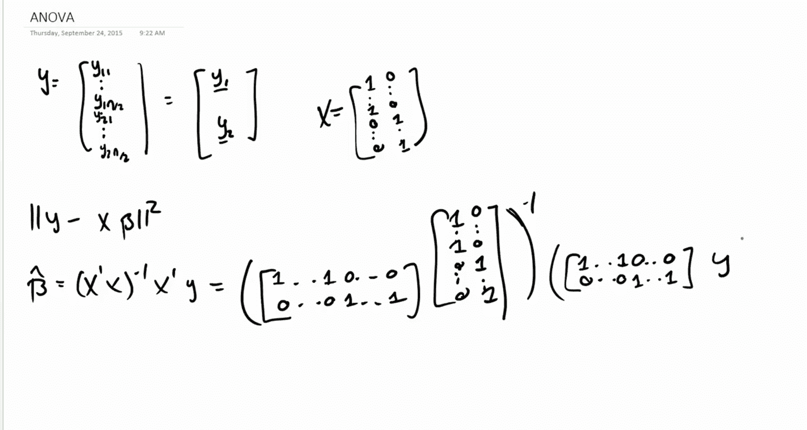
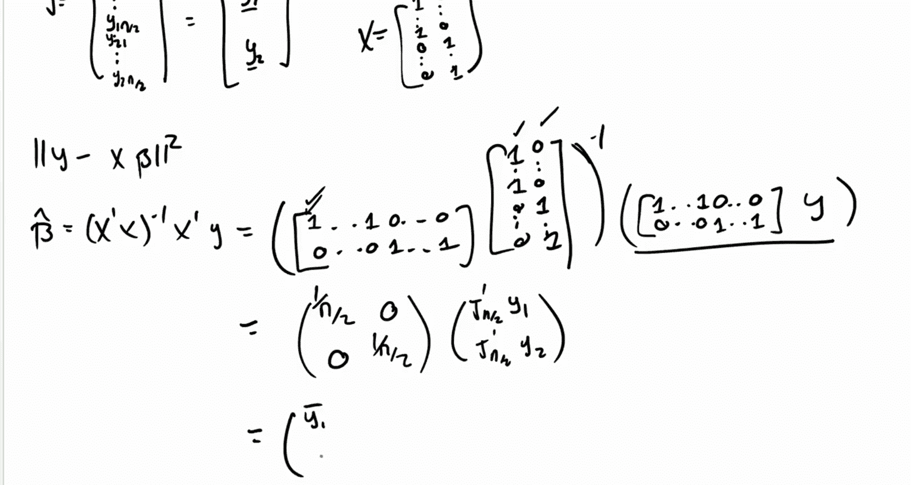
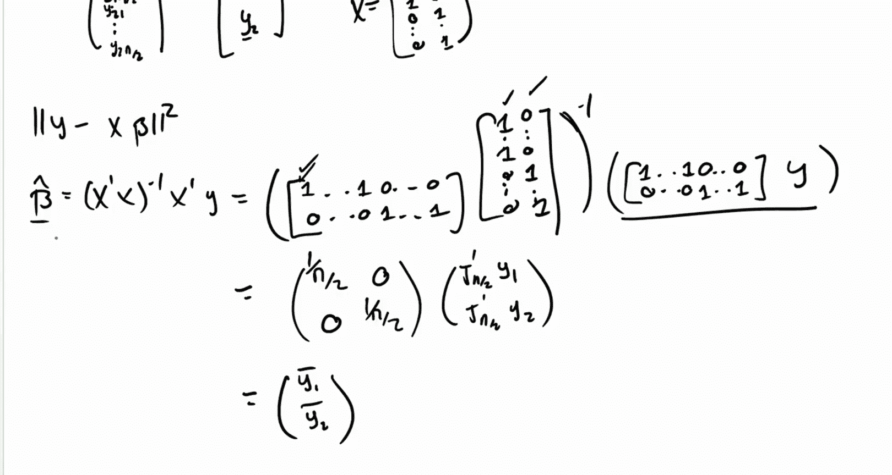
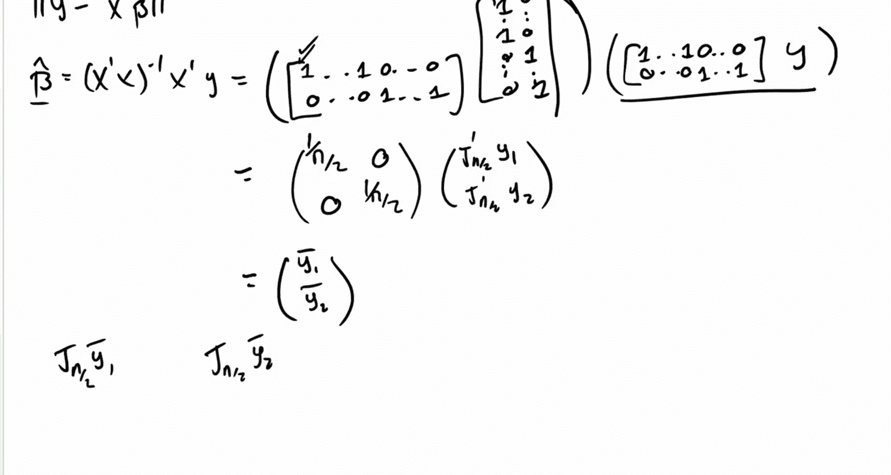

# 约翰霍普金斯大学《数据科学的高级统计｜Advanced Statistics for Data Science》中英字幕（deepseek p102 28_组效应.zh_en -BV1htPjeYEFH_p102-

Let's consider another important special case of。Linear models applied in a in a pretty general setting。

 So imagine if our y looks something like this。 It's y 1，1 up to y 1。And over two。And why，2，1。

Up to y2 and over 2。 So in other words， our y is really equal to two vectors。

 let's say y1 and y2 of two where the first comes from one group and the second comes from another group。

 So we might think of a setting where we're plotting y and we have group1。Group 2。You know。

 something like a box plot。 So in some instance like that。

Where you're interested in modeling the fact that there's two groups using these squares。

 So we could do this with y minus， let's say x。Beta minimizing that least squares criteria where x is equal to a bunch of ones。

And a bunch of zeros， and then a bunch of zeros and a bunch of ones。

So that and so x has n over two ones in the first vector and n over two ones in the second vector。

Now。Let's work out what beta hat works out to be in this case。 So beta hat。Works out to be。

Exactly equal to， of course， x transpose x inverse x transpose y， But x transpose x。 Okay。

 so that's just a vector of ones。And zeros。vectorctor is zeros and ones。Times。1s。And zeros。And zeros。

Ones。嗯。We want that。Inverse。What of this。And then our next component is x transpose y。

 which is the vector of ones。And zeros and zeros。The ones。Then times y。

Okay。So looking at this matrix， this is gonna be。N over2， because when I multiply this matrix。

 this vector times this vector， it's going to just add up the number in that first group。

 When I multiply this vector times this factor it willll just be 0。

 Sam thing for this other diagonal。 and this one will be n over 2。

 And there's nothing in particular about having。Equal numbers in the two groups。

 they they could have been。An N1 and an N2 there。 I just did N over2 just in the balance case where there's an equal number in both groups。

 Now let's look at this statement right here。 This first one is going to be the sum of the first group。

 So let's just call that。J N over2。Times y1 and the second one is just going to be J transpose n over 2 times y2。

Okay， and so and I'm sorry， that's inverted。And the inverse is pretty easy because then it's just one because it's a diagonal matrix。

 so it's just one over both of those。 And then so what we get is that y1 bar。

And why2 bar are the slope estimates。For beta， which is what we would imagine should happen if we have an effect one for group one and a second effect for group two2。

 the likely estimate would have to have turned out to be the average for group one and the average for group two so the fitted values。

The fit of values in this case。Is just going to be if you're in group one。

 it's going to be JN times y y1 bar I'm sorry， Jn over2 times y1 bar if you're in group one and JN。

Over two times y2 bar if you're in group two。

