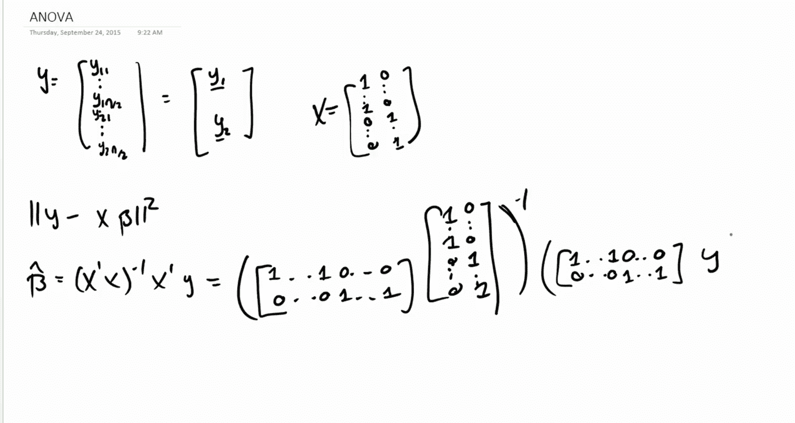
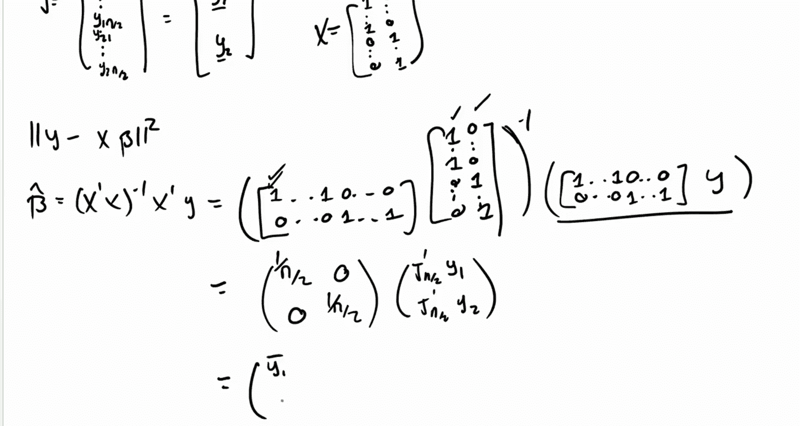
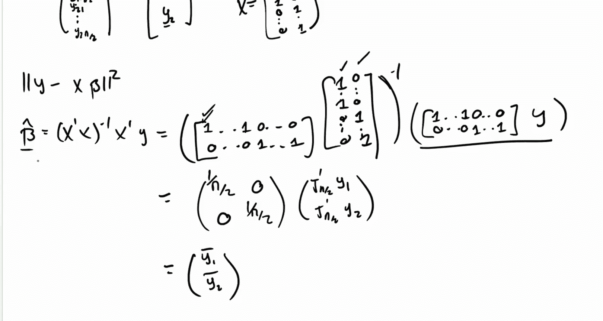
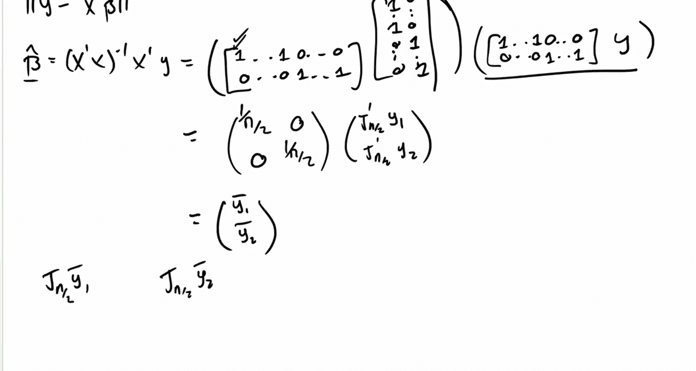

# 高级统计：第28讲：组效应模型 🧮

在本节课中，我们将学习线性模型的一个重要特例：组效应模型。我们将探讨当数据来自两个不同组别时，如何使用最小二乘法来估计各自的效应，并推导出相应的参数估计公式。

---

## 模型设定

假设我们的观测数据 `y` 的结构如下：

```
y = [y1,1, ..., y1,n/2, y2,1, ..., y2,n/2]
```

换句话说，`y` 实际上由两个向量组成：`y1` 和 `y2`。`y1` 来自第一组，`y2` 来自第二组。我们可以想象一个场景，例如绘制箱线图时，数据被清晰地分为两组。

为了用最小二乘法建模这种分组效应，我们设定模型为：

```
y = Xβ + ε
```

其中，我们的设计矩阵 `X` 构造如下：第一列的前 `n/2` 个元素为1，其余为0；第二列的前 `n/2` 个元素为0，其余为1。用矩阵表示：

```
X = [1, 0;
     1, 0;
     ...;
     0, 1;
     0, 1]
```

我们的目标是找到参数 `β` 的估计值 `β_hat`，使得残差平方和最小。

---

## 参数估计推导

上一节我们设定了模型和设计矩阵，本节中我们来看看如何推导参数 `β` 的最小二乘估计 `β_hat`。

根据最小二乘法原理，`β_hat` 的公式为：

```
β_hat = (X^T X)^{-1} X^T y
```

首先，我们计算 `X^T X`。由于 `X` 的结构特殊，其转置与自身的乘积是一个对角矩阵：

```
X^T X = [n/2,   0;
           0, n/2]
```



这里我们假设两组样本量相等，均为 `n/2`。如果样本量不等，对角线元素将分别为 `n1` 和 `n2`。

接下来，我们计算 `X^T y`：

```
X^T y = [sum(y1), sum(y2)]^T
```

即第一个元素是第一组 `y` 值的总和，第二个元素是第二组 `y` 值的总和。

由于 `(X^T X)` 是对角矩阵，其逆矩阵很容易计算，即对角线元素取倒数：

```
(X^T X)^{-1} = [2/n,   0;
                  0, 2/n]
```

最后，我们将两者相乘，得到 `β_hat`：

```
β_hat = (X^T X)^{-1} X^T y = [mean(y1), mean(y2)]^T
```

因此，参数估计 `β_hat` 的两个分量恰好分别是第一组数据的均值 `y1_bar` 和第二组数据的均值 `y2_bar`。这与我们的直观理解一致：每组效应的最佳估计就是该组数据的平均值。

---

## 拟合值计算

在得到参数估计后，我们可以计算模型的拟合值 `ŷ`。

拟合值 `ŷ` 的计算公式为：

```
ŷ = X β_hat
```



根据 `X` 的结构和 `β_hat` 的值，结果非常直观：
*   对于属于第一组的观测，其拟合值为 `y1_bar`。
*   对于属于第二组的观测，其拟合值为 `y2_bar`。

用向量表示：

```
ŷ = [y1_bar, y1_bar, ..., y2_bar, y2_bar]^T
```

这意味着，模型对组内所有个体的预测都是相同的，即该组的样本均值。



---

## 核心要点总结

本节课中我们一起学习了线性模型中的组效应模型。

1.  **模型设定**：我们处理的数据来自两个独立的组。设计矩阵 `X` 使用指示变量来区分组别。
2.  **参数估计**：通过最小二乘法推导，发现组效应参数 `β` 的估计值 `β_hat` 就是各组的样本均值。公式为 `β_hat = (X^T X)^{-1} X^T y = [mean(y1), mean(y2)]^T`。
3.  **模型预测**：模型的拟合值 `ŷ` 对于组内所有观测都是相同的，等于该组的均值。



这个简单的案例清晰地展示了线性模型如何捕捉和处理分组结构，其估计结果也与描述性统计的直觉完全吻合。