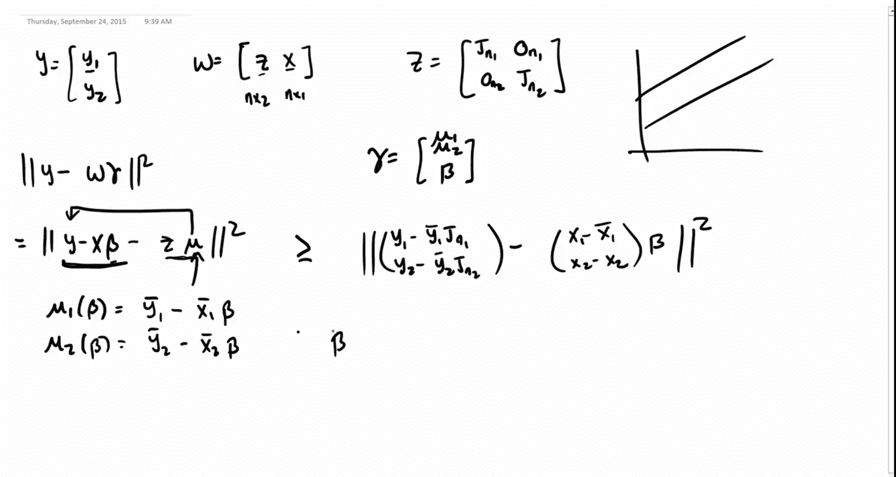
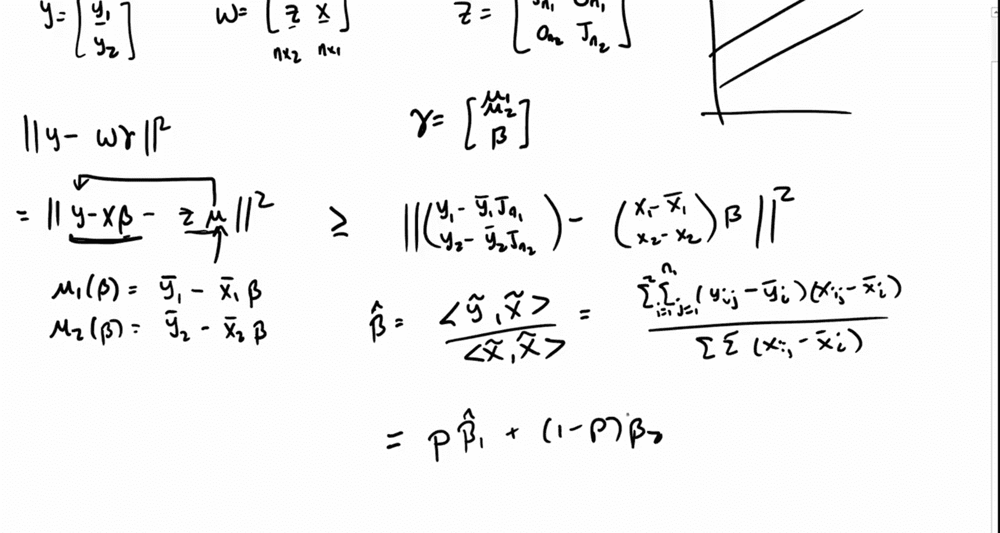
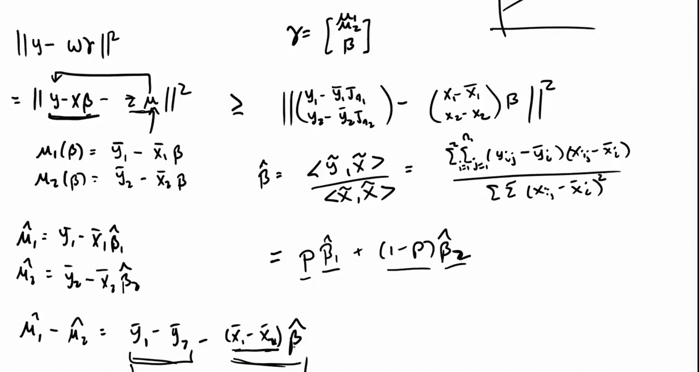

# 约翰霍普金斯大学《数据科学的高级统计｜Advanced Statistics for Data Science》中英字幕（deepseek p104 30_协方差分析.zh_en -BV1htPjeYEFH_p104-

Now， let's discuss what I think of as one of the most important examples in regression。

So imagine that my y breaks down into two vectors， a group one and a group two。And my design matrix。

 which I'm going to call W， to become clear for reasons later， is equal to a matrix called Z。

And a vector called x where x is in n by one and z is an M by2 and z looks like this Z looks like JN1 and then an n1 vector of zeros and then an N2 vector of zeros I'm sorry and then an n1 vector of zeros and then JN2 So the z matrix looks like the two way ennova matrix from previously。

 but we've appended an x onto it as well， an x vector。

 So this is the example if we do least squares with this w we are interested in fitting models where we have a regression line。

A regression line， but separate separate intercepts for two groups， right。

The coefficient in front of the x is the common slope。

 and then the coefficient in front of each Z vector is the intercept for each of the groups。Okay。

 so we want to minimize y minus W。And I'm not going to call it beta。

 let me call it gamma quantity squared， where gamma is equal to mu 1， the intercept for group1， mu 2。

 the intercept for group  two， and beta， the common slope across the two groups。

So we can write this as y minus x beta。mininus。Z。Let me just call it mu as the vector of mu 1 and mu2。

Okay so we can write it out like that and then let's figure out what this works out to be so let's use our standard trick where we hold beta fixed and we come up with the estimate for mu condition that as it depends on beta。

Well， if。If beta is held fixed， that's just a vector。

 and this is just the two way a no problem that we discussed previously。

 Remember that the two way a No problem。Worked out to the solution worked out to be the mean in group1 and the mean group two。

 so the estimate for mu1 as it depends on beta has to be the mean of this vector right here。

So that has to be y1 bar， the group1 mean for the y is minus x1 bar beta。And then mu2， the mean。

For group2， as it depends on beta has to be y2 bar minus。X 2 bar。Times beta。

Now if I were to plug those back in for mu1 and mu 2 into here。And subtract them off from Y。

What I get is nothing other than the centered versions of y。 So I get y1 minus y1 bar times Jn1。

Y 2 minus y 2 bar times J and2。That vector。Minus。X minus。X1 minus x1 bar。

X2 minus x2 bar I didn't define x1 and x2， but let me just say those are just sub the group components of x。

 x1 is the first n1 measurements of x and x and x2 is the n2 latter measurements of x。

 and that should be times beta。Okay。So os， and I shouldn't say equal。

 It should be has to be greater than or equal to， because we've plugged in the optimal estimates from mu1 and mu2 for a fixed beta。

 Well， this is now nothing other than。Reggression to the origin with the group centered version of Y and the group centered version of x。

So we know that the estimate of beta。

Beta hat。The best beta hat that I can get。

Has to work out to be the regression to the origin estimate from these data。

 So that's just summation。 Let me write it out this way， the。The double sum。Of well， here。

 probably the easiest way to write it out first is y tilde。

 the inner product of y tilde and x tilde over the inner product of x tilde with itself。

Where y Tilda？Is the group centered version of y and x tilde is the group centered version of x。

 in other words， by group centered， I mean each observations with its group mean subtracted off。

And you can show， and I have this in the notes。Okay， and you can show， well。

 let's just do it really quickly here。 What is this work out to be。

 This works out to be the double sum， let's say over I and J of y。I， J minus y bar I。

 So I equal1 to 2 and J equal1 to n sub I。X， I， J minus x。Bar eye。All over。The double sum。

X I J minus x bar I， and let me just explain my notation here。

 So Y Ij is the J component of let's say let's say y11 is the first component of the vector y1。

 y12 is the second component of vector y1， y21 is the first component of vector y2 and so on。

So we can write this out， and I think this is probably the nicest way to write it out as for  equal 1。

We can write this out as P times beta1 hat。Plus1 minus p times beta 2 hat。

Where beta 1 hat。Is the regression estimate。The regression estimate for only group  one。

 if you only had the x1 and y1 data， the centered x1 data and the centered yY1 data and beta 2 hat is the regression estimate if you only had the。

 the centered Y2 data and the centered x2 data。Okay。

 so it is interesting to note out to note that the。Slope from Ancovo works out to be。An average。

 a weighted average of the individual group specific slopes， where in this case。

 P works out to be the summation of X I J minus x。Sation of x1 J minus x1 bar。Over。

S up in this should be been squared， sorry about that， the double sum of x1 J minus x1 bar。Squared。

Okay， so P works out to be the percentage and。And。YeahX I J minus x bar I。

 so P works out to be the percentage of the total variation in the x's。From group one。

 So if most of your variation in your x's is in your group1。

 then the group one slope gets at gets contributes more to the overall Anova slope。

 and if the group2。Is more variable than the group two contributes more。

 and if they're equally variable， then both of them contribute equally。Okay， so let's go back。To now。

 once we have our beta hat， we can figure out what our mu1 hat and our mu 2 hat is。

 so mu 1 hat is equal to y1 bar minus x1 bar beta 1 hat。

And mu 2 hat is equal to y2 bar minus x2 bar beta 2 hat。Okay。

 so the difference in the means mu 1 hat minus mu 2 hat works out to be y1 bar minus y2 bar minus x1 bar minus x2 bar beta hat。

Now， so one way to think about this， the most common way to think about an COVA is the instance where you want to compare a treatment。

 say treatment one versus treatment two， but you have some confounding factor that you need to adjust for。

 say， for example， you're looking at a a weight loss treatment。

And your confounding factor is the initial weight of the person。Okay。

 and so if the initial starting weight of the people in receiving the one diet one weight loss treatment is different than the initial weight of the other weight loss treatment。

 then you'd be worried about just directly comparing the two means so this shows you what in addition to the two means you need to subtract off if you model the data as an AnCO model。

 most interestingly is if you。Randomize。And your randomization is successful in the sense of balancing thisserv this observed covariate。

 the baseline age， then the group 1 average should be pretty close to the group 2 average。

 so this difference in means should be quite small so that whether or not you adjust for baseline weight or omit baseline weight from the model and just do straight to group1nova。

 the estimate should be very similar。 However， on the other hand。

 if you happen to not have had some randomization and had to have and have an imbalance so that the average for group 1 is very different from the average for group 2。

 then the difference between the unadjusted estimate and the adjusted estimate can be quite large。

Okay， so that's sankCOvi that's an important example， I have some more written about it in the notes。

 but I think you can actually learn a lot about regression and adjustment just by thinking about this one example。

